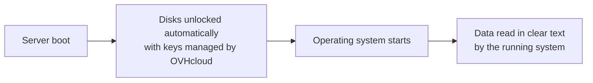

## Objective

Encryption at Rest encrypts all the disks of your OVHcloud Dedicated Server in hardware. **This guide explains what Encryption at Rest protects, how it works, and what it changes for you.**

:::info
**OVHcloud manages the encryption keys.** The keys are generated, stored, and rotated by OVHcloud. You do not manage them, and they are never sent to you. Using your own keys (Key Management Service, Secret Manager, or BYOK) is not available.

:::

## Requirements

- A [Dedicated Server](https://us.ovhcloud.com/bare-metal/) on an eligible range and in an eligible region (see [Encryption at Rest requirements and limitations](/bare-metal-cloud/dedicated-servers/encryption-at-rest-limitations))

## Instructions

This section describes how Encryption at Rest works, what it protects, and the points to know before you enable it.

### How Encryption at Rest works

The drives perform the encryption themselves. All data written to the disks is encrypted before it is stored, so it cannot be read without the disk keys.

At each boot, the disks are unlocked automatically before your operating system starts. You do not need to enter anything, and your server returns to service without any action from you.

### What Encryption at Rest protects

Encryption at Rest protects data on a disk that is physically removed:

- from your server.
- from the datacenter.

### What Encryption at Rest does not protect

Encryption at Rest does not replace the security measures you apply to your system. It does not protect:

- data while your server is running: once the disks are unlocked, the operating system reads them in clear text.
- your operating system or applications against an attack, including online attacks.
- data in transit on the network.

If you also need to protect data against these risks, add encryption at operating system level (for example LUKS on Linux or BitLocker on Windows) and follow the security practices that apply to your workloads.

### Good to know

Read these points before you enable Encryption at Rest:

- **All disks or none:** Encryption at Rest applies to every disk of the server. You cannot select disks one by one.
- **Opt-in:** Encryption at Rest is never enabled by default, including on a new server. You enable it from the [OVHcloud Console](https://console.us.ovhcloud.com/#/bare-metal/dedicated-server) or the OVHcloud API.
- **Data erasure:** enabling Encryption at Rest erases all the data on the server, and you must then reinstall the operating system. Back up your data first.
- **Disabling:** you can disable Encryption at Rest from the OVHcloud Console or the OVHcloud API. Disabling performs a cryptographic erase of the disks, and you must then reinstall the operating system.
- **Backups:** your backup tools (Veeam, Restic, etc.) keep working. They read your data as the operating system sees it.
- **Pricing:** Encryption at Rest is included, at no extra charge.

## Go further

[Enable or disable Encryption at Rest on a dedicated server](/bare-metal-cloud/dedicated-servers/encryption-at-rest-enable)

[Manage Encryption at Rest on a dedicated server with the API](/bare-metal-cloud/dedicated-servers/encryption-at-rest-api)

[Encryption at Rest requirements and limitations](/bare-metal-cloud/dedicated-servers/encryption-at-rest-limitations)

[Encryption at Rest on dedicated servers: FAQ](/bare-metal-cloud/dedicated-servers/encryption-at-rest-faq)

