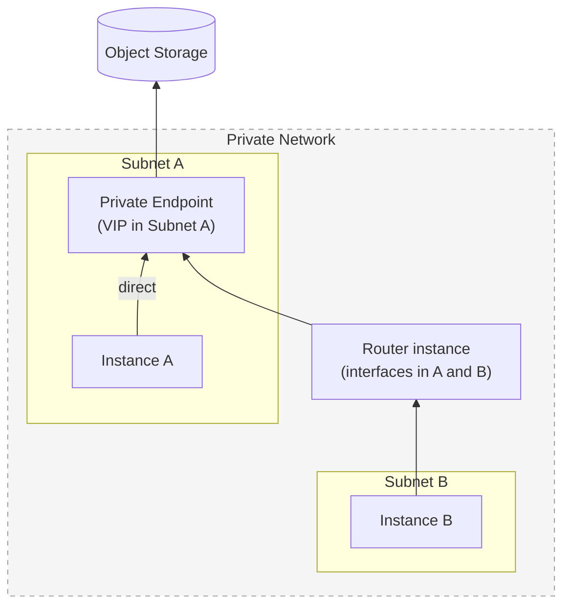

import Api from '@components/Api';

import { Tab, Tabs } from '@rspress/core/theme';

## Objective

A **Private Endpoint** lets the resources on a Public Cloud Private Network subnet reach your S3™[\*](#go-further)-compatible Object Storage over the OVHcloud network, without a Gateway. Your traffic stays private and needs no public connectivity.

**This guide explains how to create a Private Endpoint, connect your S3 client to it, and make sure your buckets can only be reached through this private path.**

:::info
Private Endpoint is only available for S3-compatible Object Storage. Swift-based Object Storage is not supported.

:::

## Requirements

- A [Public Cloud project](/public-cloud/cross-functional/create-a-public-cloud-project) in your OVHcloud account
- A [Public Cloud Private Network and subnet](/public-cloud/network-services/configure-vrack), active in the region where you want to create the Private Endpoint, with one free IP address
- An [Object Storage user and bucket](/storage-and-backup/object-storage/getting-started)
- Access to the [OVHcloud API](/manage-and-operate/api/first-steps), the OVHcloud Console, or Terraform

The clients that use the Private Endpoint are the resources in this subnet, such as instances or Bare Metal servers connected through the vRack.

{/* CP-NAV-START:publiccloud-projects */}
---

### OVHcloud Console Access

- **Direct link:** [Public Cloud projects](https://console.us.ovhcloud.com/#/public-cloud/project)
- **Navigation path:** `Public Cloud` > Select your project > `Network` > `Private Endpoint`

---
{/* CP-NAV-END:publiccloud-projects */}

## Instructions

### How it works

When you create a Private Endpoint, OVHcloud places it in the subnet of your choice and gives it:

- a private IP address (VIP) in this subnet;
- a hostname, in the form `pe-<pe_id>.s3.{region}.endpoint.cloud.ovh.us`.

Your instances then send their S3 requests to this hostname instead of the public Object Storage endpoint. Your credentials (access key and secret key) do not change.

Traffic is encrypted with TLS all the way from your S3 client to Object Storage. The Private Endpoint forwards it without decrypting it.

A Private Endpoint has two identifiers. Make sure you use the right one:

| Identifier | Example | Where to find it | Used for |
|---|---|---|---|
| Private Endpoint ID | `pe-a1b2c3d4` | In the Console, the **ID** field of the Private Endpoint details page. In the API, the `currentState.endpointId` field. It is also the first part of the hostname, before `.s3.`: `pe-` followed by 8 hexadecimal characters generated by OVHcloud, for example `pe-a1b2c3d4.s3.us-east-va.endpoint.cloud.ovh.us` | Access policies (see Step 5) |
| Resource ID (UUID) | `5d297126-f4bd-46f9-a4c4-2ffd134121b6` | The `id` field of the API response | API calls only: this is the `{privateEndpointId}` in the routes |

<details>
<summary>Using the API: how it works and routes used in this guide</summary>

Private Endpoint uses [OVHcloud API v2](/manage-and-operate/api/apiv2-principles-of-operation). Instead of performing actions one by one, you describe the configuration you want in a `targetSpec` object. OVHcloud then applies it in the background. You can follow its progress with the `resourceStatus` field, and the `currentTasks` list shows the operations in progress.

The routes used in this guide are the following:

| Method | Route | Description |
|---|---|---|
| `GET` | [`/v2/publicCloud/project/{projectId}/reference/privateEndpoint/serviceAvailability`](https://api.us.ovhcloud.com/console/?section=%2FpublicCloud&branch=v2#get-/publicCloud/project/-projectId-/reference/privateEndpoint/serviceAvailability) | List the services and connectivity tiers available |
| `GET` | [`/v2/publicCloud/project/{projectId}/privateEndpoint`](https://api.us.ovhcloud.com/console/?section=%2FpublicCloud&branch=v2#get-/publicCloud/project/-projectId-/privateEndpoint) | List the Private Endpoints of a project |
| `POST` | [`/v2/publicCloud/project/{projectId}/privateEndpoint`](https://api.us.ovhcloud.com/console/?section=%2FpublicCloud&branch=v2#post-/publicCloud/project/-projectId-/privateEndpoint) | Create a Private Endpoint |
| `GET` | [`/v2/publicCloud/project/{projectId}/privateEndpoint/{privateEndpointId}`](https://api.us.ovhcloud.com/console/?section=%2FpublicCloud&branch=v2#get-/publicCloud/project/-projectId-/privateEndpoint/-privateEndpointId-) | Get the details of a Private Endpoint |
| `PUT` | [`/v2/publicCloud/project/{projectId}/privateEndpoint/{privateEndpointId}`](https://api.us.ovhcloud.com/console/?section=%2FpublicCloud&branch=v2#put-/publicCloud/project/-projectId-/privateEndpoint/-privateEndpointId-) | Rename a Private Endpoint or change its description |
| `DELETE` | [`/v2/publicCloud/project/{projectId}/privateEndpoint/{privateEndpointId}`](https://api.us.ovhcloud.com/console/?section=%2FpublicCloud&branch=v2#delete-/publicCloud/project/-projectId-/privateEndpoint/-privateEndpointId-) | Delete a Private Endpoint |
| `GET` | [`/v2/publicCloud/project/{projectId}/reference/privateEndpoint/serviceAvailability/{name}`](https://api.us.ovhcloud.com/console/?section=%2FpublicCloud&branch=v2#get-/publicCloud/project/-projectId-/reference/privateEndpoint/serviceAvailability/-name-) | Get the availability of one service |

:::info
You do not need any local tool to run these calls: you can run them directly from the [OVHcloud API console](https://api.us.ovhcloud.com/console/?section=%2FpublicCloud&branch=v2#post-/publicCloud/project/-projectId-/privateEndpoint). Open the route, fill in `projectId` and the request body, then click `Execute`. In the same way, you can follow the creation of your Private Endpoint with the `GET` route, and list the available service names and connectivity tiers with the `serviceAvailability` route.

:::

</details>

### Step 1 - Choose a connectivity tier

Each Private Endpoint has a connectivity tier, which determines its bandwidth:

| Tier | Bandwidth | Recommended for |
|---|---|---|
| S | 500 Mbps | Workloads with moderate throughput (default tier) |
| M | 2 Gbps | Workloads with higher throughput |
| L | 4 Gbps | Heavy data transfers: backups, analytics, machine learning pipelines |

:::warning
**Limitations**

- You can create up to **2 Private Endpoints per project**. If you need more, contact us.
- Private Endpoint is available in the following regions: US-EAST-VA-1 and US-WEST-OR-1.

:::

<Tabs>
<Tab label="Via the OVHcloud Console">

You choose the tier when creating the Private Endpoint (see Step 2), in the **Service & size** section of the creation form:

1. In **Service**, select `S3`. The list shows the services available in the region of the Private Network you selected.
2. In **Size**, select the tier. Tiers are shown as sizes.

</Tab>
<Tab label="Via the OVHcloud API">

Enter the tier in `service.tier` when creating the Private Endpoint (see Step 2), in uppercase: `S`, `M`, or `L`.

To check which services and tiers are available in each region, use the following call:

<Api version="v2" section="/publicCloud" method="GET" route={"/publicCloud/project/\{projectId\}/reference/privateEndpoint/serviceAvailability"} regions={["us"]} />

To display Object Storage only, add `/s3` at the end of the route.

Each service lists its available tiers in `tiers[]`. For each tier, the response gives:

- `name`: the value to enter in `service.tier`;
- `bandwidth`: the bandwidth of the tier, in Mbps;
- `location`: the region where the tier is available (`region`, and `availabilityZone` for regions with several availability zones);
- `port` and `transport`: the port and protocol used through the Private Endpoint.

Availability is given per tier and per region: look for your region in the response before choosing a tier. For example:

```json
[
  {
    "name": "s3",
    "description": "OVHcloud Object Storage",
    "tiers": [
      { "name": "S", "bandwidth": 500, "location": { "region": "US-EAST-VA-1" }, "port": 443, "transport": "TCP" }
    ]
  }
]
```

:::info
Regions do not have the same name everywhere. In the API (`location.region`), use the Public Cloud region name, for example `US-EAST-VA-1`. In the hostname and in the `region` setting of your S3 client, use the Object Storage region, for example `us-east-va`.

:::

</Tab>
</Tabs>

### Step 2 - Create the Private Endpoint

Before you start, decide how the Private Endpoint hostname will be resolved. You make this choice when creating the Private Endpoint, with the **Public DNS** option (`publicDnsEnabled` in the API):

| Your situation | Public DNS option | What you do next |
|---|---|---|
| Your instances can use a public DNS resolver | **On** | Nothing: OVHcloud publishes and manages the DNS record for you. The record points to a private IP address, which can only be reached from your Private Network. |
| Your instances cannot use a public DNS resolver, or you do not want the record to be public | **Off** (default) | You manage resolution yourself, for example in a private DNS zone. |

Step 3 gives the details for each option.

<Tabs>
<Tab label="Via the OVHcloud Console">

1. Open `Public Cloud` and select your project, then open `Network` > `Private Endpoint`.
2. Click `Create a Private Endpoint`.
3. In the **Private Endpoint name** section, enter a name for your Private Endpoint.
4. In the **Connectivity** section:
    - select your **Private network**. The region of the Private Endpoint is the region of this Private Network;
    - select the **Subnet** in which to place the Private Endpoint;
    - optionally, enter an IP address of your choice in **VIP selection**. If you leave it empty, an address in the subnet is assigned automatically.
5. In the **Service & size** section, select the service `S3` and the connectivity tier (see Step 1).
6. In the **Public DNS** section, turn the switch on or leave it off, according to your choice above.
7. Optionally, add a **Description**.
8. Check the summary on the right, then click `Create a Private Endpoint`.

The Private Endpoint is created in the background, and is listed on the **Private Endpoints** page. It is ready when its status is `READY`.

Click its name to open its details page, and write down the following values: you will need them in the next steps.

- **ID**, in the **General information** section: the Private Endpoint ID (`pe-…`);
- **Endpoint VIP**, in the **Connection details** section: its IP address in the subnet;
- **Hostname**, in the **Connection details** section.

Each value has a copy button next to it.

</Tab>
<Tab label="Via the OVHcloud API">

Use the following call:

<Api version="v2" section="/publicCloud" method="POST" route={"/publicCloud/project/\{projectId\}/privateEndpoint"} regions={["us"]} />

with a request body similar to this one:

```json
{
  "targetSpec": {
    "name": "my-s3-endpoint",
    "description": "Private S3 access for the backup subnet",
    "location": { "region": "US-EAST-VA-1" },
    "service": {
      "name": "s3",
      "tier": "S"
    },
    "network": { "id": "<network_id>" },
    "subnet": { "id": "<subnet_id>" },
    "publicDnsEnabled": false
  }
}
```

| Field | Description |
|---|---|
| `name`, `description` | A name and an optional description for your Private Endpoint. |
| `location.region` | The region of your Private Network. |
| `service.name` | The service to reach. Only `s3` is available. |
| `service.tier` | The connectivity tier (see Step 1). |
| `network.id`, `subnet.id` | The IDs of the Private Network and subnet in which to place the Private Endpoint. Provide the subnet. A network alone works only if it has a single subnet. If you provide only the subnet, its Private Network is used. |
| `publicDnsEnabled` | `true` to publish the Private Endpoint hostname in public DNS, `false` to manage resolution yourself (see the choice above). |
| `vipAddress` | Optional. A private IP address of your choice in the subnet. It must belong to the subnet and to one of its allocation pools, it cannot be the subnet gateway address, and it cannot already be in use. It cannot be changed after creation. If you leave it out, an address is assigned automatically. |

The Private Endpoint is created in the background: its `resourceStatus` is first `CREATING`. To follow its progress, retrieve its details:

<Api version="v2" section="/publicCloud" method="GET" route={"/publicCloud/project/\{projectId\}/privateEndpoint/\{privateEndpointId\}"} regions={["us"]} />

The Private Endpoint is ready when `resourceStatus` is `READY` and `currentTasks` is empty. Its hostname is then shown in the `currentState.hostname` field, and its Private Endpoint ID in the `currentState.endpointId` field. Write down its IP address (`currentState.vipAddress`), hostname, and Private Endpoint ID: you will need them in the next steps.

</Tab>
</Tabs>

:::info
It takes some time (approximately 15 minutes) for the new Private Endpoint to become available.

:::

### Step 3 - Set up name resolution

The standard public endpoint of Object Storage (`s3.{region}.io.cloud.ovh.us`) is **not** automatically redirected to your Private Endpoint. Your applications must explicitly use the Private Endpoint hostname, for example `pe-a1b2c3d4.s3.us-east-va.endpoint.cloud.ovh.us`.

What you do depends on the **Public DNS** choice you made in Step 2:

- **Public DNS on:** there is nothing to configure. Go to Step 4.
- **Public DNS off:** in your DNS service, for example a private DNS zone, point the following names to the IP address of the Private Endpoint (**Endpoint VIP** in the Console, `currentState.vipAddress` in the API):
    - `pe-<pe_id>.s3.{region}.endpoint.cloud.ovh.us`;
    - `*.pe-<pe_id>.s3.{region}.endpoint.cloud.ovh.us`, which covers URLs that include the bucket name.

### Step 4 - Connect your S3 client to the Private Endpoint

Once the Private Endpoint is `READY`, replace the Object Storage endpoint in your S3 client with the Private Endpoint hostname. In the examples below, replace `pe-a1b2c3d4.s3.us-east-va.endpoint.cloud.ovh.us` with your own hostname.

<Tabs>
<Tab label="AWS CLI">

```bash
aws --endpoint-url https://pe-a1b2c3d4.s3.us-east-va.endpoint.cloud.ovh.us s3 ls
aws --endpoint-url https://pe-a1b2c3d4.s3.us-east-va.endpoint.cloud.ovh.us s3 cp /data/myfile.txt s3://<bucket_name>
```

To avoid adding `--endpoint-url` to each command, you can save the endpoint in a profile in `~/.aws/config`:

```ini
[profile private-endpoint]
region = us-east-va
endpoint_url = https://pe-a1b2c3d4.s3.us-east-va.endpoint.cloud.ovh.us
```

</Tab>
<Tab label="boto3 (Python)">

```python
import boto3

s3 = boto3.client(
    "s3",
    endpoint_url="https://pe-a1b2c3d4.s3.us-east-va.endpoint.cloud.ovh.us",
    aws_access_key_id="<access_key>",
    aws_secret_access_key="<secret_key>",
    region_name="us-east-va",
)
s3.list_buckets()
```

</Tab>
<Tab label="s3cmd">

In the `~/.s3cfg` file:

```ini
host_base = pe-a1b2c3d4.s3.us-east-va.endpoint.cloud.ovh.us
host_bucket = pe-a1b2c3d4.s3.us-east-va.endpoint.cloud.ovh.us
```

</Tab>
</Tabs>

You can keep using the access key and secret key of your existing Object Storage user.

### Step 5 - Restrict access to your buckets to the Private Endpoint

Creating a Private Endpoint gives your instances a private path to Object Storage, but it does **not** block access from the public endpoint. To make the Private Endpoint the only way to reach your data, add a restriction to the policy of your Object Storage user.

The following statement denies every request that does not go through your Private Endpoint. Replace `pe-<pe_id>` with your Private Endpoint ID, shown in the **ID** field of its details page in the Console, or in the `currentState.endpointId` field of the API:

```json
{
  "Version": "2012-10-17",
  "Statement": [
    {
      "Sid": "DenyUnlessViaPrivateEndpoint",
      "Effect": "Deny",
      "Action": "s3:*",
      "Resource": "*",
      "Condition": {
        "StringNotEquals": {
          "aws:SourceVpce": "pe-<pe_id>"
        }
      }
    }
  ]
}
```

:::warning
In `aws:SourceVpce`, use the Private Endpoint ID, **including the `pe-` prefix**. Copy the value of the **ID** field in the Console, or of `currentState.endpointId` as it is: it already includes the prefix. For example, with `"endpointId": "pe-9d34106b"`, use `"aws:SourceVpce": "pe-9d34106b"`.

Do not use the resource ID (UUID) returned by the API, and do not leave out the `pe-` prefix. Otherwise, the condition never matches and the user is blocked on **every** path, including through the Private Endpoint.

:::

If your user already has a policy, add this statement to its existing `Statement` list rather than replacing it.

To apply the policy, use one of the following methods.

<Tabs>
<Tab label="Via the OVHcloud Console">

The Console does not yet offer a dedicated option for Private Endpoints, but you can edit the user's policy as a JSON file:

1. In the `Object Storage` section, open the users tab and download the current policy of your user (`Download the policy`).
2. Add the statement above to the downloaded file.
3. Import the updated file on the same user (`Import a policy`).

For more details, see our guide on [identity and access management](/storage-and-backup/object-storage/identity-and-access-management#advanced-resource-access-management).

</Tab>
<Tab label="Via the AWS CLI">

Save the policy in a `policy.json` file, then use the `put-user-policy` command with the `--endpoint-url` option, so that the request goes to OVHcloud Object Storage rather than AWS:

```bash
aws iam put-user-policy \
  --endpoint-url https://s3.<region>.io.cloud.ovh.us \
  --user-name <user_name> \
  --policy-name private-endpoint-only \
  --policy-document file://policy.json
```

| Parameter | Description |
|---|---|
| `--endpoint-url` | Your Object Storage endpoint, for example `https://s3.us-east-va.io.cloud.ovh.us`. |
| `--user-name` | The name of the Object Storage user to restrict. |
| `--policy-name` | A name of your choice for this policy. |
| `--policy-document` | The path to your JSON file, preceded by `file://`. |

</Tab>
<Tab label="Via the OVHcloud API">

<Api version="v1" section="/cloud" method="POST" route={"/cloud/project/\{serviceName\}/user/\{userId\}/policy"} regions={["us"]} />

</Tab>
</Tabs>

:::warning
Once this policy is applied, the user can no longer access Object Storage through the public endpoint, from anywhere. Before applying it to a production user, test it on a dedicated user and check that your applications reach Object Storage through the Private Endpoint.

:::

### Step 6 (optional) - Reach the Private Endpoint from several subnets

A Private Endpoint is placed in a single subnet. If instances in other subnets of the same Private Network also need private access to Object Storage, you have two options:

- **Create one Private Endpoint per subnet.** This is the simplest option and requires no routing. Each one counts against the limit of 2 Private Endpoints per project.
- **Use a single Private Endpoint and a router instance.** Place the Private Endpoint in one subnet, and route traffic from the other subnets through a dedicated router instance connected to these subnets. A single Private Endpoint serves all your subnets, but you have to manage the router instance yourself.



Instances in Subnet A reach the Private Endpoint directly. Instances in Subnet B reach it through the router instance that connects the two subnets.

### Manage your Private Endpoints

[OVHcloud IAM](/manage-and-operate/iam/using-policies-ovhcloud-api) controls who can view, create, edit, and delete Private Endpoints. The actions apply to the Public Cloud project (`publicCloudProject` resource type):

- `publicCloudProject:apiovh:privateEndpoint/get`
- `publicCloudProject:apiovh:privateEndpoint/create`
- `publicCloudProject:apiovh:privateEndpoint/edit`
- `publicCloudProject:apiovh:privateEndpoint/delete`
- `publicCloudProject:apiovh:reference/privateEndpoint/serviceAvailability/get`

Only the name and description can be changed. The tier, the Private Network, and the subnet cannot be changed after creation: to change them, create a new Private Endpoint, then delete the old one.

<Tabs>
<Tab label="Via the OVHcloud Console">

Open `Network` > `Private Endpoint`. The page lists the Private Endpoints of your project, with their region, Private Network, subnet, service, size, VIP, hostname, and status. Use `Search` to find one.

**Change the description:** click the name of the Private Endpoint, then click the pencil icon next to **Description** in the **General information** section.

**Delete a Private Endpoint:** click the bin icon in the **Actions** column of the list, or click `Delete` on the details page of the Private Endpoint.

</Tab>
<Tab label="Via the OVHcloud API">

**List the Private Endpoints of a project:**

<Api version="v2" section="/publicCloud" method="GET" route={"/publicCloud/project/\{projectId\}/privateEndpoint"} regions={["us"]} />

**Rename a Private Endpoint or change its description:**

First retrieve the details of the Private Endpoint with a `GET` call and write down the value of its `checksum` field. Then send this value back with your changes:

<Api version="v2" section="/publicCloud" method="PUT" route={"/publicCloud/project/\{projectId\}/privateEndpoint/\{privateEndpointId\}"} regions={["us"]} />

```json
{
  "checksum": "<checksum>",
  "targetSpec": {
    "name": "my-s3-endpoint-renamed",
    "description": "Updated description"
  }
}
```

The `checksum` ensures that nobody has modified the Private Endpoint in the meantime. If it has been modified, the request is rejected with a `409 Conflict` error: retrieve the details again and repeat the request with the new `checksum`.

**Delete a Private Endpoint:**

<Api version="v2" section="/publicCloud" method="DELETE" route={"/publicCloud/project/\{projectId\}/privateEndpoint/\{privateEndpointId\}"} regions={["us"]} />

The deletion takes place in the background: `resourceStatus` is `DELETING` until the operation is complete.

</Tab>
</Tabs>

:::warning
If your Object Storage user policy only allows access through this Private Endpoint (see Step 5), update the policy before deleting the Private Endpoint. Otherwise, the user will no longer be able to access your buckets.

:::

### Coming soon

The following features are planned:

- restricting access to your buckets with bucket policies;
- restricting access to your buckets with OVHcloud IAM policies, once Object Storage is integrated into OVHcloud IAM.

## Go further

[Object Storage - Identity and access management](/storage-and-backup/object-storage/identity-and-access-management)

[Object Storage - How to connect Object Storage buckets with other resources in a vRack](/storage-and-backup/object-storage/connect-other-resources-in-vrack-private-network)

If you need training or technical assistance to implement our solutions, contact your sales representative or click on [this link](https://us.ovhcloud.com/professional-services/) to get a quote and ask our Professional Services experts for a custom analysis of your project.

\*S3 is a trademark filed by Amazon Technologies, Inc. OVHcloud's service is not sponsored by, endorsed by, or otherwise affiliated with Amazon Technologies, Inc.
