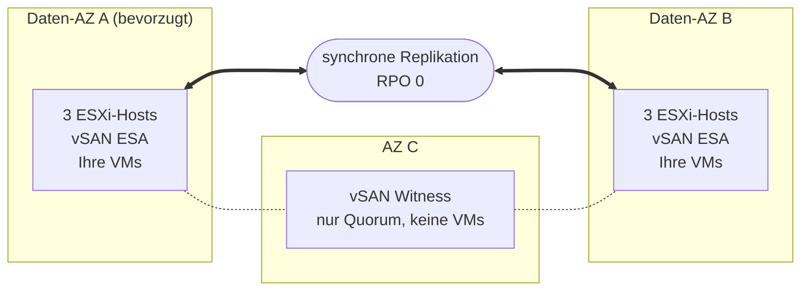

## Ziel

**Diese Anleitung stellt die Architektur von Private VCF as-a-Service Stretched Cluster 3-AZ vor: wie der Cluster auf drei Verfügbarkeitszonen verteilt ist, wie Ihre Daten repliziert werden und wie die Plattform reagiert, wenn eine Komponente ausfällt.**

{/* Re-check after December 2026: the Beta opening date below will be past. */}

:::info
Private VCF as-a-Service Stretched Cluster 3-AZ befindet sich in der Beta-Phase. Die Beta startet im Dezember 2026 für eine begrenzte Anzahl von Enterprise-Kunden. Weitere Informationen finden Sie auf der [OVHcloud Labs Seite](https://labs.ovhcloud.com/en/vmware-3az/) (Englisch).
:::

## Das Prinzip des Stretched Cluster

Private VCF as-a-Service ist eine Plattform auf Basis von VMware Cloud Foundation (VCF) 9.1, die auf dedizierter Hardware aufgebaut ist und von OVHcloud betrieben wird.

In der Variante Stretched Cluster 3-AZ betreibt Ihre Workload Domain **einen einzigen vSphere-Cluster, dessen Hosts auf zwei Verfügbarkeitszonen (AZs)** der Region Paris 3-AZ verteilt sind. Dies sind die **Daten-AZs**: Beide führen Ihre virtuellen Maschinen aus und beide enthalten eine vollständige Kopie Ihrer Daten. **Eine dritte AZ hostet einen Witness**, der nur am Quorum teilnimmt.

Der Speicher basiert auf **vSAN ESA**, das von OVHcloud konfiguriert wird. vSAN repliziert Ihre Daten **synchron** zwischen den beiden Daten-AZs: Ein Schreibvorgang wird erst bestätigt, wenn er in beiden gespeichert ist. Beide AZs enthalten daher stets dieselben Daten, und der Ausfall einer der beiden führt zu keinem Datenverlust: **RPO = 0 by Design**, gewährleistet durch die Infrastruktur.

:::warning
RPO 0 setzt eine Spiegelung zwischen den beiden Daten-AZs voraus. Weisen Sie Ihren VMs eine vSAN-Speicherrichtlinie zu, die ihre Daten auf beide Standorte spiegelt: Eine VM mit einer Richtlinie, die ihre Daten nur in einer AZ speichert, wird nicht repliziert und ist nicht gegen den Ausfall dieser AZ geschützt.
:::

Fällt eine Daten-AZ aus, **startet vSphere HA ihre virtuellen Maschinen automatisch in der verbleibenden AZ neu**, ohne dass Sie eingreifen müssen.

## Architektur

Ihre Workload Domain betreibt einen einzigen vSphere-Cluster, der sich über die beiden Daten-AZs der Region Paris 3-AZ erstreckt. Der Witness befindet sich in der dritten AZ.

| Komponente | Standort | Rolle |
|---|---|---|
| Daten-AZ A (bevorzugt) | Erste Daten-AZ | Führt Ihre VMs aus und enthält eine vollständige Kopie Ihrer Daten. Wenn die beiden Daten-AZs den Kontakt verlieren, behält sie das Quorum. |
| Daten-AZ B | Zweite Daten-AZ | Führt Ihre VMs aus und enthält eine vollständige Kopie Ihrer Daten. |
| Witness | Dritte AZ | Entscheidet über das Quorum zwischen den Daten-AZs. Er speichert keine VM-Daten und führt keine VMs aus. |
| ESXi-Hosts | Daten-AZs | Die Basiskonfiguration umfasst 6 identische vSAN-Hosts, 3 in jeder Daten-AZ. Der Cluster wächst in Paaren von Hosts, einer in jeder Daten-AZ, damit beide AZs dieselbe Kapazität behalten. |

OVHcloud weist die AZs zu: Sie erhalten zwei getrennte Daten-AZs und einen Witness in der dritten AZ, wählen aber nicht, welche AZ welche Rolle übernimmt.

## Was bei einem Ausfall passiert

Der Stretched Cluster reagiert selbstständig auf den Ausfall eines Hosts, einer Daten-AZ, des Witness oder der Verbindung zwischen den Daten-AZs.

| Was ausfällt | Was passiert | Datenverlust | Ihre Aktion |
|---|---|---|---|
| Ein Host | vSphere HA startet seine VMs auf den anderen Hosts neu. | Keiner | Keine |
| Eine komplette Daten-AZ | Ihre VMs starten automatisch in der verbleibenden AZ neu. | Keiner | Keine |
| Die Witness-AZ | Beide Daten-AZs laufen weiter und behalten das Quorum. | Keiner | Keine |
| Die Verbindung zwischen den Daten-AZs | Die bevorzugte AZ behält das Quorum; die VMs der anderen AZ starten in der bevorzugten AZ neu. | Keiner | Keine |

Dies ist das Standardverhalten eines vSAN Stretched Cluster, wie von Broadcom dokumentiert.

:::warning
Eine von vSphere HA neu gestartete VM wird nicht live verschoben: Sie startet in der verbleibenden AZ neu, und ihre Anwendungen starten mit ihr neu. Die Wiederherstellungszeit jeder Anwendung hängt von ihrem Betriebssystem und ihrer Konfiguration ab.
:::

### Kapazität für den Ausfall einer AZ einplanen

Damit die VMs einer ausgefallenen Daten-AZ neu starten können, benötigt die verbleibende AZ genügend freie CPU-Leistung und freien Arbeitsspeicher, um sie auszuführen. Dimensionieren Sie Ihre Workloads so, dass eine einzelne Daten-AZ alle VMs ausführen kann, die weiterlaufen müssen.

## Was der Stretched Cluster nicht ersetzt

Der Stretched Cluster schützt Ihre Workloads vor dem Ausfall der Infrastruktur. Er ist **weder ein Backup noch ein Disaster-Recovery-Plan**:

- Die synchrone Replikation kopiert alles gleichzeitig in beide Daten-AZs, einschließlich einer gelöschten Datei, beschädigter Daten oder von Ransomware verschlüsselter Dateien.
- Ihre Workloads laufen in einem einzigen Cluster: Wird dieser Cluster kompromittiert, gibt es keine zweite Kopie, von der aus Sie neu starten können.

Behalten Sie ein Backup und, falls Ihr Geschäft es erfordert, eine Disaster-Recovery-Lösung außerhalb des Clusters. Die Beta umfasst keinen verwalteten Backup-Dienst.

## Was rund um den Cluster enthalten ist

| Bereich | Was Sie erhalten |
|---|---|
| Betrieb | vSAN ESA ist vorkonfiguriert, und OVHcloud führt die Upgrades und Patches von VCF durch. |
| Netzwerk | VCF Networking ist enthalten. Mit Ihrer Workload Domain können Sie die kostenlose Erweiterung **Edge Services** oder die Option **vDefend** für die verteilte Firewall bestellen. |
| vRack | Optional. Ihre Workload Domain wird ohne vRack geliefert: Nach der Lieferung verbinden Sie ein bereits vorhandenes vRack oder bestellen ein neues. |
| Identität | Sie melden sich über OVHcloud IAM und SSO an: keine lokalen Accounts und eine Administratorrolle für Ihre Workload Domain ab der Lieferung. |
| Verfügbarkeit | Die Plattform ist für eine Verfügbarkeit von 99,999 % ausgelegt. |

## Weiterführende Informationen

[Produktseite Private VCF as-a-Service 3-AZ](/links/hosted-private-cloud/private-vcf-aas-3-az)

[Private VCF as-a-Service Stretched Cluster 3-AZ auf OVHcloud Labs](https://labs.ovhcloud.com/en/vmware-3az/) (Englisch)

[[fragment:professional-services]]

Treten Sie unserer [User Community](/links/community) bei.
