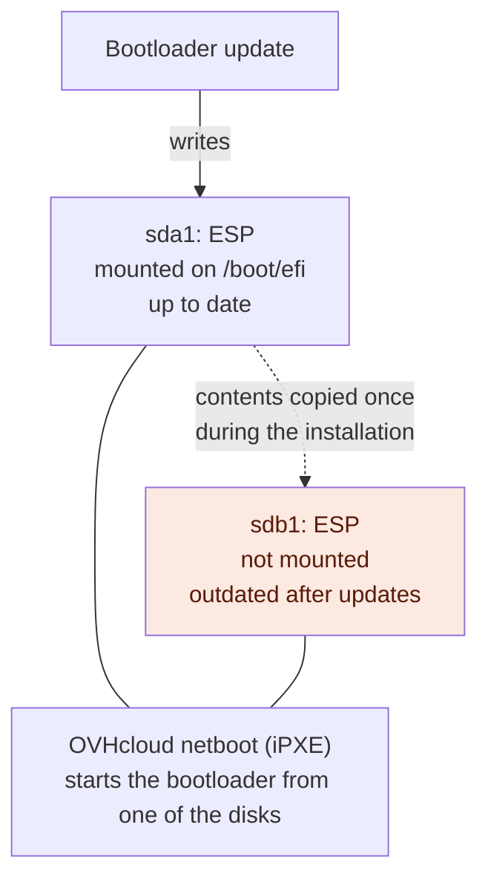
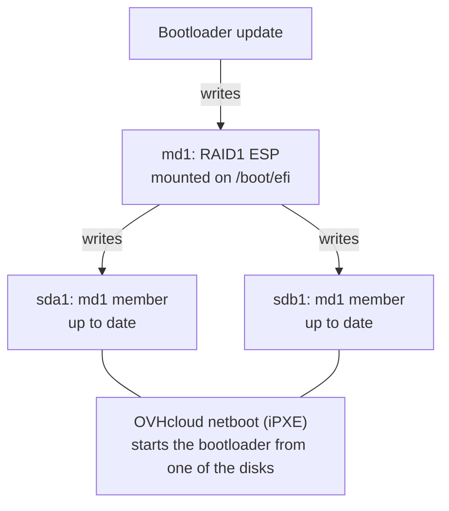

## Objective

On a server that boots in UEFI mode, the EFI System Partition (ESP) holds the bootloader of the operating system (e.g. GRUB or systemd-boot). When an operating system is installed on several disks with software RAID, every disk gets an ESP, so that the server can still boot when one of the disks fails.

Depending on the operating system, the installation either creates [one independent ESP per disk](#one-esp-per-disk), or [a single ESP on top of a software RAID1 array](#one-esp-over-raid1) that spans all the installation disks.

**This guide explains the two layouts, lists the operating systems that use each of them, and describes what the RAID1 layout changes for you.**

## Requirements

- A [dedicated server](/links/bare-metal/bare-metal) that boots in UEFI mode
- A Linux operating system installed by OVHcloud on two disks or more, with software RAID

## Instructions

### How the server boots from the ESP

OVHcloud dedicated servers boot from the network. When the server is set to boot from its disks, iPXE starts the bootloader found in the ESP of one of the disks, at the path set during the OS installation. If that fails, it falls back to rEFInd, which looks for a bootloader on every disk. See [Understanding the dedicated server boot process](/guides/bare-metal-cloud/dedicated-servers/boot-process) for the whole sequence.

Since the server can start the bootloader from any disk, every ESP has to contain the same, up-to-date files.

### One ESP per disk

This layout is mostly used by older Linux operating systems (see [Availability by operating system](#availability-by-operating-system)). Each disk has its own ESP, and only one of them is mounted on `/boot/efi`. The installation copies its contents to the ESPs of the other disks once, at the end, but later bootloader updates only write to the mounted ESP.



If the server starts the bootloader from a disk whose ESP is out of date, it runs an outdated bootloader or boot configuration, which can start an older kernel or fail to boot. To prevent this, sync the contents of the mounted ESP to the other ESPs after each bootloader update, as described in [Manage Software RAID (UEFI boot mode) on Dedicated Servers](/guides/bare-metal-cloud/dedicated-servers/raid-soft-uefi#efisystempartition).

With this layout, `lsblk -f` shows a `vfat` partition labeled `EFI_SYSPART` on each disk, and only one of them mounted on `/boot/efi`, as on this Debian 12 server:

```console
$ lsblk -f
NAME        FSTYPE            FSVER            LABEL          UUID                                 FSAVAIL FSUSE% MOUNTPOINTS
nvme0n1
├─nvme0n1p1 vfat              FAT16            EFI_SYSPART    3080-06E7                             504.7M     1% /boot/efi
├─nvme0n1p2 linux_raid_member 1.2              md2            37d67f91-25a1-6852-2764-b80ccc46b85a
│ └─md2     ext4              1.0              boot           17e70776-ef0c-4455-b1fa-683d246a21b9  848.4M     7% /boot
├─nvme0n1p3 linux_raid_member 1.2              md3            d1ad5a59-c32f-f164-4f15-ca4799820c08
│ └─md3     ext4              1.0              root           3e641163-ab2b-4275-9f46-14cffae49540  387.4G     0% /
├─nvme0n1p4 swap              1                swap-nvme0n1p4 fae5b711-0373-4ac6-bdec-ac692b4ad82d                [SWAP]
└─nvme0n1p5 iso9660           Joliet Extension config-2       2026-11-03-18-08-27-00
nvme1n1
├─nvme1n1p1 vfat              FAT16            EFI_SYSPART    3095-C236
├─nvme1n1p2 linux_raid_member 1.2              md2            37d67f91-25a1-6852-2764-b80ccc46b85a
│ └─md2     ext4              1.0              boot           17e70776-ef0c-4455-b1fa-683d246a21b9  848.4M     7% /boot
├─nvme1n1p3 linux_raid_member 1.2              md3            d1ad5a59-c32f-f164-4f15-ca4799820c08
│ └─md3     ext4              1.0              root           3e641163-ab2b-4275-9f46-14cffae49540  387.4G     0% /
└─nvme1n1p4 swap              1                swap-nvme1n1p4 590ba38f-bacd-460d-8d34-91c1d8499b2b                [SWAP]
```

### One ESP over RAID1

This layout, used by the newer Linux operating systems (see [Availability by operating system](#availability-by-operating-system)), is the most reliable one. The ESPs of all the installation disks form a software RAID1 array, `md1`, and the FAT filesystem is created on the array. `/boot/efi` is mounted from `md1`, so every bootloader update is written to all the disks.



The array uses the RAID metadata version 0.90, which is stored at the end of each member partition. This way, the UEFI firmware, which does not know about software RAID, reads each member as a normal FAT filesystem. Once Linux has started, it assembles `md1` and keeps the members in sync.

With this layout, `lsblk -f` shows the ESP of each disk as a `linux_raid_member`, and `/boot/efi` mounted from `md1`, as on this Debian 13 server:

```console
$ lsblk -f
NAME        FSTYPE            FSVER            LABEL          UUID                                 FSAVAIL FSUSE% MOUNTPOINTS
nvme1n1
├─nvme1n1p1 linux_raid_member 0.90.0                          fbb410d2-eed5-8b9c-0edd-9cfbcf09b877
│ └─md1     vfat              FAT16            EFI_SYSPART    20B8-687C                             510.5M     0% /boot/efi
├─nvme1n1p2 linux_raid_member 1.2              md2            6ef065ad-16e9-52ad-384c-94e574f41f0e
│ └─md2     ext4              1.0              boot           5d8c496e-5aed-4f04-a8a4-2a4690b7e556  840.5M     8% /boot
├─nvme1n1p3 linux_raid_member 1.2              md3            c7110db8-4597-ab47-5f18-3d7634ff3347
│ └─md3     ext4              1.0              root           f97ca283-2a1e-4222-80a6-6abcd22f5d5d  387.6G     0% /
├─nvme1n1p4 swap              1                swap-nvme0n1p4 198999e8-1150-46e9-a342-4c84ca48aa61                [SWAP]
└─nvme1n1p5 iso9660           Joliet Extension config-2       2026-11-03-15-24-14-00
nvme0n1
├─nvme0n1p1 linux_raid_member 0.90.0                          fbb410d2-eed5-8b9c-0edd-9cfbcf09b877
│ └─md1     vfat              FAT16            EFI_SYSPART    20B8-687C                             510.5M     0% /boot/efi
├─nvme0n1p2 linux_raid_member 1.2              md2            6ef065ad-16e9-52ad-384c-94e574f41f0e
│ └─md2     ext4              1.0              boot           5d8c496e-5aed-4f04-a8a4-2a4690b7e556  840.5M     8% /boot
├─nvme0n1p3 linux_raid_member 1.2              md3            c7110db8-4597-ab47-5f18-3d7634ff3347
│ └─md3     ext4              1.0              root           f97ca283-2a1e-4222-80a6-6abcd22f5d5d  387.6G     0% /
└─nvme0n1p4 swap              1                swap-nvme1n1p4 a828894f-c367-439c-bb63-c4dd9e967faa                [SWAP]
```

### Availability by operating system

The installation creates the ESP on top of RAID1 on:

- **AlmaLinux** 10 and newer
- **Debian** 13 and newer, including the Plesk variant
- **Fedora** 43 and newer
- **Proxmox Backup Server** 4 and newer
- **Proxmox Virtual Environment** 9 and newer
- **Rocky Linux** 10 and newer
- **SUSE Linux Enterprise Server for SAP Applications** 15 SP4 and newer
- **Ubuntu Server** 26.04 and newer

The installation creates one ESP per disk on:

- **AlmaLinux** 8 and 9, including the cPanel and Plesk variants
- **Debian** 12, including the Plesk variant
- **Rocky Linux** 8 and 9
- **Ubuntu Server** 20.04, 22.04 and 24.04, which has a built-in mechanism to keep multiple ESPs in sync: the `grub-efi/install_devices` debconf setting of the `grub-efi-amd64` package
- [Bring Your Own Linux](/guides/bare-metal-cloud/dedicated-servers/bring-your-own-linux): the bootloader is installed by the `make_image_bootable.sh` script of your image, which OVHcloud does not control, so the installation cannot assume that it supports an ESP on top of RAID1

Neither layout applies to servers that boot in legacy (BIOS) mode, which have no ESP, or to installations on a single disk or on a hardware RAID volume, which have a single ESP.

The layout is chosen at installation time and does not change afterwards, even after an in-place upgrade (e.g. Debian 12 → 13).

### What the RAID1 layout changes for you

- You no longer need to sync the contents of the ESPs after bootloader updates, as described in [Manage Software RAID (UEFI boot mode) on Dedicated Servers](/guides/bare-metal-cloud/dedicated-servers/raid-soft-uefi#efisystempartition): the RAID1 array writes every change to all the disks.
- The FAT filesystem keeps the `EFI_SYSPART` label, so the `/boot/efi` line of `/etc/fstab` does not change.
- Your distribution's bootloader updates work the same way as with one ESP per disk: they write to `/boot/efi`, and the RAID1 array copies them to every disk.
- If you run `grub-install` yourself, add the `--no-nvram` option. Without it, `grub-install` tries to create an EFI boot entry for the RAID1 array and fails. In any case, do not change the boot order of your server, as explained in [Understanding the dedicated server boot process](/guides/bare-metal-cloud/dedicated-servers/boot-process#why-you-must-not-change-the-boot-order).
- After a disk replacement, rebuild `md1` like the other RAID arrays. See [Manage Software RAID (UEFI boot mode) on Dedicated Servers](/guides/bare-metal-cloud/dedicated-servers/raid-soft-uefi#raidrebuildmirrored).

## Go further

[Understanding the dedicated server boot process](/guides/bare-metal-cloud/dedicated-servers/boot-process)

[Manage Software RAID (UEFI boot mode) on Dedicated Servers](/guides/bare-metal-cloud/dedicated-servers/raid-soft-uefi)

[Hot-Swapping a Disk on Software RAID Dedicated Servers](/guides/bare-metal-cloud/dedicated-servers/hotswap-raid-soft)

Join our [community of users](/links/community).
