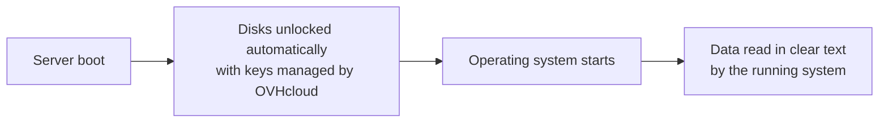

{/* REVIEW SK-2772: this page is the target of the information link in the Console activation window (action A-1). Product validation: Denis Hamon. */}

## Objective

Encryption at Rest encrypts all the disks of your OVHcloud dedicated server in hardware. **This guide explains what Encryption at Rest protects, how it works and what it changes for you.**

:::info
**OVHcloud manages the encryption keys.** The keys are generated, stored and rotated by OVHcloud. You do not manage them, and they are never sent to you. Using your own keys (Key Management Service, Secret Manager or BYOK) is not available.
:::

## Requirements

- A [dedicated server](/links/bare-metal/bare-metal) on an eligible range and in an eligible region (see [Encryption at Rest requirements and limitations](./encryption-at-rest-limitations))

## Instructions

This section describes how Encryption at Rest works, what it protects and the points to know before you enable it.

### How Encryption at Rest works

The drives perform the encryption themselves. All data written to the disks is encrypted before it is stored, so it cannot be read without the disk keys.

Unlocking is automatic. At each boot, the disks are unlocked before your operating system starts. You do not need to enter anything, and your server returns to service without any action from you.

### What Encryption at Rest protects

Encryption at Rest protects data on a disk that leaves your server:

- A disk that is physically removed or disconnected from the server.
- A disk that is replaced, or that reaches the end of its life.

{/* DRAFT: To verify — R-8 (Product, Security): confirm the protected and non-protected cases listed in this section. The draft also mentions a cryptographic erase when the server is returned; confirm before adding it. */}

### What Encryption at Rest does not protect

Encryption at Rest does not replace the security measures you apply to your system. It does not protect:

- Data while your server is running: once the disks are unlocked, the operating system reads them in clear text.
- Your operating system or applications against an attack, including online attacks.
- Data in transit on the network.

If you also need to protect data against these risks, add encryption at operating system level (for example <Tooltip term="luks">LUKS</Tooltip> on Linux or BitLocker on Windows) and follow the security practices that apply to your workloads.

### Good to know

Read these points before you enable Encryption at Rest:

- **All disks or none:** Encryption at Rest applies to every disk of the server. You cannot select disks one by one.
- **Opt-in:** Encryption at Rest is never enabled by default, including on a new server. You enable it from the <ManagerLink to="/">OVHcloud Console</ManagerLink> or the <Tooltip term="ovhcloudApi">OVHcloud API</Tooltip>.
- **Data erasure:** enabling Encryption at Rest erases all the data on the server, and the operating system must then be reinstalled. Back up your data first.
- **Disabling:** [TODO: how a customer disables Encryption at Rest at GA — the Console offers no disable action and the API update routes are not public yet. Disabling erases the disks through a cryptographic erase and requires an OS reinstall. QA Campaign C1 (staging, 30 Oct 2026) PASSED "Deactivation, server kept" via API and Manager, and "Reactivation after deactivation" via Manager — but the Console code of 10 Nov 2026 has no disable label yet (sandbox build?). Document the labels that ship.]
- **Backups:** your backup tools (Veeam, Restic, etc.) keep working. They read your data as the operating system sees it.
- **Pricing:** [TODO: R-5 — included or paid option, to confirm with Product]

{/* REVIEW R-3: do not add any regulatory framework (GDPR, ISO 27001, HDS, PCI-DSS, SecNumCloud) until Legal/Compliance has validated the mapping (action A-5). */}

## Go further

[Enable Encryption at Rest on a dedicated server](./encryption-at-rest-enable)

[Manage Encryption at Rest on a dedicated server with the OVHcloud API](./encryption-at-rest-api)

[Encryption at Rest requirements and limitations](./encryption-at-rest-limitations)

[Encryption at Rest on dedicated servers: FAQ](./encryption-at-rest-faq)

Join our [community of users](/links/community).
