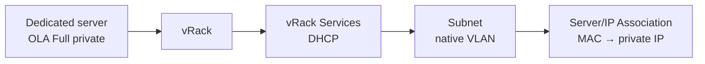

import Api from '@components/Api';

{/* DRAFT SK-2837 — generated with /single-guide (complex task, --manager v8) on 2026-11-03.
    Sources: SOT cache (manager-v8 2026-10-28, api 2026-10-20) + Product Note "BM Full Private Experience" + backoffice
    prototype specification (mocked data). The private boot card is NOT in the Console cache yet: every label marked
    "To verify" comes from the specification. The privateBoot API route is NOT in api.json. Do not publish before both are checked. */}

## Objective

By default, an OVHcloud dedicated server needs a public IPv4 address and the OVHcloud public PXE (Preboot Execution Environment) servers every time it boots. Private boot lets a server in OVHcloud Link Aggregation (OLA) **Full private** mode complete its whole boot sequence, from power-on to the iPXE script, on your [vRack](/links/network/vrack). The server keeps the same private IP address across reboots, with no static IP configuration in its operating system.

**In this guide, you will learn how to:**

- Enable private boot from the OVHcloud Console, whether or not your vRack already has a vRack Services.
- Follow the setup, and resume it if a step fails.
- Modify or disable private boot.
- Enable private boot with the OVHcloud API.
- Use rescue mode or reinstall the server while private boot is in its first release.

:::warning
In this first release, rescue mode and OS installation are not available over the private network. To use them, you must temporarily return the server to public boot. See [Use rescue mode or reinstall the server](#rescue-reinstall).

:::

## Requirements

- A compatible [dedicated server](/links/bare-metal/bare-metal) in your OVHcloud account: High Grade Gen 2 or later, Scale Gen 2 or later, or Advance Gen 3 or later. {/* [UNVERIFIED: api] Product Note PBM11; eligibility capability (LVL2-29061) not in api.json */}
- [OVHcloud Link Aggregation (OLA)](/guides/bare-metal-cloud/dedicated-servers/ola-enable-manager) enabled on the server in **Full private** mode.
- The server attached to a [vRack](/guides/bare-metal-cloud/dedicated-servers/vrack-configuring-on-dedicated-server).
- Access to the <ManagerLink to="/beta/#/bare-metal/dedicated-server">OVHcloud Console</ManagerLink>, or, for the API scenario, OVHcloud API credentials (see [First steps with the OVHcloud API](/guides/manage-and-operate/api/first-steps)).

## Introduction

Private boot relies on [vRack Services](/guides/network/vrack-services/global), the managed network layer of your vRack. Its DHCP service answers the boot requests that the server sends on its private interface, and gives it the private IP address bound to its MAC address. Private boot works on the native VLAN (untagged traffic) only. {/* [UNVERIFIED: manager-v8] specification §4 "Eligible subnet"; no Console label yet */}

## Instructions

This section explains how private boot works, then walks you through each way of enabling it.

**Contents:**

- [How private boot works](#overview)
- [Open the private boot card](#common-setup)
- [Scenario A: first private boot, vRack Services created for you](#scenario-a)
- [Scenario B: use an existing vRack Services](#scenario-b)
- [Scenario C: enable private boot with the OVHcloud API](#scenario-api)
- [IP address statuses](#ip-statuses)
- [Follow the setup and handle a failure](#workflow)
- [Modify or disable private boot](#modify-disable)
- [Use rescue mode or reinstall the server](#rescue-reinstall)
- [Private boot limitations](#limitations)
- [Troubleshooting private boot](#troubleshooting)

### How private boot works <a name="overview"></a>

When private boot is enabled, the server sends its boot requests (DHCP, then PXE and iPXE) on its private interface. The DHCP service of vRack Services answers them, and the server boots from the private network.



| Term | Description |
|---|---|
| Subnet | The private IPv4 range the server boots into. It must have no VLAN. |
| Service range | A block of the subnet, from /27 to /29, reserved for the services that OVHcloud manages, such as DHCP. Do not assign these addresses to your machines. |
| Server/IP Association | The binding between the server's MAC address and its private IP address. See [Manage Server/IP Associations in vRack Services](/guides/network/vrack-services/server-ip-associations). |

What you have to enter depends on what your <Tooltip term="vrack">vRack</Tooltip> already has in the server's region:

| Your vRack has… | What the Console does when you enable private boot | Scenario |
|---|---|---|
| No vRack Services in the server's region | Orders one, free of charge, attaches it to the vRack, creates the subnet, then enables private boot | [A](#scenario-a) |
| A vRack Services with no subnet | Creates the subnet, then enables private boot | [B](#scenario-b) |
| A vRack Services with an eligible subnet | Adds the association (and the service range, if the subnet has none), then enables private boot | [B](#scenario-b) |
| Private boot already enabled | Shows a read-only summary | [Modify](#modify-disable) |

### Open the private boot card <a name="common-setup"></a>

All the Console scenarios start from the server's **Connectivity** tab.

During the Beta, open the <ManagerLink to="/beta/#/bare-metal/dedicated-server">OVHcloud Console</ManagerLink> with the <code className="action">Discover the console &gt;BETA_</code> button in the top-right corner.

1. Select your server.
2. Open the <code className="action">Connectivity</code> tab.
3. Locate the **Boot from private network** card.

{/* DRAFT: To verify — card title "Boot from private network" (specification §3), not yet in the Console cache. */}
{/* DRAFT: To screenshot — Connectivity tab with the Boot from private network card, toggle off. */}

The card appears only when the server's range supports private boot and the server is attached to a vRack. If the server is not attached to a vRack, click <code className="action">Attach a vRack</code> in the **Private interface (vRack)** card, select the vRack, then click <code className="action">Attach</code>.

### Scenario A: first private boot, vRack Services created for you <a name="scenario-a"></a>

Use this scenario when your vRack has no vRack Services in the server's region. The Console orders one for you, free of charge, while it enables private boot. {/* [UNVERIFIED: api] "free of charge" from specification §7; check the vRack Services catalog price */}

1. Turn on the **Boot from private network** toggle. The form shows:
    - **vRack**: the server's vRack, locked. To use another vRack, change it in the **Private interface (vRack)** card.
    - **Subnet**: a new subnet, pre-filled with a suggested range. Replace it with a range from your own private addressing plan if needed.
    - **Service range**: pre-filled with the first /29 block of the subnet.
    - **IP address**: pre-filled with the first free address after the service range. The server receives this address.

    The **Resulting path** diagram next to the form shows the vRack Services as **Will be created**.
2. Check the status under the **IP address** field. It must be **Available** (see [IP address statuses](#ip-statuses)).
3. Click <code className="action">Enable private boot</code>.
4. A window shows the vRack Services to be ordered and the terms and conditions. Tick the box, then click <code className="action">Accept and enable</code>.

{/* DRAFT: To verify — field labels, "Will be created", "Enable private boot" and "Accept and enable" (specification §5-§7). */}
{/* DRAFT: To screenshot — pre-filled form with the dashed vRack Services in the Resulting path. */}
{/* DRAFT: To screenshot — Terms of Service window. */}

The card switches to **Pending** and runs four steps: order the vRack Services, attach it to the vRack, configure the subnet, service range and IP address, then enable private boot on the server. See [Follow the setup and handle a failure](#workflow).

#### Verify scenario A

| Check | How | Expected result |
|---|---|---|
| Private boot is enabled | **Boot from private network** card | Status **Active**, with the summary of the configuration |
| The vRack Services exists | Console > vRack Services | A new vRack Services, attached to the server's vRack, in the server's region |
| The server boots privately | Reboot the server, then open its <Tooltip term="kvmConsole">KVM/IPMI</Tooltip> console | The server receives the IP address shown in the summary |

### Scenario B: use an existing vRack Services <a name="scenario-b"></a>

Use this scenario when your vRack already has a vRack Services in the server's region. Nothing is ordered, so no terms and conditions window opens.

1. Turn on the **Boot from private network** toggle. The **vRack** is locked and the **vRack Services** links to its page.
2. Select or enter the subnet:
    - If the vRack Services has an eligible subnet, the first one is pre-selected in the **Subnet** list. Its service range is read-only, or pre-filled if the subnet has none. To use another range, select <code className="action">Create a new subnet</code> at the end of the list.
    - If the vRack Services has no subnet, a new subnet, its service range and an IP address are pre-filled, as in [scenario A](#scenario-a).
3. Check that the **IP address** status is **Available**. The pre-filled address skips the addresses already assigned to other servers.
4. Click <code className="action">Enable private boot</code>.

{/* DRAFT: To verify — "Create a new subnet" and the read-only service range behaviour (specification §5.3-§5.4). */}
{/* DRAFT: To screenshot — subnet list with the first eligible subnet pre-selected. */}

The card switches to **Pending** and runs two steps: configure the subnet, service range and IP address on the vRack Services, then enable private boot on the server.

#### Verify scenario B

| Check | How | Expected result |
|---|---|---|
| Private boot is enabled | **Boot from private network** card | Status **Active** |
| The association exists | Console > vRack Services > your vRack Services | The server's MAC address is bound to the IP address shown in the summary |
| The server boots privately | Reboot the server, then open its KVM/IPMI console | The server receives that IP address |

### Scenario C: enable private boot with the OVHcloud API <a name="scenario-api"></a>

Use this scenario to automate private boot, for example across a fleet of servers. The vRack Services, its subnet and its service range must already exist.

{/* DRAFT: To verify — the private boot route is not in the API schema cache (api.json, 2026-10-20). Route, version and body come from the Product Note (PBM5). */}

1. Retrieve the MAC address of the server's network interfaces:

<Api version="v1" section="/dedicated/server" method="GET" route={"/dedicated/server/{serviceName}/networkInterfaceController"} />

2. Create the Server/IP Association for this MAC address, as described in [Manage Server/IP Associations in vRack Services](/guides/network/vrack-services/server-ip-associations).

3. Enable private boot on the server:

<Api version="v1" section="/dedicated/server" method="PUT" route={"/dedicated/server/{serviceName}/privateBoot"} />

| Parameter | Required | Description | Example |
|---|---|---|---|
| `serviceName` | Yes | Name of your dedicated server. | `ns1234567.ip-203-0-113.eu` |
| `enabled` (body) | Yes | `true` to enable private boot, `false` to disable it. | `true` |
| `vrackId` (body) | Yes | Identifier of the vRack the server boots from. | `pn-123456` |

```json
{
  "enabled": true,
  "vrackId": "pn-123456"
}
```

The response returns the updated private boot state and the time it took effect. [TODO: response model name and fields]

#### Verify scenario C

| Check | How | Expected result |
|---|---|---|
| Private boot is enabled | `GET` on the same route [TODO: confirm a GET exists] | `enabled` is `true` |
| The server boots privately | Reboot the server | The server receives the IP address of its association |

### IP address statuses <a name="ip-statuses"></a>

The Console checks the IP address as you type. <code className="action">Enable private boot</code> is available only when the status is **Available**.

{/* DRAFT: To verify — status wording (specification §5.5). */}

| Status | Meaning |
|---|---|
| **Available** | The address can be used. |
| **Not a valid IPv4 address** | The value is not a valid IPv4 address. |
| **Outside subnet** | The address is not in the selected subnet. |
| **Network or broadcast address** | The address is the first or last address of the subnet. |
| **Reserved for OVHcloud** | The address is inside the service range. |
| **Reserved: inside the BGP range** | The address is inside the BGP range of the subnet. |
| **Already assigned** | The address is already bound to another server. |

:::tip
OVHcloud only checks the addresses it manages. Before you enable private boot, make sure that the address is not already used by another machine in your vRack.

:::

### Follow the setup and handle a failure <a name="workflow"></a>

The setup can take several minutes. You can leave the page: the steps continue in the background, each with its own status in the card.

When all the steps succeed:

- The card status turns **Active** and shows the vRack, vRack Services, subnet, service range and IP address.
- A notification lists the configuration and the assigned IP address.
- The server boots from the private network **at its next reboot**.

If a step fails:

1. The card status turns **Error**, and the failed step is highlighted with its error message. The resources already created are kept and listed.
2. Click <code className="action">Retry</code> to resume from the failed step.
3. If the error persists, click <code className="action">Contact support</code>.

{/* DRAFT: To verify — "Retry" and "Contact support" labels, and the notification text (specification §8). */}
{/* DRAFT: To screenshot — card in Error status with the failed step highlighted. */}

### Modify or disable private boot <a name="modify-disable"></a>

You can change the subnet or IP address of an active private boot, or disable it and keep its configuration for later.

- **Modify:** click <code className="action">Modify</code> on the card, change the subnet or the IP address, then click <code className="action">Save and apply</code>. The server uses the new address at its next reboot.
- **Disable:** turn off the **Boot from private network** toggle. The last configuration is kept for when you enable it again. With the API, send the [private boot call](#scenario-api) with `"enabled": false`.

{/* DRAFT: To verify — "Modify" and "Save and apply" labels, and whether disabling asks for confirmation (specification §9 keeps the earlier prototype behaviour). */}

### Use rescue mode or reinstall the server <a name="rescue-reinstall"></a>

In this first release, the rescue environment and the OS installation are still delivered over the public network. While the server is in Full private mode, changing its boot mode fails with the message *"Cannot change boot mode: no public network interfaces are enabled on this server."*

To boot the server in [rescue mode](/guides/bare-metal-cloud/dedicated-servers/rescue-mode) or to reinstall it:

1. Disable private boot (see [Modify or disable private boot](#modify-disable)).
2. Restore the public interface: in the **OVHcloud Link Aggregation (OLA)** card, click <code className="action">Reset</code>, then <code className="action">Confirm</code>.
3. Run the operation: <code className="action">Rescue mode</code>, then <code className="action">Reboot</code>, or <code className="action">Reinstall</code>.
4. When the operation is complete, enable OLA in **Full private** mode again, then enable private boot again. Its previous configuration and the server's Server/IP Association are kept.

{/* DRAFT: To verify — whether step 2 (OLA reset) is required in M1, or whether disabling private boot alone restores public boot. The product team must confirm (PBM13 workaround procedure). */}

:::warning
While OLA is reset, the server is reachable on its public interface again. Plan this operation during a maintenance window.

:::

### Private boot limitations <a name="limitations"></a>

The first release of private boot has the following limitations.

| Limitation | Details |
|---|---|
| Rescue mode and OS installation | Not available over the private network. Return the server to public boot temporarily, as described in [Use rescue mode or reinstall the server](#rescue-reinstall). |
| Native VLAN only | A subnet configured with a VLAN cannot be used for private boot. |
| Compatible ranges only | High Grade Gen 2 or later, Scale Gen 2 or later, Advance Gen 3 or later. The card is not shown on other servers. |
| One subnet per vRack Services | During the Beta, a vRack Services can host a single subnet. [TODO: subnet size — the Console currently requires a /24, the specification allows /23 to /28] |
| Address checks | OVHcloud only checks the addresses it manages, not machines with a static IP address in your vRack. |

### Troubleshooting private boot <a name="troubleshooting"></a>

The table below lists the most common issues when you enable private boot.

| Issue | Possible cause | Solution |
|---|---|---|
| The **Boot from private network** card does not appear | The server range is not compatible, or the server is not attached to a vRack | Check the server range in the requirements, then click <code className="action">Attach a vRack</code> in the **Private interface (vRack)** card. |
| <code className="action">Enable private boot</code> stays unavailable | The IP address status is not **Available** | Change the address according to its [status](#ip-statuses). |
| A step fails | Temporary error, or a conflict on the vRack Services | Click <code className="action">Retry</code>. If the error persists, click <code className="action">Contact support</code>. |
| The server still boots on the public network | The server has not rebooted since private boot was enabled | Reboot the server. |
| The server does not receive its private IP address | Its Server/IP Association was deleted or modified | Check the association in [vRack Services](/guides/network/vrack-services/server-ip-associations). |

## Go further

[Manage Server/IP Associations in vRack Services](/guides/network/vrack-services/server-ip-associations)

[Understanding link aggregation on dedicated servers](/guides/bare-metal-cloud/dedicated-servers/link-aggregation-overview)

[Configuring OVHcloud Link Aggregation (OLA)](/guides/bare-metal-cloud/dedicated-servers/ola-enable-manager)

[Manage your server reboot with the OVHcloud Link Aggregation feature](/guides/bare-metal-cloud/dedicated-servers/pxe-with-full-private-dedicated)

[How to activate and use rescue mode](/guides/bare-metal-cloud/dedicated-servers/rescue-mode)

[vRack Services - Exposing a Managed Service on your vRack](/guides/network/vrack-services/global)

Join our [community of users](/links/community).
