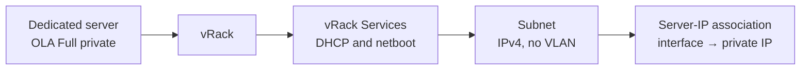

import Api from '@components/Api';

## Objective

By default, an OVHcloud dedicated server needs a public IPv4 address and the OVHcloud public PXE (Preboot Execution Environment) servers every time it boots. Private boot lets a server in OVHcloud Link Aggregation (OLA) **Full private** mode complete its whole boot sequence, from power-on to the iPXE script, on your [vRack](/links/network/vrack). The server keeps the same private IP address across reboots, with no static IP configuration in its operating system.

**In this guide, you will learn how to:**

- Check that private boot is available for your server.
- Enable private boot from the OVHcloud Console, including when your server has no vRack, vRack Services or subnet yet.
- Follow the configuration, and retry it if it fails.
- Modify or disable private boot.
- Enable private boot with the OVHcloud API.
- Use rescue mode or reinstall the server while private boot is in its first release.

:::warning
In this first release, rescue mode and OS installation are not available over the private network. To use them, you must temporarily return the server to public boot. See [Use rescue mode or reinstall the server](#rescue-reinstall).

:::

## Requirements

- A [dedicated server](/links/bare-metal/bare-metal) in your OVHcloud account that supports private boot: High Grade Gen 2 or later, Scale Gen 2 or later, or Advance Gen 3 or later (see [Check that private boot is available](#availability)).
- [OVHcloud Link Aggregation (OLA)](/guides/bare-metal-cloud/dedicated-servers/ola-enable-manager) enabled on the server in **Full private** mode.
- Access to the <ManagerLink to="/beta/#/bare-metal/dedicated-server">OVHcloud Console</ManagerLink>, or, for the API procedure, OVHcloud API credentials (see [First steps with the OVHcloud API](/guides/manage-and-operate/api/first-steps)).

You do not need a vRack, a vRack Services or a subnet before you start: the Console lets you order or create each missing resource from the private boot form.

## Introduction

Private boot relies on [vRack Services](/guides/network/vrack-services/global), the managed network layer of your <Tooltip term="vrack">vRack</Tooltip>. Its DHCP service answers the boot requests that the server sends on its private interface, and gives it the private IP address bound to that interface. Private boot works on an IPv4 subnet without a VLAN (untagged traffic) only.

## Instructions

This section explains how private boot works, then walks you through each way of enabling it.

**Contents:**

- [How private boot works](#overview)
- [Check that private boot is available](#availability)
- [Enable private boot from the OVHcloud Console](#console)
- [Follow the configuration and handle a failure](#workflow)
- [Modify or disable private boot](#modify-disable)
- [Enable private boot with the OVHcloud API](#api)
- [Use rescue mode or reinstall the server](#rescue-reinstall)
- [Private boot limitations](#limitations)
- [Troubleshooting private boot](#troubleshooting)

### How private boot works <a name="overview"></a>

When private boot is enabled, the server sends its boot requests (DHCP, then PXE and iPXE) on its private interface. The DHCP service of vRack Services answers them, and the server boots from the private network.



| Term | Description |
|---|---|
| Subnet | The private IPv4 range the server boots into. It must have no VLAN. |
| Service range | A block of the subnet, from /27 to /29, reserved for the services that OVHcloud manages, such as the DHCP server. Do not assign these addresses to your machines. |
| Server-IP association | The binding between the server's private interface and its IP address in the subnet. Enabling private boot creates it, and deleting it disables private boot. See [Manage Server-IP associations in vRack Services](/guides/network/vrack-services/server-ip-associations). |

### Check that private boot is available <a name="availability"></a>

The **Boot from private network** card appears on the server's <code className="action">Connectivity</code> tab only when private boot is available for your OVHcloud account and the server model supports it. If you do not see the card, private boot is not available for this server.

When the card is shown but the server is not in OLA **Full private** mode, the card displays **Configure OLA in Full private mode first** and its switch is unavailable. Click <code className="action">Configure OLA</code> to aggregate the server's interfaces, as described in [Configuring OVHcloud Link Aggregation (OLA)](/guides/bare-metal-cloud/dedicated-servers/ola-enable-manager). While the OLA change is running, the card shows **Switching to OLA Full private**, then private boot becomes available.

:::warning
OLA **Full private** mode aggregates all the server's interfaces on the vRack and cuts its public Internet connectivity.

:::

With the API, list the regions and availability zones where private boot is available. The `netboot` feature of each region is `AVAILABLE`, `PARTIALLY_AVAILABLE` (in some availability zones) or `UNAVAILABLE`:

<Api version="v2" section="/vrackServices" method="GET" route={"/vrackServices/reference/featureAvailability"} />

### Enable private boot from the OVHcloud Console <a name="console"></a>

During the Beta, open the <ManagerLink to="/beta/#/bare-metal/dedicated-server">OVHcloud Console</ManagerLink> with the <code className="action">Discover the console &gt;BETA_</code> button in the top-right corner, then select your server.

1. Open the <code className="action">Connectivity</code> tab.
2. In the **Boot from private network** card, turn on the switch. The form opens. Each field becomes available once the previous one is set.
3. In the **vRack** field, select the vRack the server boots from. If the server is already attached to a vRack, that vRack is shown and cannot be changed. If your account has no vRack, click <code className="action">Order a vRack</code>.
4. In the **vRack Service** field, select the vRack Services of this vRack in the server's region. If there is none, click <code className="action">Order a vRack Service</code>.
5. In the **Subnet** field, select an IPv4 subnet without a VLAN. To use a new range, click <code className="action">Create new subnet</code>, or <code className="action">Create a subnet</code> if the vRack Services has none. If the subnet has no service range yet, click <code className="action">Configure service range</code>: the subnet page opens in a new tab.
6. Check the **Service range**, shown once the subnet is selected.
7. In the **IP address** field, complete the address the server will boot with. The subnet prefix is pre-filled: enter the last number.
8. Check the **Resulting path** panel, which shows the server, vRack, vRack Service, subnet and IP address.
9. Click <code className="action">Save and apply</code>.

If the server is not yet attached to the selected vRack, the **Attach a vRack private network** window opens. It states that the server's network interface will be attached to the vRack, then boot from the subnet with the IP address you chose. Confirm to attach the server and apply the configuration.

When you order a vRack or a vRack Services, or create a subnet, from the form, its progress is shown under the field. The new resource is selected once it is ready.

The IP address must:

- be a valid address of the subnet;
- be outside the service range;
- not be the first or last address of the subnet, which are reserved;
- not be already assigned to another server.

OVHcloud only checks the addresses it manages. Make sure no other machine in your vRack already uses the address, for example a machine with a static IP address.

### Follow the configuration and handle a failure <a name="workflow"></a>

While the configuration is applied, the card shows **Applying private boot configuration…** and its status is **Pending**. The fields are locked until the configuration is applied.

When it succeeds, the status turns **Active** and a notification confirms that private boot is enabled. The server boots from the private network **at its next reboot**.

If the configuration fails, the status turns **Error** and the card states the reason:

| Message | What to do |
|---|---|
| The private network configuration could not be applied. | Click <code className="action">Retry</code>. |
| This vRack Service was changed in the meantime. | Check the configuration, then click <code className="action">Retry</code>. |
| This vRack Service is being updated. | Wait until the vRack Services is ready, then apply again. |
| This vRack Service is in error, or went into error while applying the configuration. | Its previous configuration stays active, but it cannot be changed until OVHcloud support steps in. Contact the support. |

If the server was attached to the vRack before the failure, it stays attached, and the card says so. If the attachment is still running, the card asks you to click <code className="action">Save and apply</code> again once it is done.

### Modify or disable private boot <a name="modify-disable"></a>

Once private boot is active, the card shows its configuration, and its switch can no longer be used directly: use <code className="action">Modify</code> to change or disable private boot.

- **Modify:** click <code className="action">Modify</code>, change the vRack Services, subnet or IP address, then click <code className="action">Save and apply</code>. The server uses the new configuration at its next reboot.
- **Disable:** click <code className="action">Modify</code>, turn off the switch, then click <code className="action">Save and apply</code>. A warning states that the server will boot from the public network at its next reboot. The server's Server-IP association is deleted.

To cancel your changes, click <code className="action">Cancel</code>.

The **Connectivity** tile of the <code className="action">Overview</code> tab also shows a **Private boot** row, with an <code className="action">Enable</code> or <code className="action">Disable</code> link that opens the card.

### Enable private boot with the OVHcloud API <a name="api"></a>

With the API, private boot is a configuration of the vRack Services: you add a Server-IP association for the server's interface to the DHCP configuration of a service range. The vRack Services, its IPv4 subnet without a VLAN, and its service range must already exist.

1. If the server is not yet attached to the vRack, attach its interface:

<Api version="v1" section="/vrack" method="POST" route={"/vrack/\{serviceName\}/dedicatedServerInterface"} />

2. List the server interfaces that can be associated with the vRack Services. Note the `uuid` of your server's interface:

<Api version="v2" section="/vrackServices" method="GET" route={"/vrackServices/resource/\{vrackServicesId\}/eligibleDedicatedServerInterfaces"} />

3. Retrieve the `checksum` and the `targetSpec` of the vRack Services:

<Api version="v2" section="/vrackServices" method="GET" route={"/vrackServices/resource/\{vrackServicesId\}"} />

4. Send the `targetSpec` back with the association added to the DHCP configuration of the service range, and the `checksum` you retrieved:

<Api version="v2" section="/vrackServices" method="PUT" route={"/vrackServices/resource/\{vrackServicesId\}"} />

```json
{
  "checksum": "609cf69014e57abfb3d892133692ac6f",
  "targetSpec": {
    "subnets": [
      {
        "az": "eu-west-gra-a",
        "cidr": "10.0.0.0/24",
        "displayName": null,
        "vlan": null
      }
    ],
    "services": {
      "serviceRange": [
        {
          "cidr": "10.0.0.0/29",
          "subnetCidr": "10.0.0.0/24",
          "serviceEndpoints": [],
          "dhcp": {
            "dedicatedServerInterfaceAssociations": [
              {
                "uuid": "f3a6c9e2-0b7d-4c1e-9a58-2d4e6b8c0f13",
                "ip": "10.0.0.10"
              }
            ]
          }
        }
      ]
    }
  }
}
```

| Parameter | Required | Description |
|---|---|---|
| `checksum` | Yes | Checksum returned by the previous `GET`. The request is refused if the vRack Services changed in the meantime. |
| `services.serviceRange[].dhcp.dedicatedServerInterfaceAssociations[].uuid` | Yes | Identifier of the server interface, from the previous step. |
| `services.serviceRange[].dhcp.dedicatedServerInterfaceAssociations[].ip` | Yes | Private IP address of the server. It must be in the subnet, outside the service range and any BGP range, not the first or last address of the subnet, and unique in the subnet. |

Keep every other value of the `targetSpec` as returned by the `GET`. For the `checksum` and `targetSpec` mechanism, see [vRack Services - Exposing a Managed Service on your vRack](/guides/network/vrack-services/global).

5. Follow the update until the vRack Services is `READY`:

<Api version="v2" section="/vrackServices" method="GET" route={"/vrackServices/resource/\{vrackServicesId\}/task"} />

In the `currentState` of the vRack Services, the association shows `"netboot": true` once private boot is active. To disable private boot, send the `targetSpec` without the association.

### Use rescue mode or reinstall the server <a name="rescue-reinstall"></a>

In this first release, the rescue environment and the OS installation are still delivered over the public network. While the server is in OLA **Full private** mode, its boot mode cannot be changed: the Console displays *"Cannot change boot mode: no public network interfaces are enabled on this server."*

To boot the server in [rescue mode](/guides/bare-metal-cloud/dedicated-servers/rescue-mode) or to reinstall it, temporarily return it to public boot:

1. Note the subnet and IP address shown in the **Boot from private network** card, then disable private boot, as described in [Modify or disable private boot](#modify-disable). Disabling it deletes the server's Server-IP association.
2. On the <code className="action">Connectivity</code> tab, in the **OVHcloud Link Aggregation (OLA)** card, click <code className="action">Reset</code>, then <code className="action">Confirm</code>. While the reset runs, the **Boot from private network** card shows **Resetting OLA to default mode**.
3. Run the operation: <code className="action">Rescue mode</code>, then <code className="action">Reboot</code>, or <code className="action">Reinstall</code>.
4. When the operation is complete, configure OLA in **Full private** mode again.
5. Enable private boot again, as described in [Enable private boot from the OVHcloud Console](#console). You can select the same subnet and IP address.

After a rescue boot, the network configuration of the operating system is unchanged. After a reinstallation, configure the link aggregation in the new operating system again, as described in [Configuring OVHcloud Link Aggregation (OLA)](/guides/bare-metal-cloud/dedicated-servers/ola-enable-manager).

:::warning
While OLA is reset, the server is reachable on its public interface again. Plan this operation during a maintenance window.

:::

### Private boot limitations <a name="limitations"></a>

The first release of private boot has the following limitations.

| Limitation | Details |
|---|---|
| Rescue mode and OS installation | Not available over the private network. Return the server to public boot temporarily, as described in [Use rescue mode or reinstall the server](#rescue-reinstall). |
| OLA Full private only | Private boot needs all the server's interfaces aggregated on the vRack. |
| IPv4 subnet without a VLAN | A subnet configured with a VLAN cannot be used for private boot. |
| Shared subnet | A subnet already used by another service, such as a Service Endpoint, can only be shared between dedicated servers for private boot. |
| Compatible servers and regions | High Grade Gen 2 or later, Scale Gen 2 or later, Advance Gen 3 or later, in a region where private boot is available. The card is not shown on other servers. |
| Subnet size | A vRack Services subnet is a /23 or /24 IPv4 range. A vRack Services can host up to 3 subnets. |
| Address checks | OVHcloud only checks the addresses it manages, not machines with a static IP address in your vRack. |

### Troubleshooting private boot <a name="troubleshooting"></a>

The table below lists the most common issues when you enable private boot.

| Issue | Possible cause | Solution |
|---|---|---|
| The **Boot from private network** card does not appear | The server model does not support private boot, or private boot is not available for your account | Check the [availability](#availability) of private boot. |
| The switch is unavailable | The server is not in OLA **Full private** mode, or private boot is already active | Click <code className="action">Configure OLA</code>, or use <code className="action">Modify</code> on an active private boot. |
| No subnet can be selected | The vRack Services has no IPv4 subnet without a VLAN, or its subnet has no service range | Click <code className="action">Create new subnet</code> or <code className="action">Configure service range</code>. |
| The configuration fails | Temporary error, or the vRack Services changed or is in error | See [Follow the configuration and handle a failure](#workflow). |
| The server still boots on the public network | The server has not rebooted since private boot was enabled | Reboot the server. |
| The server no longer boots from the private network | Its Server-IP association was deleted or modified in vRack Services | Check the association in [vRack Services](/guides/network/vrack-services/server-ip-associations). |

## Go further

[Manage Server-IP associations in vRack Services](/guides/network/vrack-services/server-ip-associations)

[Understanding link aggregation on dedicated servers](/guides/bare-metal-cloud/dedicated-servers/link-aggregation-overview)

[Configuring OVHcloud Link Aggregation (OLA)](/guides/bare-metal-cloud/dedicated-servers/ola-enable-manager)

[Manage your server reboot with the OVHcloud Link Aggregation feature](/guides/bare-metal-cloud/dedicated-servers/pxe-with-full-private-dedicated)

[How to activate and use rescue mode](/guides/bare-metal-cloud/dedicated-servers/rescue-mode)

[vRack Services - Exposing a Managed Service on your vRack](/guides/network/vrack-services/global)

Join our [community of users](/links/community).
