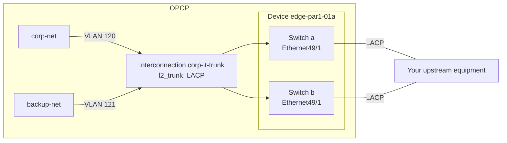

import { Tab, Tabs } from '@rspress/core/theme';

## Objective

By default, a Neutron network only lives inside the OPCP network fabric. The **Connectivity API** lets you expose a Neutron network to your own network (your upstream), through ports of the OPCP edge switches. You choose the ports, how they are bundled, and which VLAN carries each network. OPCP configures the switches for you.

**This guide explains how to declare edge interfaces, create an interconnection, and attach or detach Neutron networks with the OpenStack CLI or the REST API.**

To learn how OPCP fits into your network before you start, read [Network integration and connectivity for OPCP](/guides/hosted-private-cloud/opcp/opcp-network-architecture).

:::info
This feature is available from **OPCP Core `{{NEED TO BE DONE}}`**. If step 1 below finds no `connectivity` endpoint, your platform does not offer it yet.

:::

:::warning
The Connectivity API requires the **admin** role. Its resources are **not isolated by project**: an administrator of any project sees and changes every interface and interconnection, and can expose any Neutron network of the region outside the fabric.<br/>
Grant the **admin** role only to people allowed to connect OPCP networks to your upstream.

:::

## How the Connectivity API works

The Connectivity API handles four kinds of objects:

- **Device:** the edge switches at the border of the OPCP fabric, usually a pair named `a` and `b`. Devices are set up by OVHcloud: you can list them, not create them.
- **Interface:** a physical port of one switch (`a` or `b`) of a device. You declare the ports you want to use, with their speed and MTU.
- **Interconnection:** the logical link between OPCP and your upstream, made of one or more interfaces of the same device. Its type defines how networks are carried:
    - `l2_access`: a single Neutron network, **untagged**. See [Access mode](/guides/hosted-private-cloud/opcp/opcp-network-architecture#access-mode).
    - `l2_trunk`: several Neutron networks, each **tagged with its own VLAN**. See [Trunk mode](/guides/hosted-private-cloud/opcp/opcp-network-architecture#trunk-mode).

    Several interfaces form a link aggregation (LAG). It requires **LACP** and can span both switches of the device for redundancy.
- **Network attachment:** a Neutron network exposed through an interconnection.

The example used throughout this guide connects two Neutron networks to your upstream through one port on each switch, bundled with LACP:



**Every change is asynchronous.** The API accepts a request immediately and the resource goes to `PENDING_CREATE`, `PENDING_UPDATE` or `PENDING_DELETE` while the switches are configured. It then becomes `ACTIVE`, or `ERROR` with the reason in its `status_detail` field. A deleted resource disappears. While an interconnection, one of its interfaces or one of its networks is pending, any other change to that interconnection is refused.

## Requirements

- An active [OPCP service](/links/hosted-private-cloud/onprem-cloud-platform).
- **[Configured OpenStack CLI access](/guides/hosted-private-cloud/opcp/how-to-use-api-and-get-credentials)** (`clouds.yaml` or environment variables).
- The **admin** role on a project.
- The Connectivity plugin of the OpenStack CLI, `python-connectivityclient`, which adds the `openstack border` commands (see below).
- To follow the REST API examples, `curl` and `jq`.
- The Neutron networks you want to expose, already created. See [How to deploy an instance via the OpenStack CLI](/guides/hosted-private-cloud/opcp/how-to-setup-instance-from-cli).
- Your upstream equipment cabled to the edge switch ports you will use, and configured accordingly: the same VLANs for a trunk, and LACP if you bundle several ports.

:::warning
**`{{NEED TO BE DONE}}`**

The `python-connectivityclient` package is **not yet published on PyPI**. The installation procedure below will be completed once the package is available.

```bash
pip install python-connectivityclient
openstack border version show
```

:::

## Instructions

Each step shows the **OpenStack CLI** command and its **REST API** equivalent. Pick a tab once: the choice applies to the whole page.

To display all the options of a command, add `help` before it:

```bash
openstack help border interconnection create
```

The help lists every option with the generic limits of the API: OPCP accepts only the values given in [Connectivity API limits](#connectivity-api-limits).

### Prepare your environment

#### 1. Check access to the Connectivity API

<Tabs>
<Tab label="OpenStack CLI">

Check that the CLI reaches the Connectivity API:

```bash
openstack border version show
```

**Example output:**

```bash
+-------------+---------+
| Field       | Value   |
+-------------+---------+
| feature     | borders |
| id          | v1      |
| max_version | 1.0     |
| min_version | 1.0     |
| status      | CURRENT |
+-------------+---------+
```

</Tab>
<Tab label="REST API">

The Connectivity API is published in the Keystone catalog under the service type `connectivity`. Retrieve a token and the API URL, then store them in environment variables used by all the examples of this guide:

```bash
export OS_TOKEN=$(openstack token issue -f value -c id)
export CONNECTIVITY_URL=$(openstack endpoint list --service connectivity --interface public -f value -c URL)
export BORDERS_API="${CONNECTIVITY_URL%/}/borders/v1"
```

If your platform has several regions, add `--region <region>` to the second command. The token expires after a while: when a request answers `401` (`connectivity.auth.unauthorized`), run the first command again.

Check that the API answers:

```bash
curl -sS -H "X-Auth-Token: $OS_TOKEN" "$BORDERS_API/" | jq
```

**Example output:**

```json
{
  "version": {
    "id": "v1",
    "feature": "borders",
    "status": "CURRENT",
    "min_version": "1.0",
    "max_version": "1.0",
    "links": [
      {
        "rel": "self",
        "href": "https://connectivity.<your-platform-domain>/borders/v1/"
      }
    ]
  }
}
```

A few rules apply to every request:

- Request and response bodies are wrapped in the name of the resource, for example `{"interface": {...}}`.
- Every change answers `202 Accepted`: `POST` and `PUT` return the resource in its `PENDING_CREATE` or `PENDING_UPDATE` state, `DELETE` returns no body. Read the resource again (`GET`) until its `provisioning_status` is `ACTIVE` or `ERROR`. A deleted resource answers `404`.
- Resources are addressed by ID only: the device ID, the interface and interconnection UUIDs, and the Neutron network UUID.
- The `OpenStack-API-Version: connectivity 1.0` header is optional. Without it, the API uses version `1.0`.

</Tab>
</Tabs>

The version check needs no particular role: your rights are checked from step 2 on. If listing the devices answers `403` with the code `connectivity.policy.forbidden`, your token does not have the **admin** role.

#### 2. Identify the edge device and its ports

List the edge devices of your platform and their switches, `a` and `b`:

<Tabs>
<Tab label="OpenStack CLI">

```bash
openstack border device list --long
```

**Example output:**

```bash
+----+---------------+-------------------+----------------------------------+
| ID | Name          | Availability Zone | Members                          |
+----+---------------+-------------------+----------------------------------+
| 17 | edge-par1-01a | par1-az1          | a=edge-par1-01a, b=edge-par1-01b |
+----+---------------+-------------------+----------------------------------+
```

Then list the ports you can use on the device:

```bash
openstack border device port group list <device> [--member <a|b>]
```

**Example:**

```bash
openstack border device port group list edge-par1-01a --member a
```

**Example output:**

```bash
+--------+--------------+----------------------------------------------------------------------------------------------------+
| Member | ID           | Modes                                                                                              |
+--------+--------------+----------------------------------------------------------------------------------------------------+
| a      | Ethernet49/1 | 1x100g: Ethernet49/1 (40000, 100000, auto)                                                         |
|        |              | 4x25g: Ethernet49/1 (25000), Ethernet49/2 (25000), Ethernet49/3 (25000), Ethernet49/4 (25000)      |
| a      | Ethernet33   | sfp: Ethernet33 (1000, 10000, auto)                                                                |
+--------+--------------+----------------------------------------------------------------------------------------------------+
```

</Tab>
<Tab label="REST API">

```bash
curl -sS -H "X-Auth-Token: $OS_TOKEN" "$BORDERS_API/devices" | jq
```

**Example output:**

```json
{
  "devices": [
    {
      "id": "17",
      "name": "edge-par1-01a",
      "availability_zone": "par1-az1",
      "members": [
        { "role": "a", "hostname": "edge-par1-01a" },
        { "role": "b", "hostname": "edge-par1-01b" }
      ]
    }
  ],
  "links": []
}
```

Store the ID of the device, then list the ports you can use on it (the `member` filter is optional):

```bash
export DEVICE_ID=$(curl -sS -H "X-Auth-Token: $OS_TOKEN" "$BORDERS_API/devices?name=edge-par1-01a" | jq -r '.devices[0].id')
curl -sS -H "X-Auth-Token: $OS_TOKEN" "$BORDERS_API/devices/$DEVICE_ID/port-groups?member=a" | jq
```

**Example output:**

```json
{
  "port_groups": [
    {
      "member": "a",
      "id": "Ethernet49/1",
      "modes": [
        {
          "label": "1x100g",
          "interfaces": [
            { "name": "Ethernet49/1", "speeds_mbps": [40000, 100000, null] }
          ]
        },
        {
          "label": "4x25g",
          "interfaces": [
            { "name": "Ethernet49/1", "speeds_mbps": [25000] },
            { "name": "Ethernet49/2", "speeds_mbps": [25000] },
            { "name": "Ethernet49/3", "speeds_mbps": [25000] },
            { "name": "Ethernet49/4", "speeds_mbps": [25000] }
          ]
        }
      ]
    },
    {
      "member": "a",
      "id": "Ethernet33",
      "modes": [
        {
          "label": "sfp",
          "interfaces": [
            { "name": "Ethernet33", "speeds_mbps": [1000, 10000, null] }
          ]
        }
      ]
    }
  ],
  "links": []
}
```

</Tab>
</Tabs>

A **port group** is a physical port of a switch, or several ports that change speed together. It runs in one **mode** at a time, and each mode lists the interface names and speeds (in Mbit/s) you can declare:

- In the example, port `Ethernet49/1` can run as a single 100G interface (`1x100g`), or be split into four 25G interfaces (`4x25g`, breakout).
- `auto` (`null` in the API) means the speed is auto-negotiated.
- The first interface you declare on a port group sets its mode. The other interfaces of the group must belong to the same mode.

:::info
You can only declare the interface names and speeds listed for the device. If a switch has no port group, no interface can be declared on it: contact OVHcloud support.

:::

### Connect your upstream network

#### 3. Declare the interfaces

Declare each port you want to use, on switch `a` or `b`:

<Tabs>
<Tab label="OpenStack CLI">

```bash
openstack border interface create <port-name> \
  --device <device> \
  --member <a|b> \
  [--speed-mbps <mbps>] \
  [--mtu <mtu>] \
  [--description <description>] \
  --wait
```

**Example:**

```bash
openstack border interface create Ethernet49/1 \
  --device edge-par1-01a --member a \
  --speed-mbps 100000 --description "Uplink to corporate network" --wait
openstack border interface create Ethernet49/1 \
  --device edge-par1-01a --member b \
  --speed-mbps 100000 --description "Uplink to corporate network" --wait
```

**Example output (first command):**

```bash
+---------------------+--------------------------------------+
| Field               | Value                                |
+---------------------+--------------------------------------+
| admin_state_up      | True                                 |
| created_at          | 2026-10-29T09:30:00Z                 |
| description         | Uplink to corporate network          |
| device_id           | 17                                   |
| id                  | 0f3a9c2e-1b4d-4e5f-8a6b-7c8d9e0f1a2b |
| interconnection_id  | None                                 |
| member              | a                                    |
| mtu                 | None                                 |
| name                | Ethernet49/1                         |
| provisioning_status | ACTIVE                               |
| speed_mbps          | 100000                               |
| status              | AVAILABLE                            |
| status_detail       | None                                 |
| updated_at          | 2026-10-29T09:30:12Z                 |
+---------------------+--------------------------------------+
```

List the interfaces of the device:

```bash
openstack border interface list --device edge-par1-01a
```

**Example output:**

```bash
+--------------------------------------+--------------+--------+-----------+---------------------+
| ID                                   | Name         | Member | Status    | Provisioning Status |
+--------------------------------------+--------------+--------+-----------+---------------------+
| 0f3a9c2e-1b4d-4e5f-8a6b-7c8d9e0f1a2b | Ethernet49/1 | a      | AVAILABLE | ACTIVE              |
| 8c1e4b7a-2d3f-4a5b-9c6d-1e2f3a4b5c6d | Ethernet49/1 | b      | AVAILABLE | ACTIVE              |
+--------------------------------------+--------------+--------+-----------+---------------------+
```

</Tab>
<Tab label="REST API">

```bash
curl -sS -X POST -H "X-Auth-Token: $OS_TOKEN" -H "Content-Type: application/json" \
  -d '{"interface": {"name": "Ethernet49/1", "member": "a", "speed_mbps": 100000, "description": "Uplink to corporate network"}}' \
  "$BORDERS_API/devices/$DEVICE_ID/interfaces" | jq
```

**Example output (`202 Accepted`):**

```json
{
  "interface": {
    "id": "0f3a9c2e-1b4d-4e5f-8a6b-7c8d9e0f1a2b",
    "device_id": "17",
    "member": "a",
    "name": "Ethernet49/1",
    "description": "Uplink to corporate network",
    "speed_mbps": 100000,
    "mtu": null,
    "admin_state_up": true,
    "interconnection_id": null,
    "status": "AVAILABLE",
    "provisioning_status": "PENDING_CREATE",
    "status_detail": null,
    "created_at": "2026-10-29T09:30:00Z",
    "updated_at": "2026-10-29T09:30:00Z"
  }
}
```

Repeat the request with `"member": "b"`, then store the IDs of both interfaces:

```bash
export IF_A=$(curl -sS -H "X-Auth-Token: $OS_TOKEN" "$BORDERS_API/devices/$DEVICE_ID/interfaces?name=Ethernet49/1&member=a" | jq -r '.interfaces[0].id')
export IF_B=$(curl -sS -H "X-Auth-Token: $OS_TOKEN" "$BORDERS_API/devices/$DEVICE_ID/interfaces?name=Ethernet49/1&member=b" | jq -r '.interfaces[0].id')
```

Follow the configuration until `provisioning_status` is `ACTIVE` or `ERROR`:

```bash
curl -sS -H "X-Auth-Token: $OS_TOKEN" "$BORDERS_API/devices/$DEVICE_ID/interfaces/$IF_A" | jq -r '.interface.provisioning_status'
```

</Tab>
</Tabs>

The available options are:

| Option (CLI) | Field (API) | Description |
|---|---|---|
| `<port-name>` | `name` | **Required.** Name of the port on its switch, exactly as listed in the port groups (for example `Ethernet49/1`). |
| `--member` | `member` | **Required.** Switch of the port: `a` or `b`. |
| `--speed-mbps` | `speed_mbps` | Speed in Mbit/s, among those listed for the port. If not set, the speed is auto-negotiated: only possible when the port lists `auto`. |
| `--mtu` | `mtu` | MTU of the port. If not set, the default MTU of the device applies. Match the MTU of your upstream equipment. |
| `--description` | `description` | Free description of the port, applied on the switch. |
| `--enable` / `--disable` | `admin_state_up` | Administrative state of the port. Enabled by default. |

An interface is `AVAILABLE` while it is free, `IN_USE` once it is assigned to an interconnection, and `DOWN` when it is disabled.

:::info
- The **name** and the **switch** of an interface cannot be changed. To use another port, delete the interface and declare a new one.
- Both switches of a device can have a port with the same name (here `Ethernet49/1`). In the CLI, add `--member a` or `--member b` to every command that refers to such an interface by name, or use its ID.

:::

#### 4. Create the interconnection

Choose the type of the interconnection depending on what your upstream expects:

| Type | Networks carried | Use it when |
|---|---|---|
| `l2_access` | One Neutron network, untagged | A port of your upstream is dedicated to a single network. |
| `l2_trunk` | Several Neutron networks, each tagged with its own VLAN (802.1Q) | Your upstream receives several networks on the same link. |

<Tabs>
<Tab label="OpenStack CLI">

```bash
openstack border interconnection create <name> \
  --device <device> \
  --type <l2_access|l2_trunk> \
  [--lacp] \
  [--description <description>] \
  --wait
```

**Example (trunk bundled with LACP):**

```bash
openstack border interconnection create corp-it-trunk \
  --device edge-par1-01a --type l2_trunk --lacp \
  --description "Corporate IT network" --wait
```

**Example output:**

```bash
+---------------------+-----------------------------------------------------------+
| Field               | Value                                                     |
+---------------------+-----------------------------------------------------------+
| admin_state_up      | True                                                      |
| created_at          | 2026-10-29T09:30:00Z                                      |
| description         | Corporate IT network                                      |
| device_id           | 17                                                        |
| id                  | 5d2c1a8e-3f4b-4c6d-9e1a-7b8c9d0e1f2a                      |
| l2                  |                                                           |
| lacp                | enabled='True', min_links='1', mode='active', rate='slow' |
| mtu                 | None                                                      |
| name                | corp-it-trunk                                             |
| project_id          | 057ac6e82ade49078a5c66f4371eaf22                          |
| provisioning_status | ACTIVE                                                    |
| status_detail       | None                                                      |
| type                | l2_trunk                                                  |
| updated_at          | 2026-10-29T09:30:12Z                                      |
+---------------------+-----------------------------------------------------------+
```

**Example (single port, one untagged network):**

```bash
openstack border interconnection create corp-it-access \
  --device edge-par1-01a --type l2_access --wait
```

</Tab>
<Tab label="REST API">

Create the interconnection, then store its ID from the answer:

```bash
RESPONSE=$(curl -sS -X POST -H "X-Auth-Token: $OS_TOKEN" -H "Content-Type: application/json" \
  -d '{"interconnection": {"name": "corp-it-trunk", "device_id": "'"$DEVICE_ID"'", "type": "l2_trunk", "lacp": {"enabled": true}, "description": "Corporate IT network"}}' \
  "$BORDERS_API/interconnections")
echo "$RESPONSE" | jq
export IC_ID=$(echo "$RESPONSE" | jq -r '.interconnection.id')
```

**Example output (`202 Accepted`):**

```json
{
  "interconnection": {
    "id": "5d2c1a8e-3f4b-4c6d-9e1a-7b8c9d0e1f2a",
    "name": "corp-it-trunk",
    "description": "Corporate IT network",
    "project_id": "057ac6e82ade49078a5c66f4371eaf22",
    "device_id": "17",
    "type": "l2_trunk",
    "mtu": null,
    "admin_state_up": true,
    "lacp": {
      "enabled": true,
      "mode": "active",
      "rate": "slow",
      "min_links": 1
    },
    "l2": {},
    "provisioning_status": "PENDING_CREATE",
    "status_detail": null,
    "created_at": "2026-10-29T09:30:00Z",
    "updated_at": "2026-10-29T09:30:00Z"
  }
}
```

For a single port carrying one untagged network, use `"type": "l2_access"` and leave out `lacp`.

</Tab>
</Tabs>

The LACP settings applied by OPCP are mode `active`, rate `slow` and a minimum of `1` active link. Configure your upstream equipment to match.

Interconnection names are not unique, and every administrator of the platform sees every interconnection: choose a distinctive name. If two interconnections share a name, the CLI asks for the ID of the one you mean.

:::warning
The **type**, the **device** and the **project** of an interconnection cannot be changed after its creation. To change them, delete the interconnection and create a new one.

:::

#### 5. Assign the interfaces to the interconnection

Add the interfaces declared in step 3 to the interconnection:

<Tabs>
<Tab label="OpenStack CLI">

```bash
openstack border interconnection add interface <interconnection> <interface> [--member <a|b>] --wait
```

**Example:**

```bash
openstack border interconnection add interface corp-it-trunk Ethernet49/1 --member a --wait
openstack border interconnection add interface corp-it-trunk Ethernet49/1 --member b --wait
```

The command displays nothing when it succeeds. Check the interfaces of the interconnection:

```bash
openstack border interconnection interface list corp-it-trunk
```

**Example output:**

```bash
+--------------------------------------+---------------------+
| Interface ID                         | Provisioning Status |
+--------------------------------------+---------------------+
| 0f3a9c2e-1b4d-4e5f-8a6b-7c8d9e0f1a2b | ACTIVE              |
| 8c1e4b7a-2d3f-4a5b-9c6d-1e2f3a4b5c6d | ACTIVE              |
+--------------------------------------+---------------------+
```

</Tab>
<Tab label="REST API">

```bash
curl -sS -X POST -H "X-Auth-Token: $OS_TOKEN" -H "Content-Type: application/json" \
  -d '{"interface": {"interface_id": "'"$IF_A"'"}}' \
  "$BORDERS_API/interconnections/$IC_ID/interfaces" | jq
```

**Example output (`202 Accepted`):**

```json
{
  "interface": {
    "interface_id": "0f3a9c2e-1b4d-4e5f-8a6b-7c8d9e0f1a2b",
    "interconnection_id": "5d2c1a8e-3f4b-4c6d-9e1a-7b8c9d0e1f2a",
    "provisioning_status": "PENDING_CREATE",
    "status_detail": null,
    "created_at": "2026-10-29T09:31:00Z",
    "updated_at": "2026-10-29T09:31:00Z"
  }
}
```

Once the first assignment is `ACTIVE`, repeat the request with `$IF_B`. Then check the interfaces of the interconnection:

```bash
curl -sS -H "X-Auth-Token: $OS_TOKEN" "$BORDERS_API/interconnections/$IC_ID/interfaces" | jq
```

</Tab>
</Tabs>

Once assigned, both interfaces show the `IN_USE` status in the interface list of the device.

:::warning
- An interconnection with **more than one interface** requires LACP. Create it with `--lacp` (`"lacp": {"enabled": true}`), or keep a single interface.
- The interfaces must belong to the **same device** as the interconnection. An interface belongs to only one interconnection at a time.
- Wait for each change to be `ACTIVE` before the next one: while an assignment is pending, the interconnection refuses other changes.

:::

#### 6. Attach the Neutron networks

Attach each Neutron network you want to expose. On an `l2_trunk` interconnection, give the VLAN that tags the network towards your upstream:

<Tabs>
<Tab label="OpenStack CLI">

```bash
openstack border interconnection add network <interconnection> <network> [--vlan-id <vlan-id>] --wait
```

**Example (trunk):**

```bash
openstack border interconnection add network corp-it-trunk corp-net --vlan-id 120 --wait
openstack border interconnection add network corp-it-trunk backup-net --vlan-id 121 --wait
```

**Example (access, no VLAN):**

```bash
openstack border interconnection add network corp-it-access corp-net --wait
```

The command displays nothing when it succeeds. List the networks of the interconnection:

```bash
openstack border interconnection network list corp-it-trunk
```

**Example output:**

```bash
+--------------------------------------+---------------+---------------------+
| Network ID                           | L2            | Provisioning Status |
+--------------------------------------+---------------+---------------------+
| 6b0a2c2e-1d5f-4f86-8a8f-9e3f9e7f0001 | vlan_id='120' | ACTIVE              |
| 3c4d5e6f-7a8b-4c9d-8e0f-1a2b3c4d5e6f | vlan_id='121' | ACTIVE              |
+--------------------------------------+---------------+---------------------+
```

</Tab>
<Tab label="REST API">

The API takes the UUID of the Neutron network. Store the IDs of both networks, then attach `corp-net` on VLAN 120:

```bash
export CORP_NET_ID=$(openstack network show corp-net -f value -c id)
export BACKUP_NET_ID=$(openstack network show backup-net -f value -c id)
curl -sS -X POST -H "X-Auth-Token: $OS_TOKEN" -H "Content-Type: application/json" \
  -d '{"network": {"network_id": "'"$CORP_NET_ID"'", "l2": {"vlan_id": 120}}}' \
  "$BORDERS_API/interconnections/$IC_ID/networks" | jq
```

**Example output (`202 Accepted`):**

```json
{
  "network": {
    "network_id": "6b0a2c2e-1d5f-4f86-8a8f-9e3f9e7f0001",
    "interconnection_id": "5d2c1a8e-3f4b-4c6d-9e1a-7b8c9d0e1f2a",
    "l2": {
      "vlan_id": 120
    },
    "provisioning_status": "PENDING_CREATE",
    "status_detail": null,
    "created_at": "2026-10-29T09:32:00Z",
    "updated_at": "2026-10-29T09:32:00Z"
  }
}
```

Once the attachment is `ACTIVE`, attach `backup-net` on VLAN 121:

```bash
curl -sS -X POST -H "X-Auth-Token: $OS_TOKEN" -H "Content-Type: application/json" \
  -d '{"network": {"network_id": "'"$BACKUP_NET_ID"'", "l2": {"vlan_id": 121}}}' \
  "$BORDERS_API/interconnections/$IC_ID/networks" | jq
```

On an `l2_access` interconnection, leave out `l2` (or send an empty object): `{"network": {"network_id": "..."}}`.

List the networks of the interconnection:

```bash
curl -sS -H "X-Auth-Token: $OS_TOKEN" "$BORDERS_API/interconnections/$IC_ID/networks" | jq
```

</Tab>
</Tabs>

Traffic of the network now reaches your upstream equipment: tagged with the given VLAN on a trunk, untagged on an access interconnection.

:::warning
- An `l2_trunk` interconnection requires a VLAN for each network, and a VLAN carries only one network on the device. A trunk has no native (untagged) VLAN: to deliver a network untagged, use an `l2_access` interconnection.
- An `l2_access` interconnection takes no VLAN and carries **a single network**.
- A network can be attached to several interconnections of the same device, but always with the same VLAN.
- The VLAN must be in the ranges allowed on the device (see [Connectivity API limits](#connectivity-api-limits)). OVHcloud sets these ranges for each device: if the VLAN is outside them, the error message lists them.

:::

:::info
- While a network is attached, it **cannot be deleted** in Neutron. A port owned by `connectivity:border` appears on the network: it carries no traffic and is removed when you detach the network. Do not delete it.
- You can attach a network before assigning the interfaces: the VLAN is reserved, and traffic flows as soon as an interface is assigned.

:::

:::info
**NANOPOD deployments.** When the ToR switches also act as edge switches, OPCP may carry each network on its own Neutron VLAN. Your platform works this way if attaching a network returns `connectivity.attachment.network_not_vlan` or `connectivity.attachment.vlan_not_segmentation_id`. In that case:

- only Neutron networks of type `vlan` can be attached;
- on a trunk, `--vlan-id` must be equal to the `provider:segmentation_id` of the network. Retrieve it with `openstack network show <network> -c provider:segmentation_id`;
- this segmentation ID must be within the VLAN ranges allowed on the device.

:::

#### 7. Verify the configuration

Check that the interconnection, its interfaces and its networks are all `ACTIVE`:

<Tabs>
<Tab label="OpenStack CLI">

```bash
openstack border interconnection show corp-it-trunk
openstack border interconnection interface list corp-it-trunk
openstack border interconnection network list corp-it-trunk
```

To see the details of one attachment:

```bash
openstack border interconnection network show corp-it-trunk corp-net
```

**Example output:**

```bash
+---------------------+--------------------------------------+
| Field               | Value                                |
+---------------------+--------------------------------------+
| created_at          | 2026-10-29T09:30:00Z                 |
| interconnection_id  | 5d2c1a8e-3f4b-4c6d-9e1a-7b8c9d0e1f2a |
| l2                  | vlan_id='120'                        |
| network_id          | 6b0a2c2e-1d5f-4f86-8a8f-9e3f9e7f0001 |
| provisioning_status | ACTIVE                               |
| status_detail       | None                                 |
| updated_at          | 2026-10-29T09:30:12Z                 |
+---------------------+--------------------------------------+
```

</Tab>
<Tab label="REST API">

```bash
curl -sS -H "X-Auth-Token: $OS_TOKEN" "$BORDERS_API/interconnections/$IC_ID" | jq '.interconnection.provisioning_status'
curl -sS -H "X-Auth-Token: $OS_TOKEN" "$BORDERS_API/interconnections/$IC_ID/interfaces" | jq '.interfaces[] | {interface_id, provisioning_status}'
curl -sS -H "X-Auth-Token: $OS_TOKEN" "$BORDERS_API/interconnections/$IC_ID/networks" | jq '.networks[] | {network_id, l2, provisioning_status}'
```

</Tab>
</Tabs>

Then check on your upstream equipment that the links are up, that the LACP bundle is formed, and that the expected VLANs are received.

#### Summary of Steps

| Step | Action | Command |
|------|--------|---------|
| 1 | Check access to the API | `openstack border version show` |
| 2 | Identify the device and its ports | `openstack border device port group list <device>` |
| 3 | Declare the interfaces | `openstack border interface create <port-name> --device <device> --member <member> --wait` |
| 4 | Create the interconnection | `openstack border interconnection create <name> --device <device> --type l2_trunk --lacp --wait` |
| 5 | Assign the interfaces | `openstack border interconnection add interface <interconnection> <interface> --member <member> --wait` |
| 6 | Attach the networks | `openstack border interconnection add network <interconnection> <network> --vlan-id <vlan-id> --wait` |
| 7 | Verify the configuration | `openstack border interconnection network list <interconnection>` |

### Manage an existing connection

#### Modify an interface or an interconnection

You can change the description, speed, MTU and administrative state of an interface, and the name and description of an interconnection. LACP can only be enabled or disabled while the interconnection has no interface and no network:

<Tabs>
<Tab label="OpenStack CLI">

```bash
openstack border interface set <interface> --device <device> [--member <a|b>] \
  [--description <description>] [--speed-mbps <mbps>] [--mtu <mtu>] [--enable|--disable] --wait
openstack border interconnection set <interconnection> \
  [--name <name>] [--description <description>] [--lacp|--no-lacp] --wait
```

For example, to disable the port of switch `a` during maintenance on your side:

```bash
openstack border interface set Ethernet49/1 --device edge-par1-01a --member a --disable --wait
```

To go back to the default value of a property (auto-negotiated speed if the port lists `auto`, default MTU of the device), use `unset`:

```bash
openstack border interface unset Ethernet49/1 --device edge-par1-01a --member a --speed-mbps --mtu --wait
```

</Tab>
<Tab label="REST API">

Send only the fields to change. Setting `speed_mbps` or `mtu` to `null` restores its default value (auto-negotiation if the port lists `auto`, default MTU of the device):

```bash
curl -sS -X PUT -H "X-Auth-Token: $OS_TOKEN" -H "Content-Type: application/json" \
  -d '{"interface": {"admin_state_up": false}}' \
  "$BORDERS_API/devices/$DEVICE_ID/interfaces/$IF_A" | jq

curl -sS -X PUT -H "X-Auth-Token: $OS_TOKEN" -H "Content-Type: application/json" \
  -d '{"interconnection": {"description": "Corporate IT network - primary"}}' \
  "$BORDERS_API/interconnections/$IC_ID" | jq
```

</Tab>
</Tabs>

:::info
To disable an interconnection, disable its interfaces: OPCP does not support disabling an interconnection itself.

:::

#### Change the VLAN of a network

An attachment cannot be modified. To carry a network on another VLAN, detach it (see below), then attach it again with the new `--vlan-id`. A network uses a single VLAN on a device: if it is also attached to other interconnections of the same device, detach it from them as well.

#### Detach a network

<Tabs>
<Tab label="OpenStack CLI">

```bash
openstack border interconnection remove network <interconnection> <network> [<network> ...] --wait
```

**Example:**

```bash
openstack border interconnection remove network corp-it-trunk backup-net --wait
```

</Tab>
<Tab label="REST API">

```bash
curl -sS -X DELETE -H "X-Auth-Token: $OS_TOKEN" \
  "$BORDERS_API/interconnections/$IC_ID/networks/$BACKUP_NET_ID"
```

The request answers `202 Accepted` with no body. The attachment answers `404` once it is removed.

</Tab>
</Tabs>

:::warning
Detaching a network immediately cuts the traffic between this network and your upstream.

:::

#### Remove a connection entirely

Remove the objects in the reverse order of their creation: an interconnection can only be deleted once it has no network and no interface left, and an interface only once it is no longer assigned.

<Tabs>
<Tab label="OpenStack CLI">

```bash
openstack border interconnection remove network corp-it-trunk corp-net backup-net --wait
openstack border interconnection remove interface corp-it-trunk Ethernet49/1 --member a --wait
openstack border interconnection remove interface corp-it-trunk Ethernet49/1 --member b --wait
openstack border interconnection delete corp-it-trunk --wait
openstack border interface delete Ethernet49/1 --device edge-par1-01a --member a --wait
openstack border interface delete Ethernet49/1 --device edge-par1-01a --member b --wait
```

</Tab>
<Tab label="REST API">

Wait for each request to complete before sending the next one:

```bash
curl -sS -X DELETE -H "X-Auth-Token: $OS_TOKEN" "$BORDERS_API/interconnections/$IC_ID/networks/$CORP_NET_ID"
curl -sS -X DELETE -H "X-Auth-Token: $OS_TOKEN" "$BORDERS_API/interconnections/$IC_ID/networks/$BACKUP_NET_ID"
curl -sS -X DELETE -H "X-Auth-Token: $OS_TOKEN" "$BORDERS_API/interconnections/$IC_ID/interfaces/$IF_A"
curl -sS -X DELETE -H "X-Auth-Token: $OS_TOKEN" "$BORDERS_API/interconnections/$IC_ID/interfaces/$IF_B"
curl -sS -X DELETE -H "X-Auth-Token: $OS_TOKEN" "$BORDERS_API/interconnections/$IC_ID"
curl -sS -X DELETE -H "X-Auth-Token: $OS_TOKEN" "$BORDERS_API/devices/$DEVICE_ID/interfaces/$IF_A"
curl -sS -X DELETE -H "X-Auth-Token: $OS_TOKEN" "$BORDERS_API/devices/$DEVICE_ID/interfaces/$IF_B"
```

</Tab>
</Tabs>

### Connectivity API limits

| Item | Limit |
|---|---|
| VLAN (`l2_trunk`) | From 2 to 3999, within the VLAN ranges allowed on the device. |
| Interface name | Must match a name listed in the port groups of the switch (40 characters maximum). |
| Description | 80 printable ASCII characters maximum. |
| Interface MTU | From 576 to the maximum MTU of the device. |
| Interface speed | `1000`, `10000`, `25000`, `40000`, `50000` or `100000` Mbit/s, among those listed for the port, or auto-negotiation if the port lists `auto`. |
| LACP | Mode `active`, rate `slow`, minimum of 1 link. LACP cannot be enabled or disabled while the interconnection has interfaces or networks. |
| Interconnection MTU | Not supported: set the MTU on the interfaces. |
| Interconnection state | An interconnection cannot be disabled: disable its interfaces. |
| Interconnection type | `l2_access` and `l2_trunk` only. |

### Troubleshooting

When a change fails, the resource goes to `ERROR` and its `status_detail` field explains why:

- After a failed **creation or update**, fix the cause, then apply the change again with `set`, or delete the resource. `set` needs at least one option: to retry without changing anything, repeat the current state, for example `openstack border interface set <interface> --device <device> --enable` (`--disable` for a disabled interface) or `openstack border interconnection set <interconnection> --enable` (REST API: `PUT` the same fields again).
- An assignment or an attachment has no property: retry it with `openstack border interconnection interface set <interconnection> <interface>` or `openstack border interconnection network set <interconnection> <network>` (REST API: `PUT` with an empty object, `{"interface": {}}` or `{"network": {}}`).
- After a failed **deletion**, delete the resource again.
- With `--wait`, the CLI shows the command to run in each case. If `--wait` times out (900 seconds by default, see `--wait-timeout`), the change is **not** cancelled: follow it with `show`.

API errors show what is wrong and what to do, followed by the HTTP status, a stable error code and the request ID:

```console
Interface 0f3a9c2e-... is assigned to interconnection 5d2c1a8e-...: unassign it first. (HTTP 409 connectivity.interface.in_use; Request-ID: req-...)
```

| Error code | Possible cause | Solution |
|---|---|---|
| `connectivity.policy.forbidden` (403) | Your token does not have the **admin** role on a project. | Use credentials with the admin role. |
| `connectivity.auth.unauthorized` (401) | Your token is missing or has expired. | Issue a new token with `openstack token issue`. |
| `connectivity.request.field_invalid` (400) | A field has a value outside its range or format. | Fix the value named in the message. |
| `connectivity.request.field_unknown` (400) | A field does not exist, or cannot be changed (the name and switch of an interface, the type, device and project of an interconnection). | Remove the field. To change a fixed field, delete the resource and create a new one. |
| `connectivity.backend.unsupported` | The value or setting is not supported on OPCP. | Use a value within the [Connectivity API limits](#connectivity-api-limits). |
| `connectivity.resource.pending` | The resource, or another object of the same interconnection, is still being configured. | Wait until it is `ACTIVE` or `ERROR`, then retry. |
| `connectivity.resource.busy` | Another request is changing the same resource. | Retry later. |
| `connectivity.resource.deleting` | The resource is being deleted, or its deletion failed. | Wait for the deletion to complete. If it ended in `ERROR`, delete the resource again. |
| `connectivity.interface.duplicate` | The switch already has an interface with this name. | Use the existing interface, or another port. |
| `connectivity.interface.port_unknown` | The port name is not in the port groups of the switch. | Use a name listed by `openstack border device port group list`. |
| `connectivity.interface.port_layout_missing` | The switch has no port group: no interface can be declared on it. | Contact OVHcloud support. |
| `connectivity.interface.speed_unsupported` | The port does not run at this speed. | Use a speed listed for the port. |
| `connectivity.interface.port_mode_conflict` | The speed requires another mode than the interfaces already declared on the port group. | Use a speed of the current mode, or delete the other interfaces of the group first. |
| `connectivity.backend.port_foreign` | The port is already configured outside the Connectivity API. | Use another port, or contact OVHcloud support. |
| `connectivity.interface.in_use` | The interface is assigned to an interconnection. | Remove it from the interconnection first. |
| `connectivity.interface.device_mismatch` | The interface and the interconnection are on different devices. | Assign an interface of the device of the interconnection. |
| `connectivity.l2.lacp_required` | Several interfaces are assigned without LACP. | Enable LACP, or keep a single interface. |
| `connectivity.l2_access.single_network` | A second network is attached to an `l2_access` interconnection. | Detach the other network, or use an `l2_trunk` interconnection. |
| `connectivity.l2_trunk.duplicate_vlan` | The VLAN already carries another network on this interconnection. | Give each network its own VLAN. |
| `connectivity.attachment.vlan_in_use` | The VLAN already carries another network on the device. | Use a VLAN that is free on the device. |
| `connectivity.attachment.vlan_not_allowed` | The VLAN is outside the ranges allowed on the device. | Use a VLAN within the ranges given in the message. |
| `connectivity.backend.network_vlan_conflict` | The network already uses another VLAN on this device. | Use the VLAN given in the message, or detach the network from the other interconnections of the device. |
| `connectivity.attachment.network_not_vlan` | Your platform carries each network on its own Neutron VLAN, and this network is not of type `vlan`. | Attach a network of type `vlan` (see the NANOPOD note in step 6). |
| `connectivity.attachment.vlan_not_segmentation_id` | Your platform carries each network on its own Neutron VLAN, and the VLAN given differs from it. | Use the VLAN given in the message, the `provider:segmentation_id` of the network. |
| `connectivity.attachment.duplicate` | The network is already attached to this interconnection. | If the attachment is in `ERROR`, retry it with `network set`. |
| `connectivity.interconnection.not_empty` | The interconnection still has interfaces or networks. | Detach its networks and remove its interfaces first. |

If an error persists, contact OVHcloud support.

### References

- [Network integration and connectivity for OPCP](/guides/hosted-private-cloud/opcp/opcp-network-architecture)
- [How to set up Trunk ports on a Node](/guides/hosted-private-cloud/opcp/setup-trunk-on-node)
- [OpenStack client documentation](https://docs.openstack.org/python-openstackclient/latest/)

## Go further

[[fragment:professional-services|en]]

Join our [community of users](/links/community).
