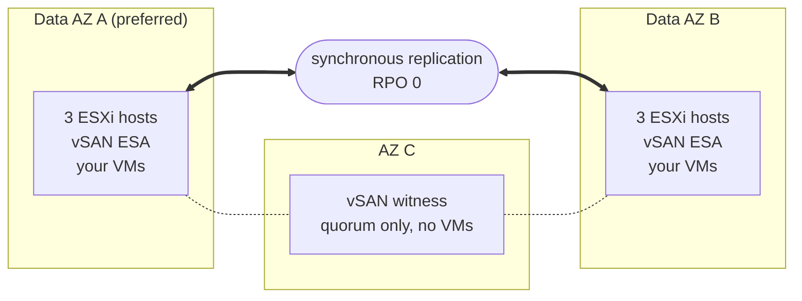

## Objective

**This guide presents the architecture of Private VCF as-a-Service Stretched Cluster 3-AZ: how the cluster is spread across three Availability Zones, how your data is replicated and how the platform reacts when a component fails.**

{/* Re-check after December 2026: the Beta opening date below will be past. */}

:::info
Private VCF as-a-Service Stretched Cluster 3-AZ is in Beta. The Beta opens in December 2026 to a limited number of Enterprise customers. Find out more on the [OVHcloud Labs page](https://labs.ovhcloud.com/en/vmware-3az/).
:::

## The stretched cluster principle

Private VCF as-a-Service is a VMware Cloud Foundation (VCF) 9.1 platform built on hardware dedicated to you and operated by OVHcloud.

In its Stretched Cluster 3-AZ form, your Workload Domain runs **a single vSphere cluster whose hosts are spread across two Availability Zones (AZs)** of the Paris 3-AZ region. These are the **data AZs**: both run your virtual machines and both hold a complete copy of your data. A **third AZ hosts a witness**, which takes part in the quorum only.

Storage relies on **vSAN ESA**, configured by OVHcloud. vSAN replicates your data **synchronously** between the two data AZs: a write is acknowledged only once it is stored in both. Both AZs therefore always hold the same data, and losing one of them loses no data: **RPO = 0 by design**, handled by the infrastructure.

:::warning
RPO 0 requires mirroring between the two data AZs. Keep your VMs on a vSAN storage policy that mirrors their data across both sites: a VM placed on a policy that keeps its data in a single AZ is not replicated, and is not protected against the loss of that AZ.
:::

When a data AZ fails, **vSphere HA automatically restarts its virtual machines in the surviving AZ**, with no intervention on your side.

## Architecture

Your Workload Domain runs a single vSphere cluster, stretched over the two data AZs of the Paris 3-AZ region. The witness sits in the third AZ.

| Component | Where | Role |
|---|---|---|
| Data AZ A (preferred) | First data AZ | Runs your VMs and holds a full copy of your data. If the two data AZs lose contact, it keeps the quorum. |
| Data AZ B | Second data AZ | Runs your VMs and holds a full copy of your data. |
| Witness | Third AZ | Arbitrates the quorum between the data AZs. It stores no VM data and runs no VMs. |
| ESXi hosts | Data AZs | The base configuration has 6 identical vSAN hosts, 3 in each data AZ. The cluster grows by pairs of hosts, one in each data AZ, so that both AZs keep the same capacity. |

OVHcloud assigns the AZs: you get two distinct data AZs and a witness in the third AZ, but you do not choose which AZ plays which role.

## What happens when something fails

The stretched cluster reacts on its own to the loss of a host, a data AZ, the witness or the link between the data AZs.

| What fails | What happens | Data lost | Your action |
|---|---|---|---|
| A host | vSphere HA restarts its VMs on the other hosts. | None | None |
| An entire data AZ | Its VMs restart automatically in the surviving AZ. | None | None |
| The witness AZ | Both data AZs keep running and keep the quorum. | None | None |
| The link between the data AZs | The preferred AZ keeps the quorum; the VMs of the other AZ restart in the preferred AZ. | None | None |

These are the standard behaviours of a vSAN stretched cluster, as documented by Broadcom.

:::warning
A VM restarted by vSphere HA is not moved live: it boots again in the surviving AZ, and its applications start again with it. Each application's recovery time depends on its operating system and configuration.
:::

### Plan capacity for the loss of an AZ

For the VMs of a failed data AZ to restart, the surviving AZ needs enough free CPU and memory to run them. Size your workloads so that a single data AZ can run all the VMs that must keep running.

## What the stretched cluster does not replace

The stretched cluster protects your workloads against the loss of infrastructure. It is **not a backup and not a disaster recovery plan**:

- synchronous replication copies everything to both data AZs at once, including a deleted file, corrupted data or files encrypted by ransomware;
- your workloads run in one single cluster: if that cluster is compromised, there is no second copy of it to restart from.

Keep a backup and, if your business needs it, a disaster recovery solution outside the cluster. The Beta does not include a managed backup service.

## What is included around the cluster

| Area | What you get |
|---|---|
| Operations | vSAN ESA comes pre-configured, and OVHcloud runs VCF upgrades and patching. |
| Network | VCF Networking is included. You can order the free **Edge Services** extension, or the **vDefend** option for distributed firewalling, with your Workload Domain. |
| vRack | Optional. Your Workload Domain is delivered without a vRack: you attach a vRack you already have, or order a new one, after delivery. |
| Identity | You sign in through OVHcloud IAM and SSO: no local accounts, and an admin role on your Workload Domain from delivery. |
| Availability | The platform is designed for 99.999% availability. |

## Go further

[Private VCF as-a-Service 3-AZ product page](/links/hosted-private-cloud/private-vcf-aas-3-az)

[Private VCF as-a-Service Stretched Cluster 3-AZ on OVHcloud Labs](https://labs.ovhcloud.com/en/vmware-3az/)

[[fragment:professional-services]]

Join our [community of users](/links/community).
