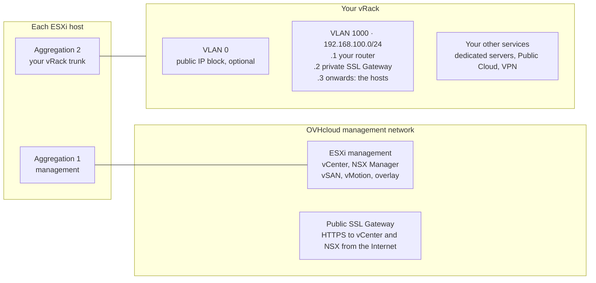

## Objective

**This guide walks you through the network configuration of your Private VCF as-a-Service cluster after delivery: the vRack, the VLAN, the subnet, the host addresses and the public IP block, and what each of these choices implies.**

Your Workload Domain is delivered: vCenter, NSX Manager and your ESXi hosts are running, and you reach vCenter and NSX through the **public SSL Gateway**. To connect the cluster to **your OVHcloud private network** (Dedicated Servers, Public Cloud, other private clouds, VPN), one step remains: the network configuration, in the OVHcloud Control Panel, in the <code className="action">Network</code> tab of the cluster.

:::info
The network configuration is not needed for vCenter and NSX to work: you can do it later. Until then, however, **your VMs have no Internet access** and no access to your other OVHcloud services: the vRack, with a public IP block or your own router, is what gives them a way out.

Choose the VLAN and the subnet carefully: changing the subnet later changes your hosts' addresses. Read at least the "[The VLAN and the subnet](#vlan-and-subnet)" section before you confirm.

:::

## Requirements

- A delivered [Private VCF as-a-Service](/links/hosted-private-cloud/private-vcf-aas-3-az) Workload Domain.

[[cpnav:privatecloud-private-vcf]]

## Instructions

### What you configure

Each ESXi host has two network links. The first one, for management, belongs to OVHcloud; the second one is the one you configure here, and it lands on your vRack.

The cluster's subnet (here on VLAN 1000) carries the addresses of the hosts and of the private SSL Gateway. Your VMs use the other VLANs of the trunk, as you see fit.

| Field | Status | What it decides | Can it be changed later? |
|---|---|---|---|
| **vRack** | Required | The OVHcloud private network the cluster is connected to, and therefore what your VMs and hosts can reach. | Yes, but it is a full reconfiguration. |
| **VLAN ID** | Required | The VLAN of your vRack on which the hosts get their address. Between 1 and 4094. | Yes, if the cluster is alone on its subnet. |
| **Subnet** | Required | The IP network of this VLAN. Its first address is your router. | Yes: the hosts change address. |
| **Cluster addresses** | Automatic by default | The addresses the hosts and the private SSL Gateway take in this subnet. | Yes, at any time. |
| **IP block** | Optional | Public addresses, attached to VLAN 0 of the vRack, to expose your NSX edges. | Yes, it can be added later. |

Without network configuration, your cluster:

- works: vCenter and NSX are reachable through the public SSL Gateway;
- is connected to no vRack: your VMs reach neither your servers nor your other OVHcloud services. Your NSX (overlay) segments work without a vRack;
- **gives your VMs no Internet access**: there is neither a public IP block nor a router to send them out through;
- has no private SSL Gateway: vCenter and NSX are reachable through the public SSL Gateway only.

### The vRack

The [vRack](/links/network/vrack) is the OVHcloud layer 2 private network. It connects your services to each other, across datacentres, without going through the Internet.

| Your situation | Recommended choice |
|---|---|
| You already have OVHcloud services the cluster must reach (Dedicated Servers, Public Cloud, Hosted Private Cloud, etc.) | The **vRack these services are on**. |
| You want two clusters or two Workload Domains to communicate privately | The **same vRack** for both. A vRack can serve several clusters and several Workload Domains. |
| You want, on the contrary, to isolate this cluster from everything else | A **dedicated vRack**, ordered from the same screen (<code className="action">Order a new vRack</code>). |
| You have no vRack | Order one from the same screen. |

What this choice implies:

- a cluster is on **one** vRack at a time; the clusters of one Workload Domain can each be on a different vRack;
- everything on this vRack shares the same layer 2 domain: separation is done by your VLANs and subnets;
- the whole vRack reaches the second aggregation of each host, as a trunk: all its VLANs are available to your VMs. Create portgroups in vCenter, tagged on one VLAN, or use the full trunk (`<cluster>-vrack-trunk`).

What it does not change:

- the OVHcloud management network (vCenter, NSX, vSAN, vMotion) stays on the first aggregation, managed by OVHcloud;
- the public SSL Gateway stays in place and keeps working;
- the VLANs and NSX segments you create afterwards stay under your sole management: OVHcloud does not step in.

:::warning
Changing the vRack later clears the cluster's VLAN, subnet and addresses: you enter them again, and the hosts are detached from the old vRack before being attached to the new one. All the portgroups of the vRack switch, including the ones you created, are deleted: the change is refused as long as a VM is connected to one. Migrate **all** your VMs off this switch first. Choose your final vRack now if you can.

:::

### The VLAN and the subnet {#vlan-and-subnet}

This is the choice that matters most. OVHcloud places the cluster's hosts on this subnet, in this VLAN of your vRack. Default proposal: **VLAN 1000** and **`192.168.100.0/22`**.

| Rule | Detail |
|---|---|
| **VLAN between 1 and 4094** | VLAN 0 is reserved for the public IP block. |
| **Gateway = first address** | The first usable address of the subnet (`.1`) is taken as **your router**. A router placed elsewhere in the subnet is not supported. |
| **Enough addresses** | The subnet must hold your router, the private SSL Gateway and every host of the cluster. We recommend a `/24` or larger. |
| **No platform range** | Refused if it overlaps `10.0.0.0/8`, `172.16.0.0/16`, `100.64.0.0/15`, `100.68.0.0/14` or `198.18.0.0/15`, used by the OVHcloud infrastructure. |
| **No overlap on the vRack** | On one vRack, two subnets are either identical and on the same VLAN (they are then shared), or disjoint. The same subnet cannot be on two VLANs of one vRack. |
| **No overlap within the domain** | The subnets of the clusters of one Workload Domain do not overlap, even on different vRacks. The only exception is the same subnet on the same vRack and VLAN: it is then shared. |
| **Unique in your network** | You confirm that this subnet is used nowhere else (remote sites, VPN, other clouds). OVHcloud cannot check this for you. |

#### Which size?

A subnet can be shared by several clusters and several Workload Domains: plan generously.

| Subnet | Usable addresses | Rough capacity |
|---|---|---|
| `/27` | 30 | One small cluster, nothing else |
| `/24` | 254 | Several clusters |
| `/22` (default) | 1022 | Several domains and their growth |

What this choice implies:

- `.1` is reserved for your router: OVHcloud never assigns it;
- the hosts and the private SSL Gateway take their addresses here. The private SSL Gateway has no route: it only answers machines on this subnet;
- the rest of the subnet, outside the addresses OVHcloud reserves, is yours: you can place your own machines there;
- your VMs do not have to be on this VLAN: use the other VLANs of the trunk and your NSX segments;
- changing the subnet later changes the hosts' addresses.

### The cluster's addresses

Two modes: <code className="action">Automatic</code>, recommended, where OVHcloud chooses the addresses; or <code className="action">I choose the addresses</code>, if your addressing plan requires it.

#### Automatic mode

OVHcloud takes the first free addresses of the subnet and assigns them in order: first the private SSL Gateway if the cluster is the first of its domain on this subnet, then the hosts. A host added later takes the next free address.

Example: first cluster of 6 hosts on `192.168.100.0/24`, VLAN 1000.

| Addresses | Use |
|---|---|
| `.1` | Your router |
| `.2` | Private SSL Gateway |
| `.3` to `.8` | The 6 hosts |
| `.9` to `.254` | Free: next hosts and clusters, or your own machines |

#### "I choose the addresses" mode

A single input field accepts entries in any of the formats below, separated by commas or line breaks. Overlapping or adjacent ranges are merged.

| Format | Example | Means |
|---|---|---|
| Address | `192.168.100.60` | This address |
| Range | `192.168.100.250-192.168.100.253` | Both ends included |
| Short range | `192.168.100.100-110` | `.100` to `.110` |
| CIDR | `192.168.100.64/28` | All its addresses |

- **Minimum**: number of hosts + 2 spare addresses, + 1 if the cluster is the first of its Workload Domain on this subnet (the private SSL Gateway then takes the first address of your list).
- **Refused**: an address outside the subnet, the network address, the gateway, the broadcast address, or an address already held by another cluster or an SSL Gateway.
- **No automatic extension**: when your addresses run out, add more by editing the cluster's ranges.

:::warning
In both modes, the ranges reserved by OVHcloud are reserved for the hosts and the private SSL Gateway: **do not place any machine there**, even a powered-off one. The rest of the subnet is yours.

:::

### The public IP block (optional)

An IP block gives your NSX edges public access.

| Your situation | Choice |
|---|---|
| Your NSX edges need public access | Choose an IP block you own, or order one from the screen. |
| Your Internet access already goes through another device on your vRack (firewall, router) | No IP block. |
| You do not know yet | No IP block: you can add it later from the <code className="action">Network</code> tab. |

- The block is automatically attached to **VLAN 0** (untagged) of your vRack, whether the vRack already existed or was ordered for the occasion.
- With the default portgroups, an untagged portgroup gives access to VLAN 0 in vCenter.
- An ordered block follows the usual OVHcloud IP block lead times and billing.
- VLAN 0 is reserved for the IP block: the cluster's VLAN cannot be 0.
- The block is attached to the vRack, not to the cluster.

Example with a `/24` block:

| Address | Use |
|---|---|
| `.0` | Network address |
| `.1` to `.253` | Free for your NSX edges and VMs |
| `.254` | Default gateway |
| `.255` | Broadcast |

Unlike Hosted Private Cloud, no address is taken by HSRP.

### After you confirm: what is created

You confirm; OVHcloud attaches the vRack to the cluster, host by host.

| # | Step | For you |
|---|---|---|
| 1 | Your vRack replaces the OVHcloud maintenance network on the second aggregation of each host. | The first aggregation, for management, is not touched. |
| 2 | A dedicated distributed switch is created in vCenter: `<cluster>-vrack-vds01`. | The VCF switch (`<cluster>-vds01`) stays untouched. Do not move the uplinks of either switch: `<cluster>-vds01` carries management, vMotion and vSAN, `<cluster>-vrack-vds01` your vRack. |
| 3 | Each host gets a VMkernel adapter at its address, on the `<cluster>-vrack-vlan<VLAN>` portgroup. | The hosts answer on their subnet address. |
| 4 | The private SSL Gateway is deployed, unless your Workload Domain already has one on this network. | vCenter and NSX become reachable from the cluster's subnet. |

#### Ready-to-use portgroups

Unless you disabled them during the configuration, the vRack switch comes with portgroups so you can connect your VMs straight away:

| Portgroup | VLAN |
|---|---|
| `<cluster>-vrack-public-vlan0` | Untagged: your public IP block |
| `<cluster>-vrack-vlan1` to `<cluster>-vrack-vlan10` | 1 to 10, one per VLAN. If the cluster's VLAN is in this range, its portgroup is the one of the last row: there is a single `<cluster>-vrack-vlan<VLAN>`. |
| `<cluster>-vrack-trunk` | 0 to 4094, as a trunk |
| `<cluster>-vrack-vlan<VLAN>` | The cluster's VLAN: carries the hosts and the private SSL Gateway |

You can freely create other portgroups and NSX segments. However, **a portgroup with a VM connected to it is never deleted**: a network change or a detachment that would delete it is refused, with the list of the VMs involved.

#### The private SSL Gateway

It is the vRack-side counterpart of the public SSL Gateway: a VM managed by OVHcloud, which gives access to vCenter and NSX from your OVHcloud private network (vRack), with no public address.

| Property | Value |
|---|---|
| How many | One per Workload Domain **and** per network (subnet + VLAN). Two clusters of a domain on the same network share it; a cluster on another network gets a second one. |
| Address | `.2` for the first domain of a subnet in automatic mode, otherwise the first free address of the subnet or the first of your list. |
| Access | From the machines of the cluster's subnet only: the gateway has no route. |
| Services | HTTPS to vCenter and NSX; DNS. |
| Names | The same URLs as on the public side for vCenter and NSX; only the DNS answer differs. |

#### One action on your side: DNS

The private SSL Gateway answers the names of vCenter, NSX and **each of your ESXi hosts** (one name per host, added or removed with it), with addresses reachable from the vRack:

| Name | Resolves to |
|---|---|
| `vcenter.vcf<id>.<dc>.enterprise.ovhcloud.com` | The private SSL Gateway |
| `nsx.vcf<id>.<dc>.enterprise.ovhcloud.com` | The private SSL Gateway |
| `host<id>.<dc>.enterprise.ovhcloud.com` | The host's vRack address |

:::tip
On your resolvers, add a **conditional forwarder** to the private SSL Gateway's address, so that these names resolve to the private addresses. The resolver querying the gateway must be on the cluster's subnet.

- With a single private SSL Gateway on your network, forward the whole `<dc>.enterprise.ovhcloud.com` zone to it.
- With several, forward each domain's zone, `vcf<id>.<dc>.enterprise.ovhcloud.com`, and each `host<id>` name to the gateway of its Workload Domain. A gateway only answers the names of its own domain: it sends the others to the OVHcloud public DNS.

:::

### Changing the configuration

Everything remains editable from the <code className="action">Network</code> tab. Here is what each change does.

| If you | What happens | Impact on your VMs |
|---|---|---|
| **add a host** | It takes the first free address of the cluster's ranges; if none is left, widen the ranges first. Its name is added to the private SSL Gateway's DNS. | None. |
| **remove a host** | Its address is released and its name removed from the private SSL Gateway's DNS. | None on the network. |
| **edit the cluster's addresses** | You can shrink, widen or replace the ranges, as long as they stay inside the subnet, do not overlap another cluster and still hold every host's address plus 2 free addresses. | None. |
| **change the VLAN or the subnet** (same vRack) | The hosts are moved in place, without a detachment; the private SSL Gateway is rebuilt on the new network; the old portgroup is deleted. Changing only the VLAN is refused if other clusters share the subnet. | Refused if a VM is connected to the old portgroup. The other portgroups stay. |
| **change the vRack** | Full reconfiguration: the VLAN, the subnet and the addresses are cleared and must be entered again; the hosts are detached from the old vRack, then attached to the new one. The switch and **all** its portgroups, including the ones you created, are deleted, then the default portgroups are created again. | Refused as long as a VM is connected to a portgroup of the switch: migrate all your VMs first. |
| **detach the vRack** | The switch, **all** its portgroups (including the ones you created) and the hosts' adapters are deleted; so is the private SSL Gateway, if no other cluster of the domain uses this network. | Refused as long as a VM is connected to a portgroup of the switch. |

Several clusters, several domains:

- another cluster can take the same vRack, the same VLAN and the same subnet: its hosts take the next free addresses;
- another Workload Domain can share the subnet: it has its own private SSL Gateway;
- a cluster can also take another subnet, on the same VLAN (without overlap) or on another one: its domain then gets one more private SSL Gateway.

### Refusal messages

| Message (in substance) | What to do |
|---|---|
| VLAN outside 1 to 4094 | Choose a VLAN in this range; 0 is reserved for the IP block. |
| Subnet too small | Take a larger subnet; ideally a `/24` or larger. |
| Subnet conflicting with the platform | Stay out of `10.0.0.0/8`, `172.16.0.0/16`, `100.64.0.0/15`, `100.68.0.0/14` and `198.18.0.0/15`. |
| Overlap with another subnet of the vRack | Use exactly the same subnet, on the same VLAN, to share it; otherwise a disjoint subnet. |
| Subnet already on another VLAN of the vRack | Use the VLAN it is already on, or another subnet. |
| Overlap with another subnet of the domain | Choose a subnet disjoint from those of the other clusters of the Workload Domain. |
| Address already in use | It belongs to another cluster or to an SSL Gateway: remove it from your list. |
| Not enough addresses | You need at least as many addresses as hosts, plus 2 (plus 1 for the SSL Gateway of the domain's first cluster). |
| No free address left | Free up addresses, or take another subnet. |
| A VM is connected to the portgroup | Disconnect or migrate the VMs named in the message, then try again. |

## Go further

[Private VCF as-a-Service - 3-AZ Stretched Cluster concepts](/guides/hosted-private-cloud/powered-by-vmware/private-vcf/3az-stretched-cluster-concepts)

[Private VCF as-a-Service 3-AZ product page](/links/hosted-private-cloud/private-vcf-aas-3-az)

[[fragment:professional-services]]

Join our [community of users](/links/community).
