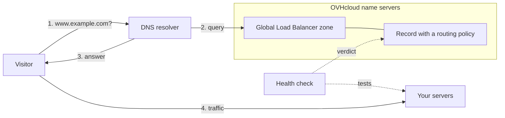

## Objective

This guide takes you from no Global Load Balancer zone to a domain answered by routing policies: the objects Global Load Balancer uses, the limits that apply to them, and the Console steps to create a zone, point your domain at its name servers, create a health check and add a record with a routing policy.

:::warning
Global Load Balancer is in **alpha**, for testing only: do not use it for production workloads. The alpha is open to the first 100 customers and is free to use. Screens and behaviour may change before general availability.
:::

**In this guide, you will learn how to:**

- Understand the objects Global Load Balancer creates and the limits that apply to them.
- Open Global Load Balancer in the OVHcloud Console.
- Create a Global Load Balancer zone for a domain or a subdomain.
- Point your domain at the zone's name servers, whether the domain is registered with OVHcloud or elsewhere.
- Create a health check for one of your servers.
- Add a record with a routing policy, and check what was created.

## Requirements

- An OVHcloud account with access to the Global Load Balancer alpha. Without it, the **Global LB** entry is not shown in the **DNS** section of the menu.
- Access to the <ManagerLink to="/">OVHcloud Console</ManagerLink>.
- A domain name, registered with OVHcloud or with another registrar, whose DNS servers you can change, or a subdomain of a domain whose DNS zone you can edit.
- At least one server reachable from the internet, with a public IP address or a host name.

## Key concepts <a name="concepts"></a>

Global Load Balancer uses DNS to distribute your domain's traffic across your servers. The OVHcloud name servers host a **zone** for your domain, and each **record** of that zone carries a **routing policy** and, where it needs one, a **health check**. The same name then answers each visitor according to the policy, and leaves out the servers whose health check fails.

Global Load Balancer only answers DNS queries: your visitors connect straight to your servers, and it never carries their traffic.



- **Zone**: a Global Load Balancer zone answers for one domain and everything beneath it. It is created, not ordered: it has no subscription to renew. It holds A, AAAA, CNAME, MX and TXT records.
- **Name servers**: the DNS servers that answer for the zone on the internet. Your domain uses the zone only once its DNS delegation points to them. Until then, resolvers do not query the zone and its records are not resolved.
- **Record**: a name and a type, such as `www` and `A`, with one or several targets and a TTL. The TTL is how long resolvers keep an answer before they ask again.
- **Group and entries**: records with the same name, type and routing policy form a group, shown on one row of the records table. Each record of a group is an **entry**, named by its **Entry name** (for example `primary-dc`), with its own target and rule.
- **Routing policy**: the rule a group uses to choose its answer. Six policies are available: **Simple**, **Weighted**, **Failover**, **Geolocation**, **Multivalue** and **Geoproximity**. Each is described in [Global Load Balancer - Routing policies and health checks](/guides/network/global-load-balancer/global-load-balancer-routing-policies).
- **Health check**: a test that regularly checks one of your servers. When it finds the server unavailable, the entries that use it leave the answers and the other entries take over. An entry without a health check always counts as available. A health check belongs to your account, not to a zone: one check can be used by records in several zones.

### Key limits <a name="key-limits"></a>

- A zone name has at least two parts, such as `example.com`, and up to 253 characters. Each part contains letters, digits and hyphens only, and cannot start or end with a hyphen. A domain can have one Global Load Balancer zone.
- A zone is deleted empty: delete its records first. A health check cannot be deleted while a record uses it.
- A health check tests a public IP address or host name: private and local addresses are refused, because the test runs from outside your network.
- During the alpha, health checks run from a single location: a network problem between that location and your server can look like a server failure.
- Every record of a name and type uses the same routing policy and the same TTL.

## Instructions

This section covers the whole first setup, in the order the Console expects it.

**Contents:**

- [Step 1 - Open Global Load Balancer](#open)
- [Step 2 - Create a zone](#zone)
- [Step 3 - Point your domain at the zone's name servers](#delegate)
- [Step 4 - Create a health check](#health-check)
- [Step 5 - Add a record](#record)
- [Step 6 - Verify](#verify)

### Step 1 - Open Global Load Balancer <a name="open"></a>

1. Log in to the <ManagerLink to="/">OVHcloud Console</ManagerLink>.
2. Select <code className="action">Bare Metal Cloud</code>, <code className="action">Hosted Private Cloud</code> or <code className="action">Public Cloud</code>.
3. In the menu, open the **DNS** section and click <code className="action">Global LB</code>. The entry carries an **Alpha** tag.

The **Global Load Balancer** page opens, with two tabs: <code className="action">Public zones</code> and <code className="action">Health checks</code>. An account with no Global Load Balancer zone sees a <code className="action">Create a Global Load Balancer zone</code> button.

### Step 2 - Create a zone <a name="zone"></a>

The zone is the first object to create: every record belongs to a zone.

1. In the <code className="action">Public zones</code> tab, click <code className="action">Create a Global Load Balancer zone</code>.
2. In **Domain name**, enter the domain the zone answers for, for example `example.com`. To test Global Load Balancer without changing how your domain answers, enter a subdomain instead, for example `glb.example.com` (see [Step 3](#delegate)).
3. Click <code className="action">Create the zone</code>.

The zone is created at once, with no order to place, and empty. Its page lists, in the **Resolution** card, the **Name servers** assigned to it. Copy them: you need them in the next step.

### Step 3 - Point your domain at the zone's name servers <a name="delegate"></a>

The zone answers only once your domain points to its name servers. Choose the case that matches your domain.

:::warning
During the alpha, use Global Load Balancer only to test, on a domain whose website and email you can do without: the domain may stop resolving as long as it uses the zone's name servers. To keep your domain answering as before, use a subdomain (case 3).
:::

**Case 1 - Your domain is registered with OVHcloud**

1. On the zone's page, click <code className="action">Use these servers for my domain</code>. The button is shown when the account holds the domain and the domain does not use the zone's name servers yet.
2. The dialog lists the **Current DNS servers** and the **New DNS servers**. Read the alpha warning, then tick the box that confirms the zone is for testing only.
3. Click <code className="action">Use these servers</code>.

The change is requested for the domain. It can take a few hours before every resolver uses the new servers.

**Case 2 - Your domain is registered with another registrar**

At your registrar, replace the domain's DNS servers with the name servers the zone shows in its **Resolution** card. The change can take a few hours to reach every resolver.

**Case 3 - Test on a subdomain**

A subdomain lets you test Global Load Balancer while the rest of your domain keeps answering from its current DNS zone. Create the Global Load Balancer zone for the subdomain, for example `glb.example.com`, as in [Step 2](#zone). Then, in your domain's current DNS zone, add one NS record per name server of the Global Load Balancer zone, for the subdomain:

```text
glb.example.com.    3600    IN    NS    <name server 1>
glb.example.com.    3600    IN    NS    <name server 2>
```

Add one line per name server the zone shows. If your domain's DNS zone is hosted by OVHcloud, add the records from <code className="action">Public zones</code>, in the **DNS** section of the menu. Queries for the subdomain and its names are then answered by the Global Load Balancer zone, and the rest of the domain is not affected.

### Step 4 - Create a health check <a name="health-check"></a>

A health check regularly tests one of your servers. Create one for each server whose availability must decide the answers.

1. Open the <code className="action">Health checks</code> tab and click <code className="action">Create a health check</code>.
2. In **Name**, enter a name that helps you find the check in the list.
3. In **Protocol**, select how the server is tested: **HTTP**, **HTTPS**, **HTTP with text check**, **HTTPS with text check**, **TCP**, **ICMP (ping)** or **DNS**. The protocol cannot be changed once the check exists.
4. Enter the server to test, in **IP address or host name**: its public IP address or its host name. **ICMP (ping)** tests an IP address only.
5. Fill in the fields the protocol needs:
    - **Port**: pre-filled with 443 for HTTPS and 80 for HTTP, 53 for DNS. ICMP does not use one.
    - **Page to test**: for HTTP and HTTPS, the path requested, pre-filled with `/health`.
    - **Expected text**: for the text checks, the text the page must contain for the server to count as available.
    - **Name to look up** and **Record type**: for DNS, the question the server must answer.
6. In **Test frequency**, select **Every 30 seconds** or **Every 10 seconds**.
7. In **Failed tests allowed**, enter how many failed tests in a row make the server unavailable, from 1 to 10. A lower number reacts faster, but also to a single slow answer.
8. Click <code className="action">Create</code>.

The check reports a verdict within a couple of test intervals. Until then, it shows **Not tested yet**.

> [!TIP]
> You can also create a health check from the record form, in [Step 5](#record): the check is created and chosen for the record, and the record itself is saved when you submit it.

### Step 5 - Add a record <a name="record"></a>

A record tells the internet where to send the visitors of a name. Here, its routing policy and health checks choose the answer.

1. Open the zone: in the <code className="action">Public zones</code> tab, click its name.
2. In the **Records** card, click <code className="action">Create a record</code>.
3. Select the record **Type**: A, AAAA, CNAME, MX or TXT.
4. In **Subdomain**, enter the name, for example `www`. Leave it empty for the zone's own name.
5. Enter the **Target**: for an A record, the server's IPv4 address. Click <code className="action">Add a value</code> to add another target.
6. Set the **TTL**, pre-filled with 300 seconds. Every record of the same name and type shares one TTL: a change here changes it for all of them.
7. In **Routing policy**, select the policy. Only the policies the record type can use are listed: Failover, Geolocation, Multivalue and Geoproximity apply to A and AAAA records only.
8. For every policy except Simple, enter an **Entry name**, for example `primary-dc`, and the policy's own fields: the **Weight** for Weighted, the **Role** (**Primary** or **Secondary**) for Failover, the **Scope** for Geolocation, the **Place** for Geoproximity.
9. In **Health check**, select the check that decides whether this entry is available, or **None**. A Failover primary needs a health check. Without one, an entry always counts as available, even during an outage.
10. Click <code className="action">Add</code>.

The record applies right away and reaches every name server within a minute. Resolvers keep their previous answer for the record's TTL: count up to that long before every visitor sees the change.

To add another entry to the same group, for example the secondary of a failover or another weighted target, click <code className="action">Create a record</code> again with the same subdomain and type. The routing policy and TTL are then those of the group.

### Step 6 - Verify <a name="verify"></a>

Check the objects in the Console, then query the name.

| Check | Where | Expected |
|---|---|---|
| The zone exists | <code className="action">Public zones</code> tab | One row, with its number of **Records** |
| The domain uses the zone | Your registrar, or the domain's page in **Domains** | The DNS servers are the zone's **Name servers** |
| The health check has a verdict | <code className="action">Health checks</code> tab | The server's status, and its **Last test** |
| The record exists | Zone page, **Records** card | One row per group, with its **Routing** |
| The record answers | A terminal | `dig www.example.com` returns the target the policy chose |

On a group's page, the resolution flow shows which answer a visitor gets right now, as a diagram or step by step: which entries are available, which are left out, and why.

```console
$ dig +short www.example.com A
203.0.113.10
```

:::info
Health verdicts come from a single test location during the alpha. If a server shows as unavailable while it answers, check that your firewall lets the tests in.
:::

## Go further <a name="go-further"></a>

- [Global Load Balancer - Routing policies and health checks](/guides/network/global-load-balancer/global-load-balancer-routing-policies)
- [Everything you need to know about DNS servers](/guides/web-cloud/domains/dns-server-general-information)
- [Editing the DNS servers for an OVHcloud domain name](/guides/web-cloud/domains/dns-server-edit)
- [Creating an OVHcloud DNS zone for a subdomain](/guides/web-cloud/domains/dns-zone-create-subdomain)

Join our [community of users](/links/community).
