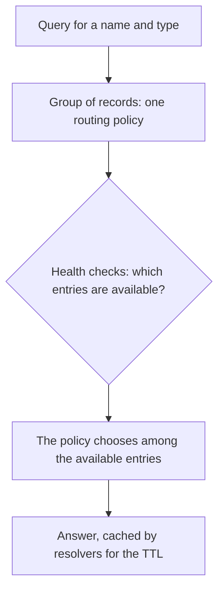

## Objective

This guide explains how Global Load Balancer chooses the answer to a DNS query: the six routing policies, what each one does and accepts, how health checks decide whether a server is available, and the rules that apply to a group of records. **It is intended for readers who have created a zone and want to choose the right policy for their records.**

:::warning
Global Load Balancer is in **alpha**, for testing only: do not use it for production workloads. Screens and behaviour may change before general availability.
:::

## Overview

Global Load Balancer answers DNS queries for your zone, and chooses each answer according to the record's routing policy and the health of your servers. It does not carry your visitors' traffic: once the resolver has the answer, the visitor connects straight to the server.

Three behaviours apply to every policy:

- **The location is the resolver's.** Geolocation and Geoproximity place a query by the address of the resolver that asks, not the visitor's. A visitor who uses a resolver far away can be answered for the resolver's location.
- **Answers are cached for the TTL.** A change, including a server leaving the answers, reaches visitors as resolvers' cached answers expire. A short TTL reacts faster.
- **A group fails open.** When every entry of a group is unhealthy, the group answers anyway rather than answering nothing.

## Routing policies

A routing policy is chosen when the record is created and cannot be changed afterwards. To use another policy, delete the records of this name and type, then create them again with the new policy. Until they are recreated, the name gives no answer for this type.

| Policy | Answers with | Record types | Health check |
|---|---|---|---|
| **Simple** | Always the same answer: every target | A, AAAA, CNAME, MX, TXT | Not accepted |
| **Weighted** | One entry, drawn by weight | A, AAAA, CNAME, MX, TXT | Optional |
| **Failover** | The primary, or the secondary when the primary is down | A, AAAA | Required on the primary |
| **Geolocation** | The entry whose scope matches the query's origin | A, AAAA | Optional |
| **Multivalue** | Every available target at once | A, AAAA | Optional |
| **Geoproximity** | The closest target | A, AAAA | Optional |

Every policy except Simple names each entry with an **Entry name**, for example `primary-dc`, of up to 128 characters.

### Simple

Simple always gives the same answer: every target of the record. It is plain DNS, with no health filtering: a health check cannot be attached. A name and type has one Simple record: to add a target, edit the existing record.

Use it for records that do not need routing, such as an MX or a TXT record.

### Weighted

Weighted shares the visitors between the entries by weight. Each entry's share is its weight over the group's total. With weights 70 and 30, 70 visitors out of 100 go to the first entry.

| Field | Values |
|---|---|
| **Weight** | 0 to 255. At 0, the entry gets no visitors but stays configured. |

When an entry is unhealthy, it leaves the draw and the remaining entries absorb its share. An entry without a health check always counts as available: in a group that mixes entries with and without a health check, the entries without one keep receiving their share during an outage.

Use it to roll out a new version on part of your traffic, then raise its weight step by step, or set it to 0 to roll back.

### Failover

Failover sends everyone to the primary, and switches to the secondary when the primary's health check finds it unavailable. It switches back on its own when the primary recovers.

| Field | Values |
|---|---|
| **Role** | **Primary** or **Secondary**. A group has one primary and one secondary. The role cannot be changed once the record exists. |
| **Health check** | Required on the primary. Recommended on the secondary, so that a broken secondary is detected. |

When both the primary and the secondary are unhealthy, the primary answers. While the primary's health check is suspended, nothing switches the traffic to the secondary, even during an outage.

Use it to keep a standby region ready to take over when your main region goes down.

### Geolocation

Geolocation answers by where the query comes from. Each entry has a **Scope**:

| Scope | Matches |
|---|---|
| **Country** | Every query from this country. A country takes priority over its continent. |
| **Continent** | Every query from this continent. |
| **Everywhere else** | Every query no other scope matches. A group holds at most one. |

The most specific matching scope wins: a country first, then its continent, then **Everywhere else**. When an entry is unhealthy, its queries go to the **Everywhere else** entry. Without an **Everywhere else** entry, a query that matches no scope gets no answer.

Use it to serve each continent or country from its own region.

### Multivalue

Multivalue gives every available target at once, and the visitor's device picks one. Each entry holds exactly one target, so that each can be judged by its own health check. An unhealthy entry leaves the answer. When every entry is unhealthy, they are all returned.

Use it to let clients retry on another server straight away, instead of waiting for a cached answer to expire.

### Geoproximity

Geoproximity sends each visitor to the closest location. Each entry has a **Place**: an OVHcloud location, which fills in its coordinates, or **Custom coordinates** (**Latitude** from -90 to 90, **Longitude** from -180 to 180). Each entry holds exactly one target.

Entries at the same position form one location, and are answered together. When a location has no healthy entry, its queries go to the next closest location.

Use it when you serve visitors from several sites and want each to reach the nearest one.

## Health checks

A health check regularly tests one of your servers. When it finds the server unavailable, every entry that uses it leaves the answers. A health check belongs to your account, not to a zone: one check can be used by records in several zones, and its page lists the records that use it.

### Protocols

The protocol decides how the server is tested. It cannot be changed once the check exists.

| Protocol | Needs | The server is available when |
|---|---|---|
| **HTTP** | IP address or host name, port (80), page to test | The request succeeds |
| **HTTPS** | IP address or host name, port (443), page to test | The request succeeds |
| **HTTP with text check** | Same as HTTP, plus the expected text | The request succeeds and the page contains the text |
| **HTTPS with text check** | Same as HTTPS, plus the expected text | The request succeeds and the page contains the text |
| **TCP** | IP address or host name, port | A connection is established |
| **ICMP (ping)** | IP address | The server answers a ping |
| **DNS** | IP address or host name, port (53), name to look up, record type | The server answers the DNS question |

The target is a public IPv4 or IPv6 address, or a host name: private and local addresses are refused. With an HTTP or HTTPS check, you can enter both an IP address and a host name: the test contacts the IP address and presents the host name to it.

### How a server is judged

| Setting | Values | Effect |
|---|---|---|
| **Test frequency** | Every 10 or 30 seconds | How often the server is tested. |
| **Failed tests allowed** | 1 to 10 (3 by default) | How many failed tests in a row make the server unavailable. A lower number reacts faster, but also to a single slow answer. |

The check page shows the server's status, the time of the **Last test** and the **Reason for the last failure**. A new check shows **Not tested yet** until its first verdict. An entry whose health check has no verdict yet keeps answering.

### Invert and suspend

Two settings change how a check affects your records:

- **Invert the result**: the server is considered available when the test fails, and unavailable when it succeeds. Use it as a switch to take a server out of the answers on purpose, for example during maintenance.
- **Suspend the check**: the tests stop. The records that use the check keep sending visitors to the server, as if it were available, even if it stops answering.

A health check cannot be deleted while a record uses it. To delete it, replace it with another health check in the records that use it, or remove it from their routing first.

## Rules for a group of records

Records with the same name and type form a group, shown on one row of the records table. These rules apply to a group:

- Every record of a name and type uses the **same routing policy**. To change it, delete the group's records first.
- Every record of a name and type shares the **same TTL**. Changing it on one record changes it for all of them.
- The name, type, routing policy and failover role are fixed once a record exists. The targets, TTL, entry name, weight, scope, place and health check can be edited.
- The A and AAAA records of a name are two separate groups: each has its own policy, entries and health checks. For a service reachable over IPv4 and IPv6, configure both.

### Resolution flow

On a group's page, under the **Policies** card, the resolution flow shows which answer a visitor gets right now, as a diagram or step by step. It lists the entries that are available, the entries left out of the answers and why, and the share of traffic each Weighted entry receives.

## Considerations and limitations

Some limits apply during the alpha:

| Limitation | Details |
|---|---|
| Single test location | Health verdicts come from a single location, so a network problem on one path can look like a server failure. |
| Resolver-based location | Geolocation and Geoproximity place the resolver, not the visitor. They support a data-residency strategy but do not guarantee one. |
| Change delay | A change applies right away and reaches every name server within a minute, but resolvers keep the previous answer for the record's TTL. |
| Record types | A, AAAA, CNAME, MX and TXT. Failover, Geolocation, Multivalue and Geoproximity accept A and AAAA only. |

## Go further

- [Global Load Balancer - Get started in the Console](/guides/network/global-load-balancer/global-load-balancer-getting-started)
- [Everything you need to know about DNS records](/guides/web-cloud/domains/dns-zone-records)

Join our [community of users](/links/community).
