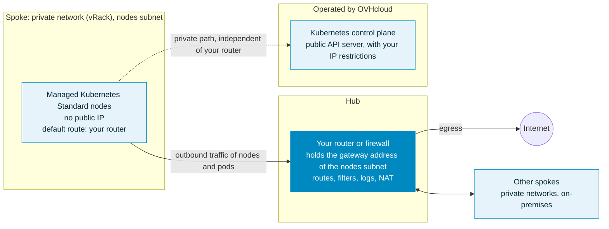

import Api from '@components/Api';


import { Tab, Tabs } from '@rspress/core/theme';


## Objective

A custom gateway lets you control how the nodes of your OVHcloud Managed Kubernetes cluster reach the Internet: for example to get a single output IP address you can allowlist, or to send all the traffic of your nodes through your own firewall to inspect, filter and log it (hub-and-spoke design).

The method depends on the plan of your cluster:

| | Standard plan | Free plan |
|---|---|---|
| Default Internet egress of the nodes | Through an OVHcloud managed gateway (one shared output IP), or through Floating IPs set at the node pool level | Through the public IP address of each node |
| Custom gateway | Your own router or firewall, set as the gateway of the nodes subnet (`useUserGateway`) | A gateway in your vRack, used as default route (`privateNetworkRoutingAsDefault` and `defaultVrackGateway`) |
| OVHcloud managed gateway required | No, when you use your own router | Not applicable |
| Public exposure of nodes and workloads | Disabled when you use your own router: no Floating IPs and no public Load Balancers | Unchanged |
| When to configure it | At cluster creation only, cannot be changed afterwards | At cluster creation or reset |

:::info
On every new Standard cluster, the traffic between the nodes and the Kubernetes control plane uses a private path operated by OVHcloud. Cluster operations do not depend on your gateway: a change or an outage of your router does not affect the communication between the nodes and the control plane.
:::

- [Use your own router or firewall (Standard plan)](#use-your-own-router-or-firewall-standard-plan)
- [Route egress through a gateway in your vRack (Free plan)](#route-egress-through-a-gateway-in-your-vrack-free-plan)

[[cpnav:publiccloud-kubernetes|en]]

## Use your own router or firewall (Standard plan)

### How it works

On the Standard plan, nodes have no public IP by default: they reach the Internet through an OVHcloud managed gateway, or through Floating IPs set at the node pool level.

Standard clusters created since 13 October 2026, whatever their Kubernetes version, can instead use your own router or firewall as the default gateway of the nodes. This is the usual hub-and-spoke design: your security appliance is the hub, and the cluster is one of the spokes. Your appliance is the gateway announced on the nodes subnet of your private network: the outbound traffic of the nodes goes through it (except the traffic to the control plane and the system images of the service), and no OVHcloud managed gateway is required.



What this means for the cluster:

- **Your appliance carries the outbound traffic of the workloads**: Internet access, other networks, on-premises resources. Pods leave with the private address of their node, so your firewall rules see node addresses, not pod addresses.
- **It is not on the path of the cluster itself**: the nodes reach the Kubernetes control plane through a private path operated by OVHcloud, and the system images of the service do not go through your appliance. If your appliance is unavailable, the cluster keeps running, but your workloads that rely on it, for example to access the Internet or other external resources, are affected.
- **The public exposure of the nodes and workloads is disabled**: Floating IPs cannot be attached to the nodes or to load balancers, and no public Load Balancer can be created. Inbound access to your applications goes through your own equipment.

:::note
On the Standard plan, `defaultVrackGateway` and `privateNetworkRoutingAsDefault` are not used: the gateway of the nodes is the one configured on the nodes subnet.
:::

### Requirements

On the Kubernetes side:

- A Public Cloud project in your OVHcloud account.
- A Standard plan cluster created since 13 October 2026, with the options described below.

On the network side, whatever your appliance is (a virtual appliance on Public Cloud instances, a dedicated server or an on-premises device connected to your vRack):

- A private network (vRack) with a subnet for the nodes, in the region of the cluster.
- The subnet announces a default gateway (DHCP option 3), and this gateway address is held by your appliance. With the OVHcloud Control Panel or the OVHcloud API, the subnet announces its first address: check <code className="action">Announce the first address of a given CIDR as the default gateway (DHCP option 3)</code>, or set `noGateway` to `false`. With the OpenStack API, you can choose another address.
- DHCP is enabled on the subnet (recommended), and its allocation pool does not include the gateway address.
- No OVHcloud managed gateway on this subnet.
- Your appliance routes the outbound traffic of the nodes and allows at least DNS (port 53, TCP and UDP), plus the Internet access your workloads need, for example to pull images from public container registries.

Recommendations:

- Make the gateway highly available, for example with two appliances sharing the gateway address as a virtual IP (VRRP or CARP): a single appliance is a single point of failure for the external access of your workloads.
- If your appliance runs on Public Cloud instances, the gateway address must be reserved by a port of your appliance, and port security must be disabled on its interfaces so that it can forward traffic that is not its own. These settings are available through the OpenStack API.

:::tip
The design of the hub (choice of appliance, high availability, filtering and routing rules) depends on your environment. To set up the network side, follow the guide [Hub and spoke landing zone on OVHcloud Public Cloud](/guides/public-cloud/cross-functional/landing-zone-hub-spoke-cloud-architects). Your appliance can also sit in a separate hub network: the gateway announced on the nodes subnet is then an OpenStack router that forwards the traffic to this hub. If you need support to design or deploy it, contact your account manager or our [Professional Services](/links/professional-services) team.
:::

### Cluster network options

On the Managed Kubernetes side, two attributes of the cluster control this configuration. Both are optional and set to `false` by default; to use your own router, set both to `true`.

| Attribute | Description |
|---|---|
| `disablePublicNetworking` | Disables the public exposure of the nodes and workloads: Floating IPs cannot be attached to the nodes or to load balancers, so no public Load Balancer can be created. The Kubernetes API server is not affected. Used alone, it still requires an OVHcloud managed gateway in the nodes subnet for outbound Internet access: it then works as a guardrail against any public exposure, see [Understanding OVHcloud Managed Kubernetes architecture](/guides/public-cloud/containers-orchestration/managed-kubernetes/understanding-mks-architecture#disabling-the-public-exposure-of-nodes-and-workloads). |
| `privateNetworkConfiguration.useUserGateway` | The nodes use your router, the gateway of the nodes subnet, as default gateway. Requires `disablePublicNetworking` set to `true`. |

:::warning
These attributes can only be set when the cluster is created and cannot be changed afterwards.

When `disablePublicNetworking` is `true`:

- Floating IPs cannot be attached to the nodes or to load balancers;
- Services of type `LoadBalancer` cannot be exposed through a public Load Balancer.

If you need to expose applications on the Internet from this cluster, keep the default configuration.

This option does not apply to the Kubernetes API server, which remains publicly reachable, subject to your IP restrictions.

:::

If the configuration is not valid, the cluster creation is rejected:

| Situation | Error message |
|---|---|
| `useUserGateway` set to `true` without `disablePublicNetworking` set to `true` | `useUserGateway require publicConnectivityDisabled` |
| `disablePublicNetworking` set to `true` alone, without a managed gateway in the nodes subnet | `missing a gateway in nodesSubnetId` |
| Free plan cluster | `not supported` |

### Create the cluster

<Tabs>
  <Tab label="OVHcloud Control Panel">
    :::info
    Support for these options in the OVHcloud Control Panel is in progress. Until then, use the OVHcloud API.
    :::
  </Tab>
  <Tab label="OVHcloud API">
    Create the cluster with the following API call:

    <Api version="v1" section="/cloud" method="POST" route={"/cloud/project/\\{serviceName\\}/kube"} />

    Use a request body like this one, replacing the network and subnet IDs with yours. For `privateNetworkId`, use the OpenStack ID of the private network in the region of the cluster (`openstackId` in the `regions` list of the private network), not its `id`:

    ```json
    {
      "name": "my-cluster",
      "region": "EU-WEST-PAR",
      "plan": "standard",
      "privateNetworkId": "d9775b7c-c267-44b4-b758-6e827b0a69bb",
      "nodesSubnetId": "aa9cf7c0-2d48-4ac4-a3d8-b6d1b2e5c1f2",
      "disablePublicNetworking": true,
      "privateNetworkConfiguration": {
        "useUserGateway": true
      }
    }
    ```

    Note the `id` in the response: you will need it to create the node pool.
  </Tab>
  <Tab label="OVHcloud CLI">
    :::info
    Support for these options in the [OVHcloud CLI](https://github.com/ovh/ovhcloud-cli) is in progress.
    :::
  </Tab>
  <Tab label="Terraform">
    :::info
    Support for these options in the OVHcloud Terraform provider is in progress. The example below will require the provider version that introduces them.
    :::

    ```python
    resource "ovh_cloud_project_kube" "cluster" {
      service_name = "my_service_name" # Replace with your OVHcloud project ID
      name         = "my-cluster"
      region       = "EU-WEST-PAR"
      plan         = "standard"

      private_network_id = "d9775b7c-c267-44b4-b758-6e827b0a69bb" # OpenStack ID of your private network
      nodes_subnet_id    = "aa9cf7c0-2d48-4ac4-a3d8-b6d1b2e5c1f2" # OpenStack ID of the nodes subnet

      disable_public_networking = true
      private_network_configuration {
        use_user_gateway = true
      }
    }
    ```
  </Tab>
</Tabs>

### Add a node pool

Floating IPs cannot be attached to the nodes of this cluster: do not enable them on the node pool. In a region with several availability zones, such as `EU-WEST-PAR`, choose the zone of the node pool.

<Tabs>
  <Tab label="OVHcloud Control Panel">
    Add a node pool from the dashboard of your cluster by following the guide [How to manage nodes and node pools on an OVHcloud Managed Kubernetes cluster](/guides/public-cloud/containers-orchestration/managed-kubernetes/managing-nodes).
  </Tab>
  <Tab label="OVHcloud API">
    <Api version="v1" section="/cloud" method="POST" route={"/cloud/project/\\{serviceName\\}/kube/\\{kubeId\\}/nodepool"} />

    ```json
    {
      "name": "my-pool",
      "flavorName": "b3-8",
      "desiredNodes": 3,
      "minNodes": 3,
      "maxNodes": 3,
      "availabilityZones": ["eu-west-par-a"]
    }
    ```

    `availabilityZones` is required in a region with several availability zones, such as `EU-WEST-PAR`.
  </Tab>
  <Tab label="OVHcloud CLI">
    ```bash
    cat > nodepool-params.json <<'JSON'
    {
      "name": "my-pool",
      "flavorName": "b3-8",
      "desiredNodes": 3,
      "minNodes": 3,
      "maxNodes": 3,
      "availabilityZones": ["eu-west-par-a"]
    }
    JSON
    ovhcloud cloud managed-kubernetes nodepool create <kubeId> \
      --cloud-project <serviceName> \
      --from-file ./nodepool-params.json
    ```
  </Tab>
  <Tab label="Terraform">
    ```python
    resource "ovh_cloud_project_kube_nodepool" "pool" {
      service_name  = ovh_cloud_project_kube.cluster.service_name
      kube_id       = ovh_cloud_project_kube.cluster.id
      name          = "my-pool" # "_" is not allowed
      flavor_name   = "b3-8"
      desired_nodes = 3
      min_nodes     = 3
      max_nodes     = 3

      availability_zones = ["eu-west-par-a"] # Regions with several availability zones only
    }
    ```
  </Tab>
</Tabs>

### Verify the configuration

Check the configuration of the cluster with the following API call:

<Api version="v1" section="/cloud" method="GET" route={"/cloud/project/\\{serviceName\\}/kube/\\{kubeId\\}"} />

The response contains `"disablePublicNetworking": true` and `"privateNetworkConfiguration": { "useUserGateway": true }`.

Once the node pool is `READY`, retrieve the kubeconfig file of your cluster (see [Configuring kubectl on an OVHcloud Managed Kubernetes cluster](/guides/public-cloud/containers-orchestration/managed-kubernetes/configure-kubectl)) and run a test Pod that displays its output IP:

```bash
kubectl run egress-test --rm -it --restart=Never --image=curlimages/curl -- curl -s https://ifconfig.me
```

The command must return the public IP address your router or firewall uses for outbound traffic.

:::note
For an existing cluster that cannot be recreated, our teams can assess a manual migration to this configuration on a case-by-case basis. Contact your account manager.
:::

## Route egress through a gateway in your vRack (Free plan)

This tutorial applies to Free plan clusters.

In this tutorial we are going to use a custom gateway deployed in vRack with a Managed Kubernetes cluster.

Why?

By default, in a Kubernetes cluster, the Pods you deploy take the Node's output IP.
So we have as many output IPs as Nodes. This can be a problem when you are in a situation where you need to manage a whitelist and you have a cluster with AutoScaling (creating and deleting Nodes on the fly).

One solution is to use a custom gateway which will allow you to have a single output IP (your gateway).

You will:

- create a private network
- create subnets
- create an OpenStack router (in every regions) and link them to the external provider network and the subnets
- create an OVHcloud Managed Kubernetes cluster with the private gateway
- test the Pod's output IP

At the end of this tutorial you should have the following flow:


:::info
In this tutorial we guide you on how to create the private network in two regions but you can use only one region if you want, GRA9 for example.

:::

### Requirements

- A [Public Cloud project](/guides/public-cloud/cross-functional/create-a-public-cloud-project) in your OVHcloud account.
- The [OpenStack API CLI](/guides/public-cloud/cross-functional/compute-prepare-openstack-api-environment) installed.
- Being familiar with the [OVHcloud API](/guides/manage-and-operate/api/first-steps).
- Being familiar with [Terraform](/guides/public-cloud/cross-functional/how-to-use-terraform) if you wish to use it.
- The JSON parser tool [jq](https://stedolan.github.io/jq/) installed.


### Initialization

To setup a functional environment, you have to load the OpenStack and the OVHcloud API credentials.
To help you we also created for you several useful scripts and templates.

First, create a `utils` folder in your environment/local machine.
Then, download the [ovhAPI.sh](https://github.com/ovh/docs/blob/develop/pages/public_cloud/containers_orchestration/managed_kubernetes/vrack-k8s-custom-gateway/utils/ovhAPI.sh) script into it.

And then add execution rights to the `ovhAPI.sh` script:

```bash
chmod +x utils/ovhAPI.sh
```

You have to load the content of the given **utils/openrc** file, to manage OpenStack, and variables contained in the **utils/ovhAPI.properties** file to manage the OVHcloud API.

Create the **utils/openrc**, or download it from your Openstack provider. It must be like:

```bash
export OS_AUTH_URL=https://auth.cloud.ovh.net/v3
export OS_IDENTITY_API_VERSION=3
export OS_USER_DOMAIN_NAME=${OS_USER_DOMAIN_NAME:-"Default"}
export OS_PROJECT_DOMAIN_NAME=${OS_PROJECT_DOMAIN_NAME:-"Default"}
export OS_TENANT_ID=xxxxxxxxxxxxxxxxxxxxx
export OS_TENANT_NAME="xxxxxxxxxxxxxxxxxx"
export OS_USERNAME="user-xxxxxxxxxxxxx"
export OS_PASSWORD="xxxxxxxxxxxxxxxxxx"
export OS_REGION_NAME="xxxx"
if [ -z "$OS_REGION_NAME" ]; then unset OS_REGION_NAME; fi
```

Create the **utils/ovhAPI.properties** with your generated keys and secret:

```bash
OVH_API_URL="https://api.eu.ovhcloud.com/1.0"
OVH_ENDPOINT="ovh-eu"
OVH_APPLICATION_KEY="xxxxxxxxxxxxxxxxx"
OVH_APPLICATION_SECRET="xxxxxxxxxxxxxxxxx"
OVH_CONSUMER_KEY="xxxxxxxxxxxxxxxxxxxxx"
```

You should have a `utils` folder with three files:

```bash
.
└── utils
    ├── openrc
    ├── ovhAPI.properties
    └── ovhAPI.sh
```

Load variables:

```bash
. utils/openrc
. utils/ovhAPI.properties
```

Get your OpenStack Tenant ID and store it into the serviceName variable.

<Tabs>
  <Tab label="Bash">
    ```bash
    export serviceName=$(utils/ovhAPI.sh GET /cloud/project/$OS_TENANT_ID | jq -r .description) && echo $serviceName
    ```
  </Tab>
  <Tab label="API">
    <Api version="v1" section="/cloud" method="GET" route={"/cloud/project/\\{serviceName\\}"} />
  </Tab>
</Tabs>


You should have a result like this:

```console
$ export serviceName=$(utils/ovhAPI.sh GET /cloud/project/$OS_TENANT_ID | jq -r .description) && echo $serviceName
EXAMPLE
```

### Create Private Network

> Important: Assuming that your PCI project is added to your [vRack](/guides/public-cloud/network-services/vrack).

We are using the OVHcloud API to create the private network. For this tutorial, we are using the two regions GRA9 and GRA11.

Create a folder `tpl` next to `utils` folder and create inside the **data-pvnw.json** file with the following content:

```json
{
"name": "demo-pvnw",
"vlanId": 20,
"regions": ["GRA9","GRA11"]
}
```

Create the private network named `demo-pvnw` in `GRA9` and `GRA11` regions and get the VLAN ID.

<Tabs>
  <Tab label="Bash">
    ```bash
    export vlanId="$(utils/ovhAPI.sh POST /cloud/project/$OS_TENANT_ID/network/private "$(cat tpl/data-pvnw.json)" | jq -r .id)" && echo $vlanId
    ```
  </Tab>
  <Tab label="API">
    <Api version="v1" section="/cloud" method="POST" route={"/cloud/project/\\{serviceName\\}/network/private"} />
    <Api version="v1" section="/cloud" method="GET" route={"/cloud/project/\\{serviceName\\}/network/private"} />
  </Tab>
</Tabs>


You should have a result like this:

```console
$ export vlanId="$(utils/ovhAPI.sh POST /cloud/project/$OS_TENANT_ID/network/private "$(cat tpl/data-pvnw.json)" | jq -r .id)" && echo $vlanId
pn-1083678_20
```

At this point, your private network is created and its ID is `pn-1083678_20`.

### Create subnets

For this tutorial, we are splitting a /24 subnet, to obtain two /25 subnets.

Ref: https://www.davidc.net/sites/default/subnets/subnets.html

| Name | Region | CIDR Address | Gateway | DHCP Range | Broadcast |
|---|---|---|---|---|---|
|Subnet 1|GRA9|192.168.0.0/25|192.168.0.1|192.168.0.2-192.168.0.126|192.168.0.127|
|Subnet 2|GRA11|192.168.0.128/25|192.168.0.129|192.168.0.130-192.168.0.254|192.168.0.255|

Create these two data files in the `tpl` folder:

**data-subnetGRA9.json** file:
```json
{
"start": "192.168.0.2",
"end": "192.168.0.126",
"region": "GRA9",
"dhcp": false,
"network": "192.168.0.0/25",
"noGateway": false
}
```

**data-subnetGRA11.json** file:
```json
{
"start": "192.168.0.130",
"end": "192.168.0.254",
"region": "GRA11",
"dhcp": false,
"network": "192.168.0.128/25",
"noGateway": false
}
```

> Note: To be clear, the parameter `"noGateway": false` means `"Gateway": true`. We want the subnet to explicitly use the first IP address of the CIDR range.

Then create subnets with appropriate routes, and finally get IDs (subnGRA9 & subnGRA11):

<Tabs>
  <Tab label="Bash">
    ```bash
    export subnGRA9="$(utils/ovhAPI.sh POST /cloud/project/$OS_TENANT_ID/network/private/$vlanId/subnet "$(cat tpl/data-subnetGRA9.json)" | jq -r .id)" && echo $subnGRA9

    export subnGRA11="$(utils/ovhAPI.sh POST /cloud/project/$OS_TENANT_ID/network/private/$vlanId/subnet "$(cat tpl/data-subnetGRA11.json)" | jq -r .id)" && echo $subnGRA11
    ```
  </Tab>
  <Tab label="API">
    <Api version="v1" section="/cloud" method="POST" route={"/cloud/project/\\{serviceName\\}/network/private/\\{networkId\\}/subnet"} />
  </Tab>
</Tabs>


You should have a result like this:

```console
$ export subnGRA9="$(utils/ovhAPI.sh POST /cloud/project/$OS_TENANT_ID/network/private/$vlanId/subnet "$(cat tpl/data-subnetGRA9.json)" | jq -r .id)" && echo $subnGRA9
668fd889-5477-445b-b4e1-b30432e39045

$ export subnGRA11="$(utils/ovhAPI.sh POST /cloud/project/$OS_TENANT_ID/network/private/$vlanId/subnet "$(cat tpl/data-subnetGRA11.json)" | jq -r .id)" && echo $subnGRA11
e76f2b49-2b9f-4248-98ae-179d596d6e45
```

> For now, it's not possible to add routes to the subnet via the API, so we must use the OpenStack CLI instead.

<Tabs>
  <Tab label="Bash">
    ```bash
    openstack --os-region-name=GRA9 subnet set ${subnGRA9} --host-route destination=192.168.0.0/25,gateway=192.168.0.1

    openstack --os-region-name=GRA11 subnet set ${subnGRA11} --host-route destination=192.168.0.128/25,gateway=192.168.0.129
    ```
  </Tab>
</Tabs>


### OpenStack router

#### Create the routers

We have the ability to create OpenStack virtual routers. To do this, we need to use the OpenStack CLI.
Create routers and get their IDs (rtrGRA9Id & rtrGRA11Id):

<Tabs>
  <Tab label="Bash">
    ```bash
    export rtrGRA9Id="$(openstack --os-region-name=GRA9 router create rtr-GRA9 -f json | jq -r .id)" && echo $rtrGRA9Id
    export rtrGRA11Id="$(openstack --os-region-name=GRA11 router create rtr-GRA11 -f json | jq -r .id)" && echo $rtrGRA11Id
    ```
  </Tab>
</Tabs>


You should have a result like this:

```console
$ export rtrGRA9Id="$(openstack --os-region-name=GRA9 router create rtr-GRA9 -f json | jq -r .id)" && echo $rtrGRA9Id
26bf99c8-d6fa-4c5a-9d42-1358776ee0a2

$ export rtrGRA11Id="$(openstack --os-region-name=GRA11 router create rtr-GRA11 -f json | jq -r .id)" && echo $rtrGRA11Id
ResourceNotFound: 404: Client Error for url: https://network.compute.gra11.cloud.ovh.net/v2.0/routers, The resource could not be found.
```

:::info
For the moment you can only create a virtual router in the GRA9 and GRA11 regions, but this feature will be released in other regions in the coming weeks and months.

:::


Now, you can display the information of your new virtual router on GRA9 in order to display its IP:

```console
$ openstack --os-region-name=GRA9 router show $rtrGRA9Id -c id -c name -c status -c created_at -c external_gateway_info
+-----------------------+-------------------------------------------------------------------------------------------------------------------------------------------------------------------------------------------------------------------------------------------------------------------------------------------+
| Field                 | Value                                                                                                                                                                                                                                                                                     |
+-----------------------+-------------------------------------------------------------------------------------------------------------------------------------------------------------------------------------------------------------------------------------------------------------------------------------------+
| created_at            | 2022-07-25T07:32:06Z                                                                                                                                                                                                                                                                      |
| external_gateway_info | {"network_id": "b2c02fdc-ffdf-40f6-9722-533bd7058c06", "external_fixed_ips": [{"subnet_id": "0f11270c-1113-4d4f-98de-eba83445d962", "ip_address": "141.94.209.244"}, {"subnet_id": "4aa6cac1-d5cd-4e25-b14b-7573aeabcab1", "ip_address": "2001:41d0:304:400::917"}], "enable_snat": true} |
| id                    | 26bf99c8-d6fa-4c5a-9d42-1358776ee0a2                                                                                                                                                                                                                                                      |
| name                  | rtr-GRA9                                                                                                                                                                                                                                                                                  |
| status                | ACTIVE                                                                                                                                                                                                                                                                                    |
+-----------------------+-------------------------------------------------------------------------------------------------------------------------------------------------------------------------------------------------------------------------------------------------------------------------------------------+
```

As you can see, in this example, the IP of the gateway will be `141.94.209.244`.

#### Link the router to the external provider network

First, get the regional external network ID (extNwGRA9Id & extNwGRA11Id), then link the router to it:

<Tabs>
  <Tab label="Bash">
    ```bash
    # GRA9
    export extNwGRA9Id="$(openstack --os-region-name=GRA9 network list -f json | jq -r '.[] | select(.Name=="Ext-Net") | .ID')" && echo $extNwGRA9Id
    openstack --os-region-name=GRA9 router set $rtrGRA9Id --external-gateway $extNwGRA9Id
    # GRA11
    export extNwGRA11Id="$(openstack --os-region-name=GRA11 network list -f json | jq -r '.[] | select(.Name=="Ext-Net") | .ID')" && echo $extNwGRA11Id
    openstack --os-region-name=GRA11 router set $rtrGRA11Id --external-gateway $extNwGRA11Id
    ```
  </Tab>
</Tabs>


You should have a result like this:

```console
$ export extNwGRA9Id="$(openstack --os-region-name=GRA9 network list -f json | jq -r '.[] | select(.Name=="Ext-Net") | .ID')" && echo $extNwGRA9Id
b2c02fdc-ffdf-40f6-9722-533bd7058c06
$ openstack --os-region-name=GRA9 router set $rtrGRA9Id --external-gateway $extNwGRA9Id

$ export extNwGRA11Id="$(openstack --os-region-name=GRA11 network list -f json | jq -r '.[] | select(.Name=="Ext-Net") | .ID')" && echo $extNwGRA11Id
bcf59eb2-9d83-41cc-b4f5-0435ed594833
$ openstack --os-region-name=GRA11 router set $rtrGRA11Id --external-gateway $extNwGRA11Id
```

#### Link the router to the subnet

Do the same with the regional subnets:

<Tabs>
  <Tab label="Bash">
    ```bash
    # GRA9
    openstack --os-region-name=GRA9 router add subnet $rtrGRA9Id $subnGRA9
    # GRA11
    openstack --os-region-name=GRA11 router add subnet $rtrGRA11Id $subnGRA11
    ```
  </Tab>
</Tabs>


### Create a Kubernetes cluster with private gateway

Now the network is ready. Create an OVHcloud Managed Kubernetes cluster, specifying the use of the gateway defined on each subnet.

> Note: until the end of this tutorial, we are only using the `GRA9` region, but you can repeat the exact same steps to create a cluster on the `GRA11` region.

:::info
In this guide we defined `1.34` version for the Kubernetes cluster but you can use another supported version.

:::


First, get the private network IDs (pvnwGRA9Id & pvnwGRA11Id), then create the OVHcloud Managed Kubernetes Cluster, and finally get the cluster ID (kubeId):

<Tabs>
  <Tab label="Bash">
    Create a **tpl/data-kube.json.tpl** file as data and add the right parameters. The files should be like:

    ```json
    {
    "region": "GRA9",
    "name": "demo",
    "version": "1.34",
    "nodepool": {
      "flavorName": "b2-7",
      "antiAffinity": false,
      "monthlyBilled": false,
      "autoscale": false,
      "desiredNodes": 3
    },
    "privateNetworkId": "@privateNetworkId@",
    "privateNetworkConfiguration" :{
          "privateNetworkRoutingAsDefault": true,
          "defaultVrackGateway": "192.168.0.1"
    }
    }
    ```

    ```bash
    # Get the GRA9 private network Id
    export pvnwGRA9Id="$(utils/ovhAPI.sh GET `/cloud/project`/$OS_TENANT_ID/network/private/${vlanId} | jq '.regions[] | select(.region=="GRA9")' | jq -r .openstackId)" && echo $pvnwGRA9Id
    # Create the kube payload file
    cat tpl/data-kube.json.tpl | sed -e "s|@privateNetworkId@|$pvnwGRA9Id|g" > tpl/data-kube.json
    # Create the kube cluster
    export kubeId="$(utils/ovhAPI.sh POST /cloud/project/$OS_TENANT_ID/kube "$(cat tpl/data-kube.json)" | jq -r .id)" && echo $kubeId
    ```

    You should have a result like this:

    ```console
    $ export pvnwGRA9Id="$(utils/ovhAPI.sh GET `/cloud/project`/$OS_TENANT_ID/network/private/${vlanId} | jq '.regions[] | select(.region=="GRA9")' | jq -r .openstackId)" && echo >> $pvnwGRA9Id
    d9775b7c-c267-44b4-b758-6e827b0a69bb

    $ cat tpl/data-kube.json.tpl | sed -e "s|@privateNetworkId@|$pvnwGRA9Id|g" > tpl/data-kube.json

    $ cat tpl/data-kube.json
    {
      "region": "GRA9",
      "name": "demo",
      "version": "1.34",
      "nodepool": {
        "flavorName": "b2-7",
        "antiAffinity": false,
        "monthlyBilled": false,
        "autoscale": false,
        "desiredNodes": 3
      },
      "privateNetworkId": "d9775b7c-c267-44b4-b758-6e827b0a69bb",
      "privateNetworkConfiguration" :{
            "privateNetworkRoutingAsDefault": true,
            "defaultVrackGateway": "192.168.0.1"
      }
    }

    $ export kubeId="$(utils/ovhAPI.sh POST /cloud/project/$OS_TENANT_ID/kube "$(cat tpl/data-kube.json)" | jq -r .id)" && echo $kubeId
    6bc9c71a-e570-4ed6-848b-de212fbab7da
    ```
  </Tab>
  <Tab label="API">
    <Api version="v1" section="/cloud" method="GET" route={"/cloud/project/\\{serviceName\\}/network/private/\\{networkId\\}"} />
    <Api version="v1" section="/cloud" method="POST" route={"/cloud/project/\\{serviceName\\}/kube"} />
    <Api version="v1" section="/cloud" method="GET" route={"/cloud/project/\\{serviceName\\}/kube"} />
  </Tab>
  <Tab label="OVHcloud Control Panel">
    In the left sidebar under **Containers & Orchestration**, click **Managed Kubernetes Service**, then click **Create a cluster**.

    Follow the cluster creation wizard. When you reach the **Private network** step, select the private network you created in your vRack. Enable the option to use this network as the default route, and enter your gateway IP address (e.g. `192.168.0.1`). Complete the remaining steps to name and confirm your cluster.
  </Tab>
  <Tab label="Terraform">
    :::info
    You can create your networks and subnets using Terraform by following [this guide](/guides/public-cloud/network-services/create-private-network-gateway).

    :::


    You need to create a file, let's name it `kubernetes-cluster-test.tf` with this content:

    ```python
    # Create your Kubernetes cluster
    resource "ovh_cloud_project_kube" "cluster_terraform" {
      service_name  = "my_service_name" # Replace with your OVHcloud project ID
      name          = "cluster_terraform"
      region        = "GRA9"

      private_network_id = "my_private_network_id" # Replace with your private network id
      private_network_configuration {
        private_network_routing_as_default = true
        default_vrack_gateway              = "192.168.0.1"
      }
    }

    # Create your node pool and assign it to your cluster
    resource "ovh_cloud_project_kube_nodepool" "node_pool" {
      service_name  = "my_service_name" # Replace with your OVHcloud project ID
      kube_id       = ovh_cloud_project_kube.cluster_terraform.id
      name          = "node-pool-terraform"
      flavor_name   = "b3-8" # Replace with the desired instance flavour
      desired_nodes = 3
      max_nodes     = 3
      min_nodes     = 3
    }
    ```

    You can create your resources by entering the following command:

    ```console
    terraform apply
    ```
  </Tab>
</Tabs>


Now wait until your OVHcloud Managed Kubernetes cluster is READY.

For that, you can check its status in the OVHcloud Control Panel:

Access the administration UI for your OVHcloud Managed Kubernetes clusters by clicking on <code className="action">Managed Kubernetes Service</code> in the left-hand menu:


As you can see, your new cluster is attached to `demo-pvnw` network.

And now click in your `demo` created Kubernetes cluster in order to see its status:


When your cluster's status is `OK`, you can go to the next section.

### Get Kubeconfig file

To proceed with the freshly created Kubernetes cluster, you must get the Kubeconfig file.

<Tabs>
  <Tab label="Bash">
    ```bash
    utils/ovhAPI.sh POST /cloud/project/$OS_TENANT_ID/kube/$kubeId/kubeconfig | jq -r .content > kubeconfig-demo
    ```
  </Tab>
  <Tab label="API">
    <Api version="v1" section="/cloud" method="POST" route={"/cloud/project/\\{serviceName\\}/kube/\\{kubeId\\}/kubeconfig"} />
  </Tab>
</Tabs>


To use this kubeconfig file and access to your cluster, you can follow our [configuring kubectl](/guides/public-cloud/containers-orchestration/managed-kubernetes/configure-kubectl) tutorial, or simply add the `--kubeconfig` flag in your `kubectl` commands.

### Test

List the running nodes in your cluster:

```bash
kubectl --kubeconfig=kubeconfig-demo get no -o wide
```

You should obtain a result like this:

```console
$ kubectl --kubeconfig=kubeconfig-demo get no -o wide
NAME                                         STATUS   ROLES    AGE   VERSION   INTERNAL-IP    EXTERNAL-IP      OS-IMAGE             KERNEL-VERSION       CONTAINER-RUNTIME
nodepool-8f0b4d98-874a-4cfd-b8-node-c74f26   Ready    <none>   56m   v1.34.0   192.168.0.71   141.94.215.23    Ubuntu 18.04.6 LTS   4.15.0-189-generic   containerd://1.4.6
nodepool-8f0b4d98-874a-4cfd-b8-node-c9bf60   Ready    <none>   57m   v1.34.0   192.168.0.96   141.94.208.78    Ubuntu 18.04.6 LTS   4.15.0-189-generic   containerd://1.4.6
nodepool-8f0b4d98-874a-4cfd-b8-node-e666f5   Ready    <none>   56m   v1.34.0   192.168.0.31   141.94.212.214   Ubuntu 18.04.6 LTS   4.15.0-189-generic   containerd://1.4.6
```

Now test the cluster by running a simple container that requests its published IP address.

```bash
kubectl --kubeconfig=kubeconfig-demo run --image=debian debian -it -- bash
apt update
apt install -y curl
curl ifconfig.me
```

You should obtain a result like this:

```console
$ kubectl --kubeconfig=kubeconfig-demo run --image=debian debian  -it -- bash
If you don't see a command prompt, try pressing enter.
root@debian:/# apt update
Get:1 http://deb.debian.org/debian bullseye InRelease [116 kB]
Get:2 http://deb.debian.org/debian-security bullseye-security InRelease [48.4 kB]
Get:3 http://deb.debian.org/debian bullseye-updates InRelease [44.1 kB]
Get:4 http://deb.debian.org/debian bullseye/main amd64 Packages [8182 kB]
Get:5 http://deb.debian.org/debian-security bullseye-security/main amd64 Packages [167 kB]
Get:6 http://deb.debian.org/debian bullseye-updates/main amd64 Packages [2592 B]
...

root@debian:/# apt install -y curl
Reading package lists... Done
Building dependency tree... Done
Reading state information... Done
The following additional packages will be installed:
  ca-certificates libbrotli1 libcurl4 libldap-2.4-2 libldap-common libnghttp2-14 libpsl5 librtmp1 libsasl2-2 libsasl2-modules libsasl2-modules-db libssh2-1 openssl publicsuffix
Suggested packages:
...

root@debian:/# curl ifconfig.me
141.94.209.244
```

The IP address of our Pod is indeed that of our gateway!

### Cleanup

To delete created resources, please follow these instructions:

#### Kubernetes cluster
<Tabs>
  <Tab label="Bash">
    ```bash
    utils/ovhAPI.sh DELETE /cloud/project/$OS_TENANT_ID/kube/$kubeId
    ```
  </Tab>
  <Tab label="API">
    <Api version="v1" section="/cloud" method="DELETE" route={"/cloud/project/\\{serviceName\\}/kube/\\{kubeId\\}"} />
  </Tab>
</Tabs>


#### Routers

To delete an Openstack router, you must first remove the linked ports.

<Tabs>
  <Tab label="Bash">
    ```bash
    # Get the routers subnets attached ports Ids
    export portIdGRA9="$(openstack --os-region-name=GRA9 port list | grep -w "192.168.0.1" | awk '{print $2}')" && echo $portIdGRA9
    export portIdGRA11="$(openstack --os-region-name=GRA11 port list | grep -w "192.168.0.129" | awk '{print $2}')" && echo $portIdGRA11
    # Get the routers Ids
    export rtrIdGRA9="$(openstack --os-region-name=GRA9 router list -f json | jq -r '.[] | select(.Name=="rtr-GRA9") | .ID')" && echo $rtrIdGRA9
    export rtrIdGRA11="$(openstack --os-region-name=GRA11 router list -f json | jq -r '.[] | select(.Name=="rtr-GRA11") | .ID')" && echo $rtrIdGRA11
    # Remove ports from routers
    openstack --os-region-name=GRA9 router remove port $rtrIdGRA9 $portIdGRA9
    openstack --os-region-name=GRA11 router remove port $rtrIdGRA11 $portIdGRA11
    # Delete routers
    openstack router delete rtr-GRA9
    openstack router delete rtr-GRA11
    ```
  </Tab>
</Tabs>


#### Subnets
<Tabs>
  <Tab label="Bash">
    ```bash
    utils/ovhAPI.sh DELETE /cloud/project/$OS_TENANT_ID/network/private/$vlanId/subnet/$subnGRA9
    utils/ovhAPI.sh DELETE /cloud/project/$OS_TENANT_ID/network/private/$vlanId/subnet/$subnGRA11
    ```
  </Tab>
  <Tab label="API">
    <Api version="v1" section="/cloud" method="DELETE" route={"/cloud/project/\\{serviceName\\}/network/private/\\{networkId\\}/subnet/\\{subnetId\\}"} />
  </Tab>
</Tabs>


#### Private Network
<Tabs>
  <Tab label="Bash">
    ```bash
    utils/ovhAPI.sh DELETE /cloud/project/$OS_TENANT_ID/network/private/$vlanId
    ```
  </Tab>
  <Tab label="API">
    <Api version="v1" section="/cloud" method="DELETE" route={"/cloud/project/\\{serviceName\\}/network/private/\\{networkId\\}/region/\\{region\\}"} />
  </Tab>
</Tabs>


## Go further

- [Hub and spoke landing zone on OVHcloud Public Cloud](/guides/public-cloud/cross-functional/landing-zone-hub-spoke-cloud-architects)
- [[fragment:professional-services|en]]

Join our [community of users](/links/community).
