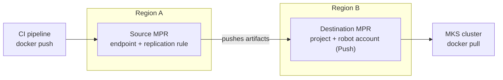
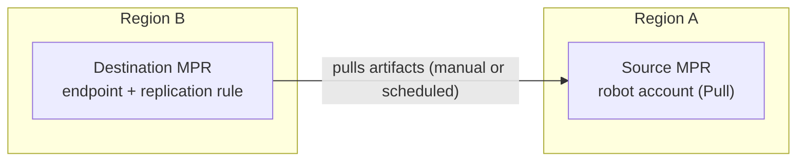

## Objective

An OVHcloud Managed Private Registry (MPR) is hosted in a single region. In a 3-AZ region, the service is distributed across several Availability Zones, but your data never leaves that region.

If you need a copy of your artifacts in another region, you can use Harbor's built-in **replication** feature between two MPRs. Common use cases include:

- keeping a secondary registry ready in another region as part of a disaster recovery plan.
- pulling images from a registry located close to your Managed Kubernetes clusters in each region.
- promoting artifacts from one environment to another (for example, from a staging registry to a production registry).

Replication copies container images, OCI artifacts (including Helm charts stored as OCI artifacts) and the artifacts attached to them, such as signatures, SBOMs and attestations (see [Signatures, SBOMs and other attached artifacts](#signatures-sboms-and-other-attached-artifacts)). Configuring and operating it is your responsibility (see the [responsibility model](/guides/public-cloud/containers-orchestration/managed-private-registry/responsibility-model)).

**This guide explains how to set up a replication rule between two OVHcloud Managed Private Registries located in different regions.**

## Requirements

- Two [OVHcloud Managed Private Registries](/guides/public-cloud/containers-orchestration/managed-private-registry/creation) located in two different regions. In this guide, they are called the **source registry** and the **destination registry**.
- An account with system administrator privileges on the [Harbor user interface](/guides/public-cloud/containers-orchestration/managed-private-registry/connect-to-ui) of both registries.

:::warning
Harbor does not support replication between different Harbor versions. Make sure both registries run the same Harbor version, and check it again after each upgrade. The version is displayed in the Harbor user interface, under your user menu > <code className="action">About</code>.
:::

## Instructions

This guide uses **push-based** replication: the replication rule is created on the source registry, which pushes artifacts to the destination registry. Push-based replication is the only mode that supports the <code className="action">Event Based</code> trigger, which replicates each new artifact as soon as it is pushed.



If you prefer to create the rule on the destination registry, for example to move your artifacts to a new registry in another region, see [Using pull-based replication](#using-pull-based-replication).

### Step 1: Prepare the destination registry

1. Log in to the Harbor user interface of the **destination registry**.
2. Create the project that will receive the replicated artifacts. See [Managing users and projects](/guides/public-cloud/containers-orchestration/managed-private-registry/managing-users-projects) for details.
3. Create a robot account that the source registry will use to push artifacts:
    - Open the project, go to the <code className="action">Robot Accounts</code> tab and click <code className="action">+ New Robot Account</code>.
    - Enter a name and an expiration time.
    - Grant at least the <code className="action">Push</code> and <code className="action">Pull</code> permissions on **Repository**.
    - Click <code className="action">Finish</code>, then copy the robot account name (for example `robot$my-project+replication`) and its secret.

:::info
If the destination project does not exist, Harbor creates it automatically during replication, but only if the account used by the endpoint is allowed to create projects. Creating the project and a project-scoped robot account beforehand gives you control over the project settings and limits the permissions granted to the source registry.
:::

### Step 2: Create a replication endpoint on the source registry

1. Log in to the Harbor user interface of the **source registry**.
2. Go to `Administration`, then <code className="action">Registries</code>.
3. Click <code className="action">+ New Endpoint</code> and fill in the details:
    - **Provider**: Harbor
    - **Name**: a name for the endpoint (for example `mpr-destination`)
    - **Description**: optional
    - **Endpoint URL**: the URL of the destination registry (for example `https://xxxxxxxx.c1.de1.container-registry.ovh.net`)
    - **Access ID**: the full name of the robot account created in step 1 (for example `robot$my-project+replication`)
    - **Access Secret**: the secret of the robot account
    - **Verify Remote Cert**: leave it checked
4. Click <code className="action">Test Connection</code>. Once the test succeeds, click <code className="action">OK</code>.

:::info
If you have configured [IP restrictions](/guides/public-cloud/containers-orchestration/managed-private-registry/add-ip-restrictions) on the `registry` endpoint of the destination registry, the replication traffic coming from the source registry must be allowed. Otherwise, the connection test and the replication tasks will fail.
:::

### Step 3: Create a replication rule

1. On the source registry, go to `Administration`, then <code className="action">Replications</code>.
2. Click <code className="action">+ New Replication Rule</code> and fill in the details:
    - **Name** and **Description**: a name for the rule and an optional description.
    - **Replication mode**: <code className="action">Push-based</code>.
    - **Source resource filter**: the artifacts to replicate. Leave the fields empty to replicate everything.
        - **Name**: a repository name or pattern (for example `my-project/**`).
        - **Tag**: a tag or pattern, which you can set to match or exclude (for example `v*` to replicate only release tags).
        - **Label**: one or more existing labels, which you can set to match or exclude.
        - **Resource**: images only, artifacts only, or all.
    - **Destination registry**: the endpoint created in step 2.
    - **Destination namespace**: the destination project (for example `my-project`). If you leave it empty, artifacts are replicated into a project with the same name as on the source registry.
    - **Destination Flattening**: how many levels of the repository path are removed. The default value, `Flattening 1 level`, turns `a/b/c/img` into `namespace/b/c/img`. Select `No Flattening` to keep the same repository paths as on the source registry.
    - **Trigger Mode**:
        - <code className="action">Manual</code>: the rule only runs when you start it.
        - <code className="action">Scheduled</code>: the rule runs periodically, based on a cron expression.
        - <code className="action">Event Based</code>: the rule runs each time an artifact is pushed or retagged on the source registry. Check **Delete remote resources when locally deleted** to also replicate deletions.
    - **Bandwidth**: the maximum bandwidth per replication task, in KB/s. `-1` means unlimited.
    - **Override**: check it to overwrite artifacts that already exist with the same name on the destination registry.
    - **Copy by chunk**: check it to copy layers in chunks of 10 MB, which can help with large images.
    - **Single active replication**: check it to skip a new run while a previous run of the same rule is still in progress.
3. Click <code className="action">Save</code>.

The **Name** and **Tag** filters support the following patterns:

| Pattern | Matches |
|---|---|
| `*` | Any sequence of characters, except `/` |
| `**` | Any sequence of characters, including `/`. It must be a full path segment (`my-project/**`) |
| `?` | Any single character, except `/` |
| `{alt1,alt2}` | One of the listed alternatives |

For example, `library/*` matches `library/nginx` but not `library/tools/nginx`, while `library/**` matches both.

:::info
<code className="action">Manual</code> and <code className="action">Scheduled</code> triggers do not replicate deletions. With <code className="action">Event Based</code>, only push, retag and delete actions trigger a replication: adding or removing a label does not.
:::

### Step 4: Run and monitor the replication

1. On the source registry, go to `Administration`, then <code className="action">Replications</code>.
2. Select the rule and click <code className="action">Replicate</code> to start an initial replication. This is recommended even with the <code className="action">Event Based</code> trigger, which only applies to artifacts pushed after the rule is created.
3. Click the rule to display its executions, then click an execution **ID** to see its tasks. Each replicated artifact is a separate task.
4. Click the log icon of a task to see its details. You can also click <code className="action">STOP</code> to stop an execution.

Failed tasks are automatically retried several times. You cannot edit or delete a rule while one of its executions is in progress.

### Step 5: Check the result on the destination registry

1. Log in to the Harbor user interface of the **destination registry** and open the destination project. The replicated repositories and tags are listed there.
2. Pull an image from the destination registry to check that it can be used:

```bash
docker login <destination-registry-url>
docker pull <destination-registry-url>/<project>/<image>:<tag>
```

To use the destination registry from a Managed Kubernetes cluster, see [Using Private Registry with OVHcloud Managed Kubernetes](/guides/public-cloud/containers-orchestration/managed-private-registry/kubernetes).

## Using pull-based replication

With **pull-based** replication, the rule is created on the destination registry, which pulls artifacts from the source registry. The source registry only needs a robot account with read access.



This mode is well suited to moving your artifacts to a new registry in another region: everything is configured on the new registry, and nothing needs to be changed on the registry you are leaving, apart from the robot account.

Pull-based replication does not support the <code className="action">Event Based</code> trigger: use <code className="action">Manual</code> or <code className="action">Scheduled</code> instead.

### Step 1: Create a read-only robot account on the source registry

1. Log in to the Harbor user interface of the **source registry**.
2. Create a robot account with the <code className="action">Pull</code> permission on **Repository**:
    - for a single project: open the project, go to the <code className="action">Robot Accounts</code> tab and click <code className="action">+ New Robot Account</code>.
    - for several projects: go to `Administration`, then <code className="action">Robot Accounts</code>, click <code className="action">+ New Robot Account</code> and select the projects to cover, or check <code className="action">Cover all projects</code>.
3. Click <code className="action">Finish</code>, then copy the robot account name and its secret.

### Step 2: Create a replication endpoint on the destination registry

1. Log in to the Harbor user interface of the **destination registry**.
2. Go to `Administration`, then <code className="action">Registries</code>, and click <code className="action">+ New Endpoint</code>.
3. Fill in the details as described in [step 2](#step-2-create-a-replication-endpoint-on-the-source-registry) above, with the URL of the **source registry** in **Endpoint URL** and the robot account created in step 1 in **Access ID** and **Access Secret**.
4. Click <code className="action">Test Connection</code>. Once the test succeeds, click <code className="action">OK</code>.

:::info
If you have configured [IP restrictions](/guides/public-cloud/containers-orchestration/managed-private-registry/add-ip-restrictions) on the `registry` endpoint of the source registry, the replication traffic coming from the destination registry must be allowed.
:::

### Step 3: Create the replication rule on the destination registry

1. On the destination registry, go to `Administration`, then <code className="action">Replications</code>, and click <code className="action">+ New Replication Rule</code>.
2. Fill in the details:
    - **Replication mode**: <code className="action">Pull-based</code>.
    - **Source registry**: the endpoint created in step 2.
    - **Source resource filter**: the artifacts to replicate, with the same filters and patterns as for push-based replication. Leave the fields empty to replicate all the artifacts the robot account can read.
    - **Destination namespace**: leave it empty to replicate each project into a project with the same name, which is created automatically if needed.
    - **Destination Flattening**: select `No Flattening` to keep the same repository paths as on the source registry.
    - **Trigger Mode**: <code className="action">Manual</code> or <code className="action">Scheduled</code>.
    - The other options (**Bandwidth**, **Override**, **Copy by chunk**, **Single active replication**) work as described in [step 3](#step-3-create-a-replication-rule) above.
3. Click <code className="action">Save</code>.

### Step 4: Run the replication and check the result

Run and monitor the rule from the destination registry, as described in [step 4](#step-4-run-and-monitor-the-replication), then check the result as described in [step 5](#step-5-check-the-result-on-the-destination-registry).

:::info
**Moving your artifacts to another region**

1. Create the rule with a <code className="action">Scheduled</code> trigger (for example, every hour), then click <code className="action">Replicate</code> to start the initial copy without waiting for the schedule.
2. While your CI pipelines and clusters still use the source registry, the scheduled runs replicate the new artifacts.
3. Pause writes to the source registry, click <code className="action">Replicate</code> one last time, and verify the result. Then switch all clients to the destination registry, delete the rule and its endpoint, and remove the temporary robot account from the source registry.

The elements listed in [What is not replicated](#what-is-not-replicated) must be configured on the destination registry before you switch your clients.
:::

## Signatures, SBOMs and other attached artifacts

Harbor replicates each artifact together with the artifacts attached to it, called **accessories**. They are replicated whenever their parent artifact is, even if they have no tag of their own:

- Cosign signatures, in both formats: the tag-based format of Cosign v2 (`sha256-<digest>.sig`) and the OCI 1.1 format used by default by Cosign v3.
- Notation signatures.
- Any artifact attached with the OCI 1.1 `subject` field, such as SBOMs, provenance attestations or VEX documents (for example, pushed with `oras attach` or `cosign attest`).
- SBOMs generated by Harbor.

Attestations added by BuildKit (`docker buildx build --sbom --provenance`) are stored inside the image index: they are copied with the image.

:::warning
Cosign v2 attestations and attachments (`cosign attest`, `cosign attach sbom`) are not accessories: they are stored as regular tags, such as `sha256-<digest>.att` or `sha256-<digest>.sbom`. They are only replicated if they match the **Tag** filter of the rule. If you filter on tags (for example `v*`), add these tags to the pattern, for example `{v*,sha256-*}`.
:::

### Vulnerability scan results

Scan results are stored in the database of each registry and are not replicated. To get them on the destination registry, enable <code className="action">Automatically scan images on push</code> in the <code className="action">Configuration</code> tab of the destination project **before** running the replication: replicated artifacts are then scanned as soon as they arrive. You can also start a scan manually afterwards. See [Scanning Docker images for vulnerabilities](/guides/public-cloud/containers-orchestration/managed-private-registry/scan-docker-images-vulnerabilities).

Projects created automatically by the replication use the default settings, in which automatic scanning is disabled: create the destination projects beforehand to configure it.

## What is not replicated

Replication only copies artifacts and their signatures. The following elements are specific to each registry and must be configured separately on the destination registry:

- project members and their roles.
- vulnerability scan results (see [Vulnerability scan results](#vulnerability-scan-results)).
- users, robot accounts and their secrets.
- authentication settings ([OVHcloud IAM](/guides/public-cloud/containers-orchestration/managed-private-registry/managed-private-registry-iam-authentication) or [OIDC provider](/guides/public-cloud/containers-orchestration/managed-private-registry/configure-oidc-provider-authentication)) and [IP restrictions](/guides/public-cloud/containers-orchestration/managed-private-registry/add-ip-restrictions).
- project settings, such as quotas, retention and immutability rules, vulnerability scanning policies and webhooks.

Keep in mind that replicated artifacts use storage on both registries: check that the plan of the destination registry offers enough capacity.

## Go further

- Harbor documentation: [Configuring Replication](https://goharbor.io/docs/2.15.0/administration/configuring-replication/)
- [Sign OCI artifacts with Cosign](/guides/public-cloud/containers-orchestration/managed-private-registry/sign-artifacts-with-cosign)
- [Configuring Proxy Cache on an OVHcloud Managed Private Registry](/guides/public-cloud/containers-orchestration/managed-private-registry/configure-proxy-cache)
- Join our [community of users](/links/community).
