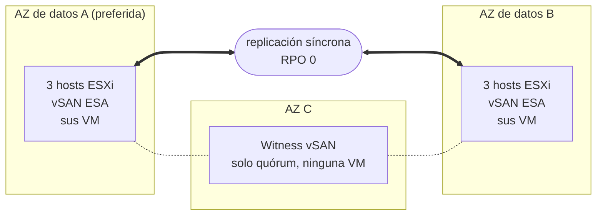

## Objetivo

**Esta guía presenta la arquitectura de Private VCF as-a-Service Stretched Cluster 3-AZ: la distribución del clúster en tres zonas de disponibilidad, la replicación de sus datos y la reacción de la plataforma cuando un componente sufre una avería.**

{/* Re-check after December 2026: the Beta opening date below will be past. */}

:::info
Private VCF as-a-Service Stretched Cluster 3-AZ está en Beta. La Beta se abre en diciembre de 2026 a un número limitado de clientes Enterprise. Para más información, consulte la [página de OVHcloud Labs](https://labs.ovhcloud.com/en/vmware-3az/) (en inglés).
:::

## El principio del stretched cluster

Private VCF as-a-Service es una plataforma VMware Cloud Foundation (VCF) 9.1 construida sobre hardware dedicado y operada por OVHcloud.

En su versión Stretched Cluster 3-AZ, su Workload Domain ejecuta **un único clúster vSphere cuyos hosts están repartidos en dos zonas de disponibilidad (AZ)** de la región Paris 3-AZ. Son las **AZ de datos**: ambas ejecutan sus máquinas virtuales y ambas contienen una copia completa de sus datos. **Una tercera AZ aloja un witness**, que solo participa en el quórum.

El almacenamiento se basa en **vSAN ESA**, configurado por OVHcloud. vSAN replica sus datos **de forma síncrona** entre las dos AZ de datos: una escritura solo se confirma una vez registrada en ambas. Por lo tanto, las dos AZ contienen siempre los mismos datos, y la pérdida de una de ellas no supone ninguna pérdida de datos: **RPO = 0 por diseño**, garantizado por la infraestructura.

:::warning
El RPO 0 requiere una replicación en espejo entre las dos AZ de datos. Mantenga sus VM en una política de almacenamiento vSAN que replique sus datos en los dos sitios: una VM asignada a una política que conserva sus datos en una sola AZ no se replica y no está protegida contra la pérdida de esa AZ.
:::

Cuando una AZ de datos sufre una avería, **vSphere HA reinicia automáticamente sus máquinas virtuales en la AZ restante**, sin intervención por su parte.

## Arquitectura

Su Workload Domain ejecuta un único clúster vSphere, extendido sobre las dos AZ de datos de la región Paris 3-AZ. El witness se encuentra en la tercera AZ.

| Componente | Ubicación | Función |
|---|---|---|
| AZ de datos A (preferida) | Primera AZ de datos | Ejecuta sus VM y contiene una copia completa de sus datos. Si las dos AZ de datos pierden el contacto, es ella la que conserva el quórum. |
| AZ de datos B | Segunda AZ de datos | Ejecuta sus VM y contiene una copia completa de sus datos. |
| Witness | Tercera AZ | Arbitra el quórum entre las AZ de datos. No almacena datos de VM ni ejecuta ninguna VM. |
| Hosts ESXi | AZ de datos | La configuración de base cuenta con 6 hosts vSAN idénticos, 3 en cada AZ de datos. El clúster crece por pares de hosts, uno en cada AZ de datos, para que ambas AZ mantengan la misma capacidad. |

OVHcloud asigna las AZ: usted dispone de dos AZ de datos distintas y de un witness en la tercera AZ, pero no elige el papel de cada AZ.

## ¿Qué ocurre en caso de avería?

El stretched cluster reacciona por sí solo a la pérdida de un host, de una AZ de datos, del witness o del enlace entre las AZ de datos.

| Elemento averiado | Qué ocurre | Datos perdidos | Su acción |
|---|---|---|---|
| Un host | vSphere HA reinicia sus VM en los demás hosts. | Ninguno | Ninguna |
| Una AZ de datos completa | Sus VM se reinician automáticamente en la AZ restante. | Ninguno | Ninguna |
| La AZ del witness | Las dos AZ de datos siguen funcionando y conservan el quórum. | Ninguno | Ninguna |
| El enlace entre las AZ de datos | La AZ preferida conserva el quórum; las VM de la otra AZ se reinician en la AZ preferida. | Ninguno | Ninguna |

Estos son los comportamientos estándar de un stretched cluster vSAN, tal como los documenta Broadcom.

:::warning
Una VM reiniciada por vSphere HA no se desplaza en caliente: se reinicia en la AZ restante, y sus aplicaciones se reinician con ella. El tiempo de recuperación de cada aplicación depende de su sistema operativo y de su configuración.
:::

### Prever la capacidad para la pérdida de una AZ

Para que todas las VM de una AZ de datos averiada se reinicien en la otra, la AZ restante debe disponer de suficiente CPU y memoria libres para ejecutarlas. Dimensione sus cargas de trabajo para que una sola AZ de datos pueda ejecutar todas las VM que deben seguir funcionando.

## Lo que el stretched cluster no sustituye

El stretched cluster protege sus cargas de trabajo contra la pérdida de infraestructura. **No es ni una copia de seguridad ni un plan de recuperación ante desastres**:

- la replicación síncrona copia todo en las dos AZ de datos al mismo tiempo, incluido un archivo eliminado, datos dañados o archivos cifrados por un ransomware;
- sus cargas de trabajo se ejecutan en un único clúster: si este clúster se ve comprometido, no existe una segunda copia a partir de la cual reiniciarlo.

Conserve una copia de seguridad y, si su actividad lo exige, una solución de recuperación ante desastres fuera del clúster. La Beta no incluye ningún servicio de copia de seguridad gestionado.

## Lo que se incluye en torno al clúster

| Ámbito | Lo que obtiene |
|---|---|
| Explotación | vSAN ESA se entrega preconfigurado, y OVHcloud realiza las actualizaciones y los parches de VCF. |
| Red | VCF Networking está incluido. Con su Workload Domain, puede contratar la extensión gratuita **Edge Services** o la opción **vDefend** para el firewall distribuido. |
| vRack | Opcional. Su Workload Domain se entrega sin vRack: tras la entrega, puede conectar un vRack que ya tenga o contratar uno nuevo. |
| Identidad | Se conecta a través de OVHcloud IAM y SSO: sin cuentas locales, y con un rol de administrador en su Workload Domain desde la entrega. |
| Disponibilidad | La plataforma está diseñada para una disponibilidad del 99,999 %. |

## Más información

[Página de producto de Private VCF as-a-Service 3-AZ](/links/hosted-private-cloud/private-vcf-aas-3-az)

[Private VCF as-a-Service Stretched Cluster 3-AZ en OVHcloud Labs](https://labs.ovhcloud.com/en/vmware-3az/) (en inglés)

[[fragment:professional-services]]

Interactúe con nuestra [comunidad de usuarios](/links/community).
