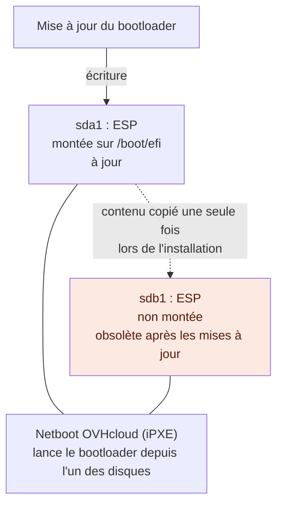
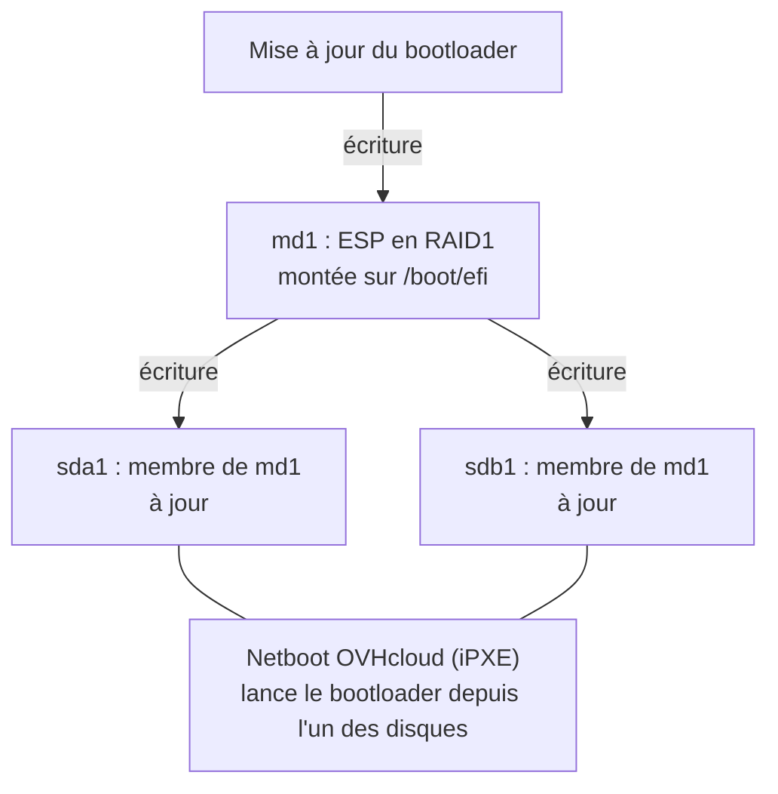

## Objectif

:::info
Ce guide concerne uniquement les serveurs qui démarrent en mode UEFI. Un serveur qui démarre en mode legacy (BIOS) n'a pas d'ESP.
:::

:::info
Une installation sur un seul disque ou sur un volume RAID matériel n'a qu'une seule ESP : elle n'est concernée par aucune des deux configurations décrites ici.
:::

Sur un serveur qui démarre en mode UEFI, la partition système EFI (ESP) contient le chargeur de démarrage (*bootloader*) du système d'exploitation (par exemple GRUB ou systemd-boot). Lorsqu'un système d'exploitation est installé sur plusieurs disques en RAID logiciel, chaque disque contient une ESP, afin que le serveur puisse toujours démarrer en cas de panne de l'un des disques.

Selon le système d'exploitation, l'installation crée soit [une ESP indépendante par disque](#une-esp-par-disque), soit [une ESP unique sur une grappe RAID1 logicielle](#une-esp-sur-un-raid1) qui s'étend sur tous les disques d'installation.

**Ce guide présente ces deux configurations, liste les systèmes d'exploitation qui utilisent chacune d'elles et décrit ce que la configuration en RAID1 change pour vous.**

## Prérequis

- Un [serveur dédié](/links/bare-metal/bare-metal) qui démarre en mode UEFI
- Un système d'exploitation Linux installé par OVHcloud sur deux disques ou plus, en RAID logiciel

## En pratique

### Comment le serveur démarre depuis l'ESP

Les serveurs dédiés OVHcloud démarrent depuis le réseau. Lorsque le serveur est configuré pour démarrer sur disque, iPXE lance, depuis l'ESP de l'un des disques, le bootloader dont le chemin a été défini lors de l'installation de l'OS. En cas d'échec, il bascule sur rEFInd, qui recherche un bootloader sur chaque disque. Consultez notre guide « [Comprendre le processus de démarrage des serveurs dédiés](/guides/bare-metal-cloud/dedicated-servers/boot-process) » pour connaître la séquence complète.

Comme le serveur peut lancer le bootloader depuis n'importe quel disque, toutes les ESP doivent être identiques et à jour.

### Une ESP par disque

Cette configuration est surtout utilisée par les systèmes d'exploitation Linux plus anciens (voir [Disponibilité selon le système d'exploitation](#disponibilité-selon-le-système-dexploitation)). Chaque disque possède sa propre ESP, et une seule d'entre elles est montée sur `/boot/efi`. À la fin de l'installation, le contenu de l'ESP montée est copié une seule fois vers les ESP des autres disques ; les mises à jour ultérieures du bootloader n'écrivent que dans l'ESP montée.



Si le serveur lance le bootloader depuis un disque dont l'ESP n'est pas à jour, il exécute un bootloader ou une configuration de démarrage obsolète : le serveur peut alors démarrer sur un noyau plus ancien, ou ne plus démarrer du tout. Pour éviter ce problème, après chaque mise à jour du bootloader, recopiez sur les autres ESP le contenu de l'ESP montée, comme décrit dans notre guide « [Gérer le RAID logiciel (mode de démarrage UEFI) sur un serveur dédié](/guides/bare-metal-cloud/dedicated-servers/raid-soft-uefi#efisystempartition) ».

Avec cette configuration, `lsblk -f` affiche une partition `vfat` portant le label `EFI_SYSPART` sur chaque disque ; une seule de ces partitions est montée sur `/boot/efi`, comme sur ce serveur sous Debian 12 :

```console
$ lsblk -f
NAME    FSTYPE            FSVER            LABEL       UUID                                 FSAVAIL FSUSE% MOUNTPOINTS
sda
├─sda1  vfat              FAT16            EFI_SYSPART 3080-06E7                             504.7M     1% /boot/efi
├─sda2  linux_raid_member 1.2              md2         37d67f91-25a1-6852-2764-b80ccc46b85a
│ └─md2 ext4              1.0              boot        17e70776-ef0c-4455-b1fa-683d246a21b9  848.4M     7% /boot
├─sda3  linux_raid_member 1.2              md3         d1ad5a59-c32f-f164-4f15-ca4799820c08
│ └─md3 ext4              1.0              root        3e641163-ab2b-4275-9f46-14cffae49540  387.4G     0% /
├─sda4  swap              1                swap-sda4   fae5b711-0373-4ac6-bdec-ac692b4ad82d                [SWAP]
└─sda5  iso9660           Joliet Extension config-2    2026-11-03-18-08-27-00
sdb
├─sdb1  vfat              FAT16            EFI_SYSPART 3095-C236
├─sdb2  linux_raid_member 1.2              md2         37d67f91-25a1-6852-2764-b80ccc46b85a
│ └─md2 ext4              1.0              boot        17e70776-ef0c-4455-b1fa-683d246a21b9  848.4M     7% /boot
├─sdb3  linux_raid_member 1.2              md3         d1ad5a59-c32f-f164-4f15-ca4799820c08
│ └─md3 ext4              1.0              root        3e641163-ab2b-4275-9f46-14cffae49540  387.4G     0% /
└─sdb4  swap              1                swap-sdb4   590ba38f-bacd-460d-8d34-91c1d8499b2b                [SWAP]
```

### Une ESP sur un RAID1

Cette configuration, utilisée par les systèmes d'exploitation Linux plus récents (voir [Disponibilité selon le système d'exploitation](#disponibilité-selon-le-système-dexploitation)), est la plus fiable des deux. Les ESP de tous les disques d'installation forment une grappe RAID1 logicielle, `md1`, et le système de fichiers FAT est créé sur cette grappe. `md1` est monté sur `/boot/efi` : les mises à jour du bootloader s'appliquent donc à tous les disques.



La grappe utilise la version 0.90 des métadonnées RAID, stockées à la fin de chacune de ses partitions. Ainsi, le firmware UEFI, qui ne gère pas le RAID logiciel, voit chacune de ces partitions comme un système de fichiers FAT ordinaire. Une fois démarré, Linux assemble `md1` et maintient ses membres synchronisés.

Avec cette configuration, `lsblk -f` affiche le type `linux_raid_member` pour l'ESP de chaque disque, et `md1` est monté sur `/boot/efi`, comme sur ce serveur sous Debian 13 :

```console
$ lsblk -f
NAME    FSTYPE            FSVER            LABEL       UUID                                 FSAVAIL FSUSE% MOUNTPOINTS
sda
├─sda1  linux_raid_member 0.90.0                       fbb410d2-eed5-8b9c-0edd-9cfbcf09b877
│ └─md1 vfat              FAT16            EFI_SYSPART 20B8-687C                             510.5M     0% /boot/efi
├─sda2  linux_raid_member 1.2              md2         6ef065ad-16e9-52ad-384c-94e574f41f0e
│ └─md2 ext4              1.0              boot        5d8c496e-5aed-4f04-a8a4-2a4690b7e556  840.5M     8% /boot
├─sda3  linux_raid_member 1.2              md3         c7110db8-4597-ab47-5f18-3d7634ff3347
│ └─md3 ext4              1.0              root        f97ca283-2a1e-4222-80a6-6abcd22f5d5d  387.6G     0% /
├─sda4  swap              1                swap-sda4   a828894f-c367-439c-bb63-c4dd9e967faa                [SWAP]
└─sda5  iso9660           Joliet Extension config-2    2026-11-03-15-24-14-00
sdb
├─sdb1  linux_raid_member 0.90.0                       fbb410d2-eed5-8b9c-0edd-9cfbcf09b877
│ └─md1 vfat              FAT16            EFI_SYSPART 20B8-687C                             510.5M     0% /boot/efi
├─sdb2  linux_raid_member 1.2              md2         6ef065ad-16e9-52ad-384c-94e574f41f0e
│ └─md2 ext4              1.0              boot        5d8c496e-5aed-4f04-a8a4-2a4690b7e556  840.5M     8% /boot
├─sdb3  linux_raid_member 1.2              md3         c7110db8-4597-ab47-5f18-3d7634ff3347
│ └─md3 ext4              1.0              root        f97ca283-2a1e-4222-80a6-6abcd22f5d5d  387.6G     0% /
└─sdb4  swap              1                swap-sdb4   198999e8-1150-46e9-a342-4c84ca48aa61                [SWAP]
```

### Disponibilité selon le système d'exploitation

L'installation crée l'ESP sur un RAID1 pour :

- **AlmaLinux** 10 et versions ultérieures
- **Debian** 13 et versions ultérieures
- **Fedora** 43 et versions ultérieures
- **Proxmox Backup Server** 4 et versions ultérieures
- **Proxmox Virtual Environment** 9 et versions ultérieures
- **Rocky Linux** 10 et versions ultérieures
- **SUSE Linux Enterprise Server for SAP Applications** 15 SP4 et versions ultérieures
- **Ubuntu Server** 26.04 et versions ultérieures

L'installation crée une ESP par disque pour :

- **AlmaLinux** 8 et 9
- **Debian** 12
- **Rocky Linux** 8 et 9
- **Ubuntu Server** 20.04, 22.04 et 24.04, qui disposent d'un mécanisme intégré pour synchroniser plusieurs ESP : le paramètre debconf `grub-efi/install_devices` du paquet `grub-efi-amd64`.
- [Bring Your Own Linux](/guides/bare-metal-cloud/dedicated-servers/bring-your-own-linux) : le bootloader est installé par le script `make_image_bootable.sh` de votre image, qu'OVHcloud ne contrôle pas. Rien ne garantit donc qu'il prenne en charge une ESP sur un RAID1.

La configuration est choisie lors de l'installation et ne change plus ensuite, même après une montée de version (par exemple de Debian 12 à Debian 13).

### Ce que la configuration en RAID1 change pour vous

- Vous n'avez plus besoin de synchroniser le contenu des ESP après les mises à jour du bootloader (procédure décrite dans notre guide « [Gérer le RAID logiciel (mode de démarrage UEFI) sur un serveur dédié](/guides/bare-metal-cloud/dedicated-servers/raid-soft-uefi#efisystempartition) ») : toute modification de l'ESP est répliquée sur tous les disques.
- Le système de fichiers FAT conserve le label `EFI_SYSPART` : la ligne `/boot/efi` du fichier `/etc/fstab` ne change donc pas.
- Les mises à jour du bootloader de votre distribution s'installent dans `/boot/efi` comme avec une ESP par disque, et sont répliquées sur chaque disque.
- Si vous exécutez vous-même `grub-install`, ajoutez l'option `--no-nvram`. Sans elle, `grub-install` tente de créer une entrée de démarrage EFI pour la grappe RAID1 et échoue. Dans tous les cas, ne modifiez pas l'ordre de boot de votre serveur, comme expliqué dans notre guide « [Comprendre le processus de démarrage des serveurs dédiés](/guides/bare-metal-cloud/dedicated-servers/boot-process#pourquoi-ne-pas-modifier-lordre-de-boot) ».
- Après un remplacement de disque, reconstruisez `md1` comme les autres grappes RAID. Consultez notre guide « [Gérer le RAID logiciel (mode de démarrage UEFI) sur un serveur dédié](/guides/bare-metal-cloud/dedicated-servers/raid-soft-uefi#raidrebuildmirrored) ».

## Aller plus loin

[Comprendre le processus de démarrage des serveurs dédiés](/guides/bare-metal-cloud/dedicated-servers/boot-process)

[Gérer le RAID logiciel (mode de démarrage UEFI) sur un serveur dédié](/guides/bare-metal-cloud/dedicated-servers/raid-soft-uefi)

[Remplacement à chaud sur un serveur dédié en RAID logiciel](/guides/bare-metal-cloud/dedicated-servers/hotswap-raid-soft)

Échangez avec notre [communauté d’utilisateurs](/links/community).
