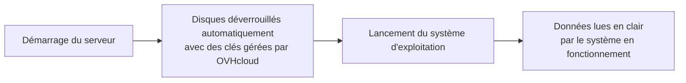

{/* REVIEW SK-2772: this page is the target of the information link in the Console activation window (action A-1). Product validation: Denis Hamon. */}

## Objectif

L'Encryption at Rest chiffre au niveau matériel tous les disques de votre serveur dédié OVHcloud. **Ce guide vous explique ce que protège l'Encryption at Rest, comment elle fonctionne et ce qu'elle change pour vous.**

:::info
**OVHcloud gère les clés de chiffrement.** Les clés sont générées, stockées et renouvelées par OVHcloud. Vous ne les gérez pas et elles ne vous sont jamais transmises. L'utilisation de vos propres clés (Key Management Service, Secret Manager ou BYOK) n'est pas disponible.
:::

## Prérequis

- Disposer d'un [serveur dédié](/links/bare-metal/bare-metal) d'une gamme et d'une région éligibles (consultez [Prérequis et limites de l'Encryption at Rest](./encryption-at-rest-limitations))

## En pratique

Cette section décrit le fonctionnement de l'Encryption at Rest, ce qu'elle protège et les points à connaître avant de l'activer.

### Fonctionnement de l'Encryption at Rest

Le chiffrement est réalisé par les disques eux-mêmes. Toute donnée écrite sur les disques est chiffrée avant d'être stockée : elle ne peut pas être lue sans les clés des disques.

Le déverrouillage est automatique. À chaque démarrage, les disques sont déverrouillés avant le lancement de votre système d'exploitation. Vous n'avez rien à saisir et votre serveur redevient opérationnel sans intervention de votre part.

### Ce que protège l'Encryption at Rest

L'Encryption at Rest protège les données d'un disque qui quitte votre serveur :

- un disque physiquement retiré ou déconnecté du serveur ;
- un disque remplacé ou arrivé en fin de vie.

{/* DRAFT: To verify — R-8 (Product, Security): confirm the protected and non-protected cases listed in this section. The draft also mentions a cryptographic erase when the server is returned; confirm before adding it. */}

### Ce que l'Encryption at Rest ne protège pas

L'Encryption at Rest ne remplace pas les mesures de sécurité que vous appliquez à votre système. Elle ne protège pas :

- les données pendant le fonctionnement de votre serveur : une fois les disques déverrouillés, le système d'exploitation les lit en clair ;
- votre système d'exploitation ou vos applications contre une attaque, y compris en ligne ;
- les données qui transitent sur le réseau.

Si vous devez aussi protéger vos données contre ces risques, ajoutez un chiffrement au niveau du système d'exploitation (par exemple <Tooltip term="luks">LUKS</Tooltip> sous Linux ou BitLocker sous Windows) et appliquez les pratiques de sécurité adaptées à vos usages.

### Bon à savoir

Lisez ces points avant d'activer l'Encryption at Rest :

- **Tous les disques ou aucun :** l'Encryption at Rest s'applique à tous les disques du serveur. Vous ne pouvez pas choisir les disques un par un.
- **Activation volontaire :** l'Encryption at Rest n'est jamais activée par défaut, y compris sur un nouveau serveur. Vous l'activez depuis la <ManagerLink to="/">console OVHcloud</ManagerLink> ou l'API OVHcloud.
- **Effacement des données :** l'activation de l'Encryption at Rest efface toutes les données du serveur, et le système d'exploitation doit ensuite être réinstallé. Sauvegardez vos données au préalable.
- **Désactivation :** [TODO: how a customer disables Encryption at Rest at GA — the Console offers no disable action and the API update routes are not public yet. Disabling erases the disks through a cryptographic erase and requires an OS reinstall. QA Campaign C1 (staging, 30 Oct 2026) PASSED "Deactivation, server kept" via API and Manager, and "Reactivation after deactivation" via Manager — but the Console code of 10 Nov 2026 has no disable label yet (sandbox build?). Document the labels that ship.]
- **Sauvegardes :** vos outils de sauvegarde (Veeam, Restic, etc.) continuent de fonctionner. Ils lisent vos données telles que le système d'exploitation les voit.
- **Tarification :** [TODO: R-5 — included or paid option, to confirm with Product]

{/* REVIEW R-3: do not add any regulatory framework (GDPR, ISO 27001, HDS, PCI-DSS, SecNumCloud) until Legal/Compliance has validated the mapping (action A-5). */}

## Aller plus loin

[Activer l'Encryption at Rest sur un serveur dédié](./encryption-at-rest-enable)

[Gérer l'Encryption at Rest d'un serveur dédié avec l'API OVHcloud](./encryption-at-rest-api)

[Prérequis et limites de l'Encryption at Rest](./encryption-at-rest-limitations)

[FAQ Encryption at Rest des serveurs dédiés](./encryption-at-rest-faq)

Echangez avec notre [communauté d'utilisateurs](/links/community).
