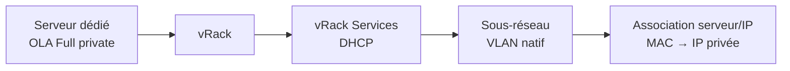

import Api from '@components/Api';

{/* BROUILLON SK-2837 — traduit de l'EN (/translate) le 2026-11-03. Sources : cache SOT (manager-v8 2026-10-28, api 2026-10-20),
    Product Note « BM Full Private Experience » + spécification du prototype backoffice (données simulées). La carte de boot privé
    n'est PAS encore dans le cache de la console : les libellés marqués « À vérifier » sont des propositions FR issues de la spécification.
    La route API privateBoot n'est PAS dans api.json. Ne pas publier avant vérification des deux. */}

## Objectif

Par défaut, un serveur dédié OVHcloud a besoin d'une adresse IPv4 publique et des serveurs PXE (Preboot Execution Environment) publics d'OVHcloud à chaque démarrage. Le boot privé permet à un serveur en mode OVHcloud Link Aggregation (OLA) **Full private** d'effectuer toute sa séquence de démarrage, de la mise sous tension jusqu'au script iPXE, sur votre [vRack](/links/network/vrack). Le serveur conserve la même adresse IP privée d'un redémarrage à l'autre, sans configuration d'IP statique dans son système d'exploitation.

**Ce guide vous explique comment :**

- activer le boot privé depuis la console OVHcloud, que votre vRack dispose déjà ou non d'un vRack Services ;
- suivre la configuration et la reprendre si une étape échoue ;
- modifier ou désactiver le boot privé ;
- activer le boot privé avec l'API OVHcloud ;
- utiliser le mode rescue ou réinstaller le serveur pendant cette première version du boot privé.

:::warning
Dans cette première version, le mode rescue et l'installation d'un OS ne sont pas disponibles via le réseau privé. Pour les utiliser, vous devez repasser temporairement le serveur en boot public. Consultez la  « []() ».

:: :

## Prérequis

- Disposer d'un [serveur dédié](/links/bare-metal/bare-metal) compatible dans votre compte OVHcloud : High Grade Gen 2 ou plus récent, Scale Gen 2 ou plus récent, ou Advance Gen 3 ou plus récent. {/* [UNVERIFIED : api] Product Note PBM11 ; capability d'éligibilité (LVL2-29061) absente d'api.json */}
- Avoir activé l'[OVHcloud Link Aggregation (OLA)](/guides/bare-metal-cloud/dedicated-servers/ola-enable-manager) sur le serveur, en mode **Full private**.
- Avoir rattaché le serveur à un [vRack](/guides/bare-metal-cloud/dedicated-servers/vrack-configuring-on-dedicated-server).
- Avoir accès à la <ManagerLink to="/beta/#/bare-metal/dedicated-server">console OVHcloud</ManagerLink> ou, pour le scénario API, disposer d'identifiants API OVHcloud (consultez le guide « [Premiers pas avec les API OVHcloud](/guides/manage-and-operate/api/first-steps) »).

## Introduction

Le boot privé s'appuie sur [vRack Services](/guides/network/vrack-services/global), la couche réseau managée de votre vRack. Son service DHCP répond aux requêtes de démarrage que le serveur envoie sur son interface privée et lui attribue l'adresse IP privée liée à son adresse MAC. Le boot privé fonctionne uniquement sur le VLAN natif (trafic non tagué). {/* [UNVERIFIED : manager-v8] spécification §4 « Eligible subnet » ; aucun libellé console pour l'instant */}

## En pratique

Cette section présente le fonctionnement du boot privé, puis chaque façon de l'activer.

**Sommaire :**

- [Fonctionnement du boot privé](#overview)
- [Ouvrir la carte du boot privé](#common-setup)
- [Scénario A : premier boot privé, vRack Services créé pour vous](#scenario-a)
- [Scénario B : utiliser un vRack Services existant](#scenario-b)
- [Scénario C : activer le boot privé avec l'API OVHcloud](#scenario-api)
- [Statuts de l'adresse IP](#ip-statuses)
- [Suivre la configuration et gérer un échec](#workflow)
- [Modifier ou désactiver le boot privé](#modify-disable)
- [Utiliser le mode rescue ou réinstaller le serveur](#rescue-reinstall)
- [Limites du boot privé](#limitations)
- [Résoudre les problèmes de boot privé](#troubleshooting)

### Fonctionnement du boot privé <a name="overview"></a>

Lorsque le boot privé est activé, le serveur envoie ses requêtes de démarrage (DHCP, puis PXE et iPXE) sur son interface privée. Le service DHCP de vRack Services y répond et le serveur démarre depuis le réseau privé.



| Terme | Description |
|---|---|
| Sous-réseau | La plage IPv4 privée dans laquelle le serveur démarre. Elle ne doit pas avoir de VLAN. |
| Plage de services | Un bloc du sous-réseau, de /27 à /29, réservé aux services gérés par OVHcloud, comme le DHCP. N'attribuez pas ces adresses à vos machines. |
| Association serveur/IP | Le lien entre l'adresse MAC du serveur et son adresse IP privée. Consultez le guide « [Gérer les associations serveur/IP dans vRack Services](/guides/network/vrack-services/server-ip-associations) ». |

Ce que vous avez à saisir dépend de ce que votre <Tooltip term="vrack">vRack</Tooltip> contient déjà dans la région du serveur :

| Votre vRack contient… | Ce que fait la console à l'activation du boot privé | Scénario |
|---|---|---|
| Aucun vRack Services dans la région du serveur | En commande un gratuitement, le rattache au vRack, crée le sous-réseau, puis active le boot privé | [A](#scenario-a) |
| Un vRack Services sans sous-réseau | Crée le sous-réseau, puis active le boot privé | [B](#scenario-b) |
| Un vRack Services avec un sous-réseau éligible | Ajoute l'association (et la plage de services si le sous-réseau n'en a pas), puis active le boot privé | [B](#scenario-b) |
| Boot privé déjà activé | Affiche un récapitulatif en lecture seule | [Modifier](#modify-disable) |

### Ouvrir la carte du boot privé <a name="common-setup"></a>

Tous les scénarios console partent de l'onglet **Connectivité** du serveur.

Pendant la bêta, ouvrez la <ManagerLink to="/beta/#/bare-metal/dedicated-server">console OVHcloud</ManagerLink> à l'aide du bouton <code className="action">Découvrir la console &gt;BETA_</code> en haut à droite.

1. Sélectionnez votre serveur.
2. Ouvrez l'onglet <code className="action">Connectivité</code>.
3. Repérez la carte **Démarrer depuis le réseau privé**.

{/* DRAFT: To verify — titre de carte « Boot from private network » (spécification §3), absent du cache console ; libellé FR proposé. */}
{/* DRAFT: To screenshot — onglet Connectivité avec la carte de boot privé, interrupteur désactivé. */}

La carte n'apparaît que si la gamme du serveur prend en charge le boot privé et si le serveur est rattaché à un vRack. S'il n'est rattaché à aucun vRack, cliquez sur <code className="action">Attacher un vRack</code> dans la carte **Interface privée (vRack)**, sélectionnez le vRack, puis cliquez sur <code className="action">Attacher</code>.

### Scénario A : premier boot privé, vRack Services créé pour vous <a name="scenario-a"></a>

Suivez ce scénario si votre vRack n'a aucun vRack Services dans la région du serveur. La console en commande un pour vous, gratuitement, pendant l'activation du boot privé. {/* [UNVERIFIED : api] « gratuitement » issu de la spécification §7 ; vérifier le prix catalogue de vRack Services */}

1. Activez l'interrupteur **Démarrer depuis le réseau privé**. Le formulaire affiche :
    - **vRack** : le vRack du serveur, verrouillé. Pour utiliser un autre vRack, modifiez-le dans la carte **Interface privée (vRack)**.
    - **Sous-réseau** : un nouveau sous-réseau, prérempli avec une plage suggérée. Remplacez-la si besoin par une plage de votre propre plan d'adressage privé.
    - **Plage de services** : préremplie avec le premier bloc /29 du sous-réseau.
    - **Adresse IP** : préremplie avec la première adresse libre après la plage de services. Le serveur reçoit cette adresse.

    Le schéma **Chemin résultant** affiché à côté du formulaire indique le vRack Services comme **Sera créé**.
2. Vérifiez le statut sous le champ **Adresse IP**. Il doit être **Disponible** (consultez la  « []() »).
3. Cliquez sur <code className="action">Activer le boot privé</code>.
4. Une fenêtre présente le vRack Services à commander et les conditions générales. Cochez la case, puis cliquez sur <code className="action">Accepter et activer</code>.

{/* DRAFT: To verify — libellés des champs, « Will be created », « Enable private boot » et « Accept and enable » (spécification §5-§7) ; libellés FR proposés. */}
{/* DRAFT: To screenshot — formulaire prérempli avec le vRack Services en pointillés dans le Chemin résultant. */}
{/* DRAFT: To screenshot — fenêtre des conditions générales. */}

La carte passe à l'état **En attente** et exécute 4 étapes : commander le vRack Services, le rattacher au vRack, configurer le sous-réseau, la plage de services et l'adresse IP, puis activer le boot privé sur le serveur. Consultez la  « []() ».

#### Vérifier le scénario A

| Vérification | Méthode | Résultat attendu |
|---|---|---|
| Le boot privé est activé | Carte **Démarrer depuis le réseau privé** | Statut **Actif**, avec le récapitulatif de la configuration |
| Le vRack Services existe | Console > vRack Services | Un nouveau vRack Services, rattaché au vRack du serveur, dans la région du serveur |
| Le serveur démarre en privé | Redémarrez le serveur, puis ouvrez sa console <Tooltip term="kvmConsole">KVM/IPMI</Tooltip> | Le serveur reçoit l'adresse IP indiquée dans le récapitulatif |

### Scénario B : utiliser un vRack Services existant <a name="scenario-b"></a>

Suivez ce scénario si votre vRack dispose déjà d'un vRack Services dans la région du serveur. Rien n'est commandé : aucune fenêtre de conditions générales ne s'ouvre.

1. Activez l'interrupteur **Démarrer depuis le réseau privé**. Le **vRack** est verrouillé et le **vRack Services** renvoie vers sa page.
2. Sélectionnez ou saisissez le sous-réseau :
    - si le vRack Services a un sous-réseau éligible, le premier est présélectionné dans la liste **Sous-réseau**. Sa plage de services est en lecture seule, ou préremplie si le sous-réseau n'en a pas. Pour utiliser une autre plage, sélectionnez <code className="action">Créer un nouveau sous-réseau</code> en bas de la liste ;
    - si le vRack Services n'a aucun sous-réseau, un nouveau sous-réseau, sa plage de services et une adresse IP sont préremplis, comme dans le [scénario A](#scenario-a).
3. Vérifiez que le statut de l'**Adresse IP** est **Disponible**. L'adresse préremplie ignore les adresses déjà attribuées à d'autres serveurs.
4. Cliquez sur <code className="action">Activer le boot privé</code>.

{/* DRAFT: To verify — « Create a new subnet » et le comportement de la plage de services en lecture seule (spécification §5.3-§5.4) ; libellé FR proposé. */}
{/* DRAFT: To screenshot — liste des sous-réseaux avec le premier sous-réseau éligible présélectionné. */}

La carte passe à l'état **En attente** et exécute 2 étapes : configurer le sous-réseau, la plage de services et l'adresse IP sur le vRack Services, puis activer le boot privé sur le serveur.

#### Vérifier le scénario B

| Vérification | Méthode | Résultat attendu |
|---|---|---|
| Le boot privé est activé | Carte **Démarrer depuis le réseau privé** | Statut **Actif** |
| L'association existe | Console > vRack Services > votre vRack Services | L'adresse MAC du serveur est liée à l'adresse IP indiquée dans le récapitulatif |
| Le serveur démarre en privé | Redémarrez le serveur, puis ouvrez sa console KVM/IPMI | Le serveur reçoit cette adresse IP |

### Scénario C : activer le boot privé avec l'API OVHcloud <a name="scenario-api"></a>

Suivez ce scénario pour automatiser le boot privé, par exemple sur un parc de serveurs. Le vRack Services, son sous-réseau et sa plage de services doivent déjà exister.

{/* DRAFT: To verify — la route du boot privé est absente du cache du schéma API (api.json, 2026-10-20). Route, version et corps issus de la Product Note (PBM5). */}

1. Récupérez l'adresse MAC des interfaces réseau du serveur :

<Api version="v1" section="/dedicated/server" method="GET" route={"/dedicated/server/{serviceName}/networkInterfaceController"} />

2. Créez l'association serveur/IP pour cette adresse MAC, comme décrit dans le guide « [Gérer les associations serveur/IP dans vRack Services](/guides/network/vrack-services/server-ip-associations) ».

3. Activez le boot privé sur le serveur :

<Api version="v1" section="/dedicated/server" method="PUT" route={"/dedicated/server/{serviceName}/privateBoot"} />

| Paramètre | Obligatoire | Description | Exemple |
|---|---|---|---|
| `serviceName` | Oui | Nom de votre serveur dédié. | `ns1234567.ip-203-0-113.eu` |
| `enabled` (corps) | Oui | `true` pour activer le boot privé, `false` pour le désactiver. | `true` |
| `vrackId` (corps) | Oui | Identifiant du vRack depuis lequel le serveur démarre. | `pn-123456` |

```json
{
  "enabled": true,
  "vrackId": "pn-123456"
}
```

La réponse renvoie l'état du boot privé mis à jour et l'heure à laquelle il a pris effet. [TODO : nom et champs du modèle de réponse]

#### Vérifier le scénario C

| Vérification | Méthode | Résultat attendu |
|---|---|---|
| Le boot privé est activé | `GET` sur la même route [TODO : confirmer qu'un GET existe] | `enabled` vaut `true` |
| Le serveur démarre en privé | Redémarrez le serveur | Le serveur reçoit l'adresse IP de son association |

### Statuts de l'adresse IP <a name="ip-statuses"></a>

La console vérifie l'adresse IP au fil de la saisie. Le bouton <code className="action">Activer le boot privé</code> n'est disponible que lorsque le statut est **Disponible**.

{/* DRAFT: To verify — libellés des statuts (spécification §5.5) ; libellés FR proposés. */}

| Statut | Signification |
|---|---|
| **Disponible** | L'adresse peut être utilisée. |
| **Adresse IPv4 non valide** | La valeur n'est pas une adresse IPv4 valide. |
| **Hors du sous-réseau** | L'adresse n'appartient pas au sous-réseau sélectionné. |
| **Adresse réseau ou de broadcast** | L'adresse est la première ou la dernière du sous-réseau. |
| **Réservée à OVHcloud** | L'adresse se trouve dans la plage de services. |
| **Réservée : dans la plage BGP** | L'adresse se trouve dans la plage BGP du sous-réseau. |
| **Déjà attribuée** | L'adresse est déjà liée à un autre serveur. |

:::tip
OVHcloud ne peut vérifier que les adresses qu'elle gère. Avant d'activer le boot privé, assurez-vous que l'adresse n'est pas déjà utilisée par une autre machine de votre vRack.

:: :

### Suivre la configuration et gérer un échec <a name="workflow"></a>

La configuration peut prendre plusieurs minutes. Vous pouvez quitter la page : les étapes se poursuivent en arrière-plan, chacune avec son propre statut dans la carte.

Une fois toutes les étapes réussies :

- la carte passe à l'état **Actif** et affiche le vRack, le vRack Services, le sous-réseau, la plage de services et l'adresse IP ;
- une notification récapitule la configuration et l'adresse IP attribuée ;
- le serveur démarre depuis le réseau privé **à son prochain redémarrage**.

Si une étape échoue :

1. La carte passe à l'état **Erreur** et l'étape en échec est mise en évidence avec son message d'erreur. Les ressources déjà créées sont conservées et listées.
2. Cliquez sur <code className="action">Réessayer</code> pour reprendre à partir de l'étape en échec.
3. Si l'erreur persiste, cliquez sur <code className="action">Contacter le support</code>.

{/* DRAFT: To verify — libellés « Retry » et « Contact support », et texte de la notification (spécification §8). */}
{/* DRAFT: To screenshot — carte à l'état Erreur avec l'étape en échec mise en évidence. */}

### Modifier ou désactiver le boot privé <a name="modify-disable"></a>

Vous pouvez changer le sous-réseau ou l'adresse IP d'un boot privé actif, ou le désactiver en conservant sa configuration.

- **Modifier** : cliquez sur <code className="action">Modifier</code> dans la carte, changez le sous-réseau ou l'adresse IP, puis cliquez sur <code className="action">Enregistrer et appliquer</code>. Le serveur utilise la nouvelle adresse à son prochain redémarrage.
- **Désactiver** : désactivez l'interrupteur **Démarrer depuis le réseau privé**. La dernière configuration est conservée pour une prochaine réactivation. Avec l'API, envoyez l'[appel du boot privé](#scenario-api) avec `"enabled": false`.

{/* DRAFT: To verify — libellés « Modify » et « Save and apply », et confirmation éventuelle à la désactivation (la spécification §9 conserve le comportement du prototype précédent). */}

### Utiliser le mode rescue ou réinstaller le serveur <a name="rescue-reinstall"></a>

Dans cette première version, l'environnement rescue et l'installation de l'OS passent encore par le réseau public. Tant que le serveur est en mode Full private, le changement de mode de démarrage échoue avec le message *« Impossible de changer le mode de démarrage : aucune interface réseau publique n'est activée sur ce serveur. »*

Pour démarrer le serveur en [mode rescue](/guides/bare-metal-cloud/dedicated-servers/rescue-mode) ou le réinstaller :

1. Désactivez le boot privé (consultez la  « []() »).
2. Rétablissez l'interface publique : dans la carte **OVHcloud Link Aggregation (OLA)**, cliquez sur <code className="action">Réinitialiser</code>, puis sur <code className="action">Confirmer</code>.
3. Lancez l'opération : <code className="action">Mode rescue</code> puis <code className="action">Redémarrer</code>, ou <code className="action">Réinstaller</code>.
4. Une fois l'opération terminée, réactivez l'OLA en mode **Full private**, puis le boot privé. Sa configuration précédente et l'association serveur/IP du serveur sont conservées.

{/* DRAFT: To verify — l'étape 2 (réinitialisation OLA) est-elle requise en M1, ou la désactivation du boot privé suffit-elle à rétablir le boot public ? À confirmer par l'équipe produit (procédure de contournement PBM13). */}

:::warning
Pendant la réinitialisation de l'OLA, le serveur redevient joignable sur son interface publique. Planifiez cette opération pendant une fenêtre de maintenance.

:: :

### Limites du boot privé <a name="limitations"></a>

La première version du boot privé présente les limites suivantes.

| Limite | Détails |
|---|---|
| Mode rescue et installation d'un OS | Non disponibles via le réseau privé. Repassez temporairement le serveur en boot public, comme décrit dans la  « []() ». |
| VLAN natif uniquement | Un sous-réseau configuré avec un VLAN ne peut pas servir au boot privé. |
| Gammes compatibles uniquement | High Grade Gen 2 ou plus récent, Scale Gen 2 ou plus récent, Advance Gen 3 ou plus récent. La carte n'apparaît pas sur les autres serveurs. |
| Un sous-réseau par vRack Services | Pendant la bêta, un vRack Services ne peut héberger qu'un seul sous-réseau. [TODO : taille du sous-réseau — la console exige actuellement un /24, la spécification autorise /23 à /28] |
| Vérification des adresses | OVHcloud ne vérifie que les adresses qu'elle gère, pas les machines configurées avec une adresse IP statique dans votre vRack. |

### Résoudre les problèmes de boot privé <a name="troubleshooting"></a>

Le tableau ci-dessous liste les problèmes les plus courants lors de l'activation du boot privé.

| Problème | Cause possible | Solution |
|---|---|---|
| La carte **Démarrer depuis le réseau privé** n'apparaît pas | La gamme du serveur n'est pas compatible, ou le serveur n'est rattaché à aucun vRack | Vérifiez la gamme du serveur dans les prérequis, puis cliquez sur <code className="action">Attacher un vRack</code> dans la carte **Interface privée (vRack)**. |
| Le bouton <code className="action">Activer le boot privé</code> reste indisponible | Le statut de l'adresse IP n'est pas **Disponible** | Changez l'adresse en fonction de son [statut](#ip-statuses). |
| Une étape échoue | Erreur temporaire, ou conflit sur le vRack Services | Cliquez sur <code className="action">Réessayer</code>. Si l'erreur persiste, cliquez sur <code className="action">Contacter le support</code>. |
| Le serveur démarre toujours sur le réseau public | Le serveur n'a pas redémarré depuis l'activation du boot privé | Redémarrez le serveur. |
| Le serveur ne reçoit pas son adresse IP privée | Son association serveur/IP a été supprimée ou modifiée | Vérifiez l'association dans [vRack Services](/guides/network/vrack-services/server-ip-associations). |

## Aller plus loin

[Gérer les associations serveur/IP dans vRack Services](/guides/network/vrack-services/server-ip-associations)

[Comprendre l'agrégation de liens sur les serveurs dédiés](/guides/bare-metal-cloud/dedicated-servers/link-aggregation-overview)

[Configurer l'agrégation de liens OLA dans votre espace client](/guides/bare-metal-cloud/dedicated-servers/ola-enable-manager)

[Gestion du reboot de vos serveurs avec la fonctionnalité OVHcloud Link Aggregation](/guides/bare-metal-cloud/dedicated-servers/pxe-with-full-private-dedicated)

[Activer et utiliser le mode rescue](/guides/bare-metal-cloud/dedicated-servers/rescue-mode)

[vRack Services - Exposer un service managé sur votre vRack](/guides/network/vrack-services/global)

Échangez avec notre [communauté d'utilisateurs](/links/community).
