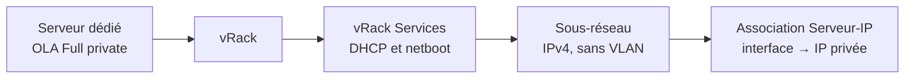

import Api from '@components/Api';

## Objectif

Par défaut, un serveur dédié OVHcloud a besoin d'une adresse IPv4 publique et des serveurs PXE (Preboot Execution Environment) publics d'OVHcloud à chaque démarrage. Le démarrage privé permet à un serveur en mode OVHcloud Link Aggregation (OLA) **Full private** d'effectuer toute sa séquence de démarrage, de la mise sous tension jusqu'au script iPXE, sur votre [vRack](/links/network/vrack). Le serveur conserve la même adresse IP privée d'un redémarrage à l'autre, sans configuration d'IP statique dans son système d'exploitation.

**Ce guide vous explique comment :**

- vérifier que le démarrage privé est disponible pour votre serveur ;
- activer le démarrage privé depuis la console OVHcloud, y compris si votre serveur n'a encore ni vRack, ni vRack Services, ni sous-réseau ;
- suivre la configuration et la relancer en cas d'échec ;
- modifier ou désactiver le démarrage privé ;
- activer le démarrage privé avec l'API OVHcloud ;
- utiliser le mode rescue ou réinstaller le serveur pendant cette première version du démarrage privé.

:::warning
Dans cette première version, le mode rescue et l'installation d'un OS ne sont pas disponibles via le réseau privé. Pour les utiliser, vous devez repasser temporairement le serveur en démarrage public. Consultez la section « [Utiliser le mode rescue ou réinstaller le serveur](#rescue-reinstall) ».

:::

## Prérequis

- Disposer d'un [serveur dédié](/links/bare-metal/bare-metal) compatible avec le démarrage privé dans votre compte OVHcloud : High Grade Gen 2 ou plus récent, Scale Gen 2 ou plus récent, ou Advance Gen 3 ou plus récent (consultez la section « [Vérifier la disponibilité du démarrage privé](#availability) »).
- Avoir activé l'[OVHcloud Link Aggregation (OLA)](/guides/bare-metal-cloud/dedicated-servers/ola-enable-manager) sur le serveur, en mode **Full private**.
- Avoir accès à la <ManagerLink to="/beta/#/bare-metal/dedicated-server">console OVHcloud</ManagerLink> ou, pour la procédure API, disposer d'identifiants API OVHcloud (consultez le guide « [Premiers pas avec les API OVHcloud](/guides/manage-and-operate/api/first-steps) »).

Vous n'avez besoin ni de vRack, ni de vRack Services, ni de sous-réseau pour commencer : la console vous permet de commander ou de créer chaque ressource manquante depuis le formulaire du démarrage privé.

## Introduction

Le démarrage privé s'appuie sur [vRack Services](/guides/network/vrack-services/global), la couche réseau managée de votre <Tooltip term="vrack">vRack</Tooltip>. Son service DHCP répond aux requêtes de démarrage que le serveur envoie sur son interface privée et lui attribue l'adresse IP privée liée à cette interface. Le démarrage privé fonctionne uniquement sur un sous-réseau IPv4 sans VLAN (trafic non tagué).

## En pratique

Cette section présente le fonctionnement du démarrage privé, puis chaque façon de l'activer.

**Sommaire :**

- [Fonctionnement du démarrage privé](#overview)
- [Vérifier la disponibilité du démarrage privé](#availability)
- [Activer le démarrage privé depuis la console OVHcloud](#console)
- [Suivre la configuration et gérer un échec](#workflow)
- [Modifier ou désactiver le démarrage privé](#modify-disable)
- [Activer le démarrage privé avec l'API OVHcloud](#api)
- [Utiliser le mode rescue ou réinstaller le serveur](#rescue-reinstall)
- [Limites du démarrage privé](#limitations)
- [Résoudre les problèmes de démarrage privé](#troubleshooting)

### Fonctionnement du démarrage privé <a name="overview"></a>

Lorsque le démarrage privé est activé, le serveur envoie ses requêtes de démarrage (DHCP, puis PXE et iPXE) sur son interface privée. Le service DHCP de vRack Services y répond et le serveur démarre depuis le réseau privé.



| Terme | Description |
|---|---|
| Sous-réseau | La plage IPv4 privée dans laquelle le serveur démarre. Elle ne doit pas avoir de VLAN. |
| Plage de service | Un bloc du sous-réseau, de /27 à /29, réservé aux services gérés par OVHcloud, comme le serveur DHCP. N'attribuez pas ces adresses à vos machines. |
| Association Serveur-IP | Le lien entre l'interface privée du serveur et son adresse IP dans le sous-réseau. L'activation du démarrage privé la crée, et sa suppression désactive le démarrage privé. Consultez le guide « [Gérer les associations Serveur-IP dans vRack Services](/guides/network/vrack-services/server-ip-associations) ». |

### Vérifier la disponibilité du démarrage privé <a name="availability"></a>

La carte **Démarrage sur le réseau privé** n'apparaît dans l'onglet <code className="action">Connectivité</code> du serveur que si le démarrage privé est disponible pour votre compte OVHcloud et si le modèle du serveur le prend en charge. Si la carte n'apparaît pas, le démarrage privé n'est pas disponible pour ce serveur.

Si la carte est affichée mais que le serveur n'est pas en mode OLA **Full private**, elle indique **Configurez d'abord l'OLA en mode Full private** et son interrupteur est indisponible. Cliquez sur <code className="action">Configurer l'OLA</code> pour agréger les interfaces du serveur, comme décrit dans le guide « [Configurer l'agrégation de liens OLA dans votre espace client](/guides/bare-metal-cloud/dedicated-servers/ola-enable-manager) ». Pendant la modification de l'OLA, la carte indique **Passage en OLA Full private en cours**, puis le démarrage privé devient disponible.

:::warning
Le mode OLA **Full private** agrège toutes les interfaces du serveur sur le vRack et coupe sa connectivité Internet publique.

:::

Avec l'API, listez les régions et les zones de disponibilité où le démarrage privé est disponible. La fonctionnalité `netboot` de chaque région vaut `AVAILABLE`, `PARTIALLY_AVAILABLE` (dans certaines zones de disponibilité) ou `UNAVAILABLE` :

<Api version="v2" section="/vrackServices" method="GET" route={"/vrackServices/reference/featureAvailability"} />

### Activer le démarrage privé depuis la console OVHcloud <a name="console"></a>

Pendant la bêta, ouvrez la <ManagerLink to="/beta/#/bare-metal/dedicated-server">console OVHcloud</ManagerLink> à l'aide du bouton <code className="action">Découvrir la console &gt;BETA_</code> en haut à droite, puis sélectionnez votre serveur.

1. Ouvrez l'onglet <code className="action">Connectivité</code>.
2. Dans la carte **Démarrage sur le réseau privé**, activez l'interrupteur. Le formulaire s'ouvre. Chaque champ devient disponible une fois le précédent renseigné.
3. Dans le champ **vRack**, sélectionnez le vRack depuis lequel le serveur démarre. Si le serveur est déjà rattaché à un vRack, celui-ci est affiché et ne peut pas être changé. Si votre compte n'a aucun vRack, cliquez sur <code className="action">Commander un vRack</code>.
4. Dans le champ **vRack Service**, sélectionnez le vRack Services de ce vRack dans la région du serveur. S'il n'y en a aucun, cliquez sur <code className="action">Commander un vRack Service</code>.
5. Dans le champ **Sous-réseau**, sélectionnez un sous-réseau IPv4 sans VLAN. Pour utiliser une nouvelle plage, cliquez sur <code className="action">Créer un nouveau sous-réseau</code>, ou sur <code className="action">Créer un sous-réseau</code> si le vRack Services n'en a aucun. Si le sous-réseau n'a pas encore de plage de service, cliquez sur <code className="action">Configurer la plage de service</code> : la page du sous-réseau s'ouvre dans un nouvel onglet.
6. Vérifiez la **Plage de service**, affichée une fois le sous-réseau sélectionné.
7. Dans le champ **Adresse IP**, complétez l'adresse avec laquelle le serveur démarrera. Le préfixe du sous-réseau est prérempli : saisissez le dernier nombre.
8. Vérifiez le panneau **Chemin obtenu**, qui affiche le serveur, le vRack, le vRack Service, le sous-réseau et l'adresse IP.
9. Cliquez sur <code className="action">Enregistrer et appliquer</code>.

Si le serveur n'est pas encore rattaché au vRack sélectionné, la fenêtre **Attacher un réseau privé vRack** s'ouvre. Elle indique que l'interface réseau du serveur sera rattachée au vRack, puis qu'il démarrera depuis le sous-réseau avec l'adresse IP choisie. Confirmez pour rattacher le serveur et appliquer la configuration.

Lorsque vous commandez un vRack ou un vRack Services, ou que vous créez un sous-réseau depuis le formulaire, sa progression s'affiche sous le champ. La nouvelle ressource est sélectionnée dès qu'elle est prête.

L'adresse IP doit :

- être une adresse valide du sous-réseau ;
- se trouver hors de la plage de service ;
- ne pas être la première ni la dernière adresse du sous-réseau, qui sont réservées ;
- ne pas être déjà attribuée à un autre serveur.

OVHcloud ne peut vérifier que les adresses qu'elle gère. Assurez-vous qu'aucune autre machine de votre vRack n'utilise déjà l'adresse, par exemple une machine configurée avec une adresse IP statique.

### Suivre la configuration et gérer un échec <a name="workflow"></a>

Pendant l'application de la configuration, la carte affiche **Application de la configuration du démarrage sur le réseau privé…** et son statut est **En cours**. Les champs sont verrouillés jusqu'à la fin de l'application.

En cas de succès, le statut passe à **Actif** et une notification confirme l'activation du démarrage privé. Le serveur démarre depuis le réseau privé **à son prochain redémarrage**.

En cas d'échec, le statut passe à **En erreur** et la carte en indique la raison :

| Message | Action |
|---|---|
| La configuration du réseau privé n'a pas pu être appliquée. | Cliquez sur <code className="action">Réessayer</code>. |
| Ce vRack Service a été modifié entre-temps. | Vérifiez la configuration, puis cliquez sur <code className="action">Réessayer</code>. |
| Ce vRack Service est en cours de mise à jour. | Attendez que le vRack Services soit prêt, puis appliquez de nouveau la configuration. |
| Ce vRack Service est en erreur, ou est passé en erreur pendant l'application. | Sa configuration précédente reste active, mais elle ne peut plus être modifiée sans une intervention du support OVHcloud. Contactez le support. |

Si le serveur a été rattaché au vRack avant l'échec, il le reste, et la carte l'indique. Si le rattachement est toujours en cours, la carte vous invite à cliquer de nouveau sur <code className="action">Enregistrer et appliquer</code> une fois qu'il est terminé.

### Modifier ou désactiver le démarrage privé <a name="modify-disable"></a>

Une fois le démarrage privé actif, la carte affiche sa configuration, et son interrupteur n'est plus utilisable directement : passez par <code className="action">Modifier</code> pour changer ou désactiver le démarrage privé.

- **Modifier** : cliquez sur <code className="action">Modifier</code>, changez le vRack Services, le sous-réseau ou l'adresse IP, puis cliquez sur <code className="action">Enregistrer et appliquer</code>. Le serveur utilise la nouvelle configuration à son prochain redémarrage.
- **Désactiver** : cliquez sur <code className="action">Modifier</code>, désactivez l'interrupteur, puis cliquez sur <code className="action">Enregistrer et appliquer</code>. Un avertissement indique que le serveur démarrera depuis le réseau public à son prochain redémarrage. L'association Serveur-IP du serveur est supprimée.

Pour annuler vos modifications, cliquez sur <code className="action">Annuler</code>.

La tuile **Connectivité** de l'onglet <code className="action">Vue d'ensemble</code> affiche aussi une ligne **Démarrage privé**, avec un lien <code className="action">Activer</code> ou <code className="action">Désactiver</code> qui ouvre la carte.

### Activer le démarrage privé avec l'API OVHcloud <a name="api"></a>

Avec l'API, le démarrage privé est une configuration du vRack Services : vous ajoutez une association Serveur-IP pour l'interface du serveur à la configuration DHCP d'une plage de service. Le vRack Services, son sous-réseau IPv4 sans VLAN et sa plage de service doivent déjà exister.

1. Si le serveur n'est pas encore rattaché au vRack, rattachez son interface :

<Api version="v1" section="/vrack" method="POST" route={"/vrack/\{serviceName\}/dedicatedServerInterface"} />

2. Listez les interfaces de serveur qui peuvent être associées au vRack Services. Notez l'`uuid` de l'interface de votre serveur :

<Api version="v2" section="/vrackServices" method="GET" route={"/vrackServices/resource/\{vrackServicesId\}/eligibleDedicatedServerInterfaces"} />

3. Récupérez le `checksum` et le `targetSpec` du vRack Services :

<Api version="v2" section="/vrackServices" method="GET" route={"/vrackServices/resource/\{vrackServicesId\}"} />

4. Renvoyez le `targetSpec` avec l'association ajoutée à la configuration DHCP de la plage de service, accompagné du `checksum` récupéré :

<Api version="v2" section="/vrackServices" method="PUT" route={"/vrackServices/resource/\{vrackServicesId\}"} />

```json
{
  "checksum": "609cf69014e57abfb3d892133692ac6f",
  "targetSpec": {
    "subnets": [
      {
        "az": "eu-west-gra-a",
        "cidr": "10.0.0.0/24",
        "displayName": null,
        "vlan": null
      }
    ],
    "services": {
      "serviceRange": [
        {
          "cidr": "10.0.0.0/29",
          "subnetCidr": "10.0.0.0/24",
          "serviceEndpoints": [],
          "dhcp": {
            "dedicatedServerInterfaceAssociations": [
              {
                "uuid": "f3a6c9e2-0b7d-4c1e-9a58-2d4e6b8c0f13",
                "ip": "10.0.0.10"
              }
            ]
          }
        }
      ]
    }
  }
}
```

| Paramètre | Obligatoire | Description |
|---|---|---|
| `checksum` | Oui | Checksum renvoyé par le `GET` précédent. La requête est refusée si le vRack Services a changé entre-temps. |
| `services.serviceRange[].dhcp.dedicatedServerInterfaceAssociations[].uuid` | Oui | Identifiant de l'interface du serveur, issu de l'étape précédente. |
| `services.serviceRange[].dhcp.dedicatedServerInterfaceAssociations[].ip` | Oui | Adresse IP privée du serveur. Elle doit appartenir au sous-réseau, se trouver hors de la plage de service et de toute plage BGP, ne pas être la première ni la dernière adresse du sous-réseau, et être unique dans le sous-réseau. |

Conservez toutes les autres valeurs du `targetSpec` telles que renvoyées par le `GET`. Pour le fonctionnement du `checksum` et du `targetSpec`, consultez le guide « [vRack Services - Exposer un service managé sur votre vRack](/guides/network/vrack-services/global) ».

5. Suivez la mise à jour jusqu'à ce que le vRack Services soit `READY` :

<Api version="v2" section="/vrackServices" method="GET" route={"/vrackServices/resource/\{vrackServicesId\}/task"} />

Dans le `currentState` du vRack Services, l'association indique `"netboot": true` une fois le démarrage privé actif. Pour désactiver le démarrage privé, renvoyez le `targetSpec` sans l'association.

### Utiliser le mode rescue ou réinstaller le serveur <a name="rescue-reinstall"></a>

Dans cette première version, l'environnement rescue et l'installation de l'OS passent encore par le réseau public. Tant que le serveur est en mode OLA **Full private**, son mode de démarrage ne peut pas être changé : la console affiche *« Impossible de changer le mode de démarrage : aucune interface réseau publique n'est activée sur ce serveur. »*

Pour démarrer le serveur en [mode rescue](/guides/bare-metal-cloud/dedicated-servers/rescue-mode) ou le réinstaller, repassez-le temporairement en démarrage public :

1. Notez le sous-réseau et l'adresse IP affichés dans la carte **Démarrage sur le réseau privé**, puis désactivez le démarrage privé, comme décrit dans la section « [Modifier ou désactiver le démarrage privé](#modify-disable) ». Sa désactivation supprime l'association Serveur-IP du serveur.
2. Dans l'onglet <code className="action">Connectivité</code>, dans la carte **OVHcloud Link Aggregation (OLA)**, cliquez sur <code className="action">Réinitialiser</code>, puis sur <code className="action">Confirmer</code>. Pendant la réinitialisation, la carte **Démarrage sur le réseau privé** indique **Retour de l'OLA en mode par défaut en cours**.
3. Lancez l'opération : <code className="action">Mode rescue</code> puis <code className="action">Redémarrer</code>, ou <code className="action">Réinstaller</code>.
4. Une fois l'opération terminée, configurez de nouveau l'OLA en mode **Full private**.
5. Réactivez le démarrage privé, comme décrit dans la section « [Activer le démarrage privé depuis la console OVHcloud](#console) ». Vous pouvez sélectionner le même sous-réseau et la même adresse IP.

Après un démarrage en mode rescue, la configuration réseau du système d'exploitation est inchangée. Après une réinstallation, configurez de nouveau l'agrégation de liens dans le nouveau système d'exploitation, comme décrit dans le guide « [Configurer l'agrégation de liens OLA dans votre espace client](/guides/bare-metal-cloud/dedicated-servers/ola-enable-manager) ».

:::warning
Pendant la réinitialisation de l'OLA, le serveur redevient joignable sur son interface publique. Planifiez cette opération pendant une fenêtre de maintenance.

:::

### Limites du démarrage privé <a name="limitations"></a>

La première version du démarrage privé présente les limites suivantes.

| Limite | Détails |
|---|---|
| Mode rescue et installation d'un OS | Non disponibles via le réseau privé. Repassez temporairement le serveur en démarrage public, comme décrit dans la section « [Utiliser le mode rescue ou réinstaller le serveur](#rescue-reinstall) ». |
| OLA Full private uniquement | Le démarrage privé nécessite que toutes les interfaces du serveur soient agrégées sur le vRack. |
| Sous-réseau IPv4 sans VLAN | Un sous-réseau configuré avec un VLAN ne peut pas servir au démarrage privé. |
| Sous-réseau partagé | Un sous-réseau déjà utilisé par un autre service, comme un Service Endpoint, ne peut être partagé qu'entre serveurs dédiés pour le démarrage privé. |
| Serveurs et régions compatibles | High Grade Gen 2 ou plus récent, Scale Gen 2 ou plus récent, Advance Gen 3 ou plus récent, dans une région où le démarrage privé est disponible. La carte n'apparaît pas sur les autres serveurs. |
| Taille du sous-réseau | Un sous-réseau vRack Services est une plage IPv4 /23 ou /24. Un vRack Services peut héberger jusqu'à 3 sous-réseaux. |
| Vérification des adresses | OVHcloud ne vérifie que les adresses qu'elle gère, pas les machines configurées avec une adresse IP statique dans votre vRack. |

### Résoudre les problèmes de démarrage privé <a name="troubleshooting"></a>

Le tableau ci-dessous liste les problèmes les plus courants lors de l'activation du démarrage privé.

| Problème | Cause possible | Solution |
|---|---|---|
| La carte **Démarrage sur le réseau privé** n'apparaît pas | Le modèle du serveur ne prend pas en charge le démarrage privé, ou celui-ci n'est pas disponible pour votre compte | Vérifiez la [disponibilité](#availability) du démarrage privé. |
| L'interrupteur est indisponible | Le serveur n'est pas en mode OLA **Full private**, ou le démarrage privé est déjà actif | Cliquez sur <code className="action">Configurer l'OLA</code>, ou utilisez <code className="action">Modifier</code> sur un démarrage privé actif. |
| Aucun sous-réseau ne peut être sélectionné | Le vRack Services n'a aucun sous-réseau IPv4 sans VLAN, ou son sous-réseau n'a pas de plage de service | Cliquez sur <code className="action">Créer un nouveau sous-réseau</code> ou sur <code className="action">Configurer la plage de service</code>. |
| La configuration échoue | Erreur temporaire, ou vRack Services modifié entre-temps ou en erreur | Consultez la section « [Suivre la configuration et gérer un échec](#workflow) ». |
| Le serveur démarre toujours sur le réseau public | Le serveur n'a pas redémarré depuis l'activation du démarrage privé | Redémarrez le serveur. |
| Le serveur ne démarre plus depuis le réseau privé | Son association Serveur-IP a été supprimée ou modifiée dans vRack Services | Vérifiez l'association dans [vRack Services](/guides/network/vrack-services/server-ip-associations). |

## Aller plus loin

[Gérer les associations Serveur-IP dans vRack Services](/guides/network/vrack-services/server-ip-associations)

[Comprendre l'agrégation de liens sur les serveurs dédiés](/guides/bare-metal-cloud/dedicated-servers/link-aggregation-overview)

[Configurer l'agrégation de liens OLA dans votre espace client](/guides/bare-metal-cloud/dedicated-servers/ola-enable-manager)

[Gestion du reboot de vos serveurs avec la fonctionnalité OVHcloud Link Aggregation](/guides/bare-metal-cloud/dedicated-servers/pxe-with-full-private-dedicated)

[Activer et utiliser le mode rescue](/guides/bare-metal-cloud/dedicated-servers/rescue-mode)

[vRack Services - Exposer un service managé sur votre vRack](/guides/network/vrack-services/global)

Échangez avec notre [communauté d'utilisateurs](/links/community).
