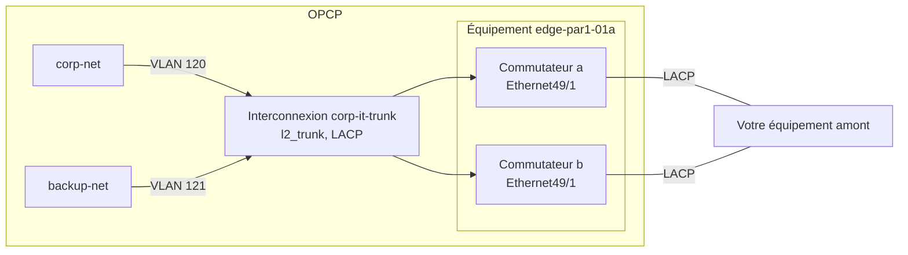

import { Tab, Tabs } from '@rspress/core/theme';

## Objectif

Par défaut, un réseau Neutron n'existe qu'à l'intérieur de la fabric réseau d'OPCP. L'**API Connectivity** vous permet d'exposer un réseau Neutron sur votre propre réseau (votre amont), à travers des ports des commutateurs de bordure (*edges*) d'OPCP. Vous choisissez les ports, leur agrégation et le VLAN qui transporte chaque réseau. OPCP configure les commutateurs pour vous.

**Ce guide explique comment déclarer des interfaces de bordure, créer une interconnexion, puis rattacher ou détacher des réseaux Neutron avec la CLI OpenStack ou l'API REST.**

Pour comprendre comment OPCP s'intègre à votre réseau avant de commencer, consultez le guide [Intégration réseau et connectivité pour OPCP](/guides/hosted-private-cloud/opcp/opcp-network-architecture).

:::info
Cette fonctionnalité est disponible à partir d'**OPCP Core `{{NEED TO BE DONE}}`**. Si l'étape 1 ci-dessous ne trouve aucun endpoint `connectivity`, votre plateforme ne la propose pas encore.

:::

:::warning
L'API Connectivity nécessite le rôle **admin**. Ses ressources ne sont **pas isolées par projet** : un administrateur de n'importe quel projet voit et modifie toutes les interfaces et interconnexions, et peut exposer hors de la fabric n'importe quel réseau Neutron de la région.<br/>
N'attribuez le rôle **admin** qu'aux personnes autorisées à raccorder les réseaux OPCP à votre amont.

:::

## Fonctionnement de l'API Connectivity

L'API Connectivity manipule quatre types d'objets :

- **Équipement (*device*) :** les commutateurs de bordure de la fabric OPCP, en général une paire nommée `a` et `b`. Les équipements sont mis en place par OVHcloud : vous pouvez les lister, pas les créer.
- **Interface :** un port physique de l'un des commutateurs (`a` ou `b`) d'un équipement. Vous déclarez les ports que vous souhaitez utiliser, avec leur vitesse et leur MTU.
- **Interconnexion :** le lien logique entre OPCP et votre amont, composé d'une ou plusieurs interfaces d'un même équipement. Son type définit la façon dont les réseaux sont transportés :
    - `l2_access` : un seul réseau Neutron, **non taggé**. Consultez la section [Mode access](/guides/hosted-private-cloud/opcp/opcp-network-architecture#mode-access).
    - `l2_trunk` : plusieurs réseaux Neutron, chacun **taggé avec son propre VLAN**. Consultez la section [Mode trunk](/guides/hosted-private-cloud/opcp/opcp-network-architecture#mode-trunk).

    Plusieurs interfaces forment une agrégation de liens (LAG). Celle-ci nécessite **LACP** et peut s'étendre sur les deux commutateurs de l'équipement pour assurer la redondance.
- **Rattachement de réseau :** un réseau Neutron exposé à travers une interconnexion.

L'exemple utilisé dans ce guide raccorde deux réseaux Neutron à votre amont via un port sur chaque commutateur, agrégés avec LACP :



**Chaque modification est asynchrone.** L'API accepte immédiatement la requête et la ressource passe à l'état `PENDING_CREATE`, `PENDING_UPDATE` ou `PENDING_DELETE` pendant la configuration des commutateurs. Elle devient ensuite `ACTIVE`, ou `ERROR` avec la raison dans son champ `status_detail`. Une ressource supprimée disparaît. Tant qu'une interconnexion, l'une de ses interfaces ou l'un de ses réseaux est en attente, toute autre modification de cette interconnexion est refusée.

## Prérequis

- Un service [OPCP](/links/hosted-private-cloud/onprem-cloud-platform) actif.
- Un accès **[OpenStack CLI configuré](/guides/hosted-private-cloud/opcp/how-to-use-api-and-get-credentials)** (`clouds.yaml` ou variables d'environnement).
- Le rôle **admin** sur un projet.
- Le plugin Connectivity de la CLI OpenStack, `python-connectivityclient`, qui ajoute les commandes `openstack border` (voir ci-dessous).
- Pour suivre les exemples de l'API REST, `curl` et `jq`.
- Les réseaux Neutron à exposer, déjà créés. Consultez le guide [Comment installer une instance depuis la CLI OpenStack](/guides/hosted-private-cloud/opcp/how-to-setup-instance-from-cli).
- Votre équipement amont câblé sur les ports des commutateurs de bordure que vous allez utiliser, et configuré en conséquence : les mêmes VLAN pour un trunk, et LACP si vous agrégez plusieurs ports.

:::warning
**`{{NEED TO BE DONE}}`**

Le paquet `python-connectivityclient` n'est **pas encore publié sur PyPI**. La procédure d'installation ci-dessous sera complétée dès que le paquet sera disponible.

```bash
pip install python-connectivityclient
openstack border version show
```

:::

## En pratique

Chaque étape présente la commande **CLI OpenStack** et son équivalent **API REST**. Choisissez un onglet une fois : ce choix s'applique à toute la page.

Pour afficher toutes les options d'une commande, ajoutez `help` devant celle-ci :

```bash
openstack help border interconnection create
```

L'aide liste toutes les options avec les limites génériques de l'API : OPCP n'accepte que les valeurs indiquées dans la section [Limites de l'API Connectivity](#limites-de-lapi-connectivity).

### Préparer votre environnement

#### 1. Vérifier l'accès à l'API Connectivity

<Tabs>
<Tab label="CLI OpenStack">

Vérifiez que la CLI accède à l'API Connectivity :

```bash
openstack border version show
```

**Exemple de sortie :**

```bash
+-------------+---------+
| Field       | Value   |
+-------------+---------+
| feature     | borders |
| id          | v1      |
| max_version | 1.0     |
| min_version | 1.0     |
| status      | CURRENT |
+-------------+---------+
```

</Tab>
<Tab label="API REST">

L'API Connectivity est publiée dans le catalogue Keystone sous le type de service `connectivity`. Récupérez un jeton et l'URL de l'API, puis enregistrez-les dans des variables d'environnement utilisées par tous les exemples de ce guide :

```bash
export OS_TOKEN=$(openstack token issue -f value -c id)
export CONNECTIVITY_URL=$(openstack endpoint list --service connectivity --interface public -f value -c URL)
export BORDERS_API="${CONNECTIVITY_URL%/}/borders/v1"
```

Si votre plateforme compte plusieurs régions, ajoutez `--region <region>` à la deuxième commande. Le jeton expire au bout d'un certain temps : lorsqu'une requête répond `401` (`connectivity.auth.unauthorized`), relancez la première commande.

Vérifiez que l'API répond :

```bash
curl -sS -H "X-Auth-Token: $OS_TOKEN" "$BORDERS_API/" | jq
```

**Exemple de sortie :**

```json
{
  "version": {
    "id": "v1",
    "feature": "borders",
    "status": "CURRENT",
    "min_version": "1.0",
    "max_version": "1.0",
    "links": [
      {
        "rel": "self",
        "href": "https://connectivity.<votre-domaine-de-plateforme>/borders/v1/"
      }
    ]
  }
}
```

Quelques règles s'appliquent à toutes les requêtes :

- Les corps de requête et de réponse sont encapsulés dans le nom de la ressource, par exemple `{"interface": {...}}`.
- Chaque modification répond `202 Accepted` : `POST` et `PUT` renvoient la ressource dans son état `PENDING_CREATE` ou `PENDING_UPDATE`, `DELETE` ne renvoie aucun corps. Relisez la ressource (`GET`) jusqu'à ce que son `provisioning_status` soit `ACTIVE` ou `ERROR`. Une ressource supprimée répond `404`.
- Les ressources sont désignées uniquement par leur identifiant : l'ID de l'équipement, les UUID des interfaces et des interconnexions, et l'UUID du réseau Neutron.
- L'en-tête `OpenStack-API-Version: connectivity 1.0` est facultatif. Sans lui, l'API utilise la version `1.0`.

</Tab>
</Tabs>

La vérification de version ne nécessite aucun rôle particulier : vos droits sont vérifiés à partir de l'étape 2. Si la liste des équipements répond `403` avec le code `connectivity.policy.forbidden`, votre jeton n'a pas le rôle **admin**.

#### 2. Identifier l'équipement de bordure et ses ports

Listez les équipements de bordure de votre plateforme et leurs commutateurs, `a` et `b` :

<Tabs>
<Tab label="CLI OpenStack">

```bash
openstack border device list --long
```

**Exemple de sortie :**

```bash
+----+---------------+-------------------+----------------------------------+
| ID | Name          | Availability Zone | Members                          |
+----+---------------+-------------------+----------------------------------+
| 17 | edge-par1-01a | par1-az1          | a=edge-par1-01a, b=edge-par1-01b |
+----+---------------+-------------------+----------------------------------+
```

Listez ensuite les ports utilisables sur l'équipement :

```bash
openstack border device port group list <device> [--member <a|b>]
```

**Exemple :**

```bash
openstack border device port group list edge-par1-01a --member a
```

**Exemple de sortie :**

```bash
+--------+--------------+----------------------------------------------------------------------------------------------------+
| Member | ID           | Modes                                                                                              |
+--------+--------------+----------------------------------------------------------------------------------------------------+
| a      | Ethernet49/1 | 1x100g: Ethernet49/1 (40000, 100000, auto)                                                         |
|        |              | 4x25g: Ethernet49/1 (25000), Ethernet49/2 (25000), Ethernet49/3 (25000), Ethernet49/4 (25000)      |
| a      | Ethernet33   | sfp: Ethernet33 (1000, 10000, auto)                                                                |
+--------+--------------+----------------------------------------------------------------------------------------------------+
```

</Tab>
<Tab label="API REST">

```bash
curl -sS -H "X-Auth-Token: $OS_TOKEN" "$BORDERS_API/devices" | jq
```

**Exemple de sortie :**

```json
{
  "devices": [
    {
      "id": "17",
      "name": "edge-par1-01a",
      "availability_zone": "par1-az1",
      "members": [
        { "role": "a", "hostname": "edge-par1-01a" },
        { "role": "b", "hostname": "edge-par1-01b" }
      ]
    }
  ],
  "links": []
}
```

Enregistrez l'ID de l'équipement, puis listez les ports utilisables sur celui-ci (le filtre `member` est facultatif) :

```bash
export DEVICE_ID=$(curl -sS -H "X-Auth-Token: $OS_TOKEN" "$BORDERS_API/devices?name=edge-par1-01a" | jq -r '.devices[0].id')
curl -sS -H "X-Auth-Token: $OS_TOKEN" "$BORDERS_API/devices/$DEVICE_ID/port-groups?member=a" | jq
```

**Exemple de sortie :**

```json
{
  "port_groups": [
    {
      "member": "a",
      "id": "Ethernet49/1",
      "modes": [
        {
          "label": "1x100g",
          "interfaces": [
            { "name": "Ethernet49/1", "speeds_mbps": [40000, 100000, null] }
          ]
        },
        {
          "label": "4x25g",
          "interfaces": [
            { "name": "Ethernet49/1", "speeds_mbps": [25000] },
            { "name": "Ethernet49/2", "speeds_mbps": [25000] },
            { "name": "Ethernet49/3", "speeds_mbps": [25000] },
            { "name": "Ethernet49/4", "speeds_mbps": [25000] }
          ]
        }
      ]
    },
    {
      "member": "a",
      "id": "Ethernet33",
      "modes": [
        {
          "label": "sfp",
          "interfaces": [
            { "name": "Ethernet33", "speeds_mbps": [1000, 10000, null] }
          ]
        }
      ]
    }
  ],
  "links": []
}
```

</Tab>
</Tabs>

Un **groupe de ports** (*port group*) est un port physique d'un commutateur, ou plusieurs ports qui changent de vitesse ensemble. Il fonctionne dans un seul **mode** à la fois, et chaque mode liste les noms d'interfaces et les vitesses (en Mbit/s) que vous pouvez déclarer :

- Dans l'exemple, le port `Ethernet49/1` peut fonctionner comme une seule interface 100G (`1x100g`), ou être divisé en quatre interfaces 25G (`4x25g`, *breakout*).
- `auto` (`null` dans l'API) signifie que la vitesse est auto-négociée.
- La première interface déclarée sur un groupe de ports fixe son mode. Les autres interfaces du groupe doivent appartenir au même mode.

:::info
Vous ne pouvez déclarer que les noms d'interfaces et les vitesses listés pour l'équipement. Si un commutateur n'a aucun groupe de ports, aucune interface ne peut y être déclarée : contactez le support OVHcloud.

:::

### Raccorder votre réseau amont

#### 3. Déclarer les interfaces

Déclarez chaque port que vous souhaitez utiliser, sur le commutateur `a` ou `b` :

<Tabs>
<Tab label="CLI OpenStack">

```bash
openstack border interface create <port-name> \
  --device <device> \
  --member <a|b> \
  [--speed-mbps <mbps>] \
  [--mtu <mtu>] \
  [--description <description>] \
  --wait
```

**Exemple :**

```bash
openstack border interface create Ethernet49/1 \
  --device edge-par1-01a --member a \
  --speed-mbps 100000 --description "Uplink to corporate network" --wait
openstack border interface create Ethernet49/1 \
  --device edge-par1-01a --member b \
  --speed-mbps 100000 --description "Uplink to corporate network" --wait
```

**Exemple de sortie (première commande) :**

```bash
+---------------------+--------------------------------------+
| Field               | Value                                |
+---------------------+--------------------------------------+
| admin_state_up      | True                                 |
| created_at          | 2026-10-29T09:30:00Z                 |
| description         | Uplink to corporate network          |
| device_id           | 17                                   |
| id                  | 0f3a9c2e-1b4d-4e5f-8a6b-7c8d9e0f1a2b |
| interconnection_id  | None                                 |
| member              | a                                    |
| mtu                 | None                                 |
| name                | Ethernet49/1                         |
| provisioning_status | ACTIVE                               |
| speed_mbps          | 100000                               |
| status              | AVAILABLE                            |
| status_detail       | None                                 |
| updated_at          | 2026-10-29T09:30:12Z                 |
+---------------------+--------------------------------------+
```

Listez les interfaces de l'équipement :

```bash
openstack border interface list --device edge-par1-01a
```

**Exemple de sortie :**

```bash
+--------------------------------------+--------------+--------+-----------+---------------------+
| ID                                   | Name         | Member | Status    | Provisioning Status |
+--------------------------------------+--------------+--------+-----------+---------------------+
| 0f3a9c2e-1b4d-4e5f-8a6b-7c8d9e0f1a2b | Ethernet49/1 | a      | AVAILABLE | ACTIVE              |
| 8c1e4b7a-2d3f-4a5b-9c6d-1e2f3a4b5c6d | Ethernet49/1 | b      | AVAILABLE | ACTIVE              |
+--------------------------------------+--------------+--------+-----------+---------------------+
```

</Tab>
<Tab label="API REST">

```bash
curl -sS -X POST -H "X-Auth-Token: $OS_TOKEN" -H "Content-Type: application/json" \
  -d '{"interface": {"name": "Ethernet49/1", "member": "a", "speed_mbps": 100000, "description": "Uplink to corporate network"}}' \
  "$BORDERS_API/devices/$DEVICE_ID/interfaces" | jq
```

**Exemple de sortie (`202 Accepted`) :**

```json
{
  "interface": {
    "id": "0f3a9c2e-1b4d-4e5f-8a6b-7c8d9e0f1a2b",
    "device_id": "17",
    "member": "a",
    "name": "Ethernet49/1",
    "description": "Uplink to corporate network",
    "speed_mbps": 100000,
    "mtu": null,
    "admin_state_up": true,
    "interconnection_id": null,
    "status": "AVAILABLE",
    "provisioning_status": "PENDING_CREATE",
    "status_detail": null,
    "created_at": "2026-10-29T09:30:00Z",
    "updated_at": "2026-10-29T09:30:00Z"
  }
}
```

Répétez la requête avec `"member": "b"`, puis enregistrez les ID des deux interfaces :

```bash
export IF_A=$(curl -sS -H "X-Auth-Token: $OS_TOKEN" "$BORDERS_API/devices/$DEVICE_ID/interfaces?name=Ethernet49/1&member=a" | jq -r '.interfaces[0].id')
export IF_B=$(curl -sS -H "X-Auth-Token: $OS_TOKEN" "$BORDERS_API/devices/$DEVICE_ID/interfaces?name=Ethernet49/1&member=b" | jq -r '.interfaces[0].id')
```

Suivez la configuration jusqu'à ce que `provisioning_status` soit `ACTIVE` ou `ERROR` :

```bash
curl -sS -H "X-Auth-Token: $OS_TOKEN" "$BORDERS_API/devices/$DEVICE_ID/interfaces/$IF_A" | jq -r '.interface.provisioning_status'
```

</Tab>
</Tabs>

Les options disponibles sont les suivantes :

| Option (CLI) | Champ (API) | Description |
|---|---|---|
| `<port-name>` | `name` | **Obligatoire.** Nom du port sur son commutateur, tel que listé dans les groupes de ports (par exemple `Ethernet49/1`). |
| `--member` | `member` | **Obligatoire.** Commutateur du port : `a` ou `b`. |
| `--speed-mbps` | `speed_mbps` | Vitesse en Mbit/s, parmi celles listées pour le port. Si elle n'est pas définie, la vitesse est auto-négociée : uniquement possible si le port liste `auto`. |
| `--mtu` | `mtu` | MTU du port. Si elle n'est pas définie, la MTU par défaut de l'équipement s'applique. Alignez-la sur la MTU de votre équipement amont. |
| `--description` | `description` | Description libre du port, appliquée sur le commutateur. |
| `--enable` / `--disable` | `admin_state_up` | État administratif du port. Activé par défaut. |

Une interface est `AVAILABLE` tant qu'elle est libre, `IN_USE` une fois affectée à une interconnexion, et `DOWN` lorsqu'elle est désactivée.

:::info
- Le **nom** et le **commutateur** d'une interface ne peuvent pas être modifiés. Pour utiliser un autre port, supprimez l'interface et déclarez-en une nouvelle.
- Les deux commutateurs d'un équipement peuvent avoir un port de même nom (ici `Ethernet49/1`). Dans la CLI, ajoutez `--member a` ou `--member b` à chaque commande qui désigne une telle interface par son nom, ou utilisez son ID.

:::

#### 4. Créer l'interconnexion

Choisissez le type d'interconnexion selon ce qu'attend votre amont :

| Type | Réseaux transportés | Cas d'usage |
|---|---|---|
| `l2_access` | Un seul réseau Neutron, non taggé | Un port de votre amont est dédié à un seul réseau. |
| `l2_trunk` | Plusieurs réseaux Neutron, chacun taggé avec son propre VLAN (802.1Q) | Votre amont reçoit plusieurs réseaux sur le même lien. |

<Tabs>
<Tab label="CLI OpenStack">

```bash
openstack border interconnection create <name> \
  --device <device> \
  --type <l2_access|l2_trunk> \
  [--lacp] \
  [--description <description>] \
  --wait
```

**Exemple (trunk agrégé avec LACP) :**

```bash
openstack border interconnection create corp-it-trunk \
  --device edge-par1-01a --type l2_trunk --lacp \
  --description "Corporate IT network" --wait
```

**Exemple de sortie :**

```bash
+---------------------+-----------------------------------------------------------+
| Field               | Value                                                     |
+---------------------+-----------------------------------------------------------+
| admin_state_up      | True                                                      |
| created_at          | 2026-10-29T09:30:00Z                                      |
| description         | Corporate IT network                                      |
| device_id           | 17                                                        |
| id                  | 5d2c1a8e-3f4b-4c6d-9e1a-7b8c9d0e1f2a                      |
| l2                  |                                                           |
| lacp                | enabled='True', min_links='1', mode='active', rate='slow' |
| mtu                 | None                                                      |
| name                | corp-it-trunk                                             |
| project_id          | 057ac6e82ade49078a5c66f4371eaf22                          |
| provisioning_status | ACTIVE                                                    |
| status_detail       | None                                                      |
| type                | l2_trunk                                                  |
| updated_at          | 2026-10-29T09:30:12Z                                      |
+---------------------+-----------------------------------------------------------+
```

**Exemple (un seul port, un réseau non taggé) :**

```bash
openstack border interconnection create corp-it-access \
  --device edge-par1-01a --type l2_access --wait
```

</Tab>
<Tab label="API REST">

Créez l'interconnexion, puis enregistrez son ID à partir de la réponse :

```bash
RESPONSE=$(curl -sS -X POST -H "X-Auth-Token: $OS_TOKEN" -H "Content-Type: application/json" \
  -d '{"interconnection": {"name": "corp-it-trunk", "device_id": "'"$DEVICE_ID"'", "type": "l2_trunk", "lacp": {"enabled": true}, "description": "Corporate IT network"}}' \
  "$BORDERS_API/interconnections")
echo "$RESPONSE" | jq
export IC_ID=$(echo "$RESPONSE" | jq -r '.interconnection.id')
```

**Exemple de sortie (`202 Accepted`) :**

```json
{
  "interconnection": {
    "id": "5d2c1a8e-3f4b-4c6d-9e1a-7b8c9d0e1f2a",
    "name": "corp-it-trunk",
    "description": "Corporate IT network",
    "project_id": "057ac6e82ade49078a5c66f4371eaf22",
    "device_id": "17",
    "type": "l2_trunk",
    "mtu": null,
    "admin_state_up": true,
    "lacp": {
      "enabled": true,
      "mode": "active",
      "rate": "slow",
      "min_links": 1
    },
    "l2": {},
    "provisioning_status": "PENDING_CREATE",
    "status_detail": null,
    "created_at": "2026-10-29T09:30:00Z",
    "updated_at": "2026-10-29T09:30:00Z"
  }
}
```

Pour un seul port transportant un réseau non taggé, utilisez `"type": "l2_access"` et omettez `lacp`.

</Tab>
</Tabs>

Les paramètres LACP appliqués par OPCP sont le mode `active`, la fréquence `slow` et un minimum de `1` lien actif. Configurez votre équipement amont en conséquence.

Les noms d'interconnexion ne sont pas uniques, et chaque administrateur de la plateforme voit toutes les interconnexions : choisissez un nom distinctif. Si deux interconnexions portent le même nom, la CLI demande l'ID de celle que vous visez.

:::warning
Le **type**, l'**équipement** et le **projet** d'une interconnexion ne peuvent pas être modifiés après sa création. Pour les changer, supprimez l'interconnexion et créez-en une nouvelle.

:::

#### 5. Affecter les interfaces à l'interconnexion

Ajoutez à l'interconnexion les interfaces déclarées à l'étape 3 :

<Tabs>
<Tab label="CLI OpenStack">

```bash
openstack border interconnection add interface <interconnection> <interface> [--member <a|b>] --wait
```

**Exemple :**

```bash
openstack border interconnection add interface corp-it-trunk Ethernet49/1 --member a --wait
openstack border interconnection add interface corp-it-trunk Ethernet49/1 --member b --wait
```

La commande n'affiche rien en cas de succès. Vérifiez les interfaces de l'interconnexion :

```bash
openstack border interconnection interface list corp-it-trunk
```

**Exemple de sortie :**

```bash
+--------------------------------------+---------------------+
| Interface ID                         | Provisioning Status |
+--------------------------------------+---------------------+
| 0f3a9c2e-1b4d-4e5f-8a6b-7c8d9e0f1a2b | ACTIVE              |
| 8c1e4b7a-2d3f-4a5b-9c6d-1e2f3a4b5c6d | ACTIVE              |
+--------------------------------------+---------------------+
```

</Tab>
<Tab label="API REST">

```bash
curl -sS -X POST -H "X-Auth-Token: $OS_TOKEN" -H "Content-Type: application/json" \
  -d '{"interface": {"interface_id": "'"$IF_A"'"}}' \
  "$BORDERS_API/interconnections/$IC_ID/interfaces" | jq
```

**Exemple de sortie (`202 Accepted`) :**

```json
{
  "interface": {
    "interface_id": "0f3a9c2e-1b4d-4e5f-8a6b-7c8d9e0f1a2b",
    "interconnection_id": "5d2c1a8e-3f4b-4c6d-9e1a-7b8c9d0e1f2a",
    "provisioning_status": "PENDING_CREATE",
    "status_detail": null,
    "created_at": "2026-10-29T09:31:00Z",
    "updated_at": "2026-10-29T09:31:00Z"
  }
}
```

Une fois la première affectation `ACTIVE`, répétez la requête avec `$IF_B`. Vérifiez ensuite les interfaces de l'interconnexion :

```bash
curl -sS -H "X-Auth-Token: $OS_TOKEN" "$BORDERS_API/interconnections/$IC_ID/interfaces" | jq
```

</Tab>
</Tabs>

Une fois affectées, les deux interfaces apparaissent avec le statut `IN_USE` dans la liste des interfaces de l'équipement.

:::warning
- Une interconnexion comportant **plus d'une interface** nécessite LACP. Créez-la avec `--lacp` (`"lacp": {"enabled": true}`), ou conservez une seule interface.
- Les interfaces doivent appartenir au **même équipement** que l'interconnexion. Une interface n'appartient qu'à une seule interconnexion à la fois.
- Attendez que chaque modification soit `ACTIVE` avant de lancer la suivante : tant qu'une affectation est en attente, l'interconnexion refuse toute autre modification.

:::

#### 6. Rattacher les réseaux Neutron

Rattachez chaque réseau Neutron à exposer. Sur une interconnexion `l2_trunk`, indiquez le VLAN qui tagge le réseau vers votre amont :

<Tabs>
<Tab label="CLI OpenStack">

```bash
openstack border interconnection add network <interconnection> <network> [--vlan-id <vlan-id>] --wait
```

**Exemple (trunk) :**

```bash
openstack border interconnection add network corp-it-trunk corp-net --vlan-id 120 --wait
openstack border interconnection add network corp-it-trunk backup-net --vlan-id 121 --wait
```

**Exemple (access, sans VLAN) :**

```bash
openstack border interconnection add network corp-it-access corp-net --wait
```

La commande n'affiche rien en cas de succès. Listez les réseaux de l'interconnexion :

```bash
openstack border interconnection network list corp-it-trunk
```

**Exemple de sortie :**

```bash
+--------------------------------------+---------------+---------------------+
| Network ID                           | L2            | Provisioning Status |
+--------------------------------------+---------------+---------------------+
| 6b0a2c2e-1d5f-4f86-8a8f-9e3f9e7f0001 | vlan_id='120' | ACTIVE              |
| 3c4d5e6f-7a8b-4c9d-8e0f-1a2b3c4d5e6f | vlan_id='121' | ACTIVE              |
+--------------------------------------+---------------+---------------------+
```

</Tab>
<Tab label="API REST">

L'API attend l'UUID du réseau Neutron. Enregistrez les ID des deux réseaux, puis rattachez `corp-net` sur le VLAN 120 :

```bash
export CORP_NET_ID=$(openstack network show corp-net -f value -c id)
export BACKUP_NET_ID=$(openstack network show backup-net -f value -c id)
curl -sS -X POST -H "X-Auth-Token: $OS_TOKEN" -H "Content-Type: application/json" \
  -d '{"network": {"network_id": "'"$CORP_NET_ID"'", "l2": {"vlan_id": 120}}}' \
  "$BORDERS_API/interconnections/$IC_ID/networks" | jq
```

**Exemple de sortie (`202 Accepted`) :**

```json
{
  "network": {
    "network_id": "6b0a2c2e-1d5f-4f86-8a8f-9e3f9e7f0001",
    "interconnection_id": "5d2c1a8e-3f4b-4c6d-9e1a-7b8c9d0e1f2a",
    "l2": {
      "vlan_id": 120
    },
    "provisioning_status": "PENDING_CREATE",
    "status_detail": null,
    "created_at": "2026-10-29T09:32:00Z",
    "updated_at": "2026-10-29T09:32:00Z"
  }
}
```

Une fois le rattachement `ACTIVE`, rattachez `backup-net` sur le VLAN 121 :

```bash
curl -sS -X POST -H "X-Auth-Token: $OS_TOKEN" -H "Content-Type: application/json" \
  -d '{"network": {"network_id": "'"$BACKUP_NET_ID"'", "l2": {"vlan_id": 121}}}' \
  "$BORDERS_API/interconnections/$IC_ID/networks" | jq
```

Sur une interconnexion `l2_access`, omettez `l2` (ou envoyez un objet vide) : `{"network": {"network_id": "..."}}`.

Listez les réseaux de l'interconnexion :

```bash
curl -sS -H "X-Auth-Token: $OS_TOKEN" "$BORDERS_API/interconnections/$IC_ID/networks" | jq
```

</Tab>
</Tabs>

Le trafic du réseau atteint désormais votre équipement amont : taggé avec le VLAN indiqué sur un trunk, non taggé sur une interconnexion access.

:::warning
- Une interconnexion `l2_trunk` exige un VLAN pour chaque réseau, et un VLAN ne transporte qu'un seul réseau sur l'équipement. Un trunk n'a pas de VLAN natif (non taggé) : pour livrer un réseau non taggé, utilisez une interconnexion `l2_access`.
- Une interconnexion `l2_access` ne prend pas de VLAN et transporte **un seul réseau**.
- Un réseau peut être rattaché à plusieurs interconnexions d'un même équipement, mais toujours avec le même VLAN.
- Le VLAN doit se trouver dans les plages autorisées sur l'équipement (consultez la section [Limites de l'API Connectivity](#limites-de-lapi-connectivity)). OVHcloud définit ces plages pour chaque équipement : si le VLAN est en dehors, le message d'erreur les indique.

:::

:::info
- Tant qu'un réseau est rattaché, il **ne peut pas être supprimé** dans Neutron. Un port appartenant à `connectivity:border` apparaît sur le réseau : il ne transporte aucun trafic et il est supprimé lorsque vous détachez le réseau. Ne le supprimez pas.
- Vous pouvez rattacher un réseau avant d'affecter les interfaces : le VLAN est réservé, et le trafic circule dès qu'une interface est affectée.

:::

:::info
**Déploiements NANOPOD.** Lorsque les commutateurs ToR font aussi office de commutateurs de bordure, OPCP peut transporter chaque réseau sur son propre VLAN Neutron. C'est le cas de votre plateforme si le rattachement d'un réseau renvoie `connectivity.attachment.network_not_vlan` ou `connectivity.attachment.vlan_not_segmentation_id`. Dans ce cas :

- seuls les réseaux Neutron de type `vlan` peuvent être rattachés ;
- sur un trunk, `--vlan-id` doit être égal au `provider:segmentation_id` du réseau. Récupérez-le avec `openstack network show <network> -c provider:segmentation_id` ;
- cet identifiant de segmentation doit se trouver dans les plages de VLAN autorisées sur l'équipement.

:::

#### 7. Vérifier la configuration

Vérifiez que l'interconnexion, ses interfaces et ses réseaux sont tous `ACTIVE` :

<Tabs>
<Tab label="CLI OpenStack">

```bash
openstack border interconnection show corp-it-trunk
openstack border interconnection interface list corp-it-trunk
openstack border interconnection network list corp-it-trunk
```

Pour afficher le détail d'un rattachement :

```bash
openstack border interconnection network show corp-it-trunk corp-net
```

**Exemple de sortie :**

```bash
+---------------------+--------------------------------------+
| Field               | Value                                |
+---------------------+--------------------------------------+
| created_at          | 2026-10-29T09:30:00Z                 |
| interconnection_id  | 5d2c1a8e-3f4b-4c6d-9e1a-7b8c9d0e1f2a |
| l2                  | vlan_id='120'                        |
| network_id          | 6b0a2c2e-1d5f-4f86-8a8f-9e3f9e7f0001 |
| provisioning_status | ACTIVE                               |
| status_detail       | None                                 |
| updated_at          | 2026-10-29T09:30:12Z                 |
+---------------------+--------------------------------------+
```

</Tab>
<Tab label="API REST">

```bash
curl -sS -H "X-Auth-Token: $OS_TOKEN" "$BORDERS_API/interconnections/$IC_ID" | jq '.interconnection.provisioning_status'
curl -sS -H "X-Auth-Token: $OS_TOKEN" "$BORDERS_API/interconnections/$IC_ID/interfaces" | jq '.interfaces[] | {interface_id, provisioning_status}'
curl -sS -H "X-Auth-Token: $OS_TOKEN" "$BORDERS_API/interconnections/$IC_ID/networks" | jq '.networks[] | {network_id, l2, provisioning_status}'
```

</Tab>
</Tabs>

Vérifiez ensuite sur votre équipement amont que les liens sont actifs, que l'agrégat LACP est formé et que les VLAN attendus sont reçus.

#### Résumé des étapes

| Étape | Action | Commande |
|------|--------|---------|
| 1 | Vérifier l'accès à l'API | `openstack border version show` |
| 2 | Identifier l'équipement et ses ports | `openstack border device port group list <device>` |
| 3 | Déclarer les interfaces | `openstack border interface create <port-name> --device <device> --member <member> --wait` |
| 4 | Créer l'interconnexion | `openstack border interconnection create <name> --device <device> --type l2_trunk --lacp --wait` |
| 5 | Affecter les interfaces | `openstack border interconnection add interface <interconnection> <interface> --member <member> --wait` |
| 6 | Rattacher les réseaux | `openstack border interconnection add network <interconnection> <network> --vlan-id <vlan-id> --wait` |
| 7 | Vérifier la configuration | `openstack border interconnection network list <interconnection>` |

### Gérer un raccordement existant

#### Modifier une interface ou une interconnexion

Vous pouvez modifier la description, la vitesse, la MTU et l'état administratif d'une interface, ainsi que le nom et la description d'une interconnexion. LACP ne peut être activé ou désactivé que tant que l'interconnexion n'a aucune interface ni aucun réseau :

<Tabs>
<Tab label="CLI OpenStack">

```bash
openstack border interface set <interface> --device <device> [--member <a|b>] \
  [--description <description>] [--speed-mbps <mbps>] [--mtu <mtu>] [--enable|--disable] --wait
openstack border interconnection set <interconnection> \
  [--name <name>] [--description <description>] [--lacp|--no-lacp] --wait
```

Par exemple, pour désactiver le port du commutateur `a` lors d'une maintenance de votre côté :

```bash
openstack border interface set Ethernet49/1 --device edge-par1-01a --member a --disable --wait
```

Pour revenir à la valeur par défaut d'une propriété (vitesse auto-négociée si le port liste `auto`, MTU par défaut de l'équipement), utilisez `unset` :

```bash
openstack border interface unset Ethernet49/1 --device edge-par1-01a --member a --speed-mbps --mtu --wait
```

</Tab>
<Tab label="API REST">

N'envoyez que les champs à modifier. Définir `speed_mbps` ou `mtu` à `null` rétablit sa valeur par défaut (auto-négociation si le port liste `auto`, MTU par défaut de l'équipement) :

```bash
curl -sS -X PUT -H "X-Auth-Token: $OS_TOKEN" -H "Content-Type: application/json" \
  -d '{"interface": {"admin_state_up": false}}' \
  "$BORDERS_API/devices/$DEVICE_ID/interfaces/$IF_A" | jq

curl -sS -X PUT -H "X-Auth-Token: $OS_TOKEN" -H "Content-Type: application/json" \
  -d '{"interconnection": {"description": "Corporate IT network - primary"}}' \
  "$BORDERS_API/interconnections/$IC_ID" | jq
```

</Tab>
</Tabs>

:::info
Pour désactiver une interconnexion, désactivez ses interfaces : OPCP ne permet pas de désactiver l'interconnexion elle-même.

:::

#### Changer le VLAN d'un réseau

Un rattachement ne peut pas être modifié. Pour transporter un réseau sur un autre VLAN, détachez-le (voir ci-dessous), puis rattachez-le avec le nouveau `--vlan-id`. Un réseau utilise un seul VLAN sur un équipement : s'il est aussi rattaché à d'autres interconnexions du même équipement, détachez-le également de celles-ci.

#### Détacher un réseau

<Tabs>
<Tab label="CLI OpenStack">

```bash
openstack border interconnection remove network <interconnection> <network> [<network> ...] --wait
```

**Exemple :**

```bash
openstack border interconnection remove network corp-it-trunk backup-net --wait
```

</Tab>
<Tab label="API REST">

```bash
curl -sS -X DELETE -H "X-Auth-Token: $OS_TOKEN" \
  "$BORDERS_API/interconnections/$IC_ID/networks/$BACKUP_NET_ID"
```

La requête répond `202 Accepted` sans corps. Le rattachement répond `404` une fois supprimé.

</Tab>
</Tabs>

:::warning
Détacher un réseau coupe immédiatement le trafic entre ce réseau et votre amont.

:::

#### Supprimer entièrement un raccordement

Supprimez les objets dans l'ordre inverse de leur création : une interconnexion ne peut être supprimée qu'une fois qu'elle n'a plus aucun réseau ni aucune interface, et une interface qu'une fois qu'elle n'est plus affectée.

<Tabs>
<Tab label="CLI OpenStack">

```bash
openstack border interconnection remove network corp-it-trunk corp-net backup-net --wait
openstack border interconnection remove interface corp-it-trunk Ethernet49/1 --member a --wait
openstack border interconnection remove interface corp-it-trunk Ethernet49/1 --member b --wait
openstack border interconnection delete corp-it-trunk --wait
openstack border interface delete Ethernet49/1 --device edge-par1-01a --member a --wait
openstack border interface delete Ethernet49/1 --device edge-par1-01a --member b --wait
```

</Tab>
<Tab label="API REST">

Attendez la fin de chaque requête avant d'envoyer la suivante :

```bash
curl -sS -X DELETE -H "X-Auth-Token: $OS_TOKEN" "$BORDERS_API/interconnections/$IC_ID/networks/$CORP_NET_ID"
curl -sS -X DELETE -H "X-Auth-Token: $OS_TOKEN" "$BORDERS_API/interconnections/$IC_ID/networks/$BACKUP_NET_ID"
curl -sS -X DELETE -H "X-Auth-Token: $OS_TOKEN" "$BORDERS_API/interconnections/$IC_ID/interfaces/$IF_A"
curl -sS -X DELETE -H "X-Auth-Token: $OS_TOKEN" "$BORDERS_API/interconnections/$IC_ID/interfaces/$IF_B"
curl -sS -X DELETE -H "X-Auth-Token: $OS_TOKEN" "$BORDERS_API/interconnections/$IC_ID"
curl -sS -X DELETE -H "X-Auth-Token: $OS_TOKEN" "$BORDERS_API/devices/$DEVICE_ID/interfaces/$IF_A"
curl -sS -X DELETE -H "X-Auth-Token: $OS_TOKEN" "$BORDERS_API/devices/$DEVICE_ID/interfaces/$IF_B"
```

</Tab>
</Tabs>

### Limites de l'API Connectivity

| Élément | Limite |
|---|---|
| VLAN (`l2_trunk`) | De 2 à 3999, dans les plages de VLAN autorisées sur l'équipement. |
| Nom d'interface | Doit correspondre à un nom listé dans les groupes de ports du commutateur (40 caractères maximum). |
| Description | 80 caractères ASCII imprimables maximum. |
| MTU d'interface | De 576 à la MTU maximale de l'équipement. |
| Vitesse d'interface | `1000`, `10000`, `25000`, `40000`, `50000` ou `100000` Mbit/s, parmi celles listées pour le port, ou auto-négociation si le port liste `auto`. |
| LACP | Mode `active`, fréquence `slow`, minimum de 1 lien. LACP ne peut pas être activé ou désactivé tant que l'interconnexion a des interfaces ou des réseaux. |
| MTU d'interconnexion | Non prise en charge : définissez la MTU sur les interfaces. |
| État d'interconnexion | Une interconnexion ne peut pas être désactivée : désactivez ses interfaces. |
| Type d'interconnexion | `l2_access` et `l2_trunk` uniquement. |

### Dépannage

Lorsqu'une modification échoue, la ressource passe à l'état `ERROR` et son champ `status_detail` en explique la raison :

- Après l'échec d'une **création ou d'une modification**, corrigez la cause, puis appliquez à nouveau la modification avec `set`, ou supprimez la ressource. `set` nécessite au moins une option : pour réessayer sans rien changer, répétez l'état actuel, par exemple `openstack border interface set <interface> --device <device> --enable` (`--disable` pour une interface désactivée) ou `openstack border interconnection set <interconnection> --enable` (API REST : renvoyez les mêmes champs avec `PUT`).
- Une affectation ou un rattachement n'a pas de propriété : réessayez-le avec `openstack border interconnection interface set <interconnection> <interface>` ou `openstack border interconnection network set <interconnection> <network>` (API REST : `PUT` avec un objet vide, `{"interface": {}}` ou `{"network": {}}`).
- Après l'échec d'une **suppression**, supprimez à nouveau la ressource.
- Avec `--wait`, la CLI indique la commande à lancer dans chaque cas. Si `--wait` expire (900 secondes par défaut, voir `--wait-timeout`), la modification n'est **pas** annulée : suivez-la avec `show`.

Les erreurs de l'API indiquent le problème et la marche à suivre, suivis du statut HTTP, d'un code d'erreur stable et de l'identifiant de la requête :

```console
Interface 0f3a9c2e-... is assigned to interconnection 5d2c1a8e-...: unassign it first. (HTTP 409 connectivity.interface.in_use; Request-ID: req-...)
```

| Code d'erreur | Cause possible | Solution |
|---|---|---|
| `connectivity.policy.forbidden` (403) | Votre jeton n'a pas le rôle **admin** sur un projet. | Utilisez des identifiants disposant du rôle admin. |
| `connectivity.auth.unauthorized` (401) | Votre jeton est absent ou a expiré. | Générez un nouveau jeton avec `openstack token issue`. |
| `connectivity.request.field_invalid` (400) | Un champ a une valeur en dehors de sa plage ou de son format. | Corrigez la valeur indiquée par le message. |
| `connectivity.request.field_unknown` (400) | Un champ n'existe pas, ou ne peut pas être modifié (le nom et le commutateur d'une interface, le type, l'équipement et le projet d'une interconnexion). | Retirez le champ. Pour changer un champ fixe, supprimez la ressource et créez-en une nouvelle. |
| `connectivity.backend.unsupported` | La valeur ou le paramètre n'est pas pris en charge sur OPCP. | Utilisez une valeur comprise dans les [limites de l'API Connectivity](#limites-de-lapi-connectivity). |
| `connectivity.resource.pending` | La ressource, ou un autre objet de la même interconnexion, est encore en cours de configuration. | Attendez qu'elle soit `ACTIVE` ou `ERROR`, puis réessayez. |
| `connectivity.resource.busy` | Une autre requête modifie la même ressource. | Réessayez plus tard. |
| `connectivity.resource.deleting` | La ressource est en cours de suppression, ou sa suppression a échoué. | Attendez la fin de la suppression. Si elle s'est terminée en `ERROR`, supprimez à nouveau la ressource. |
| `connectivity.interface.duplicate` | Le commutateur a déjà une interface de ce nom. | Utilisez l'interface existante, ou un autre port. |
| `connectivity.interface.port_unknown` | Le nom du port ne figure pas dans les groupes de ports du commutateur. | Utilisez un nom listé par `openstack border device port group list`. |
| `connectivity.interface.port_layout_missing` | Le commutateur n'a aucun groupe de ports : aucune interface ne peut y être déclarée. | Contactez le support OVHcloud. |
| `connectivity.interface.speed_unsupported` | Le port ne fonctionne pas à cette vitesse. | Utilisez une vitesse listée pour le port. |
| `connectivity.interface.port_mode_conflict` | La vitesse nécessite un autre mode que celui des interfaces déjà déclarées sur le groupe de ports. | Utilisez une vitesse du mode actuel, ou supprimez d'abord les autres interfaces du groupe. |
| `connectivity.backend.port_foreign` | Le port est déjà configuré en dehors de l'API Connectivity. | Utilisez un autre port, ou contactez le support OVHcloud. |
| `connectivity.interface.in_use` | L'interface est affectée à une interconnexion. | Retirez-la d'abord de l'interconnexion. |
| `connectivity.interface.device_mismatch` | L'interface et l'interconnexion sont sur des équipements différents. | Affectez une interface de l'équipement de l'interconnexion. |
| `connectivity.l2.lacp_required` | Plusieurs interfaces sont affectées sans LACP. | Activez LACP, ou conservez une seule interface. |
| `connectivity.l2_access.single_network` | Un second réseau est rattaché à une interconnexion `l2_access`. | Détachez l'autre réseau, ou utilisez une interconnexion `l2_trunk`. |
| `connectivity.l2_trunk.duplicate_vlan` | Le VLAN transporte déjà un autre réseau sur cette interconnexion. | Attribuez un VLAN distinct à chaque réseau. |
| `connectivity.attachment.vlan_in_use` | Le VLAN transporte déjà un autre réseau sur l'équipement. | Utilisez un VLAN libre sur l'équipement. |
| `connectivity.attachment.vlan_not_allowed` | Le VLAN est en dehors des plages autorisées sur l'équipement. | Utilisez un VLAN compris dans les plages indiquées par le message. |
| `connectivity.backend.network_vlan_conflict` | Le réseau utilise déjà un autre VLAN sur cet équipement. | Utilisez le VLAN indiqué par le message, ou détachez le réseau des autres interconnexions de l'équipement. |
| `connectivity.attachment.network_not_vlan` | Votre plateforme transporte chaque réseau sur son propre VLAN Neutron, et ce réseau n'est pas de type `vlan`. | Rattachez un réseau de type `vlan` (consultez l'encadré NANOPOD de l'étape 6). |
| `connectivity.attachment.vlan_not_segmentation_id` | Votre plateforme transporte chaque réseau sur son propre VLAN Neutron, et le VLAN indiqué en diffère. | Utilisez le VLAN indiqué par le message, soit le `provider:segmentation_id` du réseau. |
| `connectivity.attachment.duplicate` | Le réseau est déjà rattaché à cette interconnexion. | Si le rattachement est en `ERROR`, relancez-le avec `network set`. |
| `connectivity.interconnection.not_empty` | L'interconnexion a encore des interfaces ou des réseaux. | Détachez d'abord ses réseaux et retirez ses interfaces. |

Si une erreur persiste, contactez le support OVHcloud.

### Références

- [Intégration réseau et connectivité pour OPCP](/guides/hosted-private-cloud/opcp/opcp-network-architecture)
- [Comment configurer les ports Trunk sur un nœud](/guides/hosted-private-cloud/opcp/setup-trunk-on-node)
- [Documentation du client OpenStack](https://docs.openstack.org/python-openstackclient/latest/)

## Aller plus loin

[[fragment:professional-services]]

Échangez avec notre [communauté d’utilisateurs](/links/community).
