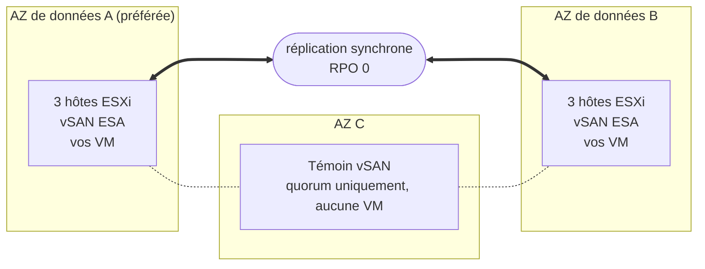

## Objectif

**Ce guide présente l'architecture de Private VCF as-a-Service Stretched Cluster 3-AZ : la répartition du cluster sur trois zones de disponibilité, la réplication de vos données et la réaction de la plateforme quand un composant tombe en panne.**

:::info
Private VCF as-a-Service Stretched Cluster 3-AZ est en Beta. La Beta ouvre en décembre 2026 à un nombre limité de clients Enterprise. Pour en savoir plus, consultez la [page OVHcloud Labs](https://labs.ovhcloud.com/en/vmware-3az/) (en anglais).
:::

## Le principe du stretched cluster

Private VCF as-a-Service est une plateforme VMware Cloud Foundation (VCF) 9.1 bâtie sur du matériel qui vous est dédié et opérée par OVHcloud.

Dans sa version Stretched Cluster 3-AZ, votre Workload Domain exécute **un seul cluster vSphere dont les hôtes sont répartis sur deux zones de disponibilité (AZ)** de la région Paris 3-AZ. Ce sont les **AZ de données** : toutes deux exécutent vos machines virtuelles et toutes deux détiennent une copie complète de vos données. **Une troisième AZ héberge un témoin**, qui ne participe qu'au quorum.

Le stockage repose sur **vSAN ESA**, configuré par OVHcloud. vSAN réplique vos données **de façon synchrone** entre les deux AZ de données : une écriture n'est confirmée qu'une fois enregistrée dans les deux. Les deux AZ détiennent donc toujours les mêmes données, et la perte de l'une d'elles ne fait perdre aucune donnée : **RPO = 0 par conception**, assuré par l'infrastructure.

:::warning
Le RPO 0 suppose que le cluster soit configuré en mirroring entre les deux AZ de données. Gardez vos VM sur une politique de stockage vSAN qui réplique leurs données sur les deux sites : une VM placée sur une politique qui conserve ses données dans une seule AZ n'est pas répliquée, et n'est pas protégée contre la perte de cette AZ.
:::

Quand une AZ de données tombe, **vSphere HA redémarre automatiquement ses machines virtuelles dans l'AZ restante**, sans intervention de votre part.

## Architecture

Votre Workload Domain exécute un seul cluster vSphere, étendu sur les deux AZ de données de la région Paris 3-AZ. Le témoin se trouve dans la troisième AZ.

| Composant | Emplacement | Rôle |
|---|---|---|
| AZ de données A (préférée) | Première AZ de données | Exécute vos VM et détient une copie complète de vos données. Si les deux AZ de données perdent le contact, c'est elle qui garde le quorum. |
| AZ de données B | Seconde AZ de données | Exécute vos VM et détient une copie complète de vos données. |
| Témoin | Troisième AZ | Arbitre le quorum entre les AZ de données. Il ne stocke aucune donnée de VM et n'exécute aucune VM. |
| Hôtes ESXi | AZ de données | La configuration de base compte 6 hôtes vSAN identiques, 3 dans chaque AZ de données. Le cluster s'agrandit par paires d'hôtes, un dans chaque AZ de données, pour que les deux AZ gardent la même capacité. |

C'est OVHcloud qui attribue les AZ : vous disposez de deux AZ de données distinctes et d'un témoin dans la troisième AZ, mais vous ne choisissez pas le rôle de chaque AZ.

## Que se passe-t-il en cas de panne ?

Le stretched cluster réagit seul à la perte d'un hôte, d'une AZ de données, du témoin ou du lien entre les AZ de données. Aucune procédure à déclencher, personne à réveiller.

| Ce qui tombe | Ce qui se passe | Données perdues | Votre action |
|---|---|---|---|
| Un hôte | vSphere HA redémarre ses VM sur les autres hôtes. | Aucune | Aucune |
| Une AZ de données entière | Ses VM redémarrent automatiquement dans l'AZ restante. | Aucune | Aucune |
| L'AZ témoin | Les deux AZ de données continuent de tourner et gardent le quorum. | Aucune | Aucune |
| Le lien entre les AZ de données | L'AZ préférée garde le quorum ; les VM de l'autre AZ redémarrent dans l'AZ préférée. | Aucune | Aucune |

Ce sont les comportements standards d'un stretched cluster vSAN, tels que documentés par Broadcom.

:::warning
Une VM redémarrée par vSphere HA n'est pas déplacée à chaud : elle redémarre dans l'AZ restante, et ses applications redémarrent avec elle. Le temps de reprise de chaque application dépend de son système d'exploitation et de sa configuration.
:::

### Prévoir la capacité pour la perte d'une AZ

Pour que toutes les VM d'une AZ de données en panne redémarrent dans l'autre, l'AZ restante doit disposer d'assez de CPU et de mémoire libres pour les exécuter. Dimensionnez vos workloads pour qu'une seule AZ de données puisse exécuter toutes les VM qui doivent continuer de tourner.

## Ce que le stretched cluster ne remplace pas

Le stretched cluster protège vos workloads contre la perte d'infrastructure. Ce **n'est ni une sauvegarde, ni un plan de reprise d'activité** :

- la réplication synchrone copie tout dans les deux AZ de données en même temps, y compris un fichier supprimé, des données corrompues ou des fichiers chiffrés par un rançongiciel ;
- vos workloads tournent dans un seul cluster : si ce cluster est compromis, il n'en existe pas de seconde copie à partir de laquelle redémarrer.

Conservez une sauvegarde et, si votre activité l'exige, une solution de reprise d'activité en dehors du cluster. La Beta n'inclut pas de service de sauvegarde managé.

## Ce qui est inclus autour du cluster

| Domaine | Ce que vous obtenez |
|---|---|
| Exploitation | vSAN ESA est livré préconfiguré, et OVHcloud réalise les mises à jour et les correctifs de VCF. |
| Réseau | VCF Networking est inclus. Vous pouvez commander avec votre Workload Domain l'extension gratuite **Edge Services**, ou l'option **vDefend** pour le pare-feu distribué. |
| vRack | Facultatif. Votre Workload Domain est livré sans vRack : après la livraison, vous y rattachez un vRack que vous possédez déjà, ou vous en commandez un nouveau. |
| Identité | Vous vous connectez via OVHcloud IAM et SSO : aucun compte local, et un rôle administrateur sur votre Workload Domain dès la livraison. |
| Disponibilité | La plateforme est conçue pour une disponibilité de 99,999 %. |

## Aller plus loin

[Page produit Private VCF as-a-Service 3-AZ](https://www.ovhcloud.com/fr/hosted-private-cloud/vmware/private-vcf-aas-3-az/)

[Private VCF as-a-Service Stretched Cluster 3-AZ sur OVHcloud Labs](https://labs.ovhcloud.com/en/vmware-3az/) (en anglais)

[[fragment:professional-services]]

Échangez avec notre [communauté d'utilisateurs](/links/community).
