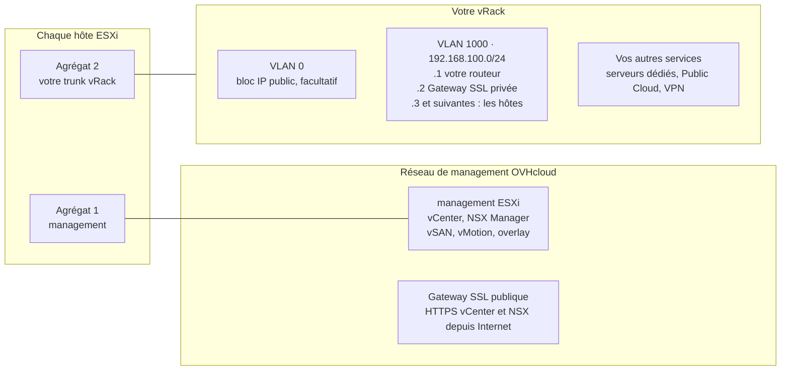

## Objectif

**Ce guide vous accompagne dans la configuration réseau de votre cluster Private VCF as-a-Service après la livraison : le vRack, le VLAN, le sous-réseau, les adresses des hôtes et le bloc IP public, et ce que chacun de ces choix implique.**

Votre Workload Domain est livré : vCenter, NSX Manager et vos hôtes ESXi fonctionnent, et vous accédez à vCenter et NSX par la **Gateway SSL publique**. Pour raccorder le cluster à **votre réseau privé OVHcloud** (Serveurs dédiés, Public Cloud, autres clouds privés, VPN), il reste une étape : la configuration réseau, dans l'espace client OVHcloud, onglet <code className="action">Network</code> du cluster.

:::info
La configuration réseau n'est pas nécessaire au fonctionnement de vCenter et NSX : vous pouvez la faire plus tard. Mais d'ici là, **vos VM n'ont aucun accès à Internet** ni à vos autres services OVHcloud : c'est le vRack, avec un bloc IP public ou votre propre routeur, qui leur donne une sortie.

Choisissez le VLAN et le sous-réseau avec soin : changer de sous-réseau ensuite change les adresses de vos hôtes. Lisez au moins la section « [Le VLAN et le sous-réseau](#vlan-et-sous-reseau) » avant de valider.

:::

## Prérequis

- Disposer d'un Workload Domain [Private VCF as-a-Service](/links/hosted-private-cloud/private-vcf-aas-3-az) livré.

[[cpnav:privatecloud-private-vcf]]

## En pratique

### Ce que vous configurez

Chaque hôte ESXi a deux liens réseau. Le premier, celui du management, appartient à OVHcloud ; le second est celui que vous configurez ici, et il arrive sur votre vRack.

Le sous-réseau du cluster (ici sur le VLAN 1000) porte les adresses des hôtes et de la Gateway SSL privée. Vos VM utilisent les autres VLAN du trunk, comme vous le souhaitez.

| Champ | Statut | Ce qu'il décide | Modifiable ensuite ? |
|---|---|---|---|
| **vRack** | Requis | Le réseau privé OVHcloud auquel le cluster est relié, donc ce que vos VM et vos hôtes peuvent joindre. | Oui, mais c'est une reconfiguration complète. |
| **VLAN ID** | Requis | Le VLAN de votre vRack sur lequel les hôtes reçoivent leur adresse. Entre 1 et 4094. | Oui, si le cluster est seul sur son sous-réseau. |
| **Sous-réseau** | Requis | Le réseau IP de ce VLAN. Sa première adresse est votre routeur. | Oui : les hôtes changent d'adresse. |
| **Adresses du cluster** | Automatique par défaut | Les adresses que prennent les hôtes et la Gateway SSL privée dans ce sous-réseau. | Oui, à tout moment. |
| **Bloc IP** | Facultatif | Des adresses publiques, rattachées au VLAN 0 du vRack, pour exposer vos edges NSX. | Oui, ajout possible plus tard. |

Sans configuration réseau, votre cluster :

- fonctionne : vCenter et NSX sont accessibles par la Gateway SSL publique ;
- n'est relié à aucun vRack : vos VM ne joignent ni vos serveurs ni vos autres services OVHcloud. Vos segments NSX (overlay) fonctionnent, eux, sans vRack ;
- **ne donne aucun accès à Internet à vos VM** : il n'y a ni bloc IP public, ni routeur vers lequel les faire sortir ;
- n'a pas de Gateway SSL privée : vCenter et NSX ne sont accessibles que par la Gateway SSL publique.

### Le vRack

Le [vRack](/links/network/vrack) est le réseau privé de niveau 2 d'OVHcloud. Il relie vos services entre eux, d'un datacenter à l'autre, sans passer par Internet.

| Votre situation | Choix recommandé |
|---|---|
| Vous avez déjà des services OVHcloud que le cluster doit joindre (Serveurs dédiés, Public Cloud, Hosted Private Cloud, etc.) | Le **vRack où se trouvent ces services**. |
| Vous voulez que deux clusters ou deux Workload Domains communiquent en privé | Le **même vRack** pour les deux. Un vRack peut servir plusieurs clusters et plusieurs Workload Domains. |
| Vous voulez au contraire isoler ce cluster de tout le reste | Un **vRack dédié**, commandé depuis le même écran (<code className="action">Commander un nouveau vRack</code>). |
| Vous n'avez aucun vRack | Commandez-en un depuis le même écran. |

Ce que ce choix implique :

- un cluster est sur **un seul** vRack à la fois ; les clusters d'un même Workload Domain peuvent chacun être sur un vRack différent ;
- tout ce qui est sur ce vRack partage un même domaine de niveau 2 : vos VLAN et vos sous-réseaux assurent la séparation ;
- le vRack entier arrive sur le second agrégat de chaque hôte, en trunk : tous ses VLAN sont disponibles pour vos VM. Créez des portgroups dans vCenter, tagués sur un VLAN, ou utilisez le trunk complet (`<cluster>-vrack-trunk`).

Ce qu'il ne change pas :

- le réseau de management d'OVHcloud (vCenter, NSX, vSAN, vMotion) reste sur le premier agrégat, géré par OVHcloud ;
- la Gateway SSL publique reste en place et continue de fonctionner ;
- les VLAN et segments NSX que vous créez ensuite restent sous votre seule gestion : OVHcloud n'intervient pas.

:::warning
Changer de vRack plus tard efface le VLAN, le sous-réseau et les adresses du cluster : vous les saisissez de nouveau, et les hôtes sont détachés de l'ancien vRack avant d'être attachés au nouveau. Tous les portgroups (groupes de ports distribués) du switch du vRack, y compris ceux que vous avez créés, sont supprimés : le changement est refusé tant qu'une VM y est branchée. Migrez d'abord **toutes** vos VM hors de ce switch. Choisissez le vRack définitif dès maintenant si vous le pouvez.

:::

### Le VLAN et le sous-réseau {#vlan-et-sous-reseau}

C'est le choix qui compte le plus. OVHcloud place les hôtes du cluster sur ce sous-réseau, dans ce VLAN de votre vRack. Proposition par défaut : **VLAN 1000** et `192.168.100.0/22`.

| Règle | Détail |
|---|---|
| **VLAN entre 1 et 4094** | Le VLAN 0 est réservé au bloc IP public. |
| **Passerelle = première adresse** | La première adresse utilisable du sous-réseau (`.1`) est considérée comme **votre routeur**. Un routeur placé ailleurs dans le sous-réseau n'est pas pris en charge. |
| **Assez d'adresses** | Le sous-réseau doit loger votre routeur, la Gateway SSL privée et tous les hôtes du cluster. Nous recommandons un `/24` ou plus. |
| **Pas de plage de la plateforme** | Refusé s'il chevauche `10.0.0.0/8`, `172.16.0.0/16`, `100.64.0.0/15`, `100.68.0.0/14` ou `198.18.0.0/15`, utilisés par l'infrastructure OVHcloud. |
| **Pas de chevauchement sur le vRack** | Sur un même vRack, deux sous-réseaux sont soit identiques et sur le même VLAN (ils sont alors partagés), soit disjoints. Un même sous-réseau ne peut pas être sur deux VLAN d'un vRack. |
| **Pas de chevauchement dans le domaine** | Les sous-réseaux des clusters d'un même Workload Domain ne se chevauchent pas, même sur des vRacks différents. Seule exception : le même sous-réseau sur le même vRack et le même VLAN, qui est alors partagé. |
| **Unique dans votre réseau** | Vous confirmez que ce sous-réseau n'est utilisé nulle part ailleurs (sites distants, VPN, autres clouds). OVHcloud ne peut pas le vérifier pour vous. |

#### Quelle taille ?

Un sous-réseau peut être partagé par plusieurs clusters et plusieurs Workload Domains : prévoyez large.

| Sous-réseau | Adresses utilisables | Ordre de grandeur |
|---|---|---|
| `/27` | 30 | Un petit cluster, rien d'autre |
| `/24` | 254 | Plusieurs clusters |
| `/22` (par défaut) | 1022 | Plusieurs domaines et leur croissance |

Ce que ce choix implique :

- la `.1` est réservée à votre routeur : OVHcloud ne l'attribue jamais ;
- les hôtes et la Gateway SSL privée prennent leurs adresses ici. La Gateway SSL privée n'a pas de route : elle ne répond qu'aux machines de ce sous-réseau ;
- le reste du sous-réseau, hors des adresses réservées par OVHcloud, vous appartient : vous pouvez y placer vos propres machines ;
- vos VM n'ont pas à être sur ce VLAN : utilisez les autres VLAN du trunk et vos segments NSX ;
- changer plus tard de sous-réseau change les adresses des hôtes.

### Les adresses du cluster

Deux modes : <code className="action">Automatique</code>, recommandé, où OVHcloud choisit les adresses ; ou <code className="action">Je choisis les adresses</code>, si votre plan d'adressage l'impose.

#### Mode automatique

OVHcloud prend les premières adresses libres du sous-réseau et les attribue dans l'ordre : d'abord la Gateway SSL privée si le cluster est le premier de son domaine sur ce sous-réseau, puis les hôtes. Un hôte ajouté plus tard prend l'adresse libre suivante.

Exemple : premier cluster de 6 hôtes sur `192.168.100.0/24`, VLAN 1000.

| Adresses | Usage |
|---|---|
| `.1` | Votre routeur |
| `.2` | Gateway SSL privée |
| `.3` à `.8` | Les 6 hôtes |
| `.9` à `.254` | Libres : prochains hôtes et clusters, ou vos propres machines |

#### Mode « Je choisis les adresses »

Une seule zone de saisie, qui accepte tous les formats, séparés par des virgules ou des retours à la ligne. Les plages qui se chevauchent ou se touchent sont fusionnées.

| Format | Exemple | Signifie |
|---|---|---|
| Adresse | `192.168.100.60` | Cette adresse |
| Plage | `192.168.100.250-192.168.100.253` | Les deux bornes incluses |
| Plage courte | `192.168.100.100-110` | `.100` à `.110` |
| CIDR | `192.168.100.64/28` | Toutes ses adresses |

- **Minimum** : nombre d'hôtes + 2 adresses de secours, + 1 si le cluster est le premier de son Workload Domain sur ce sous-réseau (la Gateway SSL privée prend alors la première adresse de votre liste).
- **Refusé** : une adresse hors du sous-réseau, l'adresse réseau, la passerelle, le broadcast, ou une adresse déjà prise par un autre cluster ou une Gateway SSL.
- **Pas d'extension automatique** : quand vos adresses s'épuisent, ajoutez-en en modifiant les plages du cluster.

:::warning
Dans les deux modes, les plages réservées par OVHcloud sont réservées aux hôtes et à la Gateway SSL privée : **n'y placez aucune machine**, même éteinte. Le reste du sous-réseau vous appartient.

:::

### Le bloc IP public (facultatif)

Un bloc IP donne un accès public à vos edges NSX.

| Votre situation | Choix |
|---|---|
| Vos edges NSX doivent avoir un accès public | Choisissez un bloc IP que vous possédez, ou commandez-en un depuis l'écran. |
| Votre accès Internet passe déjà par un autre équipement de votre vRack (pare-feu, routeur) | Aucun bloc IP. |
| Vous ne savez pas encore | Aucun bloc IP : vous pourrez l'ajouter plus tard depuis l'onglet <code className="action">Network</code>. |

- Le bloc est rattaché automatiquement au **VLAN 0** (non tagué) de votre vRack, que le vRack soit existant ou commandé pour l'occasion.
- Avec les portgroups par défaut, un portgroup non tagué donne accès au VLAN 0 dans vCenter.
- Un bloc commandé suit les délais et la facturation habituels des blocs IP OVHcloud.
- Le VLAN 0 est réservé au bloc IP : le VLAN du cluster ne peut pas être 0.
- Le bloc est rattaché au vRack, pas au cluster.

Exemple avec un bloc `/24` :

| Adresse | Usage |
|---|---|
| `.0` | Adresse réseau |
| `.1` à `.253` | Libres pour vos edges NSX et vos VM |
| `.254` | Passerelle par défaut |
| `.255` | Broadcast |

Contrairement à Hosted Private Cloud, aucune adresse n'est prise par HSRP.

### Après validation : ce qui est créé

Une fois la configuration validée, OVHcloud attache le vRack au cluster, hôte par hôte.

| # | Étape | Pour vous |
|---|---|---|
| 1 | Votre vRack remplace le réseau de maintenance d'OVHcloud sur le second agrégat de chaque hôte. | Le premier agrégat, celui du management, n'est pas touché. |
| 2 | Un switch distribué dédié est créé dans vCenter : `<cluster>-vrack-vds01`. | Le switch de VCF (`<cluster>-vds01`) reste intact. Ne déplacez les uplinks d'aucun des deux switchs : `<cluster>-vds01` porte le management, vMotion et vSAN, `<cluster>-vrack-vds01` votre vRack. |
| 3 | Chaque hôte reçoit une interface VMkernel à son adresse, sur le portgroup `<cluster>-vrack-vlan<VLAN>`. | Les hôtes répondent sur leur adresse du sous-réseau. |
| 4 | La Gateway SSL privée est déployée, sauf si votre Workload Domain en a déjà une sur ce réseau. | vCenter et NSX deviennent accessibles depuis le sous-réseau du cluster. |

#### Les portgroups prêts à l'emploi

Sauf si vous les avez désactivés à la configuration, le switch du vRack est livré avec des portgroups pour brancher vos VM tout de suite :

| Portgroup | VLAN |
|---|---|
| `<cluster>-vrack-public-vlan0` | Non tagué : votre bloc IP public |
| `<cluster>-vrack-vlan1` à `<cluster>-vrack-vlan10` | 1 à 10, un par VLAN. Si le VLAN du cluster est dans cette plage, son portgroup est celui de la dernière ligne : il n'y a qu'un seul `<cluster>-vrack-vlan<VLAN>`. |
| `<cluster>-vrack-trunk` | 0 à 4094, en trunk |
| `<cluster>-vrack-vlan<VLAN>` | Le VLAN du cluster : porte les hôtes et la Gateway SSL privée |

Vous pouvez créer d'autres portgroups et segments NSX librement. En revanche, **un portgroup où une VM est branchée n'est jamais supprimé** : un changement de réseau ou un détachement qui devrait le supprimer est refusé, avec la liste des VM concernées.

#### La Gateway SSL privée

C'est l'équivalent, côté vRack, de la Gateway SSL publique : une VM gérée par OVHcloud, qui donne accès à vCenter et à NSX depuis votre réseau privé OVHcloud (vRack), sans adresse publique.

| Propriété | Valeur |
|---|---|
| Combien | Une par Workload Domain **et** par réseau (sous-réseau + VLAN). Deux clusters d'un domaine sur le même réseau la partagent ; un cluster sur un autre réseau en a une seconde. |
| Adresse | `.2` pour le premier domaine d'un sous-réseau en mode automatique, sinon la première adresse libre du sous-réseau ou la première de votre liste. |
| Accès | Depuis les machines du sous-réseau du cluster uniquement : la passerelle n'a pas de route. |
| Services | HTTPS vers vCenter et NSX ; DNS. |
| Noms | Les mêmes URL que côté public pour vCenter et NSX ; seule la réponse DNS change. |

#### Une action de votre côté : le DNS

La Gateway SSL privée répond aux noms de vCenter, de NSX et de **chacun de vos ESXi** (un nom par hôte, ajouté ou retiré avec lui), avec des adresses joignables depuis le vRack :

| Nom | Résout vers |
|---|---|
| `vcenter.vcf<id>.<dc>.enterprise.ovhcloud.com` | La Gateway SSL privée |
| `nsx.vcf<id>.<dc>.enterprise.ovhcloud.com` | La Gateway SSL privée |
| `host<id>.<dc>.enterprise.ovhcloud.com` | L'adresse vRack de l'hôte |

:::tip
Sur vos résolveurs, ajoutez un **transfert conditionnel** vers l'adresse de la Gateway SSL privée, pour que ces noms soient résolus en adresses privées. Le résolveur qui interroge la passerelle doit être dans le sous-réseau du cluster.

- Avec une seule Gateway SSL privée sur votre réseau, transférez-lui toute la zone `<dc>.enterprise.ovhcloud.com`.
- Avec plusieurs, transférez la zone de chaque domaine, `vcf<id>.<dc>.enterprise.ovhcloud.com`, et chaque nom `host<id>` vers la passerelle de son Workload Domain. Une passerelle ne répond qu'aux noms de son propre domaine : elle envoie les autres au DNS public d'OVHcloud.

:::

### Faire évoluer la configuration

Tout reste modifiable depuis l'onglet <code className="action">Network</code>. Voici ce que chaque changement provoque.

| Si vous | Ce qui se passe | Impact sur vos VM |
|---|---|---|
| **ajoutez un hôte** | Il prend la première adresse libre des plages du cluster ; s'il n'en reste aucune, élargissez d'abord les plages. Son nom est ajouté au DNS de la Gateway SSL privée. | Aucun. |
| **retirez un hôte** | Son adresse est libérée et son nom retiré du DNS de la Gateway SSL privée. | Aucun sur le réseau. |
| **modifiez les adresses** du cluster | Vous pouvez réduire, agrandir ou remplacer les plages, dans le sous-réseau, sans chevaucher un autre cluster, en gardant l'adresse de chaque hôte et 2 adresses libres. | Aucun. |
| **changez de VLAN ou de sous-réseau** (même vRack) | Les hôtes sont déplacés sur place, sans détachement ; la Gateway SSL privée est reconstruite sur le nouveau réseau ; l'ancien portgroup est supprimé. Changer seulement le VLAN est refusé si d'autres clusters partagent le sous-réseau. | Refusé si une VM est branchée sur l'ancien portgroup. Les autres portgroups restent. |
| **changez de vRack** | Reconfiguration complète : le VLAN, le sous-réseau et les adresses sont effacés et à saisir de nouveau ; détachement puis attachement. Le switch et **tous** ses portgroups, y compris ceux que vous avez créés, sont supprimés, puis les portgroups par défaut sont recréés. | Refusé tant qu'une VM est branchée sur un portgroup du switch : migrez d'abord toutes vos VM. |
| **détachez le vRack** | Le switch, **tous** ses portgroups (y compris ceux que vous avez créés) et les interfaces des hôtes sont supprimés ; la Gateway SSL privée aussi, si aucun autre cluster du domaine n'utilise ce réseau. | Refusé tant qu'une VM est branchée sur un portgroup du switch. |

Plusieurs clusters, plusieurs domaines :

- un autre cluster peut prendre le même vRack, le même VLAN et le même sous-réseau : ses hôtes prennent les adresses libres suivantes ;
- un autre Workload Domain peut partager le sous-réseau : il a sa propre Gateway SSL privée ;
- un cluster peut aussi prendre un autre sous-réseau, sur le même VLAN (sans chevauchement) ou sur un autre : son domaine reçoit alors une Gateway SSL privée de plus.

### Messages de refus

| Message (en substance) | Que faire |
|---|---|
| VLAN hors de 1 à 4094 | Choisissez un VLAN dans cette plage ; 0 est réservé au bloc IP. |
| Sous-réseau trop petit | Prenez un sous-réseau plus grand ; idéalement un `/24` ou plus. |
| Sous-réseau en conflit avec la plateforme | Choisissez un sous-réseau en dehors de `10.0.0.0/8`, `172.16.0.0/16`, `100.64.0.0/15`, `100.68.0.0/14` et `198.18.0.0/15`. |
| Chevauchement avec un autre sous-réseau du vRack | Reprenez exactement le même sous-réseau, sur le même VLAN, pour le partager ; sinon un sous-réseau disjoint. |
| Sous-réseau déjà sur un autre VLAN du vRack | Reprenez le VLAN où il se trouve déjà, ou un autre sous-réseau. |
| Chevauchement avec un autre sous-réseau du domaine | Choisissez un sous-réseau disjoint de ceux des autres clusters du Workload Domain. |
| Adresse déjà utilisée | Elle appartient à un autre cluster ou à une Gateway SSL : retirez-la de votre liste. |
| Pas assez d'adresses | Il faut au moins autant d'adresses que d'hôtes, plus 2 (plus 1 pour la Gateway SSL du premier cluster du domaine). |
| Plus aucune adresse libre | Libérez des adresses, ou prenez un autre sous-réseau. |
| Une VM est branchée sur le portgroup | Débranchez ou migrez les VM nommées dans le message, puis réessayez. |

## Aller plus loin

[Private VCF as-a-Service - Concepts du Stretched Cluster 3-AZ](/guides/hosted-private-cloud/powered-by-vmware/private-vcf/3az-stretched-cluster-concepts)

[Page produit Private VCF as-a-Service 3-AZ](/links/hosted-private-cloud/private-vcf-aas-3-az)

[[fragment:professional-services]]

Échangez avec notre [communauté d'utilisateurs](/links/community).
