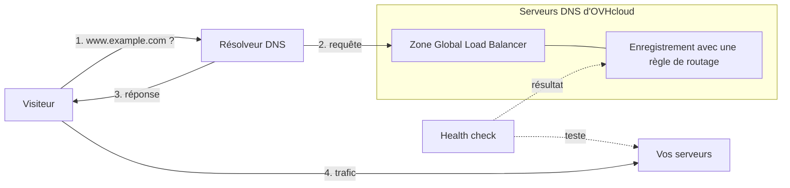

## Objectif

Ce guide vous emmène de l'absence de zone Global Load Balancer à un domaine qui répond selon des règles de routage : les objets qu'utilise Global Load Balancer, les limites qui s'y appliquent, et les étapes dans la Console pour créer une zone, faire pointer votre domaine vers ses serveurs DNS, créer un health check et ajouter un enregistrement avec une règle de routage.

:::warning
Global Load Balancer est en **alpha**, uniquement pour tester : ne l'utilisez pas pour des charges de production. L'alpha est ouverte aux 100 premiers clients et son utilisation est gratuite. Les écrans et le comportement peuvent changer avant la disponibilité générale.
:::

**Dans ce guide, vous apprendrez à :**

- Comprendre les objets que crée Global Load Balancer et les limites qui s'y appliquent.
- Ouvrir Global Load Balancer dans la Console OVHcloud.
- Créer une zone Global Load Balancer pour un domaine ou un sous-domaine.
- Faire pointer votre domaine vers les serveurs DNS de la zone, qu'il soit enregistré chez OVHcloud ou ailleurs.
- Créer un health check pour l'un de vos serveurs.
- Ajouter un enregistrement avec une règle de routage, et vérifier ce qui a été créé.

## Prérequis

- Un compte OVHcloud ayant accès à l'alpha de Global Load Balancer. Sans cet accès, l'entrée **Global LB** n'apparaît pas dans la section **DNS** du menu.
- Un accès à la <ManagerLink to="/beta/#/bare-metal/network/dns/glb/zones">Console OVHcloud</ManagerLink>.
- Un nom de domaine, enregistré chez OVHcloud ou chez un autre bureau d'enregistrement, dont vous pouvez modifier les serveurs DNS, ou un sous-domaine d'un domaine dont vous pouvez modifier la zone DNS.
- Au moins un serveur joignable depuis Internet, avec une adresse IP publique ou un nom d'hôte.

## Concepts clés <a name="concepts"></a>

Global Load Balancer utilise le DNS pour répartir le trafic de votre domaine entre vos serveurs. Les serveurs DNS d'OVHcloud hébergent une **zone** pour votre domaine, et chaque **enregistrement** de cette zone porte une **règle de routage** et, quand il en a besoin, un **health check**. Le même nom répond alors à chaque visiteur selon la règle, et écarte les serveurs dont le health check échoue.

Global Load Balancer répond uniquement aux requêtes DNS : vos visiteurs se connectent directement à vos serveurs, et leur trafic ne passe jamais par lui.



- **Zone** : une zone Global Load Balancer répond pour un domaine et tout ce qui se trouve en dessous. Elle se crée, elle ne se commande pas : elle n'a pas d'abonnement à renouveler. Elle contient des enregistrements A, AAAA, CNAME, MX et TXT.
- **Serveurs DNS** : les serveurs qui répondent pour la zone sur Internet. Votre domaine n'utilise la zone qu'une fois que sa délégation DNS pointe vers eux. Tant que ce n'est pas le cas, les résolveurs n'interrogent pas la zone et ses enregistrements ne sont pas résolus.
- **Enregistrement** : un nom et un type, comme `www` et `A`, avec une ou plusieurs cibles et un TTL. Le TTL est la durée pendant laquelle les résolveurs conservent une réponse avant de redemander.
- **Groupe et entrées** : les enregistrements qui ont le même nom, le même type et la même règle de routage forment un groupe, affiché sur une seule ligne du tableau des enregistrements. Chaque enregistrement d'un groupe est une **entrée**, désignée par son **Nom de l'entrée** (par exemple `primary-dc`), avec sa propre cible et sa propre règle.
- **Règle de routage** : la règle qu'un groupe applique pour choisir sa réponse. Six règles sont disponibles : **Simple**, **Pondéré**, **Bascule**, **Géolocalisation**, **Multivaleur** et **Géoproximité**. Chacune est décrite dans [Global Load Balancer - Règles de routage et health checks](/guides/network/global-load-balancer/global-load-balancer-routing-policies).
- **Health check** : un test qui vérifie régulièrement l'un de vos serveurs. Quand il trouve le serveur indisponible, les entrées qui l'utilisent sortent des réponses et les autres entrées prennent le relais. Une entrée sans health check est toujours considérée comme disponible. Un health check appartient à votre compte, pas à une zone : un même health check peut servir à des enregistrements de plusieurs zones.

### Limites principales <a name="key-limits"></a>

- Un nom de zone comporte au moins deux parties, comme `example.com`, et 253 caractères au plus. Chaque partie ne contient que des lettres, des chiffres et des tirets, et ne peut ni commencer ni finir par un tiret. Un domaine peut avoir une seule zone Global Load Balancer.
- Une zone se supprime vide : supprimez d'abord ses enregistrements. Un health check ne peut pas être supprimé tant qu'un enregistrement l'utilise.
- Un health check teste une adresse IP publique ou un nom d'hôte : les adresses privées et locales sont refusées, car le test s'exécute depuis l'extérieur de votre réseau.
- Pendant l'alpha, les health checks s'exécutent depuis un seul endroit : un problème de réseau entre cet endroit et votre serveur peut ressembler à une panne du serveur.
- Tous les enregistrements d'un même nom et d'un même type utilisent la même règle de routage et le même TTL.

## En pratique

Cette section couvre toute la première configuration, dans l'ordre attendu par la Console.

**Sommaire :**

- [Étape 1 - Ouvrir Global Load Balancer](#open)
- [Étape 2 - Créer une zone](#zone)
- [Étape 3 - Faire pointer votre domaine vers les serveurs DNS de la zone](#delegate)
- [Étape 4 - Créer un health check](#health-check)
- [Étape 5 - Ajouter un enregistrement](#record)
- [Étape 6 - Vérifier](#verify)

### Étape 1 - Ouvrir Global Load Balancer <a name="open"></a>

1. Connectez-vous à la <ManagerLink to="/beta/#/bare-metal/network/dns/glb/zones">Console OVHcloud</ManagerLink>.
2. Sélectionnez <code className="action">Bare Metal Cloud</code>, <code className="action">Hosted Private Cloud</code> ou <code className="action">Public Cloud</code>.
3. Dans le menu, ouvrez la section **DNS** et cliquez sur <code className="action">Global LB</code>. L'entrée porte une étiquette **Alpha**.

La page **Global Load Balancer** s'ouvre, avec deux onglets : <code className="action">Zones publiques</code> et <code className="action">Health checks</code>. Un compte sans zone Global Load Balancer voit un bouton <code className="action">Créer une zone Global Load Balancer</code>.

### Étape 2 - Créer une zone <a name="zone"></a>

La zone est le premier objet à créer : tout enregistrement appartient à une zone.

1. Dans l'onglet <code className="action">Zones publiques</code>, cliquez sur <code className="action">Créer une zone Global Load Balancer</code>.
2. Dans **Nom de domaine**, saisissez le domaine pour lequel la zone répond, par exemple `example.com`. Pour tester Global Load Balancer sans changer la façon dont votre domaine répond, saisissez plutôt un sous-domaine, par exemple `glb.example.com` (voir l'[étape 3](#delegate)).
3. Cliquez sur <code className="action">Créer la zone</code>.

La zone est créée immédiatement, sans commande à passer, et vide. Sa page indique, dans la carte **Résolution**, les **Serveurs DNS** qui lui sont attribués. Copiez-les : vous en avez besoin à l'étape suivante.

### Étape 3 - Faire pointer votre domaine vers les serveurs DNS de la zone <a name="delegate"></a>

La zone ne répond qu'une fois que votre domaine pointe vers ses serveurs DNS. Choisissez le cas qui correspond à votre domaine.

:::warning
Pendant l'alpha, utilisez Global Load Balancer uniquement pour tester, sur un domaine dont vous pouvez vous passer du site et des e-mails : le domaine peut cesser de répondre tant qu'il utilise les serveurs DNS de la zone. Pour que votre domaine continue de répondre comme avant, utilisez un sous-domaine (cas 3).
:::

**Cas 1 - Votre domaine est enregistré chez OVHcloud**

1. Sur la page de la zone, cliquez sur <code className="action">Utiliser ces serveurs pour mon domaine</code>. Le bouton apparaît quand le compte détient le domaine et que celui-ci n'utilise pas encore les serveurs DNS de la zone.
2. La fenêtre affiche les **Serveurs DNS actuels** et les **Nouveaux serveurs DNS**. Lisez l'avertissement sur l'alpha, puis cochez la case qui confirme que la zone sert uniquement à tester.
3. Cliquez sur <code className="action">Utiliser ces serveurs</code>.

La modification est demandée pour le domaine. Il peut falloir quelques heures avant que tous les résolveurs utilisent les nouveaux serveurs.

**Cas 2 - Votre domaine est enregistré chez un autre bureau d'enregistrement**

Chez votre bureau d'enregistrement, remplacez les serveurs DNS du domaine par les serveurs DNS indiqués dans la carte **Résolution** de la zone. La modification peut mettre quelques heures à atteindre tous les résolveurs.

**Cas 3 - Tester sur un sous-domaine**

Un sous-domaine vous permet de tester Global Load Balancer pendant que le reste de votre domaine continue de répondre depuis sa zone DNS actuelle. Créez la zone Global Load Balancer pour le sous-domaine, par exemple `glb.example.com`, comme à l'[étape 2](#zone). Puis, dans la zone DNS actuelle de votre domaine, ajoutez un enregistrement NS par serveur DNS de la zone Global Load Balancer, pour le sous-domaine :

```text
glb.example.com.    3600    IN    NS    <serveur DNS 1>
glb.example.com.    3600    IN    NS    <serveur DNS 2>
```

Ajoutez une ligne par serveur DNS indiqué par la zone. Si la zone DNS de votre domaine est hébergée chez OVHcloud, ajoutez les enregistrements depuis <code className="action">Zones publiques</code>, dans la section **DNS** du menu. Les requêtes pour le sous-domaine et ses noms reçoivent alors leur réponse de la zone Global Load Balancer, et le reste du domaine n'est pas affecté.

### Étape 4 - Créer un health check <a name="health-check"></a>

Un health check teste régulièrement l'un de vos serveurs. Créez-en un pour chaque serveur dont la disponibilité doit décider des réponses.

1. Ouvrez l'onglet <code className="action">Health checks</code> et cliquez sur <code className="action">Créer un health check</code>.
2. Dans **Nom**, saisissez un nom qui vous aide à retrouver le health check dans la liste.
3. Dans **Protocole**, sélectionnez la façon dont le serveur est testé : **HTTP**, **HTTPS**, **HTTP avec recherche de texte**, **HTTPS avec recherche de texte**, **TCP**, **ICMP (ping)** ou **DNS**. Le protocole ne peut plus être modifié une fois le health check créé.
4. Saisissez le serveur à tester, dans **Adresse IP ou nom d'hôte** : son adresse IP publique ou son nom d'hôte. **ICMP (ping)** teste uniquement une adresse IP.
5. Renseignez les champs dont le protocole a besoin :
    - **Port** : prérempli avec 443 pour HTTPS et 80 pour HTTP, 53 pour DNS. ICMP n'en utilise pas.
    - **Page à tester** : pour HTTP et HTTPS, le chemin demandé, prérempli avec `/health`.
    - **Texte attendu** : pour les recherches de texte, le texte que la page doit contenir pour que le serveur soit considéré comme disponible.
    - **Nom à interroger** et **Type d'enregistrement** : pour DNS, la question à laquelle le serveur doit répondre.
6. Dans **Fréquence des tests**, sélectionnez **Toutes les 30 secondes** ou **Toutes les 10 secondes**.
7. Dans **Échecs tolérés**, saisissez le nombre de tests ratés d'affilée avant que le serveur soit considéré comme indisponible, de 1 à 10. Un nombre plus faible réagit plus vite, mais aussi à une seule réponse lente.
8. Cliquez sur <code className="action">Créer</code>.

Le health check donne son premier résultat après un ou deux tests. D'ici là, il affiche **Pas encore testé**.

> [!TIP]
> Vous pouvez aussi créer un health check depuis le formulaire d'enregistrement, à l'[étape 5](#record) : le health check est créé et choisi pour l'enregistrement, et l'enregistrement lui-même est enregistré quand vous le validez.

### Étape 5 - Ajouter un enregistrement <a name="record"></a>

Un enregistrement indique à Internet où envoyer les visiteurs d'un nom. Ici, sa règle de routage et ses health checks choisissent la réponse.

1. Ouvrez la zone : dans l'onglet <code className="action">Zones publiques</code>, cliquez sur son nom.
2. Dans la carte **Enregistrements**, cliquez sur <code className="action">Créer un enregistrement</code>.
3. Sélectionnez le **Type** d'enregistrement : A, AAAA, CNAME, MX ou TXT.
4. Dans **Sous-domaine**, saisissez le nom, par exemple `www`. Laissez-le vide pour le nom de la zone elle-même.
5. Saisissez la **Cible** : pour un enregistrement A, l'adresse IPv4 du serveur. Cliquez sur <code className="action">Ajouter une valeur</code> pour ajouter une autre cible.
6. Réglez le **TTL**, prérempli avec 300 secondes. Tous les enregistrements d'un même nom et d'un même type ont le même TTL : le modifier ici le modifie pour tous.
7. Dans **Règle de routage**, sélectionnez la règle. Seules les règles possibles pour le type d'enregistrement sont proposées : Bascule, Géolocalisation, Multivaleur et Géoproximité s'appliquent uniquement aux enregistrements A et AAAA.
8. Pour toutes les règles sauf Simple, saisissez un **Nom de l'entrée**, par exemple `primary-dc`, et les champs propres à la règle : le **Poids** pour Pondéré, le **Rôle** (**Principal** ou **Secours**) pour Bascule, la **Portée** pour Géolocalisation, le **Lieu** pour Géoproximité.
9. Dans **Health check**, sélectionnez le health check qui décide si cette entrée est disponible, ou **Aucun**. Une entrée principale de Bascule a besoin d'un health check. Sans health check, une entrée est toujours considérée comme disponible, même pendant une panne.
10. Cliquez sur <code className="action">Ajouter</code>.

L'enregistrement s'applique tout de suite et atteint tous les serveurs DNS en moins d'une minute. Les résolveurs gardent leur ancienne réponse pendant le TTL de l'enregistrement : comptez jusqu'à cette durée avant que tous les visiteurs voient le changement.

Pour ajouter une autre entrée au même groupe, par exemple le secours d'une bascule ou une autre cible pondérée, cliquez de nouveau sur <code className="action">Créer un enregistrement</code> avec le même sous-domaine et le même type. La règle de routage et le TTL sont alors ceux du groupe.

### Étape 6 - Vérifier <a name="verify"></a>

Vérifiez les objets dans la Console, puis interrogez le nom.

| Vérification | Où | Résultat attendu |
|---|---|---|
| La zone existe | Onglet <code className="action">Zones publiques</code> | Une ligne, avec son nombre d'**Enregistrements** |
| Le domaine utilise la zone | Votre bureau d'enregistrement, ou la page du domaine dans **Domaines** | Les serveurs DNS sont les **Serveurs DNS** de la zone |
| Le health check a un résultat | Onglet <code className="action">Health checks</code> | L'état du serveur et son **Dernier test** |
| L'enregistrement existe | Page de la zone, carte **Enregistrements** | Une ligne par groupe, avec son **Routage** |
| L'enregistrement répond | Un terminal | `dig www.example.com` renvoie la cible choisie par la règle |

Sur la page d'un groupe, le parcours de résolution montre quelle réponse reçoit un visiteur en ce moment, en diagramme ou étape par étape : quelles entrées sont disponibles, lesquelles sont écartées, et pourquoi.

```console
$ dig +short www.example.com A
203.0.113.10
```

:::info
Pendant l'alpha, la disponibilité est testée depuis un seul endroit. Si un serveur apparaît indisponible alors qu'il répond, vérifiez que votre pare-feu laisse passer les tests.
:::

## Aller plus loin <a name="go-further"></a>

- [Global Load Balancer - Règles de routage et health checks](/guides/network/global-load-balancer/global-load-balancer-routing-policies)
- [Tout savoir sur les serveurs DNS](/guides/web-cloud/domains/dns-server-general-information)
- [Modifier les serveurs DNS d’un nom de domaine OVHcloud](/guides/web-cloud/domains/dns-server-edit)
- [Créer une zone DNS OVHcloud pour un sous-domaine](/guides/web-cloud/domains/dns-zone-create-subdomain)

Échangez avec notre [communauté d'utilisateurs](/links/community).
