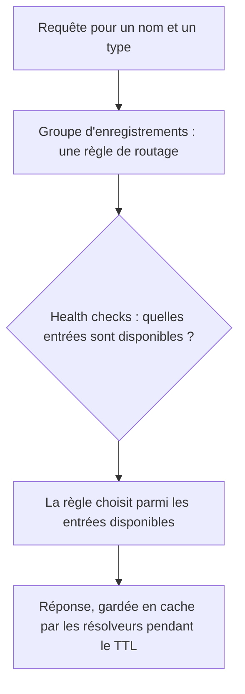

## Objectif

Ce guide explique comment Global Load Balancer choisit la réponse à une requête DNS : les six règles de routage, ce que fait et accepte chacune, comment les health checks décident si un serveur est disponible, et les règles qui s'appliquent à un groupe d'enregistrements. **Il s'adresse aux lecteurs qui ont créé une zone et veulent choisir la bonne règle pour leurs enregistrements.**

:::warning
Global Load Balancer est en **alpha**, uniquement pour tester : ne l'utilisez pas pour des charges de production. Les écrans et le comportement peuvent changer avant la disponibilité générale.
:::

## Vue d'ensemble

Global Load Balancer répond aux requêtes DNS pour votre zone, et choisit chaque réponse selon la règle de routage de l'enregistrement et l'état de vos serveurs. Le trafic de vos visiteurs ne passe pas par lui : une fois que le résolveur a la réponse, le visiteur se connecte directement au serveur.

Trois comportements s'appliquent à toutes les règles :

- **L'emplacement est celui du résolveur.** Géolocalisation et Géoproximité situent une requête d'après l'adresse du résolveur qui la pose, pas celle du visiteur. Un visiteur qui utilise un résolveur éloigné peut recevoir la réponse prévue pour l'emplacement du résolveur.
- **Les réponses sont gardées en cache pendant le TTL.** Un changement, y compris un serveur qui sort des réponses, atteint les visiteurs à mesure que les réponses en cache des résolveurs expirent. Un TTL court réagit plus vite.
- **Un groupe ne reste jamais sans réponse.** Quand toutes les entrées d'un groupe sont indisponibles, le groupe répond quand même plutôt que de ne rien répondre.

## Règles de routage

Une règle de routage est choisie à la création de l'enregistrement et ne peut plus être modifiée ensuite. Pour utiliser une autre règle, créez un nouvel enregistrement, puis supprimez l'ancien.

| Règle | Répond avec | Types d'enregistrement | Health check |
|---|---|---|---|
| **Simple** | Toujours la même réponse : toutes les cibles | A, AAAA, CNAME, MX, TXT | Non accepté |
| **Pondéré** | Une entrée, tirée selon son poids | A, AAAA, CNAME, MX, TXT | Facultatif |
| **Bascule** | L'entrée principale, ou celle de secours quand la principale est en panne | A, AAAA | Obligatoire sur l'entrée principale |
| **Géolocalisation** | L'entrée dont la portée correspond à l'origine de la requête | A, AAAA | Facultatif |
| **Multivaleur** | Toutes les cibles disponibles à la fois | A, AAAA | Facultatif |
| **Géoproximité** | La cible la plus proche | A, AAAA | Facultatif |

Toutes les règles sauf Simple désignent chaque entrée par un **Nom de l'entrée**, par exemple `primary-dc`, de 128 caractères au plus.

### Simple

Simple donne toujours la même réponse : toutes les cibles de l'enregistrement. C'est du DNS classique, sans filtrage selon l'état des serveurs : un health check ne peut pas y être associé. Un nom et un type ont un seul enregistrement Simple : pour ajouter une cible, modifiez l'enregistrement existant.

Utilisez-la pour les enregistrements qui n'ont pas besoin de routage, comme un enregistrement MX ou TXT.

### Pondéré

Pondéré répartit les visiteurs entre les entrées selon leur poids. La part de chaque entrée est son poids rapporté au total du groupe. Avec des poids de 70 et 30, 70 visiteurs sur 100 vont vers la première entrée.

| Champ | Valeurs |
|---|---|
| **Poids** | De 0 à 255. À 0, l'entrée ne reçoit plus de visiteurs mais reste configurée. |

Quand une entrée est indisponible, elle sort du tirage et les entrées restantes se partagent sa part. Une entrée sans health check est toujours considérée comme disponible : dans un groupe qui mélange des entrées avec et sans health check, celles qui n'en ont pas continuent de recevoir leur part pendant une panne.

Utilisez-la pour déployer une nouvelle version sur une partie de votre trafic, puis augmenter son poids pas à pas, ou le mettre à 0 pour revenir en arrière.

### Bascule

Bascule envoie tout le monde vers l'entrée principale, et passe à l'entrée de secours quand le health check de la principale la trouve indisponible. Elle revient d'elle-même à la principale quand celle-ci est rétablie.

| Champ | Valeurs |
|---|---|
| **Rôle** | **Principal** ou **Secours**. Un groupe a une entrée principale et une entrée de secours. Le rôle ne peut plus être modifié une fois l'enregistrement créé. |
| **Health check** | Obligatoire sur l'entrée principale. Recommandé sur l'entrée de secours, pour détecter une entrée de secours en panne. |

Quand l'entrée principale et l'entrée de secours sont toutes deux indisponibles, c'est la principale qui répond. Tant que le health check de l'entrée principale est suspendu, rien ne bascule le trafic vers l'entrée de secours, même pendant une panne.

Utilisez-la pour garder une région de secours prête à prendre le relais quand votre région principale tombe en panne.

### Géolocalisation

Géolocalisation répond selon l'origine de la requête. Chaque entrée a une **Portée** :

| Portée | Couvre |
|---|---|
| **Pays** | Toutes les requêtes de ce pays. Un pays est prioritaire sur son continent. |
| **Continent** | Toutes les requêtes de ce continent. |
| **Partout ailleurs** | Toutes les requêtes qu'aucune autre portée ne couvre. Un groupe en contient une au plus. |

La portée la plus précise qui correspond l'emporte : d'abord un pays, puis son continent, puis **Partout ailleurs**. Quand une entrée est indisponible, ses requêtes vont vers l'entrée **Partout ailleurs**. Sans entrée **Partout ailleurs**, une requête qu'aucune portée ne couvre n'obtient aucune réponse.

Utilisez-la pour servir chaque continent ou chaque pays depuis sa propre région.

### Multivaleur

Multivaleur donne toutes les cibles disponibles à la fois, et l'appareil du visiteur en choisit une. Chaque entrée contient exactement une cible, pour que chacune soit jugée par son propre health check. Une entrée indisponible sort de la réponse. Quand toutes les entrées sont indisponibles, elles sont toutes renvoyées.

Utilisez-la pour permettre aux clients de réessayer tout de suite sur un autre serveur, plutôt que d'attendre l'expiration d'une réponse en cache.

### Géoproximité

Géoproximité envoie chaque visiteur vers l'emplacement le plus proche. Chaque entrée a un **Lieu** : un site OVHcloud, qui remplit ses coordonnées, ou des **Coordonnées personnalisées** (**Latitude** de -90 à 90, **Longitude** de -180 à 180). Chaque entrée contient exactement une cible.

Les entrées situées au même endroit forment un seul emplacement et répondent ensemble. Quand un emplacement n'a plus d'entrée disponible, ses requêtes vont vers l'emplacement suivant le plus proche.

Utilisez-la quand vous servez vos visiteurs depuis plusieurs sites et voulez que chacun atteigne le plus proche.

## Health checks

Un health check teste régulièrement l'un de vos serveurs. Quand il trouve le serveur indisponible, toutes les entrées qui l'utilisent sortent des réponses. Un health check appartient à votre compte, pas à une zone : un même health check peut servir à des enregistrements de plusieurs zones, et sa page liste les enregistrements qui l'utilisent.

### Protocoles

Le protocole détermine comment le serveur est testé. Il ne peut plus être modifié une fois le health check créé.

| Protocole | Nécessite | Le serveur est disponible quand |
|---|---|---|
| **HTTP** | Adresse IP ou nom d'hôte, port (80), page à tester | La requête aboutit |
| **HTTPS** | Adresse IP ou nom d'hôte, port (443), page à tester | La requête aboutit |
| **HTTP avec recherche de texte** | Comme HTTP, plus le texte attendu | La requête aboutit et la page contient le texte |
| **HTTPS avec recherche de texte** | Comme HTTPS, plus le texte attendu | La requête aboutit et la page contient le texte |
| **TCP** | Adresse IP ou nom d'hôte, port | Une connexion s'établit |
| **ICMP (ping)** | Adresse IP | Le serveur répond à un ping |
| **DNS** | Adresse IP ou nom d'hôte, port (53), nom à interroger, type d'enregistrement | Le serveur répond à la question DNS |

La cible est une adresse IPv4 ou IPv6 publique, ou un nom d'hôte : les adresses privées et locales sont refusées. Avec un health check HTTP ou HTTPS, vous pouvez saisir à la fois une adresse IP et un nom d'hôte : le test contacte l'adresse IP en lui présentant le nom d'hôte.

### Comment un serveur est jugé

| Réglage | Valeurs | Effet |
|---|---|---|
| **Fréquence des tests** | Toutes les 10 ou 30 secondes | À quelle fréquence le serveur est testé. |
| **Échecs tolérés** | De 1 à 10 (3 par défaut) | Nombre de tests ratés d'affilée avant que le serveur soit considéré comme indisponible. Un nombre plus faible réagit plus vite, mais aussi à une seule réponse lente. |

La page du health check affiche l'état du serveur, l'heure du **Dernier test** et la **Cause du dernier échec**. Un nouveau health check affiche **Pas encore testé** jusqu'à son premier résultat. Une entrée dont le health check n'a pas encore de résultat continue de répondre.

### Inverser et suspendre

Deux réglages changent l'effet d'un health check sur vos enregistrements :

- **Inverser le résultat** : le serveur est considéré comme disponible quand le test échoue, et indisponible quand il réussit. Utilisez-le comme interrupteur pour sortir volontairement un serveur des réponses, par exemple pendant une maintenance.
- **Suspendre le health check** : les tests s'arrêtent. Les enregistrements qui utilisent ce health check continuent d'envoyer des visiteurs au serveur, comme s'il était disponible, même s'il ne répond plus.

Un health check ne peut pas être supprimé tant qu'un enregistrement l'utilise. Pour le supprimer, remplacez-le par un autre health check dans les enregistrements qui l'utilisent, ou retirez-le d'abord de leur routage.

## Règles d'un groupe d'enregistrements

Les enregistrements qui ont le même nom et le même type forment un groupe, affiché sur une seule ligne du tableau des enregistrements. Ces règles s'appliquent à un groupe :

- Tous les enregistrements d'un même nom et d'un même type utilisent la **même règle de routage**. Pour la changer, supprimez d'abord les enregistrements du groupe.
- Tous les enregistrements d'un même nom et d'un même type ont le **même TTL**. Le modifier sur un enregistrement le modifie pour tous.
- Le nom, le type, la règle de routage et le rôle de bascule sont fixés une fois l'enregistrement créé. Les cibles, le TTL, le nom de l'entrée, le poids, la portée, le lieu et le health check peuvent être modifiés.
- Les enregistrements A et AAAA d'un nom forment deux groupes distincts : chacun a sa propre règle, ses propres entrées et ses propres health checks. Pour un service joignable en IPv4 et en IPv6, configurez les deux.

### Parcours de résolution

Sur la page d'un groupe, sous la carte **Policies**, le parcours de résolution montre quelle réponse reçoit un visiteur en ce moment, en diagramme ou étape par étape. Il liste les entrées disponibles, les entrées écartées des réponses et pourquoi, et la part du trafic que reçoit chaque entrée de la règle Pondéré.

## Points d'attention et limites

Certaines limites s'appliquent pendant l'alpha :

| Limite | Détails |
|---|---|
| Un seul endroit de test | La disponibilité est testée depuis un seul endroit : un problème de réseau sur un chemin peut ressembler à une panne du serveur. |
| Emplacement du résolveur | Géolocalisation et Géoproximité situent le résolveur, pas le visiteur. Elles aident une stratégie de localisation des données mais ne la garantissent pas. |
| Délai d'un changement | Un changement s'applique tout de suite et atteint tous les serveurs DNS en moins d'une minute, mais les résolveurs gardent l'ancienne réponse pendant le TTL de l'enregistrement. |
| Types d'enregistrement | A, AAAA, CNAME, MX et TXT. Bascule, Géolocalisation, Multivaleur et Géoproximité acceptent uniquement A et AAAA. |

## Aller plus loin

- [Global Load Balancer - Premiers pas dans la console](/guides/network/global-load-balancer/global-load-balancer-getting-started)
- [Tout savoir sur les enregistrements DNS](/guides/web-cloud/domains/dns-zone-records)

Échangez avec notre [communauté d'utilisateurs](/links/community).
