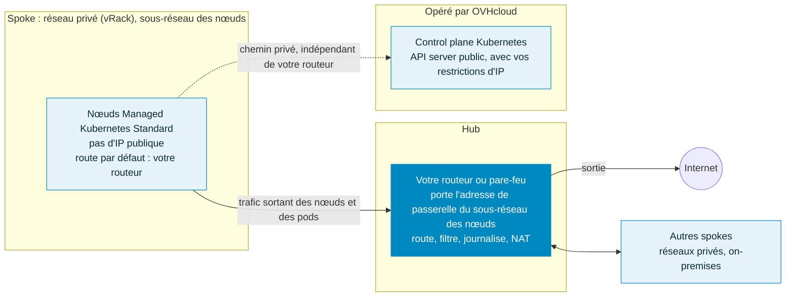

import Api from '@components/Api';


import { Tab, Tabs } from '@rspress/core/theme';


## Objectif

Une passerelle personnalisée vous permet de contrôler la façon dont les nœuds de votre cluster OVHcloud Managed Kubernetes accèdent à Internet : par exemple pour disposer d'une seule adresse IP de sortie à autoriser chez vos partenaires, ou pour faire passer tout le trafic de vos nœuds par votre propre pare-feu afin de l'inspecter, de le filtrer et de le journaliser (architecture hub-and-spoke).

La méthode dépend du plan de votre cluster :

| | Plan Standard | Plan Free |
|---|---|---|
| Sortie Internet par défaut des nœuds | Via une passerelle managée OVHcloud (une IP de sortie partagée), ou via des Floating IP définies au niveau du pool de nœuds | Via l'adresse IP publique de chaque nœud |
| Passerelle personnalisée | Votre propre routeur ou pare-feu, défini comme passerelle du sous-réseau des nœuds (`useUserGateway`) | Une passerelle dans votre vRack, utilisée comme route par défaut (`privateNetworkRoutingAsDefault` et `defaultVrackGateway`) |
| Passerelle managée OVHcloud nécessaire | Non, lorsque vous utilisez votre propre routeur | Sans objet |
| Exposition publique des nœuds et des workloads | Désactivée lorsque vous utilisez votre propre routeur : ni Floating IP, ni Load Balancer public | Inchangée |
| Moment de la configuration | À la création du cluster uniquement, non modifiable ensuite | À la création ou à la réinitialisation du cluster |

:::info
Sur tout nouveau cluster Standard, le trafic entre les nœuds et le control plane Kubernetes passe par un chemin privé opéré par OVHcloud. Le fonctionnement du cluster ne dépend pas de votre passerelle : une modification ou une panne de votre routeur n'affecte pas la communication entre les nœuds et le control plane.
:::

- [Utiliser votre propre routeur ou pare-feu (plan Standard)](#utiliser-votre-propre-routeur-ou-pare-feu-plan-standard)
- [Router la sortie via une passerelle dans votre vRack (plan Free)](#router-la-sortie-via-une-passerelle-dans-votre-vrack-plan-free)

[[cpnav:publiccloud-kubernetes]]

## Utiliser votre propre routeur ou pare-feu (plan Standard)

### Fonctionnement

Avec le plan Standard, les nœuds n'ont pas d'IP publique par défaut : ils accèdent à Internet via une passerelle managée OVHcloud, ou via des Floating IP définies au niveau du pool de nœuds.

Les clusters Standard créés depuis le 13 octobre 2026, quelle que soit leur version de Kubernetes, peuvent à la place utiliser votre propre routeur ou pare-feu comme passerelle par défaut des nœuds. C'est l'architecture hub-and-spoke classique : votre appliance de sécurité est le hub, et le cluster est l'un des spokes. Votre appliance est la passerelle annoncée sur le sous-réseau des nœuds de votre réseau privé : le trafic sortant des nœuds passe par elle (sauf le trafic vers le control plane et les images système du service), et aucune passerelle managée OVHcloud n'est nécessaire.



Ce que cela implique pour le cluster :

- **Votre appliance porte le trafic sortant des workloads** : accès à Internet, aux autres réseaux, aux ressources on-premises. Les pods sortent avec l'adresse privée de leur nœud : vos règles de pare-feu voient donc des adresses de nœuds, et non des adresses de pods.
- **Elle n'est pas sur le chemin du cluster lui-même** : les nœuds joignent le control plane Kubernetes via un chemin privé opéré par OVHcloud, et les images système du service ne passent pas par votre appliance. Si votre appliance est indisponible, le cluster continue de fonctionner, mais vos workloads qui dépendent d'elle, par exemple pour accéder à Internet ou à d'autres ressources externes, sont affectés.
- **L'exposition publique des nœuds et des workloads est désactivée** : aucune Floating IP ne peut être attachée aux nœuds ni aux load balancers, et aucun Load Balancer public ne peut être créé. L'accès entrant à vos applications passe par vos propres équipements.

:::note
Avec le plan Standard, `defaultVrackGateway` et `privateNetworkRoutingAsDefault` ne sont pas utilisés : la passerelle des nœuds est celle configurée sur le sous-réseau des nœuds.
:::

### Prérequis

Côté Kubernetes :

- Disposer d'un projet Public Cloud dans votre compte OVHcloud.
- Disposer d'un cluster du plan Standard créé depuis le 13 octobre 2026, avec les options décrites ci-dessous.

Côté réseau, quelle que soit votre appliance (appliance virtuelle sur des instances Public Cloud, serveur dédié ou équipement on-premises relié à votre vRack) :

- Disposer d'un réseau privé (vRack) avec un sous-réseau pour les nœuds, dans la région du cluster.
- Le sous-réseau annonce une passerelle par défaut (DHCP option 3), et cette adresse de passerelle est portée par votre appliance. Avec l'espace client OVHcloud ou l'API OVHcloud, le sous-réseau annonce sa première adresse : cochez <code className="action">Annoncer la première adresse d'un CIDR donné comme passerelle par défaut (DHCP option 3)</code>, ou définissez `noGateway` à `false`. Avec l'API OpenStack, vous pouvez choisir une autre adresse.
- Le DHCP est activé sur le sous-réseau (recommandé), et sa plage d'allocation n'inclut pas l'adresse de la passerelle.
- Aucune passerelle managée OVHcloud sur ce sous-réseau.
- Votre appliance route le trafic sortant des nœuds et autorise au minimum le DNS (port 53, TCP et UDP), ainsi que l'accès à Internet dont vos workloads ont besoin, par exemple pour récupérer des images depuis des registres de conteneurs publics.

Recommandations :

- Rendez la passerelle hautement disponible, par exemple avec deux appliances qui partagent l'adresse de passerelle sous forme d'IP virtuelle (VRRP ou CARP) : une appliance unique est un point de défaillance unique pour l'accès externe de vos workloads.
- Si votre appliance fonctionne sur des instances Public Cloud, l'adresse de passerelle doit être réservée par un port de votre appliance, et la sécurité de port doit être désactivée sur ses interfaces pour qu'elle puisse acheminer un trafic qui ne lui est pas destiné. Ces réglages sont disponibles via l'API OpenStack.

:::tip
La conception du hub (choix de l'appliance, haute disponibilité, règles de filtrage et de routage) dépend de votre environnement. Pour mettre en place la partie réseau, suivez le guide « [Landing zone hub and spoke sur OVHcloud Public Cloud](/guides/public-cloud/cross-functional/landing-zone-hub-spoke-cloud-architects) ». L'appliance peut aussi se trouver dans un réseau hub distinct : la passerelle annoncée sur le sous-réseau des nœuds est alors un routeur OpenStack, qui achemine le trafic vers ce hub. Si vous avez besoin d'un accompagnement pour la concevoir ou la déployer, contactez votre commercial ou nos équipes [Professional Services](/links/professional-services).
:::

### Options réseau du cluster

Côté Managed Kubernetes, deux attributs du cluster contrôlent cette configuration. Tous deux sont optionnels et valent `false` par défaut ; pour utiliser votre propre routeur, définissez-les tous deux à `true`.

| Attribut | Description |
|---|---|
| `disablePublicNetworking` | Désactive l'exposition publique des nœuds et des workloads : aucune Floating IP ne peut être attachée aux nœuds ni aux load balancers, donc aucun Load Balancer public ne peut être créé. L'API server Kubernetes n'est pas concerné. Utilisé seul, il exige toujours une passerelle managée OVHcloud dans le sous-réseau des nœuds pour l'accès sortant à Internet : il sert alors de garde-fou contre toute exposition publique, consultez le guide « [Comprendre l'architecture d'OVHcloud Managed Kubernetes](/guides/public-cloud/containers-orchestration/managed-kubernetes/understanding-mks-architecture#désactiver-lexposition-publique-des-nœuds-et-des-workloads) ». |
| `privateNetworkConfiguration.useUserGateway` | Les nœuds utilisent votre routeur, passerelle du sous-réseau des nœuds, comme passerelle par défaut. Exige `disablePublicNetworking` à `true`. |

:::warning
Ces attributs ne peuvent être définis qu'à la création du cluster et ne sont plus modifiables ensuite.

Lorsque `disablePublicNetworking` vaut `true` :

- aucune Floating IP ne peut être attachée aux nœuds ni aux load balancers ;
- les Services de type `LoadBalancer` ne peuvent pas être exposés via un Load Balancer public.

Si vous devez exposer des applications sur Internet depuis ce cluster, conservez la configuration par défaut.

Cette option ne concerne pas l'API server Kubernetes, qui reste accessible publiquement avec vos restrictions d'IP.

:::

Si la configuration n'est pas valide, la création du cluster est refusée :

| Situation | Message d'erreur |
|---|---|
| `useUserGateway` à `true` sans `disablePublicNetworking` à `true` | `useUserGateway require publicConnectivityDisabled` |
| `disablePublicNetworking` à `true` seul, sans passerelle managée dans le sous-réseau des nœuds | `missing a gateway in nodesSubnetId` |
| Cluster du plan Free | `not supported` |

### Créer le cluster

<Tabs>
  <Tab label="Espace client OVHcloud">
    :::info
    La prise en charge de ces options dans l'espace client OVHcloud est en cours. En attendant, utilisez l'API OVHcloud.
    :::
  </Tab>
  <Tab label="API OVHcloud">
    Créez le cluster avec l'appel API suivant :

    <Api version="v1" section="/cloud" method="POST" route={"/cloud/project/\\{serviceName\\}/kube"} />

    Utilisez un corps de requête comme celui-ci, en remplaçant les identifiants de réseau et de sous-réseau par les vôtres. Pour `privateNetworkId`, utilisez l'identifiant OpenStack du réseau privé dans la région du cluster (`openstackId` dans la liste `regions` du réseau privé), et non son `id` :

    ```json
    {
      "name": "my-cluster",
      "region": "EU-WEST-PAR",
      "plan": "standard",
      "privateNetworkId": "d9775b7c-c267-44b4-b758-6e827b0a69bb",
      "nodesSubnetId": "aa9cf7c0-2d48-4ac4-a3d8-b6d1b2e5c1f2",
      "disablePublicNetworking": true,
      "privateNetworkConfiguration": {
        "useUserGateway": true
      }
    }
    ```

    Notez l'`id` retourné dans la réponse : il sera nécessaire pour créer le pool de nœuds.
  </Tab>
  <Tab label="CLI OVHcloud">
    :::info
    La prise en charge de ces options dans la [CLI OVHcloud](https://github.com/ovh/ovhcloud-cli) est en cours.
    :::
  </Tab>
  <Tab label="Terraform">
    :::info
    La prise en charge de ces options dans le provider Terraform OVHcloud est en cours. L'exemple ci-dessous nécessitera la version du provider qui les introduit.
    :::

    ```python
    resource "ovh_cloud_project_kube" "cluster" {
      service_name = "my_service_name" # Remplacez par l'ID de votre projet OVHcloud
      name         = "my-cluster"
      region       = "EU-WEST-PAR"
      plan         = "standard"

      private_network_id = "d9775b7c-c267-44b4-b758-6e827b0a69bb" # ID OpenStack de votre réseau privé
      nodes_subnet_id    = "aa9cf7c0-2d48-4ac4-a3d8-b6d1b2e5c1f2" # ID OpenStack du sous-réseau des nœuds

      disable_public_networking = true
      private_network_configuration {
        use_user_gateway = true
      }
    }
    ```
  </Tab>
</Tabs>

### Ajouter un pool de nœuds

Les Floating IP ne peuvent pas être attachées aux nœuds de ce cluster : ne les activez pas sur le pool de nœuds. Dans une région à plusieurs zones de disponibilité, comme `EU-WEST-PAR`, choisissez la zone du pool de nœuds.

<Tabs>
  <Tab label="Espace client OVHcloud">
    Ajoutez un pool de nœuds depuis le tableau de bord de votre cluster en suivant le guide « [Gérer les nœuds et les pools de nœuds d'un cluster OVHcloud Managed Kubernetes](/guides/public-cloud/containers-orchestration/managed-kubernetes/managing-nodes) ».
  </Tab>
  <Tab label="API OVHcloud">
    <Api version="v1" section="/cloud" method="POST" route={"/cloud/project/\\{serviceName\\}/kube/\\{kubeId\\}/nodepool"} />

    ```json
    {
      "name": "my-pool",
      "flavorName": "b3-8",
      "desiredNodes": 3,
      "minNodes": 3,
      "maxNodes": 3,
      "availabilityZones": ["eu-west-par-a"]
    }
    ```

    `availabilityZones` est obligatoire dans une région à plusieurs zones de disponibilité, comme `EU-WEST-PAR`.
  </Tab>
  <Tab label="CLI OVHcloud">
    ```bash
    cat > nodepool-params.json <<'JSON'
    {
      "name": "my-pool",
      "flavorName": "b3-8",
      "desiredNodes": 3,
      "minNodes": 3,
      "maxNodes": 3,
      "availabilityZones": ["eu-west-par-a"]
    }
    JSON
    ovhcloud cloud managed-kubernetes nodepool create <kubeId> \
      --cloud-project <serviceName> \
      --from-file ./nodepool-params.json
    ```
  </Tab>
  <Tab label="Terraform">
    ```python
    resource "ovh_cloud_project_kube_nodepool" "pool" {
      service_name  = ovh_cloud_project_kube.cluster.service_name
      kube_id       = ovh_cloud_project_kube.cluster.id
      name          = "my-pool" # "_" n'est pas autorisé
      flavor_name   = "b3-8"
      desired_nodes = 3
      min_nodes     = 3
      max_nodes     = 3

      availability_zones = ["eu-west-par-a"] # Régions à plusieurs zones de disponibilité uniquement
    }
    ```
  </Tab>
</Tabs>

### Vérifier la configuration

Vérifiez la configuration du cluster avec l'appel API suivant :

<Api version="v1" section="/cloud" method="GET" route={"/cloud/project/\\{serviceName\\}/kube/\\{kubeId\\}"} />

La réponse contient `"disablePublicNetworking": true` et `"privateNetworkConfiguration": { "useUserGateway": true }`.

Une fois le pool de nœuds à l'état `READY`, récupérez le fichier kubeconfig de votre cluster (consultez le guide « [Configurer kubectl sur un cluster OVHcloud Managed Kubernetes](/guides/public-cloud/containers-orchestration/managed-kubernetes/configure-kubectl) ») et lancez un Pod de test qui affiche son IP de sortie :

```bash
kubectl run egress-test --rm -it --restart=Never --image=curlimages/curl -- curl -s https://ifconfig.me
```

La commande doit renvoyer l'adresse IP publique que votre routeur ou pare-feu utilise pour le trafic sortant.

:::note
Pour un cluster existant qui ne peut pas être recréé, nos équipes peuvent étudier au cas par cas une migration manuelle vers cette configuration. Contactez votre commercial.
:::

## Router la sortie via une passerelle dans votre vRack (plan Free)

Ce tutoriel s'applique aux clusters du plan Free.

Dans ce tutoriel, nous allons utiliser une passerelle personnalisée déployée dans le vRack avec un cluster Managed Kubernetes.

Pourquoi ?

Par défaut, dans un cluster Kubernetes, les pods que vous déployez utilisent l'IP de sortie du nœud.
Nous avons donc autant d'IP de sortie que de nœuds. Cela peut poser problème lorsque vous devez gérer une liste blanche et que votre cluster utilise l'autoscaling (création et suppression de nœuds à la volée).

Une solution consiste à utiliser une passerelle personnalisée, qui vous permet de disposer d'une seule IP de sortie (votre passerelle).

Vous allez :

- créer un réseau privé
- créer des sous-réseaux
- créer un routeur OpenStack (dans chaque région) et le relier au réseau du fournisseur externe ainsi qu'aux sous-réseaux
- créer un cluster OVHcloud Managed Kubernetes avec la passerelle privée
- tester l'IP de sortie du pod

À la fin de ce tutoriel, vous devriez obtenir le flux suivant :


:::info
Dans ce tutoriel, nous vous guidons pour créer le réseau privé dans deux régions, mais vous pouvez n'en utiliser qu'une seule si vous le souhaitez, par exemple GRA9.

:::

### Prérequis

- Disposer d'un [projet Public Cloud](/guides/public-cloud/cross-functional/create-a-public-cloud-project) dans votre compte OVHcloud.
- Avoir installé la [CLI de l'API OpenStack](/guides/public-cloud/cross-functional/compute-prepare-openstack-api-environment).
- Être familiarisé avec l'[API OVHcloud](/guides/manage-and-operate/api/first-steps).
- Être familiarisé avec [Terraform](/guides/public-cloud/cross-functional/how-to-use-terraform) si vous souhaitez l'utiliser.
- Avoir installé l'outil d'analyse JSON [jq](https://stedolan.github.io/jq/).


### Initialisation

Pour configurer un environnement fonctionnel, vous devez charger les identifiants OpenStack et de l'API OVHcloud.
Pour vous aider, nous avons également créé plusieurs scripts et modèles utiles.

Tout d'abord, créez un dossier `utils` dans votre environnement/machine locale.
Puis téléchargez-y le script [ovhAPI.sh](https://github.com/ovh/docs/blob/develop/pages/public_cloud/containers_orchestration/managed_kubernetes/vrack-k8s-custom-gateway/utils/ovhAPI.sh).

Puis ajoutez les droits d'exécution au script `ovhAPI.sh` :

```bash 
chmod +x utils/ovhAPI.sh
```

Vous devez charger le contenu du fichier **utils/openrc** fourni, pour gérer OpenStack, ainsi que les variables contenues dans le fichier **utils/ovhAPI.properties** pour gérer l'API OVHcloud.

Créez le fichier **utils/openrc**, ou téléchargez-le depuis votre fournisseur OpenStack. Il doit ressembler à ceci :

```bash
export OS_AUTH_URL=https://auth.cloud.ovh.net/v3
export OS_IDENTITY_API_VERSION=3
export OS_USER_DOMAIN_NAME=${OS_USER_DOMAIN_NAME:-"Default"}
export OS_PROJECT_DOMAIN_NAME=${OS_PROJECT_DOMAIN_NAME:-"Default"}
export OS_TENANT_ID=xxxxxxxxxxxxxxxxxxxxx
export OS_TENANT_NAME="xxxxxxxxxxxxxxxxxx"
export OS_USERNAME="user-xxxxxxxxxxxxx"
export OS_PASSWORD="xxxxxxxxxxxxxxxxxx"
export OS_REGION_NAME="xxxx"
if [ -z "$OS_REGION_NAME" ]; then unset OS_REGION_NAME; fi
```

Créez le fichier **utils/ovhAPI.properties** avec vos clés et secret générés :

```bash
OVH_API_URL="https://api.eu.ovhcloud.com/1.0"
OVH_ENDPOINT="ovh-eu"
OVH_APPLICATION_KEY="xxxxxxxxxxxxxxxxx"
OVH_APPLICATION_SECRET="xxxxxxxxxxxxxxxxx"
OVH_CONSUMER_KEY="xxxxxxxxxxxxxxxxxxxxx"
```

Vous devriez avoir un dossier `utils` contenant trois fichiers :

```bash
.
└── utils
    ├── openrc
    ├── ovhAPI.properties
    └── ovhAPI.sh
```

Chargez les variables :

```bash 
. utils/openrc
. utils/ovhAPI.properties
```

Récupérez l'ID de votre tenant OpenStack et stockez-le dans la variable serviceName.

<Tabs>
  <Tab label="Bash">
    ```bash
    export serviceName=$(utils/ovhAPI.sh GET /cloud/project/$OS_TENANT_ID | jq -r .description) && echo $serviceName
    ```
  </Tab>
  <Tab label="API">
    <Api version="v1" section="/cloud" method="GET" route={"/cloud/project/\\{serviceName\\}"} />
  </Tab>
</Tabs>


Vous devriez obtenir un résultat de ce type :

```console
$ export serviceName=$(utils/ovhAPI.sh GET /cloud/project/$OS_TENANT_ID | jq -r .description) && echo $serviceName
EXAMPLE
```

### Créer le réseau privé

> Important : nous supposons que votre projet PCI est ajouté à votre [vRack](/guides/public-cloud/network-services/vrack).

Nous utilisons l'API OVHcloud pour créer le réseau privé. Pour ce tutoriel, nous utilisons les deux régions GRA9 et GRA11.

Créez un dossier `tpl` à côté du dossier `utils`, puis créez à l'intérieur le fichier **data-pvnw.json** avec le contenu suivant :

```json
{
"name": "demo-pvnw",
"vlanId": 20,
"regions": ["GRA9","GRA11"]
}
```

Créez le réseau privé nommé `demo-pvnw` dans les régions `GRA9` et `GRA11` et récupérez l'ID du VLAN.

<Tabs>
  <Tab label="Bash">
    ```bash
    export vlanId="$(utils/ovhAPI.sh POST /cloud/project/$OS_TENANT_ID/network/private "$(cat tpl/data-pvnw.json)" | jq -r .id)" && echo $vlanId
    ```
  </Tab>
  <Tab label="API">
    <Api version="v1" section="/cloud" method="POST" route={"/cloud/project/\\{serviceName\\}/network/private"} />
    <Api version="v1" section="/cloud" method="GET" route={"/cloud/project/\\{serviceName\\}/network/private"} />
  </Tab>
</Tabs>


Vous devriez obtenir un résultat de ce type :

```console
$ export vlanId="$(utils/ovhAPI.sh POST /cloud/project/$OS_TENANT_ID/network/private "$(cat tpl/data-pvnw.json)" | jq -r .id)" && echo $vlanId
pn-1083678_20
```

À ce stade, votre réseau privé est créé et son ID est `pn-1083678_20`.

### Créer des sous-réseaux

Pour ce tutoriel, nous divisons un sous-réseau /24 pour obtenir deux sous-réseaux /25.

Réf. : https://www.davidc.net/sites/default/subnets/subnets.html

| Nom | Région | Adresse CIDR | Passerelle | Plage DHCP | Diffusion |
|---|---|---|---|---|---|
|Sous-réseau 1|GRA9|192.168.0.0/25|192.168.0.1|192.168.0.2-192.168.0.126|192.168.0.127|
|Sous-réseau 2|GRA11|192.168.0.128/25|192.168.0.129|192.168.0.130-192.168.0.254|192.168.0.255|

Créez ces deux fichiers de données dans le dossier `tpl` :

Fichier **data-subnetGRA9.json** :
```json
{
"start": "192.168.0.2",
"end": "192.168.0.126",
"region": "GRA9",
"dhcp": false,
"network": "192.168.0.0/25",
"noGateway": false
}
```

Fichier **data-subnetGRA11.json** :
```json
{
"start": "192.168.0.130",
"end": "192.168.0.254",
"region": "GRA11",
"dhcp": false,
"network": "192.168.0.128/25",
"noGateway": false
}
```

> Remarque : pour être précis, le paramètre `"noGateway": false` signifie `"Gateway": true`. Nous voulons que le sous-réseau utilise explicitement la première adresse IP de la plage CIDR.

Puis créez les sous-réseaux avec les routes appropriées, et enfin récupérez les ID (subnGRA9 et subnGRA11) :

<Tabs>
  <Tab label="Bash">
    ```bash
    export subnGRA9="$(utils/ovhAPI.sh POST /cloud/project/$OS_TENANT_ID/network/private/$vlanId/subnet "$(cat tpl/data-subnetGRA9.json)" | jq -r .id)" && echo $subnGRA9
    
    export subnGRA11="$(utils/ovhAPI.sh POST /cloud/project/$OS_TENANT_ID/network/private/$vlanId/subnet "$(cat tpl/data-subnetGRA11.json)" | jq -r .id)" && echo $subnGRA11
    ```
  </Tab>
  <Tab label="API">
    <Api version="v1" section="/cloud" method="POST" route={"/cloud/project/\\{serviceName\\}/network/private/\\{networkId\\}/subnet"} />
  </Tab>
</Tabs>


Vous devriez obtenir un résultat de ce type :

```console
$ export subnGRA9="$(utils/ovhAPI.sh POST /cloud/project/$OS_TENANT_ID/network/private/$vlanId/subnet "$(cat tpl/data-subnetGRA9.json)" | jq -r .id)" && echo $subnGRA9
668fd889-5477-445b-b4e1-b30432e39045

$ export subnGRA11="$(utils/ovhAPI.sh POST /cloud/project/$OS_TENANT_ID/network/private/$vlanId/subnet "$(cat tpl/data-subnetGRA11.json)" | jq -r .id)" && echo $subnGRA11
e76f2b49-2b9f-4248-98ae-179d596d6e45
```

> Pour le moment, il n'est pas possible d'ajouter des routes au sous-réseau via l'API, il faut donc utiliser la CLI OpenStack.

<Tabs>
  <Tab label="Bash">
    ```bash
    openstack --os-region-name=GRA9 subnet set ${subnGRA9} --host-route destination=192.168.0.0/25,gateway=192.168.0.1
    
    openstack --os-region-name=GRA11 subnet set ${subnGRA11} --host-route destination=192.168.0.128/25,gateway=192.168.0.129
    ```
  </Tab>
</Tabs>


### Routeur OpenStack

#### Créer les routeurs

Nous avons la possibilité de créer des routeurs virtuels OpenStack. Pour cela, nous devons utiliser la CLI OpenStack.
Créez les routeurs et récupérez leurs ID (rtrGRA9Id et rtrGRA11Id) :

<Tabs>
  <Tab label="Bash">
    ```bash
    export rtrGRA9Id="$(openstack --os-region-name=GRA9 router create rtr-GRA9 -f json | jq -r .id)" && echo $rtrGRA9Id
    export rtrGRA11Id="$(openstack --os-region-name=GRA11 router create rtr-GRA11 -f json | jq -r .id)" && echo $rtrGRA11Id
    ```
  </Tab>
</Tabs>


Vous devriez obtenir un résultat de ce type :

```console
$ export rtrGRA9Id="$(openstack --os-region-name=GRA9 router create rtr-GRA9 -f json | jq -r .id)" && echo $rtrGRA9Id
26bf99c8-d6fa-4c5a-9d42-1358776ee0a2

$ export rtrGRA11Id="$(openstack --os-region-name=GRA11 router create rtr-GRA11 -f json | jq -r .id)" && echo $rtrGRA11Id
ResourceNotFound: 404: Client Error for url: https://network.compute.gra11.cloud.ovh.net/v2.0/routers, The resource could not be found.
```

:::info
Pour le moment, vous ne pouvez créer un routeur virtuel que dans les régions GRA9 et GRA11, mais cette fonctionnalité sera déployée dans d'autres régions dans les semaines et mois à venir.

:::


Vous pouvez maintenant afficher les informations de votre nouveau routeur virtuel sur GRA9 afin d'afficher son IP :

```console
$ openstack --os-region-name=GRA9 router show $rtrGRA9Id -c id -c name -c status -c created_at -c external_gateway_info
+-----------------------+-------------------------------------------------------------------------------------------------------------------------------------------------------------------------------------------------------------------------------------------------------------------------------------------+
| Field                 | Value                                                                                                                                                                                                                                                                                     |
+-----------------------+-------------------------------------------------------------------------------------------------------------------------------------------------------------------------------------------------------------------------------------------------------------------------------------------+
| created_at            | 2022-07-25T07:32:06Z                                                                                                                                                                                                                                                                      |
| external_gateway_info | {"network_id": "b2c02fdc-ffdf-40f6-9722-533bd7058c06", "external_fixed_ips": [{"subnet_id": "0f11270c-1113-4d4f-98de-eba83445d962", "ip_address": "141.94.209.244"}, {"subnet_id": "4aa6cac1-d5cd-4e25-b14b-7573aeabcab1", "ip_address": "2001:41d0:304:400::917"}], "enable_snat": true} |
| id                    | 26bf99c8-d6fa-4c5a-9d42-1358776ee0a2                                                                                                                                                                                                                                                      |
| name                  | rtr-GRA9                                                                                                                                                                                                                                                                                  |
| status                | ACTIVE                                                                                                                                                                                                                                                                                    |
+-----------------------+-------------------------------------------------------------------------------------------------------------------------------------------------------------------------------------------------------------------------------------------------------------------------------------------+
```

Comme vous pouvez le voir, dans cet exemple, l'IP de la passerelle sera `141.94.209.244`.

#### Relier le routeur au réseau du fournisseur externe

Tout d'abord, récupérez l'ID du réseau externe régional (extNwGRA9Id et extNwGRA11Id), puis reliez-le au routeur :

<Tabs>
  <Tab label="Bash">
    ```bash
    # GRA9
    export extNwGRA9Id="$(openstack --os-region-name=GRA9 network list -f json | jq -r '.[] | select(.Name=="Ext-Net") | .ID')" && echo $extNwGRA9Id
    openstack --os-region-name=GRA9 router set $rtrGRA9Id --external-gateway $extNwGRA9Id
    # GRA11
    export extNwGRA11Id="$(openstack --os-region-name=GRA11 network list -f json | jq -r '.[] | select(.Name=="Ext-Net") | .ID')" && echo $extNwGRA11Id
    openstack --os-region-name=GRA11 router set $rtrGRA11Id --external-gateway $extNwGRA11Id
    ```
  </Tab>
</Tabs>


Vous devriez obtenir un résultat de ce type :

```console
$ export extNwGRA9Id="$(openstack --os-region-name=GRA9 network list -f json | jq -r '.[] | select(.Name=="Ext-Net") | .ID')" && echo $extNwGRA9Id
b2c02fdc-ffdf-40f6-9722-533bd7058c06
$ openstack --os-region-name=GRA9 router set $rtrGRA9Id --external-gateway $extNwGRA9Id

$ export extNwGRA11Id="$(openstack --os-region-name=GRA11 network list -f json | jq -r '.[] | select(.Name=="Ext-Net") | .ID')" && echo $extNwGRA11Id
bcf59eb2-9d83-41cc-b4f5-0435ed594833
$ openstack --os-region-name=GRA11 router set $rtrGRA11Id --external-gateway $extNwGRA11Id
```

#### Relier le routeur au sous-réseau

Faites de même avec les sous-réseaux régionaux :

<Tabs>
  <Tab label="Bash">
    ```bash
    # GRA9
    openstack --os-region-name=GRA9 router add subnet $rtrGRA9Id $subnGRA9
    # GRA11
    openstack --os-region-name=GRA11 router add subnet $rtrGRA11Id $subnGRA11
    ```
  </Tab>
</Tabs>


### Créer un cluster Kubernetes avec passerelle privée

Le réseau est maintenant prêt. Créez un cluster OVHcloud Managed Kubernetes en spécifiant l'utilisation de la passerelle définie sur chaque sous-réseau.

> Remarque : jusqu'à la fin de ce tutoriel, nous n'utilisons que la région `GRA9`, mais vous pouvez répéter exactement les mêmes étapes pour créer un cluster dans la région `GRA11`.

:::info
Dans ce guide, nous avons défini la version `1.34` pour le cluster Kubernetes, mais vous pouvez utiliser une autre version prise en charge.

:::


Tout d'abord, récupérez les ID des réseaux privés (pvnwGRA9Id et pvnwGRA11Id), puis créez le cluster OVHcloud Managed Kubernetes, et enfin récupérez l'ID du cluster (kubeId) :

<Tabs>
  <Tab label="Bash">
    Créez un fichier **tpl/data-kube.json.tpl** comme données et ajoutez les paramètres appropriés. Les fichiers devraient ressembler à ceci :
    
    ```json
    {
    "region": "GRA9",
    "name": "demo",
    "version": "1.34",
    "nodepool": {
      "flavorName": "b2-7",
      "antiAffinity": false,
      "monthlyBilled": false,
      "autoscale": false,
      "desiredNodes": 3
    },
    "privateNetworkId": "@privateNetworkId@",
    "privateNetworkConfiguration" :{
          "privateNetworkRoutingAsDefault": true,
          "defaultVrackGateway": "192.168.0.1"
    }
    }
    ```
    
    ```bash
    # Get the GRA9 private network Id
    export pvnwGRA9Id="$(utils/ovhAPI.sh GET `/cloud/project`/$OS_TENANT_ID/network/private/${vlanId} | jq '.regions[] | select(.region=="GRA9")' | jq -r .openstackId)" && echo $pvnwGRA9Id
    # Create the kube payload file
    cat tpl/data-kube.json.tpl | sed -e "s|@privateNetworkId@|$pvnwGRA9Id|g" > tpl/data-kube.json
    # Create the kube cluster
    export kubeId="$(utils/ovhAPI.sh POST /cloud/project/$OS_TENANT_ID/kube "$(cat tpl/data-kube.json)" | jq -r .id)" && echo $kubeId
    ```
    
    Vous devriez obtenir un résultat de ce type :
    
    ```console
    $ export pvnwGRA9Id="$(utils/ovhAPI.sh GET `/cloud/project`/$OS_TENANT_ID/network/private/${vlanId} | jq '.regions[] | select(.region=="GRA9")' | jq -r .openstackId)" && echo >> $pvnwGRA9Id
    d9775b7c-c267-44b4-b758-6e827b0a69bb
    
    $ cat tpl/data-kube.json.tpl | sed -e "s|@privateNetworkId@|$pvnwGRA9Id|g" > tpl/data-kube.json
    
    $ cat tpl/data-kube.json
    {
      "region": "GRA9",
      "name": "demo",
      "version": "1.34",
      "nodepool": {
        "flavorName": "b2-7",
        "antiAffinity": false,
        "monthlyBilled": false,
        "autoscale": false,
        "desiredNodes": 3
      },
      "privateNetworkId": "d9775b7c-c267-44b4-b758-6e827b0a69bb",
      "privateNetworkConfiguration" :{
            "privateNetworkRoutingAsDefault": true,
            "defaultVrackGateway": "192.168.0.1"
      }
    }
    
    $ export kubeId="$(utils/ovhAPI.sh POST /cloud/project/$OS_TENANT_ID/kube "$(cat tpl/data-kube.json)" | jq -r .id)" && echo $kubeId
    6bc9c71a-e570-4ed6-848b-de212fbab7da
    ```
  </Tab>
  <Tab label="API">
    <Api version="v1" section="/cloud" method="GET" route={"/cloud/project/\\{serviceName\\}/network/private/\\{networkId\\}"} />
    <Api version="v1" section="/cloud" method="POST" route={"/cloud/project/\\{serviceName\\}/kube"} />
    <Api version="v1" section="/cloud" method="GET" route={"/cloud/project/\\{serviceName\\}/kube"} />
  </Tab>
  <Tab label="Espace client OVHcloud">
    Dans le menu de gauche, sous **Conteneurs et orchestration**, cliquez sur **Managed Kubernetes Service**, puis cliquez sur **Créer un cluster**.

    Suivez l'assistant de création du cluster. Lorsque vous arrivez à l'étape **Réseau privé**, sélectionnez le réseau privé que vous avez créé dans votre vRack. Activez l'option permettant d'utiliser ce réseau comme route par défaut, puis renseignez l'adresse IP de votre passerelle (par exemple `192.168.0.1`). Terminez les étapes restantes pour nommer et confirmer votre cluster.
  </Tab>
  <Tab label="Terraform">
    :::info
    Vous pouvez créer vos réseaux et sous-réseaux avec Terraform en suivant [ce guide](/guides/public-cloud/network-services/create-private-network-gateway).

    :::

    
    Vous devez créer un fichier, nommons-le `kubernetes-cluster-test.tf`, avec ce contenu :
    
    ```python
    # Create your Kubernetes cluster
    resource "ovh_cloud_project_kube" "cluster_terraform" {
      service_name  = "my_service_name" # Replace with your OVHcloud project ID
      name          = "cluster_terraform"
      region        = "GRA9"
    
      private_network_id = "my_private_network_id" # Replace with your private network id
      private_network_configuration {
        private_network_routing_as_default = true
        default_vrack_gateway              = "192.168.0.1"
      }
    }
    
    # Create your node pool and assign it to your cluster
    resource "ovh_cloud_project_kube_nodepool" "node_pool" {
      service_name  = "my_service_name" # Replace with your OVHcloud project ID
      kube_id       = ovh_cloud_project_kube.cluster_terraform.id
      name          = "node-pool-terraform"
      flavor_name   = "b3-8" # Replace with the desired instance flavour 
      desired_nodes = 3
      max_nodes     = 3
      min_nodes     = 3
    }
    ```
    
    Vous pouvez créer vos ressources en exécutant la commande suivante :
    
    ```console
    terraform apply
    ```
  </Tab>
</Tabs>


Attendez maintenant que votre cluster OVHcloud Managed Kubernetes soit à l'état READY.

Pour cela, vous pouvez vérifier son statut dans l'espace client OVHcloud :

Accédez à l'interface d'administration de vos clusters OVHcloud Managed Kubernetes en cliquant sur <code className="action">Managed Kubernetes Service</code> dans le menu de gauche :


Comme vous pouvez le voir, votre nouveau cluster est attaché au réseau `demo-pvnw`.

Puis cliquez sur votre cluster Kubernetes `demo` nouvellement créé afin de voir son statut :


Lorsque le statut de votre cluster est `OK`, vous pouvez passer à la section suivante.

### Récupérer le fichier Kubeconfig

Pour continuer avec le cluster Kubernetes nouvellement créé, vous devez récupérer le fichier Kubeconfig.

<Tabs>
  <Tab label="Bash">
    ```bash
    utils/ovhAPI.sh POST /cloud/project/$OS_TENANT_ID/kube/$kubeId/kubeconfig | jq -r .content > kubeconfig-demo
    ```
  </Tab>
  <Tab label="API">
    <Api version="v1" section="/cloud" method="POST" route={"/cloud/project/\\{serviceName\\}/kube/\\{kubeId\\}/kubeconfig"} />
  </Tab>
</Tabs>


Pour utiliser ce fichier kubeconfig et accéder à votre cluster, vous pouvez suivre notre tutoriel [configurer kubectl](/guides/public-cloud/containers-orchestration/managed-kubernetes/configure-kubectl), ou simplement ajouter l'option `--kubeconfig` dans vos commandes `kubectl`.

### Test

Listez les nœuds actifs de votre cluster :

```bash
kubectl --kubeconfig=kubeconfig-demo get no -o wide
```

Vous devriez obtenir un résultat de ce type :

```console
$ kubectl --kubeconfig=kubeconfig-demo get no -o wide
NAME                                         STATUS   ROLES    AGE   VERSION   INTERNAL-IP    EXTERNAL-IP      OS-IMAGE             KERNEL-VERSION       CONTAINER-RUNTIME
nodepool-8f0b4d98-874a-4cfd-b8-node-c74f26   Ready    <none>   56m   v1.34.0   192.168.0.71   141.94.215.23    Ubuntu 18.04.6 LTS   4.15.0-189-generic   containerd://1.4.6
nodepool-8f0b4d98-874a-4cfd-b8-node-c9bf60   Ready    <none>   57m   v1.34.0   192.168.0.96   141.94.208.78    Ubuntu 18.04.6 LTS   4.15.0-189-generic   containerd://1.4.6
nodepool-8f0b4d98-874a-4cfd-b8-node-e666f5   Ready    <none>   56m   v1.34.0   192.168.0.31   141.94.212.214   Ubuntu 18.04.6 LTS   4.15.0-189-generic   containerd://1.4.6
```

Testez maintenant le cluster en exécutant un conteneur simple qui demande son adresse IP publiée.

```bash
kubectl --kubeconfig=kubeconfig-demo run --image=debian debian -it -- bash
apt update
apt install -y curl
curl ifconfig.me
```

Vous devriez obtenir un résultat de ce type :

```console
$ kubectl --kubeconfig=kubeconfig-demo run --image=debian debian  -it -- bash
If you don't see a command prompt, try pressing enter.
root@debian:/# apt update
Get:1 http://deb.debian.org/debian bullseye InRelease [116 kB]
Get:2 http://deb.debian.org/debian-security bullseye-security InRelease [48.4 kB]
Get:3 http://deb.debian.org/debian bullseye-updates InRelease [44.1 kB]
Get:4 http://deb.debian.org/debian bullseye/main amd64 Packages [8182 kB]
Get:5 http://deb.debian.org/debian-security bullseye-security/main amd64 Packages [167 kB]
Get:6 http://deb.debian.org/debian bullseye-updates/main amd64 Packages [2592 B]
...

root@debian:/# apt install -y curl
Reading package lists... Done
Building dependency tree... Done
Reading state information... Done
The following additional packages will be installed:
  ca-certificates libbrotli1 libcurl4 libldap-2.4-2 libldap-common libnghttp2-14 libpsl5 librtmp1 libsasl2-2 libsasl2-modules libsasl2-modules-db libssh2-1 openssl publicsuffix
Suggested packages:
...

root@debian:/# curl ifconfig.me
141.94.209.244
```

L'adresse IP de notre pod est bien celle de notre passerelle !

### Suppression (nettoyage)

Pour supprimer les ressources créées, suivez les instructions ci-dessous :

#### Cluster Kubernetes
<Tabs>
  <Tab label="Bash">
    ```bash
    utils/ovhAPI.sh DELETE /cloud/project/$OS_TENANT_ID/kube/$kubeId
    ```
  </Tab>
  <Tab label="API">
    <Api version="v1" section="/cloud" method="DELETE" route={"/cloud/project/\\{serviceName\\}/kube/\\{kubeId\\}"} />
  </Tab>
</Tabs>


#### Routeurs

Pour supprimer un routeur OpenStack, vous devez d'abord retirer les ports qui lui sont liés.

<Tabs>
  <Tab label="Bash">
    ```bash
    # Get the routers subnets attached ports Ids
    export portIdGRA9="$(openstack --os-region-name=GRA9 port list | grep -w "192.168.0.1" | awk '{print $2}')" && echo $portIdGRA9
    export portIdGRA11="$(openstack --os-region-name=GRA11 port list | grep -w "192.168.0.129" | awk '{print $2}')" && echo $portIdGRA11
    # Get the routers Ids
    export rtrIdGRA9="$(openstack --os-region-name=GRA9 router list -f json | jq -r '.[] | select(.Name=="rtr-GRA9") | .ID')" && echo $rtrIdGRA9
    export rtrIdGRA11="$(openstack --os-region-name=GRA11 router list -f json | jq -r '.[] | select(.Name=="rtr-GRA11") | .ID')" && echo $rtrIdGRA11
    # Remove ports from routers
    openstack --os-region-name=GRA9 router remove port $rtrIdGRA9 $portIdGRA9
    openstack --os-region-name=GRA11 router remove port $rtrIdGRA11 $portIdGRA11
    # Delete routers
    openstack router delete rtr-GRA9
    openstack router delete rtr-GRA11
    ```
  </Tab>
</Tabs>


#### Sous-réseaux
<Tabs>
  <Tab label="Bash">
    ```bash
    utils/ovhAPI.sh DELETE /cloud/project/$OS_TENANT_ID/network/private/$vlanId/subnet/$subnGRA9
    utils/ovhAPI.sh DELETE /cloud/project/$OS_TENANT_ID/network/private/$vlanId/subnet/$subnGRA11
    ```
  </Tab>
  <Tab label="API">
    <Api version="v1" section="/cloud" method="DELETE" route={"/cloud/project/\\{serviceName\\}/network/private/\\{networkId\\}/subnet/\\{subnetId\\}"} />
  </Tab>
</Tabs>


#### Réseau privé
<Tabs>
  <Tab label="Bash">
    ```bash
    utils/ovhAPI.sh DELETE /cloud/project/$OS_TENANT_ID/network/private/$vlanId
    ```
  </Tab>
  <Tab label="API">
    <Api version="v1" section="/cloud" method="DELETE" route={"/cloud/project/\\{serviceName\\}/network/private/\\{networkId\\}/region/\\{region\\}"} />
  </Tab>
</Tabs>


## Aller plus loin

- [Landing zone hub and spoke sur OVHcloud Public Cloud](/guides/public-cloud/cross-functional/landing-zone-hub-spoke-cloud-architects)
- [[fragment:professional-services]]

Échangez avec notre [communauté d'utilisateurs](/links/community).
