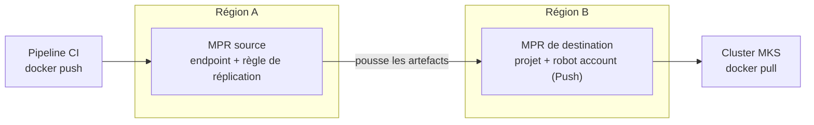
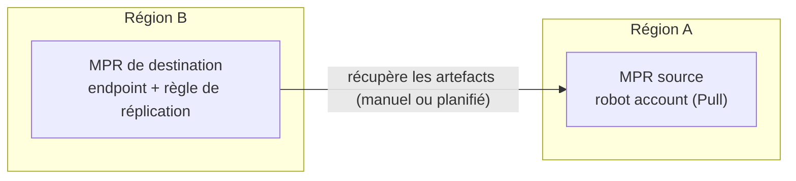

## Objectif

Un OVHcloud Managed Private Registry (MPR) est hébergé dans une seule région. Dans une région 3-AZ, le service est réparti sur plusieurs zones de disponibilité, mais vos données ne quittent jamais cette région.

Si vous avez besoin d'une copie de vos artefacts dans une autre région, vous pouvez utiliser la fonctionnalité de **réplication** intégrée à Harbor entre deux MPR. Cas d'usage courants :

- disposer d'un registry secondaire prêt à l'emploi dans une autre région, dans le cadre d'un plan de reprise d'activité.
- récupérer les images depuis un registry situé au plus près de vos clusters Managed Kubernetes dans chaque région.
- promouvoir des artefacts d'un environnement à un autre (par exemple, d'un registry de préproduction vers un registry de production).

La réplication copie les images de conteneurs, les artefacts OCI (y compris les charts Helm stockés au format OCI) et les artefacts qui leur sont rattachés, tels que les signatures, les SBOM et les attestations (consultez la section [Signatures, SBOM et autres artefacts rattachés](#signatures-sbom-et-autres-artefacts-rattachés)). Sa configuration et son exploitation relèvent de votre responsabilité (consultez le [modèle de responsabilité](/guides/public-cloud/containers-orchestration/managed-private-registry/responsibility-model)).

**Ce guide explique comment configurer une règle de réplication entre deux OVHcloud Managed Private Registry situés dans des régions différentes.**

## Prérequis

- Disposer de deux [OVHcloud Managed Private Registry](/guides/public-cloud/containers-orchestration/managed-private-registry/creation) situés dans deux régions différentes. Dans ce guide, ils sont appelés **registry source** et **registry de destination**.
- Disposer d'un compte avec les droits d'administrateur système sur l'[interface utilisateur Harbor](/guides/public-cloud/containers-orchestration/managed-private-registry/connect-to-ui) des deux registries.

:::warning
Harbor ne prend pas en charge la réplication entre des versions de Harbor différentes. Assurez-vous que les deux registries utilisent la même version de Harbor, et vérifiez-le à nouveau après chaque mise à jour. La version est affichée dans l'interface utilisateur Harbor, dans votre menu utilisateur > <code className="action">About</code>.
:::

## En pratique

Ce guide utilise la réplication **push-based** : la règle de réplication est créée sur le registry source, qui pousse les artefacts vers le registry de destination. Le mode push-based est le seul à prendre en charge le déclencheur <code className="action">Event Based</code>, qui réplique chaque nouvel artefact dès qu'il est poussé.



Si vous préférez créer la règle sur le registry de destination, par exemple pour déplacer vos artefacts vers un nouveau registry dans une autre région, consultez la section [Utiliser la réplication pull-based](#utiliser-la-réplication-pull-based).

### Étape 1 : préparer le registry de destination

1. Connectez-vous à l'interface utilisateur Harbor du **registry de destination**.
2. Créez le projet qui recevra les artefacts répliqués. Consultez le guide [Gérer les utilisateurs et les projets](/guides/public-cloud/containers-orchestration/managed-private-registry/managing-users-projects) pour plus de détails.
3. Créez un robot account que le registry source utilisera pour pousser les artefacts :
    - Ouvrez le projet, rendez-vous dans l'onglet <code className="action">Robot Accounts</code> et cliquez sur <code className="action">+ New Robot Account</code>.
    - Saisissez un nom et une durée d'expiration.
    - Accordez au minimum les permissions <code className="action">Push</code> et <code className="action">Pull</code> sur **Repository**.
    - Cliquez sur <code className="action">Finish</code>, puis copiez le nom du robot account (par exemple `robot$my-project+replication`) et son secret.

:::info
Si le projet de destination n'existe pas, Harbor le crée automatiquement lors de la réplication, à condition que le compte utilisé par l'endpoint soit autorisé à créer des projets. Créer le projet et un robot account limité à ce projet au préalable vous permet de maîtriser les paramètres du projet et de limiter les droits accordés au registry source.
:::

### Étape 2 : créer un endpoint de réplication sur le registry source

1. Connectez-vous à l'interface utilisateur Harbor du **registry source**.
2. Rendez-vous dans `Administration`, puis <code className="action">Registries</code>.
3. Cliquez sur <code className="action">+ New Endpoint</code> et renseignez les informations suivantes :
    - **Provider** : Harbor
    - **Name** : un nom pour l'endpoint (par exemple `mpr-destination`)
    - **Description** : facultatif
    - **Endpoint URL** : l'URL du registry de destination (par exemple `https://xxxxxxxx.c1.de1.container-registry.ovh.net`)
    - **Access ID** : le nom complet du robot account créé à l'étape 1 (par exemple `robot$my-project+replication`)
    - **Access Secret** : le secret du robot account
    - **Verify Remote Cert** : laissez cette case cochée
4. Cliquez sur <code className="action">Test Connection</code>. Une fois le test réussi, cliquez sur <code className="action">OK</code>.

:::info
Si vous avez configuré des [restrictions d'IP](/guides/public-cloud/containers-orchestration/managed-private-registry/add-ip-restrictions) sur l'endpoint `registry` du registry de destination, le trafic de réplication provenant du registry source doit être autorisé. Dans le cas contraire, le test de connexion et les tâches de réplication échoueront.
:::

### Étape 3 : créer une règle de réplication

1. Sur le registry source, rendez-vous dans `Administration`, puis <code className="action">Replications</code>.
2. Cliquez sur <code className="action">+ New Replication Rule</code> et renseignez les informations suivantes :
    - **Name** et **Description** : un nom pour la règle et une description facultative.
    - **Replication mode** : <code className="action">Push-based</code>.
    - **Source resource filter** : les artefacts à répliquer. Laissez les champs vides pour tout répliquer.
        - **Name** : un nom de dépôt ou un motif (par exemple `my-project/**`).
        - **Tag** : un tag ou un motif, à inclure ou à exclure (par exemple `v*` pour ne répliquer que les tags de version).
        - **Label** : un ou plusieurs labels existants, à inclure ou à exclure.
        - **Resource** : images uniquement, artefacts uniquement, ou tous.
    - **Destination registry** : l'endpoint créé à l'étape 2.
    - **Destination namespace** : le projet de destination (par exemple `my-project`). Si vous laissez ce champ vide, les artefacts sont répliqués dans un projet portant le même nom que sur le registry source.
    - **Destination Flattening** : le nombre de niveaux du chemin du dépôt qui sont supprimés. La valeur par défaut, `Flattening 1 level`, transforme `a/b/c/img` en `namespace/b/c/img`. Sélectionnez `No Flattening` pour conserver les mêmes chemins de dépôt que sur le registry source.
    - **Trigger Mode** :
        - <code className="action">Manual</code> : la règle ne s'exécute que lorsque vous la lancez.
        - <code className="action">Scheduled</code> : la règle s'exécute périodiquement, selon une expression cron.
        - <code className="action">Event Based</code> : la règle s'exécute à chaque fois qu'un artefact est poussé ou retagué sur le registry source. Cochez **Delete remote resources when locally deleted** pour répliquer également les suppressions.
    - **Bandwidth** : la bande passante maximale par tâche de réplication, en Ko/s. `-1` signifie illimitée.
    - **Override** : cochez cette case pour écraser les artefacts qui existent déjà sous le même nom sur le registry de destination.
    - **Copy by chunk** : cochez cette case pour copier les couches par blocs de 10 Mo, ce qui peut aider pour les images volumineuses.
    - **Single active replication** : cochez cette case pour ne pas lancer une nouvelle exécution tant qu'une exécution précédente de la même règle est en cours.
3. Cliquez sur <code className="action">Save</code>.

Les filtres **Name** et **Tag** acceptent les motifs suivants :

| Motif | Correspondance |
|---|---|
| `*` | N'importe quelle suite de caractères, sauf `/` |
| `**` | N'importe quelle suite de caractères, y compris `/`. Il doit constituer un segment de chemin complet (`my-project/**`) |
| `?` | Un seul caractère, sauf `/` |
| `{alt1,alt2}` | L'une des alternatives indiquées |

Par exemple, `library/*` correspond à `library/nginx` mais pas à `library/tools/nginx`, alors que `library/**` correspond aux deux.

:::info
Les déclencheurs <code className="action">Manual</code> et <code className="action">Scheduled</code> ne répliquent pas les suppressions. Avec <code className="action">Event Based</code>, seules les actions de push, de retag et de suppression déclenchent une réplication : l'ajout ou le retrait d'un label n'en déclenche pas.
:::

### Étape 4 : lancer et suivre la réplication

1. Sur le registry source, rendez-vous dans `Administration`, puis <code className="action">Replications</code>.
2. Sélectionnez la règle et cliquez sur <code className="action">Replicate</code> pour lancer une réplication initiale. Cette étape est recommandée même avec le déclencheur <code className="action">Event Based</code>, qui ne s'applique qu'aux artefacts poussés après la création de la règle.
3. Cliquez sur la règle pour afficher ses exécutions, puis sur l'**ID** d'une exécution pour voir ses tâches. Chaque artefact répliqué correspond à une tâche distincte.
4. Cliquez sur l'icône de log d'une tâche pour en voir le détail. Vous pouvez également cliquer sur <code className="action">STOP</code> pour arrêter une exécution.

Les tâches en échec sont automatiquement relancées plusieurs fois. Vous ne pouvez pas modifier ni supprimer une règle tant que l'une de ses exécutions est en cours.

### Étape 5 : vérifier le résultat sur le registry de destination

1. Connectez-vous à l'interface utilisateur Harbor du **registry de destination** et ouvrez le projet de destination. Les dépôts et tags répliqués y sont listés.
2. Récupérez une image depuis le registry de destination pour vérifier qu'elle est utilisable :

```bash
docker login <destination-registry-url>
docker pull <destination-registry-url>/<project>/<image>:<tag>
```

Pour utiliser le registry de destination depuis un cluster Managed Kubernetes, consultez le guide [Utiliser Private Registry avec OVHcloud Managed Kubernetes](/guides/public-cloud/containers-orchestration/managed-private-registry/kubernetes).

## Utiliser la réplication pull-based

Avec la réplication **pull-based**, la règle est créée sur le registry de destination, qui récupère les artefacts depuis le registry source. Le registry source n'a besoin que d'un robot account disposant d'un accès en lecture.



Ce mode est adapté au déplacement de vos artefacts vers un nouveau registry dans une autre région : tout est configuré sur le nouveau registry, et rien ne doit être modifié sur le registry que vous quittez, à part le robot account.

La réplication pull-based ne prend pas en charge le déclencheur <code className="action">Event Based</code> : utilisez <code className="action">Manual</code> ou <code className="action">Scheduled</code>.

### Étape 1 : créer un robot account en lecture seule sur le registry source

1. Connectez-vous à l'interface utilisateur Harbor du **registry source**.
2. Créez un robot account disposant de la permission <code className="action">Pull</code> sur **Repository** :
    - pour un seul projet : ouvrez le projet, rendez-vous dans l'onglet <code className="action">Robot Accounts</code> et cliquez sur <code className="action">+ New Robot Account</code>.
    - pour plusieurs projets : rendez-vous dans `Administration`, puis <code className="action">Robot Accounts</code>, cliquez sur <code className="action">+ New Robot Account</code> et sélectionnez les projets concernés, ou cochez <code className="action">Cover all projects</code>.
3. Cliquez sur <code className="action">Finish</code>, puis copiez le nom du robot account et son secret.

### Étape 2 : créer un endpoint de réplication sur le registry de destination

1. Connectez-vous à l'interface utilisateur Harbor du **registry de destination**.
2. Rendez-vous dans `Administration`, puis <code className="action">Registries</code>, et cliquez sur <code className="action">+ New Endpoint</code>.
3. Renseignez les informations comme décrit à l'[étape 2](#étape-2--créer-un-endpoint-de-réplication-sur-le-registry-source) ci-dessus, avec l'URL du **registry source** dans **Endpoint URL** et le robot account créé à l'étape 1 dans **Access ID** et **Access Secret**.
4. Cliquez sur <code className="action">Test Connection</code>. Une fois le test réussi, cliquez sur <code className="action">OK</code>.

:::info
Si vous avez configuré des [restrictions d'IP](/guides/public-cloud/containers-orchestration/managed-private-registry/add-ip-restrictions) sur l'endpoint `registry` du registry source, le trafic de réplication provenant du registry de destination doit être autorisé.
:::

### Étape 3 : créer la règle de réplication sur le registry de destination

1. Sur le registry de destination, rendez-vous dans `Administration`, puis <code className="action">Replications</code>, et cliquez sur <code className="action">+ New Replication Rule</code>.
2. Renseignez les informations suivantes :
    - **Replication mode** : <code className="action">Pull-based</code>.
    - **Source registry** : l'endpoint créé à l'étape 2.
    - **Source resource filter** : les artefacts à répliquer, avec les mêmes filtres et motifs que pour la réplication push-based. Laissez les champs vides pour répliquer tous les artefacts accessibles au robot account.
    - **Destination namespace** : laissez ce champ vide pour répliquer chaque projet dans un projet portant le même nom, créé automatiquement si nécessaire.
    - **Destination Flattening** : sélectionnez `No Flattening` pour conserver les mêmes chemins de dépôt que sur le registry source.
    - **Trigger Mode** : <code className="action">Manual</code> ou <code className="action">Scheduled</code>.
    - Les autres options (**Bandwidth**, **Override**, **Copy by chunk**, **Single active replication**) fonctionnent comme décrit à l'[étape 3](#étape-3--créer-une-règle-de-réplication) ci-dessus.
3. Cliquez sur <code className="action">Save</code>.

### Étape 4 : lancer la réplication et vérifier le résultat

Lancez et suivez la règle depuis le registry de destination, comme décrit à l'[étape 4](#étape-4--lancer-et-suivre-la-réplication), puis vérifiez le résultat comme décrit à l'[étape 5](#étape-5--vérifier-le-résultat-sur-le-registry-de-destination).

:::info
**Déplacer vos artefacts vers une autre région**

1. Créez la règle avec un déclencheur <code className="action">Scheduled</code> (par exemple, toutes les heures), puis cliquez sur <code className="action">Replicate</code> pour lancer la copie initiale sans attendre la planification.
2. Tant que vos pipelines CI et vos clusters utilisent encore le registry source, les exécutions planifiées répliquent les nouveaux artefacts.
3. Suspendez les écritures sur le registry source, cliquez une dernière fois sur <code className="action">Replicate</code> et vérifiez le résultat. Basculez ensuite tous vos clients vers le registry de destination, supprimez la règle et son endpoint, puis supprimez le robot account temporaire du registry source.

Les éléments listés dans la section [Éléments non répliqués](#éléments-non-répliqués) doivent être configurés sur le registry de destination avant de basculer vos clients.
:::

## Signatures, SBOM et autres artefacts rattachés

Harbor réplique chaque artefact avec les artefacts qui lui sont rattachés, appelés **accessoires** (*accessories*). Ils sont répliqués dès que leur artefact parent l'est, même s'ils n'ont pas de tag propre :

- les signatures Cosign, dans les deux formats : le format à base de tag de Cosign v2 (`sha256-<digest>.sig`) et le format OCI 1.1 utilisé par défaut par Cosign v3.
- les signatures Notation.
- tout artefact rattaché via le champ `subject` d'OCI 1.1, comme les SBOM, les attestations de provenance ou les documents VEX (par exemple, poussés avec `oras attach` ou `cosign attest`).
- les SBOM générés par Harbor.

Les attestations ajoutées par BuildKit (`docker buildx build --sbom --provenance`) sont stockées dans l'index de l'image : elles sont copiées avec l'image.

:::warning
Les attestations et pièces jointes de Cosign v2 (`cosign attest`, `cosign attach sbom`) ne sont pas des accessoires : elles sont stockées sous forme de tags classiques, comme `sha256-<digest>.att` ou `sha256-<digest>.sbom`. Elles ne sont répliquées que si elles correspondent au filtre **Tag** de la règle. Si vous filtrez sur les tags (par exemple `v*`), ajoutez ces tags au motif, par exemple `{v*,sha256-*}`.
:::

### Résultats d'analyse de vulnérabilités

Les résultats d'analyse sont stockés dans la base de données de chaque registry et ne sont pas répliqués. Pour les obtenir sur le registry de destination, activez l'option <code className="action">Automatically scan images on push</code> dans l'onglet <code className="action">Configuration</code> du projet de destination **avant** de lancer la réplication : les artefacts répliqués sont alors analysés dès leur arrivée. Vous pouvez également lancer une analyse manuellement par la suite. Consultez le guide [Analyser les vulnérabilités des images Docker](/guides/public-cloud/containers-orchestration/managed-private-registry/scan-docker-images-vulnerabilities).

Les projets créés automatiquement par la réplication utilisent les paramètres par défaut, dans lesquels l'analyse automatique est désactivée : créez les projets de destination au préalable pour la configurer.

## Éléments non répliqués

La réplication copie uniquement les artefacts et leurs signatures. Les éléments suivants sont propres à chaque registry et doivent être configurés séparément sur le registry de destination :

- les membres des projets et leurs rôles.
- les résultats d'analyse de vulnérabilités (consultez la section [Résultats d'analyse de vulnérabilités](#résultats-danalyse-de-vulnérabilités)).
- les utilisateurs, les robot accounts et leurs secrets.
- les paramètres d'authentification ([OVHcloud IAM](/guides/public-cloud/containers-orchestration/managed-private-registry/managed-private-registry-iam-authentication) ou [fournisseur OIDC](/guides/public-cloud/containers-orchestration/managed-private-registry/configure-oidc-provider-authentication)) et les [restrictions d'IP](/guides/public-cloud/containers-orchestration/managed-private-registry/add-ip-restrictions).
- les paramètres des projets, tels que les quotas, les règles de rétention et d'immutabilité, les politiques d'analyse de vulnérabilités et les webhooks.

Les artefacts répliqués consomment de l'espace de stockage sur les deux registries : vérifiez que l'offre du registry de destination dispose d'une capacité suffisante.

## Aller plus loin

- Documentation Harbor : [Configuring Replication](https://goharbor.io/docs/2.15.0/administration/configuring-replication/)
- [Signer des artefacts OCI avec Cosign](/guides/public-cloud/containers-orchestration/managed-private-registry/sign-artifacts-with-cosign)
- [Configurer le Proxy Cache sur un OVHcloud Managed Private Registry](/guides/public-cloud/containers-orchestration/managed-private-registry/configure-proxy-cache)
- Échangez avec notre [communauté d'utilisateurs](/links/community).
