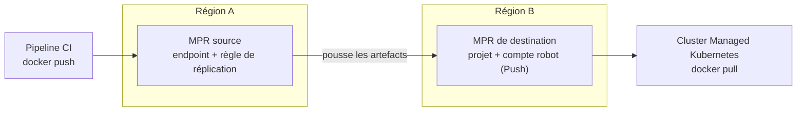
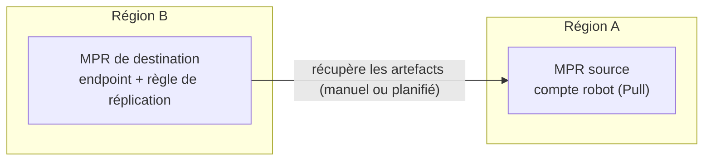

## Objectif

Un OVHcloud Managed Private Registry (MPR) est hébergé dans une seule région. Dans une région 3-AZ, le service est réparti sur plusieurs zones de disponibilité, mais vos données ne quittent jamais cette région.

Si vous avez besoin d'une copie de vos artefacts dans une autre région, vous pouvez utiliser la fonctionnalité de **réplication** intégrée à Harbor entre deux MPR. Cas d'usage courants :

- disposer d'un registre secondaire prêt à l'emploi dans une autre région, dans le cadre d'un plan de reprise d'activité.
- récupérer les images depuis un registre situé au plus près de vos clusters Managed Kubernetes dans chaque région.
- promouvoir des artefacts d'un environnement à un autre (par exemple, d'un registre de préproduction vers un registre de production).

La réplication copie les images de conteneurs, les artefacts OCI (y compris les charts Helm stockés au format OCI) et les artefacts qui leur sont rattachés, tels que les signatures, les SBOM et les attestations (reportez-vous à la section « [Signatures, SBOM et autres artefacts rattachés](#signatures-sbom-et-autres-artefacts-rattachés) »). Sa configuration et son exploitation relèvent de votre responsabilité (consultez le [modèle de responsabilité](/guides/public-cloud/containers-orchestration/managed-private-registry/responsibility-model)).

**Ce guide explique comment configurer une règle de réplication entre deux OVHcloud Managed Private Registry situés dans des régions différentes.**

## Prérequis

- Disposer de deux [OVHcloud Managed Private Registry](/guides/public-cloud/containers-orchestration/managed-private-registry/creation) situés dans deux régions différentes. Dans ce guide, ils sont appelés **registre source** et **registre de destination**.
- Disposer d'un compte avec les droits d'administrateur système sur l'[interface utilisateur Harbor](/guides/public-cloud/containers-orchestration/managed-private-registry/connect-to-ui) des deux registres.

:::warning
Harbor ne prend pas en charge la réplication entre des versions de Harbor différentes. Assurez-vous que les deux registres utilisent la même version de Harbor, et vérifiez-le à nouveau après chaque mise à jour. La version est affichée dans l'interface utilisateur Harbor, dans votre menu utilisateur > <code className="action">À propos</code>.

:::

## En pratique

Ce guide utilise la réplication **push-based** : la règle de réplication est créée sur le registre source, qui pousse les artefacts vers le registre de destination. Le mode push-based est le seul à prendre en charge le déclencheur <code className="action">Sur évènement</code>, qui réplique chaque nouvel artefact dès qu'il est poussé.



Si vous préférez créer la règle sur le registre de destination, par exemple pour déplacer vos artefacts vers un nouveau registre dans une autre région, reportez-vous à la section « [Utiliser la réplication pull-based](#utiliser-la-réplication-pull-based) ».

:::info
L'interface utilisateur Harbor s'affiche en français lorsque votre navigateur est réglé en français (France) : ce guide cite ces libellés. Si l'interface s'affiche en anglais, sélectionnez <code className="action">Français</code> dans le champ **Language** de votre menu utilisateur > <code className="action">Preferences</code>.

:::

### Étape 1 : préparer le registre de destination

1. Connectez-vous à l'interface utilisateur Harbor du **registre de destination**.
2. Créez le projet qui recevra les artefacts répliqués. Consultez le guide « [Gérer les utilisateurs et les projets](/guides/public-cloud/containers-orchestration/managed-private-registry/managing-users-projects) » pour plus de détails.
3. Créez un compte robot que le registre source utilisera pour pousser les artefacts :
    - Ouvrez le projet, rendez-vous dans l'onglet <code className="action">Comptes robot</code> et cliquez sur <code className="action">+ Nouveau compte robot</code>.
    - Saisissez un nom et une durée d'expiration.
    - Accordez au minimum les permissions <code className="action">Push</code> et <code className="action">Pull</code> sur **Dépôt**.
    - Cliquez sur <code className="action">Finir</code>, puis copiez le nom du compte robot (par exemple `robot$my-project+replication`) et son secret.

:::info
Si le projet de destination n'existe pas, Harbor le crée automatiquement lors de la réplication, à condition que le compte utilisé par l'endpoint soit autorisé à créer des projets. Créer le projet et un compte robot limité à ce projet au préalable vous permet de maîtriser les paramètres du projet et de limiter les droits accordés au registre source.

:::

### Étape 2 : créer un endpoint de réplication sur le registre source

1. Connectez-vous à l'interface utilisateur Harbor du **registre source**.
2. Rendez-vous dans <code className="action">Administration</code>, puis <code className="action">Registres</code>.
3. Cliquez sur <code className="action">+ Nouveau Endpoint</code> et renseignez les informations suivantes :
    - **Fournisseur** : <code className="action">Harbor</code>
    - **Nom** : un nom pour l'endpoint (par exemple `mpr-destination`)
    - **Description** : facultatif
    - **URL de l'endpoint** : l'URL du registre de destination (par exemple `https://xxxxxxxx.c1.de1.container-registry.ovh.net`)
    - **ID d'accès** : le nom complet du compte robot créé à l'étape 1 (par exemple `robot$my-project+replication`)
    - **Secret d'accès** : le secret du compte robot
    - **Vérifier le certificat distant** : laissez cette case cochée
4. Cliquez sur <code className="action">Test de connexion</code>. Une fois le test réussi, cliquez sur <code className="action">OK</code>.

:::info
Les adresses IP sortantes d'un Managed Private Registry ne sont pas publiées. Si vous avez configuré des [restrictions IP](/guides/public-cloud/containers-orchestration/managed-private-registry/add-ip-restrictions) sur l'endpoint `registry` ou `management` du registre de destination, le trafic de réplication provenant du registre source est bloqué : le test de connexion et les tâches de réplication échouent. Dans ce cas, vous pouvez :

- utiliser plutôt la [réplication pull-based](#utiliser-la-réplication-pull-based) : c'est alors le registre de destination qui initie les connexions vers le registre source.
- ou supprimer les restrictions IP du registre de destination le temps de la réplication, puis les rétablir. Cette solution ne convient qu'à une réplication ponctuelle, comme le déplacement de vos artefacts vers une autre région.

:::

### Étape 3 : créer une règle de réplication

1. Sur le registre source, rendez-vous dans <code className="action">Administration</code>, puis <code className="action">Réplication</code>.
2. Cliquez sur <code className="action">+ Nouvelle règle de réplication</code> et renseignez les informations suivantes :
    - **Nom** et **Description** : un nom pour la règle et une description facultative.
    - **Mode de réplication** : <code className="action">Push-based</code>.
    - **Filtre de ressource source** : les artefacts à répliquer. Laissez les champs vides pour tout répliquer.
        - **Nom** : un nom de dépôt ou un motif (par exemple `my-project/**`).
        - **Tag** : un tag ou un motif, à inclure ou à exclure (par exemple `v*` pour ne répliquer que les tags de version).
        - **Label** : un ou plusieurs labels existants, à inclure ou à exclure.
        - **Ressource** : images uniquement, artefacts uniquement, ou tous.
    - **Registre de destination** : l'endpoint créé à l'étape 2.
    - **Namespace** : le projet de destination (par exemple `my-project`). Si vous laissez ce champ vide, les artefacts sont répliqués dans un projet portant le même nom que sur le registre source.
    - **Aplanissement** : le nombre de niveaux supprimés du chemin du dépôt. La valeur par défaut, <code className="action">Aplanissement sur 1 niveau</code>, transforme `a/b/c/img` en `namespace/b/c/img`. Sélectionnez <code className="action">Pas d'aplanissement</code> pour conserver le chemin source complet sous le namespace de destination (`a/b/c/img` devient `namespace/a/b/c/img`).
    - **Mode de déclenchement** :
        - <code className="action">Manuelle</code> : la règle ne s'exécute que lorsque vous la lancez.
        - <code className="action">Planifiée</code> : la règle s'exécute périodiquement, selon une expression cron.
        - <code className="action">Sur évènement</code> : la règle s'exécute chaque fois qu'un artefact est poussé ou retagué sur le registre source. Cochez <code className="action">Supprimer les ressources distantes lors de la suppression locale</code> pour répliquer également les suppressions (le compte robot doit alors aussi disposer de la permission <code className="action">Supprimer</code> sur **Dépôt**).
    - **Bande passante** : la bande passante maximale par tâche de réplication, en Ko/s. `-1` signifie illimitée.
    - **Surcharger** : cochez cette case pour écraser les artefacts qui existent déjà sous le même nom sur le registre de destination.
    - **Copier par morceaux** : cochez cette case pour copier les couches par blocs de 10 Mo, ce qui peut aider pour les images volumineuses.
    - **Single active replication** : cochez cette case pour ne pas lancer une nouvelle exécution tant qu'une exécution précédente de la même règle est en cours.
3. Cliquez sur <code className="action">Sauvegarder</code>.

Les filtres **Nom** et **Tag** acceptent les motifs suivants :

| Motif | Correspondance |
|---|---|
| `*` | N'importe quelle suite de caractères, sauf `/` |
| `**` | N'importe quelle suite de caractères, y compris `/`. Il doit constituer un segment de chemin complet (`my-project/**`). |
| `?` | Un seul caractère, sauf `/` |
| `{alt1,alt2}` | L'une des alternatives indiquées |

Par exemple, `library/*` correspond à `library/nginx` mais pas à `library/tools/nginx`, alors que `library/**` correspond aux deux.

:::info
Les déclencheurs <code className="action">Manuelle</code> et <code className="action">Planifiée</code> ne répliquent pas les suppressions. Avec <code className="action">Sur évènement</code>, seules les actions de push, de retag et de suppression déclenchent une réplication : l'ajout ou le retrait d'un label n'en déclenche pas.

:::

### Étape 4 : lancer et suivre la réplication

1. Sur le registre source, rendez-vous dans <code className="action">Administration</code>, puis <code className="action">Réplication</code>.
2. Sélectionnez la règle et cliquez sur <code className="action">Répliquer</code> pour lancer une réplication initiale. Cette réplication initiale reste recommandée avec le déclencheur <code className="action">Sur évènement</code>, qui ne s'applique qu'aux artefacts poussés après la création de la règle.
3. Cliquez sur la règle pour afficher ses exécutions, puis sur l'**ID** d'une exécution pour voir ses tâches. Chaque artefact répliqué correspond à une tâche distincte.
4. Cliquez sur l'icône de log d'une tâche pour en voir le détail. Vous pouvez également cliquer sur <code className="action">STOP</code> pour arrêter une exécution.

Les tâches en échec sont automatiquement relancées plusieurs fois. Vous ne pouvez pas modifier ni supprimer une règle tant que l'une de ses exécutions est en cours.

### Étape 5 : vérifier le résultat sur le registre de destination

1. Connectez-vous à l'interface utilisateur Harbor du **registre de destination** et ouvrez le projet de destination. Les dépôts et tags répliqués y sont listés.
2. Récupérez une image depuis le registre de destination pour vérifier qu'elle est utilisable :

    ```bash
    docker login <destination-registry-url>
    docker pull <destination-registry-url>/<project>/<image>:<tag>
    ```

Pour utiliser le registre de destination depuis un cluster Managed Kubernetes, consultez le guide « [Utiliser Private Registry avec OVHcloud Managed Kubernetes](/guides/public-cloud/containers-orchestration/managed-private-registry/kubernetes) ».

## Utiliser la réplication pull-based

Avec la réplication **pull-based**, la règle est créée sur le registre de destination, qui récupère les artefacts depuis le registre source. Le registre source n'a besoin que d'un compte robot en lecture seule.



Ce mode est adapté au déplacement de vos artefacts vers un nouveau registre dans une autre région : tout est configuré sur le nouveau registre, et rien ne doit être modifié sur le registre que vous quittez, à part le compte robot.

La réplication pull-based ne prend pas en charge le déclencheur <code className="action">Sur évènement</code> : utilisez <code className="action">Manuelle</code> ou <code className="action">Planifiée</code>.

### Étape 1 : créer un compte robot en lecture seule sur le registre source

1. Connectez-vous à l'interface utilisateur Harbor du **registre source**.
2. Créez un compte robot disposant de la permission <code className="action">Lire</code> sur **Projet**, des permissions <code className="action">Lister</code> et <code className="action">Lire</code> sur **Artefact** et des permissions <code className="action">Lister</code> et <code className="action">Pull</code> sur **Dépôt** :
    - pour un seul projet : ouvrez le projet, rendez-vous dans l'onglet <code className="action">Comptes robot</code> et cliquez sur <code className="action">+ Nouveau compte robot</code>.
    - pour plusieurs projets : rendez-vous dans <code className="action">Administration</code>, puis <code className="action">Comptes robot</code>, cliquez sur <code className="action">+ Nouveau compte robot</code> et sélectionnez les projets concernés, ou cochez <code className="action">Couvrir tous les projets</code>.
3. Cliquez sur <code className="action">Finir</code>, puis copiez le nom du compte robot et son secret.

### Étape 2 : créer un endpoint de réplication sur le registre de destination

1. Connectez-vous à l'interface utilisateur Harbor du **registre de destination**.
2. Rendez-vous dans <code className="action">Administration</code>, puis <code className="action">Registres</code>, et cliquez sur <code className="action">+ Nouveau Endpoint</code>.
3. Renseignez les informations comme décrit à l'[étape 2](#étape-2-créer-un-endpoint-de-réplication-sur-le-registre-source) ci-dessus, avec l'URL du **registre source** dans **URL de l'endpoint** et le compte robot créé à l'étape 1 dans **ID d'accès** et **Secret d'accès**.
4. Cliquez sur <code className="action">Test de connexion</code>. Une fois le test réussi, cliquez sur <code className="action">OK</code>.

:::info
Les adresses IP sortantes d'un Managed Private Registry ne sont pas publiées. Si vous avez configuré des [restrictions IP](/guides/public-cloud/containers-orchestration/managed-private-registry/add-ip-restrictions) sur l'endpoint `registry` ou `management` du registre source, le trafic de réplication provenant du registre de destination est bloqué. Dans ce cas, vous pouvez :

- utiliser plutôt la [réplication push-based](#en-pratique) : c'est alors le registre source qui initie les connexions vers le registre de destination.
- ou supprimer les restrictions IP du registre source le temps de la réplication, puis les rétablir.

:::

### Étape 3 : créer la règle de réplication sur le registre de destination

1. Sur le registre de destination, rendez-vous dans <code className="action">Administration</code>, puis <code className="action">Réplication</code>, et cliquez sur <code className="action">+ Nouvelle règle de réplication</code>.
2. Renseignez les informations suivantes :
    - **Mode de réplication** : <code className="action">Pull-based</code>.
    - **Registre source** : l'endpoint créé à l'étape 2.
    - **Filtre de ressource source** : les artefacts à répliquer, avec les mêmes filtres et motifs que pour la réplication push-based. Laissez les champs vides pour répliquer tous les artefacts accessibles au compte robot.
    - **Namespace** : laissez ce champ vide pour répliquer chaque projet dans un projet portant le même nom, créé automatiquement si nécessaire.
    - **Aplanissement** : sélectionnez <code className="action">Pas d'aplanissement</code> pour conserver les mêmes chemins de dépôt que sur le registre source.
    - **Mode de déclenchement** : <code className="action">Manuelle</code> ou <code className="action">Planifiée</code>.
    - Les autres options (**Bande passante**, **Surcharger**, **Copier par morceaux**, **Single active replication**) fonctionnent comme décrit à l'[étape 3](#étape-3-créer-une-règle-de-réplication) ci-dessus.
3. Cliquez sur <code className="action">Sauvegarder</code>.

### Étape 4 : lancer la réplication et vérifier le résultat

Lancez et suivez la règle depuis le registre de destination, comme décrit à l'[étape 4](#étape-4-lancer-et-suivre-la-réplication), puis vérifiez le résultat comme décrit à l'[étape 5](#étape-5-vérifier-le-résultat-sur-le-registre-de-destination).

:::info
**Déplacer vos artefacts vers une autre région**

1. Créez la règle avec un déclencheur <code className="action">Planifiée</code> (par exemple, toutes les heures), puis cliquez sur <code className="action">Répliquer</code> pour lancer la copie initiale sans attendre la planification.
2. Tant que vos pipelines CI et vos clusters utilisent encore le registre source, les exécutions planifiées répliquent les nouveaux artefacts.
3. Suspendez les écritures sur le registre source, cliquez une dernière fois sur <code className="action">Répliquer</code> et vérifiez le résultat. Basculez ensuite tous vos clients vers le registre de destination, supprimez la règle et son endpoint, puis supprimez le compte robot temporaire du registre source.

Les éléments listés dans la section « [Éléments non répliqués](#éléments-non-répliqués) » doivent être configurés sur le registre de destination avant de basculer vos clients.

:::

## Signatures, SBOM et autres artefacts rattachés

Harbor réplique chaque artefact avec les artefacts qui lui sont rattachés, appelés **accessoires** (*accessories*). Ils sont répliqués en même temps que leur artefact parent, même s'ils n'ont pas de tag propre :

- les signatures Cosign, dans les deux formats : le format à base de tag de Cosign v2 (`sha256-<digest>.sig`) et le format OCI 1.1 utilisé par défaut par Cosign v3.
- les signatures Notation.
- tout artefact rattaché via le champ `subject` d'OCI 1.1, comme les SBOM, les attestations de provenance ou les documents VEX (par exemple, poussés avec `oras attach` ou `cosign attest`).
- les SBOM générés par Harbor.

Les attestations ajoutées par BuildKit (`docker buildx build --sbom --provenance`) sont stockées dans l'index de l'image : elles sont copiées avec l'image.

:::warning
Les attestations et pièces jointes de Cosign v2 (`cosign attest`, `cosign attach sbom`) ne sont pas des accessoires : elles sont stockées sous forme de tags classiques, comme `sha256-<digest>.att` ou `sha256-<digest>.sbom`. Elles ne sont répliquées que si elles correspondent au filtre **Tag** de la règle. Si vous filtrez sur les tags (par exemple `v*`), ajoutez ces tags au motif, par exemple `{v*,sha256-*}`.

:::

### Résultats d'analyse de vulnérabilités

Les résultats d'analyse sont stockés dans la base de données de chaque registre et ne sont pas répliqués. Pour les obtenir sur le registre de destination, qui doit disposer d'un plan `M` ou `L` pour inclure un scanner de vulnérabilités, activez l'option <code className="action">Analyse automatique des images lors de l'envoi</code> dans l'onglet <code className="action">Configuration</code> du projet de destination **avant** de lancer la réplication : les artefacts répliqués sont alors analysés dès leur arrivée. Vous pouvez également lancer une analyse manuellement par la suite. Consultez le guide « [Analyser les vulnérabilités des images Docker](/guides/public-cloud/containers-orchestration/managed-private-registry/scan-docker-images-vulnerabilities) ».

Les projets créés automatiquement par la réplication utilisent les paramètres par défaut, dans lesquels l'analyse automatique est désactivée : créez les projets de destination au préalable pour la configurer.

## Éléments non répliqués

La réplication copie uniquement les artefacts, leurs signatures et les autres artefacts qui leur sont rattachés. Les éléments suivants sont propres à chaque registre et doivent être configurés séparément sur le registre de destination :

- les membres des projets et leurs rôles.
- les résultats d'analyse de vulnérabilités (reportez-vous à la section « [Résultats d'analyse de vulnérabilités](#résultats-danalyse-de-vulnérabilités) »).
- les utilisateurs, les comptes robots et leurs secrets.
- les paramètres d'authentification ([OVHcloud IAM](/guides/public-cloud/containers-orchestration/managed-private-registry/managed-private-registry-iam-authentication) ou [fournisseur OIDC](/guides/public-cloud/containers-orchestration/managed-private-registry/configure-oidc-provider-authentication)) et les [restrictions IP](/guides/public-cloud/containers-orchestration/managed-private-registry/add-ip-restrictions).
- les paramètres des projets, tels que les quotas, les règles de rétention et d'immutabilité, les politiques d'analyse de vulnérabilités et les webhooks.

Les artefacts répliqués consomment de l'espace de stockage sur les deux registres : vérifiez que l'offre du registre de destination dispose d'une capacité suffisante.

## Aller plus loin

Documentation Harbor : [Configuring Replication](https://goharbor.io/docs/2.15.0/administration/configuring-replication/)

[Signer des artefacts OCI avec Cosign](/guides/public-cloud/containers-orchestration/managed-private-registry/sign-artifacts-with-cosign)

[Configurer le Proxy Cache sur un OVHcloud Managed Private Registry](/guides/public-cloud/containers-orchestration/managed-private-registry/configure-proxy-cache)

Échangez avec notre [communauté d'utilisateurs](/links/community).
