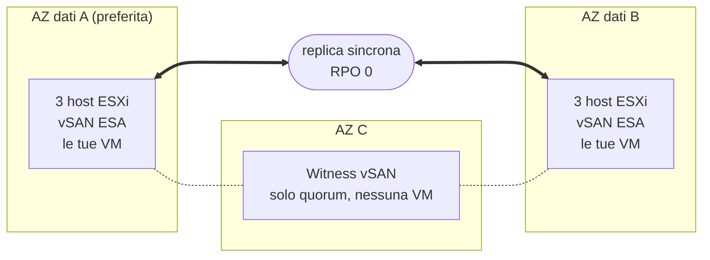

## Obiettivo

**Questa guida presenta l'architettura di Private VCF as-a-Service Stretched Cluster 3-AZ: la distribuzione del cluster su tre zone di disponibilità, la replica dei tuoi dati e la reazione della piattaforma quando un componente si guasta.**

{/* Re-check after December 2026: the Beta opening date below will be past. */}

:::info
Private VCF as-a-Service Stretched Cluster 3-AZ è in Beta. La Beta apre a dicembre 2026 a un numero limitato di clienti Enterprise. Per maggiori informazioni, consulta la [pagina OVHcloud Labs](https://labs.ovhcloud.com/en/vmware-3az/) (in inglese).
:::

## Il principio dello stretched cluster

Private VCF as-a-Service è una piattaforma VMware Cloud Foundation (VCF) 9.1 basata su hardware dedicato e gestita da OVHcloud.

Nella versione Stretched Cluster 3-AZ, il tuo Workload Domain esegue **un unico cluster vSphere i cui host sono distribuiti su due zone di disponibilità (AZ)** della regione Paris 3-AZ. Queste sono le **AZ dati**: entrambe eseguono le tue macchine virtuali ed entrambe contengono una copia completa dei tuoi dati. **Una terza AZ ospita un witness**, che partecipa solo al quorum.

Lo storage si basa su **vSAN ESA**, configurato da OVHcloud. vSAN replica i tuoi dati **in modo sincrono** tra le due AZ dati: una scrittura viene confermata solo dopo essere stata registrata in entrambe. Le due AZ contengono quindi sempre gli stessi dati, e la perdita di una di esse non comporta alcuna perdita di dati: **RPO = 0 by design**, garantito dall'infrastruttura.

:::warning
L'RPO 0 richiede una replica in mirroring tra le due AZ dati. Mantieni le tue VM su una policy di storage vSAN che replica i loro dati sui due siti: una VM assegnata a una policy che conserva i dati in una sola AZ non viene replicata e non è protetta contro la perdita di quella AZ.
:::

Quando una AZ dati si guasta, **vSphere HA riavvia automaticamente le sue macchine virtuali nella AZ rimanente**, senza alcun intervento da parte tua.

## Architettura

Il tuo Workload Domain esegue un unico cluster vSphere, esteso sulle due AZ dati della regione Paris 3-AZ. Il witness si trova nella terza AZ.

| Componente | Posizione | Ruolo |
|---|---|---|
| AZ dati A (preferita) | Prima AZ dati | Esegue le tue VM e contiene una copia completa dei tuoi dati. Se le due AZ dati perdono il contatto, è lei a mantenere il quorum. |
| AZ dati B | Seconda AZ dati | Esegue le tue VM e contiene una copia completa dei tuoi dati. |
| Witness | Terza AZ | Arbitra il quorum tra le AZ dati. Non memorizza dati delle VM e non esegue alcuna VM. |
| Host ESXi | AZ dati | La configurazione di base comprende 6 host vSAN identici, 3 in ogni AZ dati. Il cluster cresce per coppie di host, uno in ogni AZ dati, affinché le due AZ mantengano la stessa capacità. |

OVHcloud assegna le AZ: disponi di due AZ dati distinte e di un witness nella terza AZ, ma non scegli il ruolo di ciascuna AZ.

## Cosa succede in caso di guasto?

Lo stretched cluster reagisce autonomamente alla perdita di un host, di una AZ dati, del witness o del collegamento tra le AZ dati.

| Elemento guasto | Cosa succede | Dati persi | La tua azione |
|---|---|---|---|
| Un host | vSphere HA riavvia le sue VM sugli altri host. | Nessuno | Nessuna |
| Un'intera AZ dati | Le sue VM si riavviano automaticamente nella AZ rimanente. | Nessuno | Nessuna |
| La AZ del witness | Le due AZ dati continuano a funzionare e mantengono il quorum. | Nessuno | Nessuna |
| Il collegamento tra le AZ dati | La AZ preferita mantiene il quorum; le VM dell'altra AZ si riavviano nella AZ preferita. | Nessuno | Nessuna |

Questi sono i comportamenti standard di uno stretched cluster vSAN, come documentato da Broadcom.

:::warning
Una VM riavviata da vSphere HA non viene spostata a caldo: si riavvia nella AZ rimanente, e le sue applicazioni si riavviano con essa. Il tempo di ripristino di ogni applicazione dipende dal suo sistema operativo e dalla sua configurazione.
:::

### Pianificare la capacità per la perdita di una AZ

Affinché tutte le VM di una AZ dati guasta si riavviino nell'altra, la AZ rimanente deve disporre di CPU e memoria libere sufficienti per eseguirle. Dimensiona i tuoi workload in modo che una sola AZ dati possa eseguire tutte le VM che devono continuare a funzionare.

## Cosa non sostituisce lo stretched cluster

Lo stretched cluster protegge i tuoi workload dalla perdita dell'infrastruttura. **Non è né un backup né un piano di disaster recovery**:

- la replica sincrona copia tutto nelle due AZ dati contemporaneamente, compresi un file eliminato, dati danneggiati o file cifrati da un ransomware;
- i tuoi workload vengono eseguiti in un unico cluster: se questo cluster viene compromesso, non ne esiste una seconda copia da cui ripartire.

Conserva un backup e, se la tua attività lo richiede, una soluzione di disaster recovery al di fuori del cluster. La Beta non include alcun servizio di backup gestito.

## Cosa è incluso intorno al cluster

| Ambito | Cosa ottieni |
|---|---|
| Gestione | vSAN ESA è fornito preconfigurato, e OVHcloud esegue gli aggiornamenti e le patch di VCF. |
| Rete | VCF Networking è incluso. Con il tuo Workload Domain puoi ordinare l'estensione gratuita **Edge Services** o l'opzione **vDefend** per il firewall distribuito. |
| vRack | Facoltativo. Il tuo Workload Domain viene consegnato senza vRack: dopo la consegna, puoi collegare un vRack che possiedi già o ordinarne uno nuovo. |
| Identità | Ti connetti tramite OVHcloud IAM e SSO: nessun account locale e un ruolo di amministratore sul tuo Workload Domain fin dalla consegna. |
| Disponibilità | La piattaforma è progettata per una disponibilità del 99,999%. |

## Per saperne di più

[Pagina prodotto Private VCF as-a-Service 3-AZ](/links/hosted-private-cloud/private-vcf-aas-3-az)

[Private VCF as-a-Service Stretched Cluster 3-AZ su OVHcloud Labs](https://labs.ovhcloud.com/en/vmware-3az/) (in inglese)

[[fragment:professional-services]]

Contatta la nostra [Community di utenti](/links/community).
