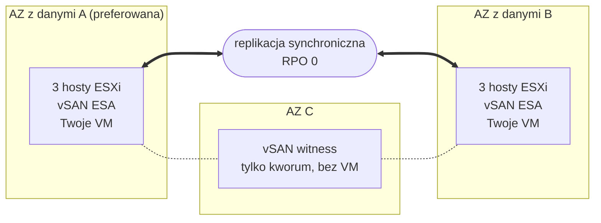

## Wprowadzenie

**Ten przewodnik przedstawia architekturę Private VCF as-a-Service Stretched Cluster 3-AZ: jak klaster jest rozłożony na trzy strefy dostępności, jak replikowane są Twoje dane i jak platforma reaguje na awarię jednego z komponentów.**

{/* Re-check after December 2026: the Beta opening date below will be past. */}

:::info
Private VCF as-a-Service Stretched Cluster 3-AZ jest dostępny w wersji Beta. Program Beta rusza w grudniu 2026 r. dla ograniczonej liczby klientów Enterprise. Więcej informacji znajdziesz na [stronie OVHcloud Labs](https://labs.ovhcloud.com/en/vmware-3az/) (w języku angielskim).
:::

## Zasada działania stretched cluster

Private VCF as-a-Service to platforma VMware Cloud Foundation (VCF) 9.1 zbudowana na dedykowanym sprzęcie i zarządzana przez OVHcloud.

W wariancie Stretched Cluster 3-AZ Twoja Workload Domain obsługuje **jeden klaster vSphere, którego hosty są rozłożone na dwie strefy dostępności (AZ)** regionu Paris 3-AZ. Są to **strefy AZ z danymi**: obie uruchamiają Twoje maszyny wirtualne i obie przechowują pełną kopię Twoich danych. **Trzecia strefa AZ hostuje witness**, który bierze udział wyłącznie w kworum.

Pamięć masowa opiera się na **vSAN ESA**, skonfigurowanym przez OVHcloud. vSAN replikuje Twoje dane **synchronicznie** między dwiema strefami AZ z danymi: zapis jest potwierdzany dopiero po zapisaniu go w obu. Obie strefy AZ przechowują więc zawsze te same dane, a utrata jednej z nich nie powoduje utraty danych: **RPO = 0 z założenia**, zapewnione przez infrastrukturę.

:::warning
RPO 0 wymaga dublowania (mirroring) danych między dwiema strefami AZ z danymi. Przypisz maszynom wirtualnym zasadę przechowywania vSAN, która dubluje ich dane w obu lokalizacjach: maszyna wirtualna objęta zasadą przechowującą dane w jednej strefie AZ nie jest replikowana i nie jest chroniona przed utratą tej strefy.
:::

W przypadku awarii strefy AZ z danymi **vSphere HA automatycznie uruchamia ponownie jej maszyny wirtualne w pozostałej strefie AZ**, bez żadnej interwencji z Twojej strony.

## Architektura

Twoja Workload Domain obsługuje jeden klaster vSphere rozciągnięty na dwie strefy AZ z danymi regionu Paris 3-AZ. Witness znajduje się w trzeciej strefie AZ.

| Komponent | Lokalizacja | Rola |
|---|---|---|
| AZ z danymi A (preferowana) | Pierwsza strefa AZ z danymi | Uruchamia Twoje maszyny wirtualne i przechowuje pełną kopię Twoich danych. Jeśli dwie strefy AZ z danymi utracą łączność, to ona zachowuje kworum. |
| AZ z danymi B | Druga strefa AZ z danymi | Uruchamia Twoje maszyny wirtualne i przechowuje pełną kopię Twoich danych. |
| Witness | Trzecia strefa AZ | Rozstrzyga o kworum między strefami AZ z danymi. Nie przechowuje danych maszyn wirtualnych i nie uruchamia maszyn wirtualnych. |
| Hosty ESXi | Strefy AZ z danymi | Konfiguracja podstawowa obejmuje 6 identycznych hostów vSAN, po 3 w każdej strefie AZ z danymi. Klaster rozbudowuje się parami hostów, po jednym w każdej strefie AZ z danymi, aby obie strefy zachowały taką samą pojemność. |

OVHcloud przydziela strefy AZ: otrzymujesz dwie odrębne strefy AZ z danymi i witness w trzeciej strefie AZ, ale nie wybierasz, która strefa pełni jaką rolę.

## Co dzieje się w razie awarii

Stretched cluster samodzielnie reaguje na utratę hosta, strefy AZ z danymi, witnessa lub połączenia między strefami AZ z danymi.

| Co ulega awarii | Co się dzieje | Utracone dane | Twoje działanie |
|---|---|---|---|
| Host | vSphere HA uruchamia ponownie jego maszyny wirtualne na pozostałych hostach. | Brak | Brak |
| Cała strefa AZ z danymi | Jej maszyny wirtualne automatycznie uruchamiają się ponownie w pozostałej strefie AZ. | Brak | Brak |
| Strefa AZ witnessa | Obie strefy AZ z danymi nadal działają i zachowują kworum. | Brak | Brak |
| Połączenie między strefami AZ z danymi | Preferowana strefa AZ zachowuje kworum; maszyny wirtualne drugiej strefy uruchamiają się ponownie w preferowanej strefie AZ. | Brak | Brak |

Są to standardowe zachowania vSAN stretched cluster opisane w dokumentacji Broadcom.

:::warning
Maszyna wirtualna uruchomiona ponownie przez vSphere HA nie jest przenoszona na żywo: uruchamia się od nowa w pozostałej strefie AZ, a jej aplikacje uruchamiają się ponownie razem z nią. Czas przywracania każdej aplikacji zależy od jej systemu operacyjnego i konfiguracji.
:::

### Zaplanuj zasoby na wypadek utraty strefy AZ

Aby maszyny wirtualne strefy AZ z danymi, która uległa awarii, mogły uruchomić się ponownie, pozostała strefa AZ musi dysponować wystarczającą ilością wolnego procesora i pamięci, aby je obsłużyć. Zwymiaruj swoje obciążenia tak, aby jedna strefa AZ z danymi mogła uruchomić wszystkie maszyny wirtualne, które muszą nadal działać.

## Czego stretched cluster nie zastępuje

Stretched cluster chroni Twoje obciążenia przed utratą infrastruktury. **Nie jest kopią zapasową ani planem odtwarzania po awarii**:

- replikacja synchroniczna kopiuje wszystko jednocześnie do obu stref AZ z danymi, w tym usunięty plik, uszkodzone dane lub pliki zaszyfrowane przez ransomware;
- Twoje obciążenia działają w jednym klastrze: jeśli ten klaster zostanie przejęty, nie istnieje jego druga kopia, z której można by wznowić działanie.

Utrzymuj kopię zapasową oraz, jeśli wymaga tego Twoja działalność, rozwiązanie do odtwarzania po awarii poza klastrem. Wersja Beta nie obejmuje zarządzanej usługi kopii zapasowych.

## Co jest dostępne w ramach klastra

| Obszar | Co otrzymujesz |
|---|---|
| Eksploatacja | vSAN ESA jest wstępnie skonfigurowany, a OVHcloud przeprowadza aktualizacje i poprawki VCF. |
| Sieć | VCF Networking jest w cenie. Wraz z Workload Domain możesz zamówić bezpłatne rozszerzenie **Edge Services** lub opcję **vDefend** dla rozproszonej zapory sieciowej. |
| vRack | Opcjonalny. Twoja Workload Domain jest dostarczana bez vRack: po dostarczeniu podłączasz posiadany już vRack lub zamawiasz nowy. |
| Tożsamość | Logujesz się przez OVHcloud IAM i SSO: bez kont lokalnych, z rolą administratora w Workload Domain od momentu dostarczenia. |
| Dostępność | Platforma została zaprojektowana z myślą o dostępności na poziomie 99,999%. |

## Sprawdź również

[Strona produktu Private VCF as-a-Service 3-AZ](/links/hosted-private-cloud/private-vcf-aas-3-az)

[Private VCF as-a-Service Stretched Cluster 3-AZ w OVHcloud Labs](https://labs.ovhcloud.com/en/vmware-3az/) (w języku angielskim)

[[fragment:professional-services]]

Dołącz do [grona naszych użytkowników](/links/community).
