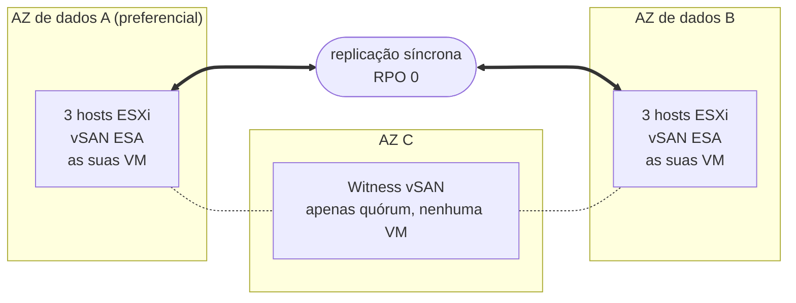

## Objetivo

**Este guia apresenta a arquitetura do Private VCF as-a-Service Stretched Cluster 3-AZ: a distribuição do cluster por três zonas de disponibilidade, a replicação dos seus dados e a reação da plataforma quando um componente avaria.**

{/* Re-check after December 2026: the Beta opening date below will be past. */}

:::info
O Private VCF as-a-Service Stretched Cluster 3-AZ está em Beta. A Beta abre em dezembro de 2026 a um número limitado de clientes Enterprise. Para mais informações, consulte a [página OVHcloud Labs](https://labs.ovhcloud.com/en/vmware-3az/) (em inglês).
:::

## O princípio do stretched cluster

O Private VCF as-a-Service é uma plataforma VMware Cloud Foundation (VCF) 9.1 construída sobre hardware dedicado e operada pela OVHcloud.

Na sua versão Stretched Cluster 3-AZ, o seu Workload Domain executa **um único cluster vSphere cujos hosts estão distribuídos por duas zonas de disponibilidade (AZ)** da região Paris 3-AZ. São as **AZ de dados**: ambas executam as suas máquinas virtuais e ambas contêm uma cópia completa dos seus dados. **Uma terceira AZ aloja uma witness**, que participa apenas no quórum.

O armazenamento assenta no **vSAN ESA**, configurado pela OVHcloud. O vSAN replica os seus dados **de forma síncrona** entre as duas AZ de dados: uma escrita só é confirmada depois de registada em ambas. As duas AZ contêm, portanto, sempre os mesmos dados, e a perda de uma delas não implica qualquer perda de dados: **RPO = 0 por conceção**, assegurado pela infraestrutura.

:::warning
O RPO 0 requer uma replicação em espelho entre as duas AZ de dados. Mantenha as suas VM numa política de armazenamento vSAN que replique os respetivos dados nos dois sites: uma VM associada a uma política que conserva os dados numa única AZ não é replicada e não está protegida contra a perda dessa AZ.
:::

Quando uma AZ de dados avaria, **o vSphere HA reinicia automaticamente as suas máquinas virtuais na AZ restante**, sem qualquer intervenção da sua parte.

## Arquitetura

O seu Workload Domain executa um único cluster vSphere, estendido pelas duas AZ de dados da região Paris 3-AZ. A witness encontra-se na terceira AZ.

| Componente | Localização | Função |
|---|---|---|
| AZ de dados A (preferencial) | Primeira AZ de dados | Executa as suas VM e contém uma cópia completa dos seus dados. Se as duas AZ de dados perderem o contacto, é ela que mantém o quórum. |
| AZ de dados B | Segunda AZ de dados | Executa as suas VM e contém uma cópia completa dos seus dados. |
| Witness | Terceira AZ | Arbitra o quórum entre as AZ de dados. Não armazena dados de VM nem executa qualquer VM. |
| Hosts ESXi | AZ de dados | A configuração base inclui 6 hosts vSAN idênticos, 3 em cada AZ de dados. O cluster cresce por pares de hosts, um em cada AZ de dados, para que as duas AZ mantenham a mesma capacidade. |

A OVHcloud atribui as AZ: dispõe de duas AZ de dados distintas e de uma witness na terceira AZ, mas não escolhe a função de cada AZ.

## O que acontece em caso de avaria?

O stretched cluster reage por si só à perda de um host, de uma AZ de dados, da witness ou da ligação entre as AZ de dados.

| Elemento avariado | O que acontece | Dados perdidos | A sua ação |
|---|---|---|---|
| Um host | O vSphere HA reinicia as suas VM nos outros hosts. | Nenhum | Nenhuma |
| Uma AZ de dados inteira | As suas VM reiniciam automaticamente na AZ restante. | Nenhum | Nenhuma |
| A AZ da witness | As duas AZ de dados continuam a funcionar e mantêm o quórum. | Nenhum | Nenhuma |
| A ligação entre as AZ de dados | A AZ preferencial mantém o quórum; as VM da outra AZ reiniciam na AZ preferencial. | Nenhum | Nenhuma |

Estes são os comportamentos padrão de um stretched cluster vSAN, tal como documentados pela Broadcom.

:::warning
Uma VM reiniciada pelo vSphere HA não é deslocada a quente: reinicia na AZ restante, e as suas aplicações reiniciam com ela. O tempo de recuperação de cada aplicação depende do respetivo sistema operativo e da sua configuração.
:::

### Prever a capacidade para a perda de uma AZ

Para que todas as VM de uma AZ de dados avariada reiniciem na outra, a AZ restante deve dispor de CPU e memória livres suficientes para as executar. Dimensione as suas cargas de trabalho para que uma única AZ de dados consiga executar todas as VM que devem continuar a funcionar.

## O que o stretched cluster não substitui

O stretched cluster protege as suas cargas de trabalho contra a perda de infraestrutura. **Não é nem um backup nem um plano de recuperação de desastres**:

- a replicação síncrona copia tudo para as duas AZ de dados ao mesmo tempo, incluindo um ficheiro eliminado, dados corrompidos ou ficheiros cifrados por um ransomware;
- as suas cargas de trabalho são executadas num único cluster: se este cluster for comprometido, não existe uma segunda cópia a partir da qual o reiniciar.

Mantenha um backup e, se a sua atividade o exigir, uma solução de recuperação de desastres fora do cluster. A Beta não inclui um serviço de backup gerido.

## O que está incluído em torno do cluster

| Área | O que obtém |
|---|---|
| Exploração | O vSAN ESA é fornecido pré-configurado, e a OVHcloud realiza as atualizações e as correções do VCF. |
| Rede | O VCF Networking está incluído. Com o seu Workload Domain, pode encomendar a extensão gratuita **Edge Services** ou a opção **vDefend** para a firewall distribuída. |
| vRack | Opcional. O seu Workload Domain é entregue sem vRack: após a entrega, pode associar um vRack que já possua ou encomendar um novo. |
| Identidade | Inicia sessão através do OVHcloud IAM e do SSO: sem contas locais, e com uma função de administrador no seu Workload Domain desde a entrega. |
| Disponibilidade | A plataforma foi concebida para uma disponibilidade de 99,999%. |

## Quer saber mais?

[Página do produto Private VCF as-a-Service 3-AZ](/links/hosted-private-cloud/private-vcf-aas-3-az)

[Private VCF as-a-Service Stretched Cluster 3-AZ no OVHcloud Labs](https://labs.ovhcloud.com/en/vmware-3az/) (em inglês)

[[fragment:professional-services]]

Fale com a nossa [comunidade de utilizadores](/links/community).
